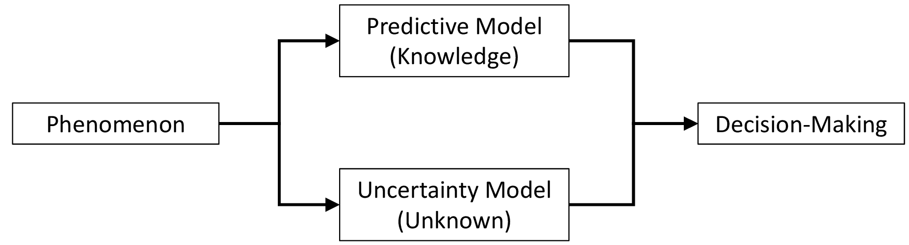
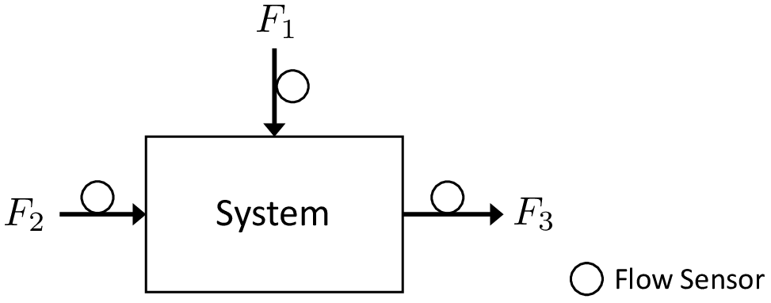
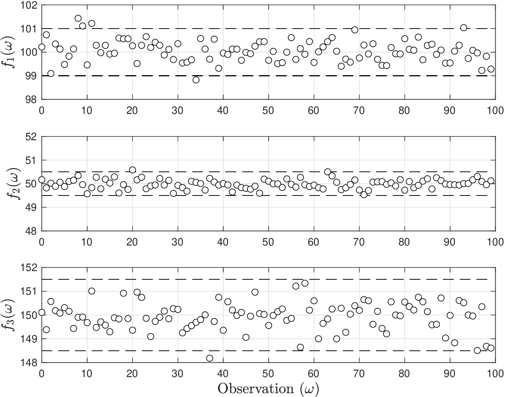
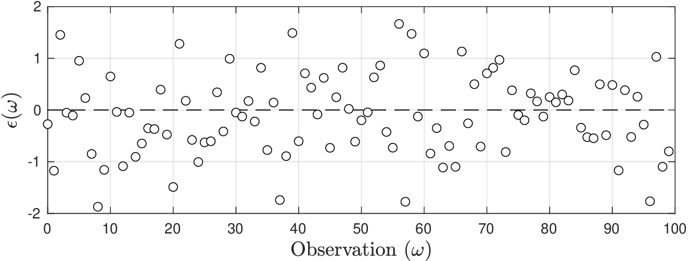
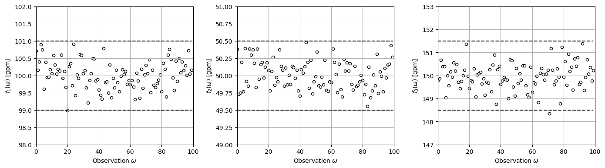
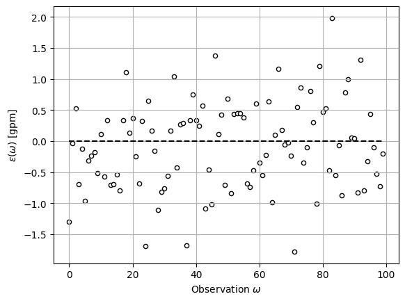
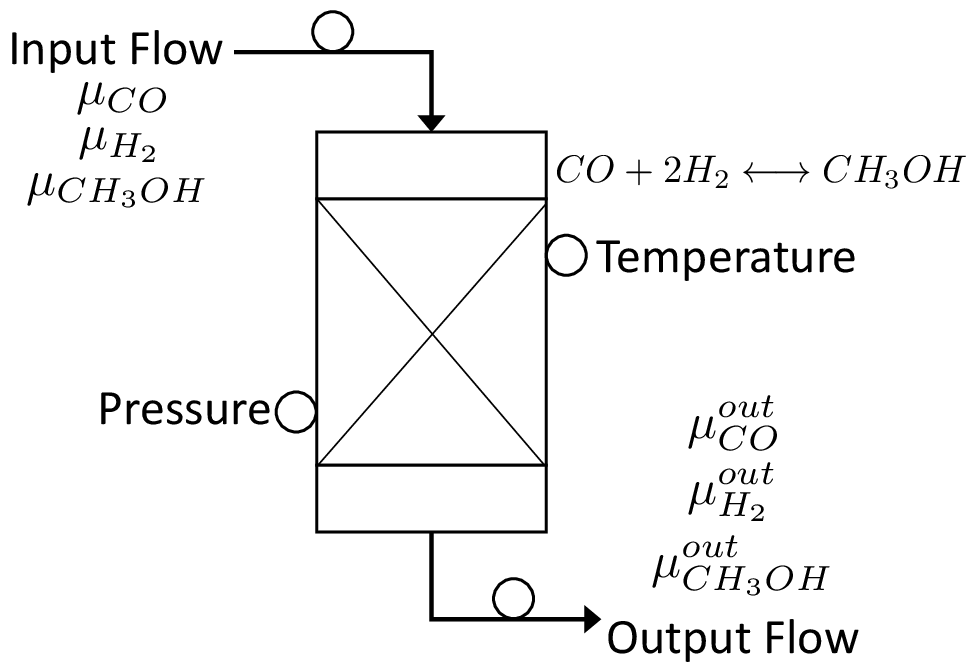
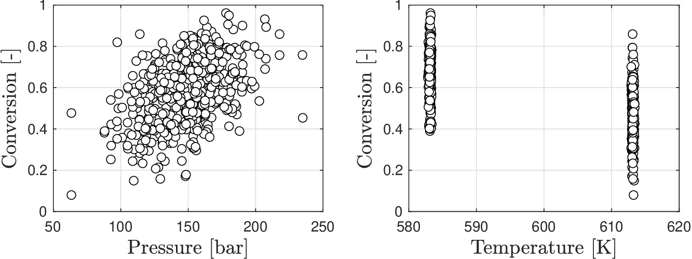
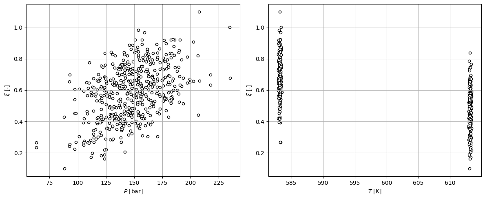

# Motivation

As engineers, we often use *fundamental laws* to make *decisions*:


* Discovery of fundamental laws has been the result of extensive collection and analysis of observations (data)
* Fundamental law is often expressed in the form of a mechanistic model
* Mechanistic model provides a concise summary of observations (knowledge) that allow us to predict and generalize



Can you think of fundamental laws used in chemical engineering?


Fundamental laws are powerful but only provide limited descriptions of phenomena:


* Laws are applicable under specific settings (e.g., continuum vs. atomistic)
* Discovering laws and new mechanistic models might be challenging or cost-prohibitive (e.g., climate)


To account for this, we also often build predictive models based purely on observations (data); such models are known as *empirical models* and also embed knowledge.

Engineering decisions rely on a combination of mechanistic and empirical knowledge.


Can you think of fundamental laws used in chemical engineering?


However:


* Model predictions will *always* face a certain degree of *uncertainty* (due to limited knowledge/understanding/data or due to *random* phenomena affecting systems).
* Despite these limitations, we still need to be able to *make decisions*. In fact, we (as humans), make predictions and decisions in our daily lives.
* The human brain naturally gathers knowledge (learns) from observations by building empirical models and has the ability to blend such empirical knowledge with mechanistic knowledge.
* The human brain has a natural ability to hedge against uncertainty and adapts decisions based on new knowledge.



**Examples of random phenomena:** time to failure of a material, “pop” time of a corn kernel, molecular fluctuations.



**Example of brain learning:** riding a bicycle, cooking.


<figure></figure>

Decision-making relies on ability to characterize of what is known (predictable) and not known (not predictable).

*Statistics* is the branch of mathematics that offers tools to:

* Collect, analyze, and extract knowledge (models) from data
* Characterize and model the unknown (uncertainty)
* Systematically make decisions in the face of uncertainty


For an engineering perspective, *statistics* aids the discovery of fundamental laws and the development of mechanistic and empirical models as well as the characterization of random phenomena.



From a scientific perspective, *statistics* provides a framework for thinking about the world that can help us understand how humans extract knowledge from data and use this to make decisions in the face of uncertainty.


## Example: Flow Mixer

* Consider a mixing system with input flows $$F_1$$, $$F_2$$ and output flow $$F_3$$
* Sensors measure flows at time $$\omega$$: $$f_1(\omega)=101.5$$, $$f_2(\omega)=50.5$$, $$f_3(\omega)=151$$ gpm
* Conservation laws tell us that $$f_3(\omega)=f_1(\omega)+f_2(\omega)$$ (but this is not true). Why?

  <figure></figure>


* What is known and unknown about this system?
* What is source of uncertainty?


Collect  100 observations and monitor mismatch  $$\epsilon(\omega)=f_3(\omega)-f_1(\omega)-f_2(\omega)$$

<figure></figure>

<figure></figure>

#### Python implementation


Notebook [`ch1_mixer_example.ipynb`](https://colab.research.google.com/github/vzavala/StatsBook-GitBook/blob/main/notebooks/ch1_mixer_example.ipynb) — open it in Colab and run the cells alongside this section.


Flow mixer example (Victor Z and Ugochukwu Ikegwu, UW-Madison, 2024).

| Slides | Python | Meaning |
|---|---|---|
| $$\omega$$ | `omega` | observation (time) index |
| $$S$$ | `S` | number of observations |
| $$f_1(\omega)$$, $$f_2(\omega)$$, $$f_3(\omega)$$ | `f1`, `f2`, `f3` | measured flows [gpm] |
| $$\epsilon(\omega)$$ | `epsilon` | conservation mismatch $$f_3-f_1-f_2$$ |

```python
import numpy as np
import matplotlib.pyplot as plt
```

Simulate $$S=100$$ sensor readings of each flow (sensor noise of about 1%) and compute the
mismatch $$\epsilon(\omega)=f_3(\omega)-f_1(\omega)-f_2(\omega)$$.

```python
np.random.seed(0)  # reproducibility
S = 100
omega = np.arange(S)
f1 = np.random.normal(100, 100*0.01/2.5, S)
f2 = np.random.normal(50, 50*0.01/2.5, S)
f3 = np.random.normal(150, 150*0.01/2.5, S)

epsilon = f3 - f1 - f2   # conservation mismatch
```

```python
fig, axs = plt.subplots(1, 3, figsize=(14, 4))
for ax, f_k, nominal, label in zip(axs, (f1, f2, f3), (100, 50, 150), ('f_1', 'f_2', 'f_3')):
    ax.scatter(omega, f_k, marker='o', s=20, color='white', edgecolor='black')
    ax.plot(omega, nominal * 1.01 * np.ones(S), 'k--')
    ax.plot(omega, nominal * 0.99 * np.ones(S), 'k--')
    ax.set_xlabel(r'Observation $\omega$')
    ax.set_ylabel(rf'${label}(\omega)$ [gpm]')
    ax.axis([0, S, nominal * 0.98, nominal * 1.02])
    ax.grid(True)
plt.tight_layout()
plt.show()
```

<figure></figure>

```python
plt.scatter(omega, epsilon, marker='o', s=20, color='white', edgecolor='black')
plt.plot(omega, np.zeros(S), 'k--')
plt.xlabel(r'Observation $\omega$')
plt.ylabel(r'$\epsilon(\omega)$ [gpm]')
plt.grid(True)
plt.show()
```

<figure></figure>

## Example: Gibbs Reactor

* Consider a reactor under which the reaction $$CO+2H_2\leftrightarrow CH_3OH$$ takes place

  <figure></figure>

  <figure></figure>

* Data seems to indicate that reaction favored (achieves higher conversion $$\xi$$) at high pressure ($$P$$) and low temperature ($$T$$) but this is blurred by variability.


* What is known and unknown about this system?
* Note that trends are blurred by uncertainty/noise.


#### Python implementation


Notebook [`ch1_gibbs_data.ipynb`](https://colab.research.google.com/github/vzavala/StatsBook-GitBook/blob/main/notebooks/ch1_gibbs_data.ipynb) — open it in Colab and run the cells alongside this section.


Data for the Gibbs reactor (Victor Z and Ugochukwu Ikegwu, UW-Madison, 2024).

| Slides | Python | Meaning |
|---|---|---|
| $$P$$ | `P` | pressure [bar] |
| $$T$$ | `T` | temperature [K] |
| $$\xi$$ | `xi` | conversion [-] |

```python
import pandas as pd
import numpy as np
import matplotlib.pyplot as plt
```

Each file has columns $$(T, P, \xi)$$; we stack the high- and low-temperature data
and add a little noise to blur the pattern, as in measured data.

```python
data_high = pd.read_csv(path+'Data/gibbs_hightemp_class.dat', sep="\t", header=None)
data_low = pd.read_csv(path+'Data/gibbs_lowtemp_class.dat', sep="\t", header=None)
data = pd.concat([data_high, data_low])
n = len(data)

np.random.seed(1)  # reproducibility
T = data.iloc[:, 0].to_numpy() + np.random.randn(n)*0.1    # temperature
P = data.iloc[:, 1].to_numpy() + np.random.randn(n)*0.1    # pressure
xi = data.iloc[:, 2].to_numpy() + np.random.randn(n)*0.1   # conversion
```

```python
fig, axs = plt.subplots(1, 2, figsize=(12, 5))
axs[0].scatter(P, xi, marker='o', s=20, color='white', edgecolor='black')
axs[0].set_xlabel('$P$ [bar]')
axs[0].set_ylabel(r'$\xi$ [-]')
axs[0].grid(True)
axs[1].scatter(T, xi, marker='o', s=20, color='white', edgecolor='black')
axs[1].set_xlabel('$T$ [K]')
axs[1].set_ylabel(r'$\xi$ [-]')
axs[1].grid(True)
plt.tight_layout()
plt.show()
```

<figure></figure>

<figure></figure>

$$
\begin{aligned}
\mu^{out}_k&=\mu_k+\gamma_k\cdot \xi\cdot \mu_{CO},\;k\in K\\
\xi&=1-\frac{\mu^{out}_{CO}}{\mu_{CO}}\\
K_{eq}&=\frac{(\mu_{CH_3OH}+\xi\cdot \mu_{CO})}{(\mu_{CO}-\xi\mu_{CO})(\mu_{H_2}-2\cdot \xi\cdot \mu_{CO})^2}\left(\frac{\mu_{out}}{P}\right)^2\\
\frac{\partial \log K_{eq} }{\partial T}&=-\frac{\Delta H_0}{R\cdot T}
\end{aligned}
$$

* We know fundamental conservation and thermodynamic laws hold and mechanistic model allow us to predict $$\xi$$ from $$P$$ and $$T$$.
* This knowledge, however, is limited (e.g., makes assumptions, cannot explain random behavior).
* How to predict $$\xi$$ as a function of $$P$$ and $$T$$ without any mechanistic knowledge?
* What are trade-offs between mechanistic and empirical knowledge?

## Motivation


**Don't forget:**

Inherent limitation of engineering practice: no matter how sophisticated our predictive models and sensing devices are, we will *always* have a certain degree of uncertainty.

Characterizing both known and unknown aspects of a system is key.

