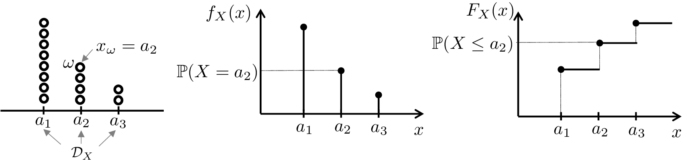
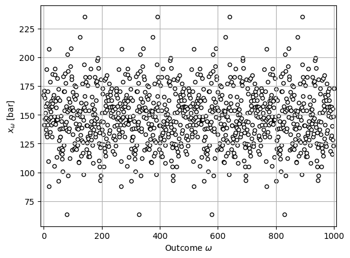
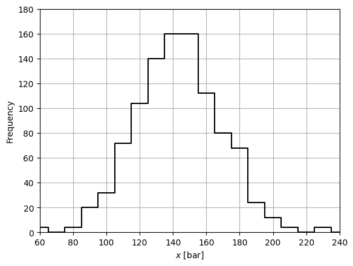
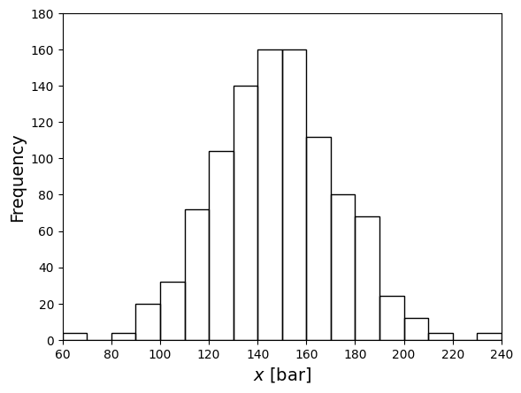
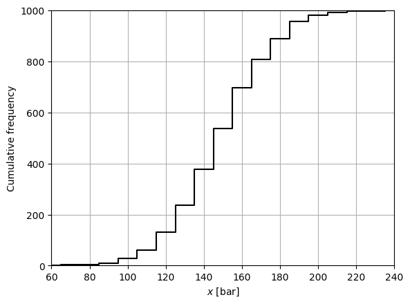

# Random Variables

* In statistics, we use random variables (RVs) to *model* unknown (random) behavior.
* An RV does not have a known value and exhibits variability.
* Statistical view of the
   world is significant departure from traditional deterministic
   viewpoint (commonly used in engineering).

* Under a deterministic view of the world, we *assume* that variables
   have known and unique values (ignore uncertainty and variability).


* Deterministic Thinking: Temperature is 20$${}^o$$C (no uncertainty)
* Statistical Thinking: Temperature is 20$$\pm 0.5{}^o$$C (account for uncertainty)


An RV model (denoted as $$X$$) has the following elements:


* Set of possible realizations $$\omega \in \Omega$$ with associated values $$x_\omega \in \mathcal{D}_X$$.
* Domain $$\mathcal{D}_X$$ under which realizations $$x_\omega$$ of $$X$$ “live”.
* Probability measure $$\mathbb{P}:\Omega \to [0,1]$$ that assigns probability to events.
* Cumulative density function (cdf) $$F_X:\mathcal{D}_X\to [0,1]$$ that tells us $$\mathbb{P}(X\leq t)$$.
* Associated with cdf, there is a probability density function (pdf) $$f_X:\mathcal{D}_X\to [0,\infty)$$.


Some observations:


* Think of $$\omega$$ as being a pinball that carries data $$x_\omega$$
* When you drop a pinball, this will “fall” in different locations of the domain $$\mathcal{D}_X$$
* pdf/cdf tell us how “densely” pinballs accumulate in certain locations of the domain.
* Where in the domain the pinball falls is an event and probability tell us how likely are specific event.
* An event is a subdomain $$\mathcal{A}\subseteq \mathcal{D}_X$$ (location or set of locations in domain).
* Probabilities are related to how densely pinballs accumulate in parts of domain.


<figure><figcaption><p>Illustration of the elements of a random variable.</p></figcaption></figure>


**Don't Forget:**

* A random variable is a *model* (a characterization) of a random phenomenon.
* To fully define an RV model, you need to know $$\mathcal{D}_X$$, $$f_X$$, and $$F_X$$.


## Example: Gibbs Reactor

* Assume *pressure* varies due to malfunction of flow control and model this as RV $$X$$
* Collect 1000 realizations $$x_\omega$$ (data); visualize as cumulative frequency and frequency.
* Cumulative frequency approximates cdf, frequency approximates pdf.

  <figure></figure>

#### Python implementation: Realizations, frequency, and cumulative frequency


Notebook [`ch1_gibbs_example.ipynb`](https://colab.research.google.com/github/vzavala/StatsBook-GitBook/blob/main/notebooks/ch1_gibbs_example.ipynb) — open it in Colab and run the cells alongside this section.


Gibbs reactor example (Victor Z and Ugochukwu Ikegwu, UW-Madison, 2024).

| Slides | Python | Meaning |
|---|---|---|
| $$X$$, $$x_\omega$$ | `x_omega` | reactor pressure (RV) and its realizations [bar] |
| $$Y(u)$$, $$Y(u')$$, $$y_\omega$$ | `y_low`, `y_high` | conversion (RV) and its realizations at $$u$$, $$u'$$ [%] |
| $$\mathcal{S}$$, $$S$$ | `S` | set and number of observations |
| $$\Delta x$$ | `dx` | bin size of the empirical pdf |
| $$\hat{f}(x)$$, $$\hat{F}(x)$$ | `f_hat`, `F_hat` | empirical pdf and cdf |
| $$u$$, $$u'$$ | `u_low`, `u_high` | operating temperature (decision) [K] |

```python
import pandas as pd
import numpy as np
import matplotlib.pyplot as plt
from scipy.stats import norm
```

Load the realizations at high temperature $$u'$$ (column 0: pressure $$x_\omega$$,
column 1: conversion $$y_\omega$$) and at low temperature $$u$$.

```python
data_high = pd.read_csv(path+'Data/gibbs_hightemp.dat', sep="\t", header=None)  # u' = 613 K
data_low = pd.read_csv(path+'Data/gibbs_lowtemp.dat', sep="\t", header=None)    # u  = 583 K
data_high.head(5)
```

```
            0         1
0  166.977686  0.679262
1  170.710337  0.688514
2  141.174815  0.604848
3  146.628653  0.622223
4  164.665427  0.673354
```

```python
x_omega = data_high.iloc[:, 0].to_numpy()   # realizations x_omega of pressure X
S = len(x_omega)                            # number of observations
omega = np.arange(S)                  # observation index

plt.scatter(omega, x_omega, marker='o', s=20, color='white', edgecolor='black')
plt.ylim([min(x_omega)-10, max(x_omega)+10])
plt.xlim([min(omega)-10, max(omega)+10])
plt.xlabel(r'Outcome $\omega$')
plt.ylabel(r'$x_\omega$ [bar]')
plt.grid(True)
plt.show()
```

<figure></figure>

The *frequency* counts the observations in each bin $$[x, x+\Delta x]$$:

$$
\sum_{\omega \in \mathcal{S}}\mathbf{1}[x\leq x_\omega\leq x+\Delta x]
$$

```python
dx = 10
x_grid = np.arange(60, 240+dx, dx)   # discretized empirical domain

freq = np.zeros(len(x_grid))
for i in range(len(x_grid)):
    for w in range(S):
        if x_grid[i] <= x_omega[w] < x_grid[i] + dx:   # indicator 1[x <= x_omega <= x + dx]
            freq[i] += 1

plt.step(x_grid, freq, color='black', where='mid')
plt.xlabel('$x$ [bar]')
plt.ylabel('Frequency')
plt.axis([60, 240, 0, 180])
plt.grid(True)
plt.show()
```

<figure></figure>

The same frequency plot can be produced directly with a histogram:

```python
plt.hist(x_omega, bins=np.arange(60, 250, dx), edgecolor='black', facecolor='none', linewidth=1)
plt.xlabel('$x$ [bar]', fontsize=14)
plt.ylabel('Frequency', fontsize=14)
plt.axis([60, 240, 0, 180])
plt.show()
```

<figure></figure>

The *cumulative frequency* counts the observations below $$x$$:

$$
\sum_{\omega \in \mathcal{S}}\mathbf{1}[x_\omega\leq x]
$$

```python
cum_freq = np.zeros(len(x_grid))
for i in range(len(x_grid)):
    for w in range(S):
        if x_omega[w] <= x_grid[i]:                    # indicator 1[x_omega <= x]
            cum_freq[i] += 1

plt.step(x_grid, cum_freq, color='black', where='mid')
plt.xlabel('$x$ [bar]')
plt.ylabel('Cumulative frequency')
plt.axis([60, 240, 0, 1000])
plt.grid(True)
plt.show()
```

<figure></figure>
