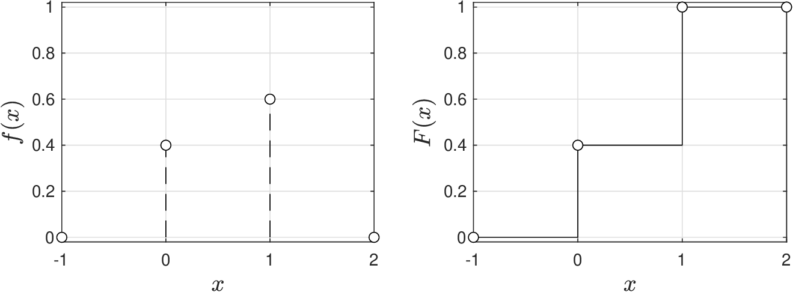
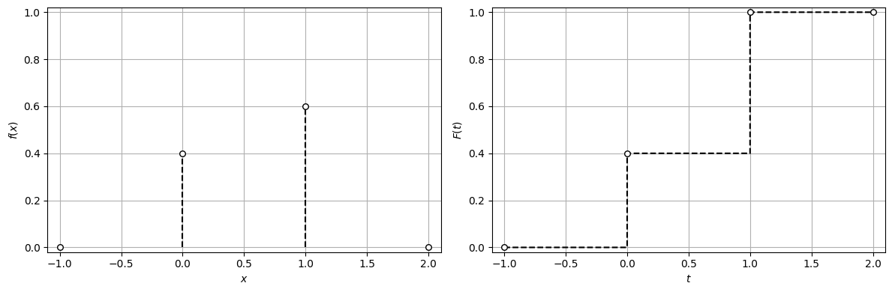
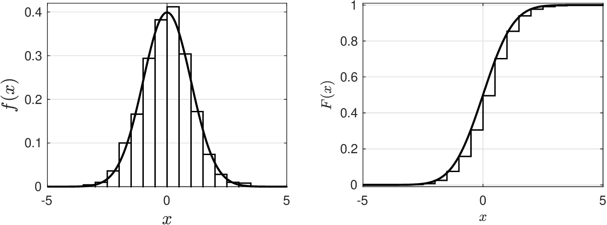
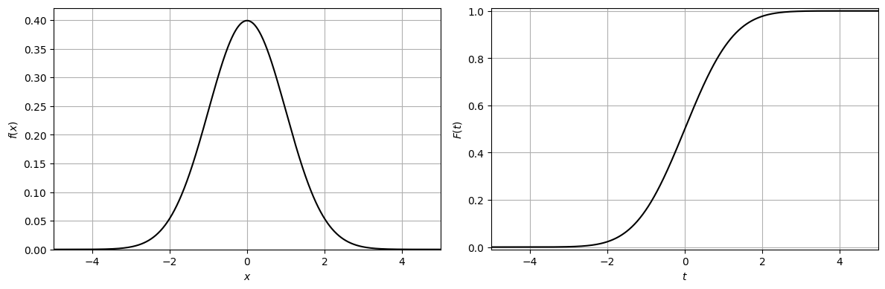
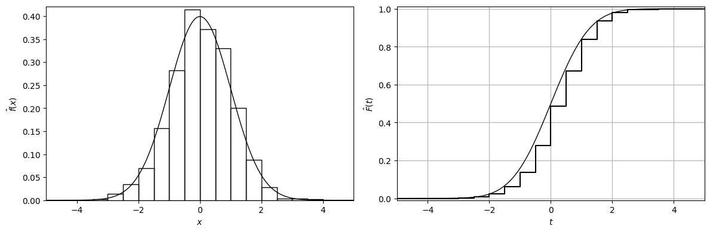

# Types of Random Variables

RVs are categorized as multivariate vs. univariate:


* A *multivariate* RV $$X=(X_{1},X_{2},...,X_n)$$ has realizations that generate vector values $$x_{\omega}=(x_{\omega,1},x_{\omega,2},...,x_{\omega,n})\in \mathbb{R}^n$$.
* A *univariate* RV $$X$$ is a multivariate with $$n=1$$ and has realizations generate scalar values $$x_\omega\in \mathbb{R}$$.



* For a univariate RV, a pinball $$\omega$$ (observation) carries a single number $$x_\omega$$ (e.g., temperature).
* For a multivariate RV, a pinball $$\omega$$ carries a set of numbers $$x_{\omega}=(x_{\omega,1},x_{\omega,2},...,x_{\omega,n})$$ (e.g., temperature, pressure, conversion)


For now, we will focus discussion on univariate RVs.

RVs are categorized as continuous vs. discrete:


* A *continuous* RV $$X$$ is that in which the domain $$\mathcal{D}_X$$ is continuous; e.g., $$X$$ has realizations satisfying $$0\leq x_{\omega}\leq 1$$.
* A *discrete* RV $$X$$ is that in which the domain $$\mathcal{D}_X$$ is discrete; e.g., $$X$$ has realizations satisfying $$x_{\omega}\in \{0,1\}$$.


Many RV models are available that apply to different categories.

Type of RV used to characterize uncertainty depends on nature of random phenomenon.

## Probability Density of Discrete and Continuous RVs

Discrete $$X$$ has discrete domain $$\mathcal{D}$$ and cdf/pdf are discontinuous functions.

The pdf and cdf have the following properties:

1. $$f(x)\geq 0,\quad x\in \mathcal{D}$$
1. $$f(x)=\mathbb{P}(X=x), \quad x\in \mathcal{D}$$
1. $$\displaystyle\sum_{x\in \mathcal{D}}f(x)=\displaystyle\sum_{x\in \mathcal{D}}\mathbb{P}(X=x)=1$$
1. $$\displaystyle\mathbb{P}(X\in \mathcal{A})=\sum_{x\in \mathcal{A}}f(x),\quad \mathcal{A}\subseteq \mathcal{D}$$.
1. $$\displaystyle F(t)=\mathbb{P}(X\leq t)=\sum_{x \in \mathcal{D}\,|\, x\leq t}f(x)\quad t\in \mathbb{R}$$.

A discrete RV is easy to handle computationally (simple summations and counting):

* Since $$\mathcal{D}$$ is discrete, we have that:

  $$
  \begin{aligned}
  \mathbb{P}(X\leq t)&=F(t)\\
  &=\sum_{x \in \mathcal{D}|x\leq t}f(x)\\
  &=\sum_{x\in \mathcal{D}}\mathbf{1}[x\leq t]f(x).
  \end{aligned}
  $$

   Here, we use the indicator function:

  $$
  \begin{aligned}
  \mathbf{1}[x\leq t]=\begin{cases}1& \textrm{if}\quad  x\leq t\\
  0& \textrm{if}\quad   x> t\end{cases}.
  \end{aligned}
  $$

* Can compute pdf and cdf by *counting* how many times realizations $$x_\omega$$ of $$X$$ take a certain value (or are below a certain value):

  $$
  \begin{aligned}
  f(x)=\mathbb{P}(X=x)&=\frac{1}{|\Omega|}\sum_{\omega \in \Omega }\mathbf{1}[x_\omega=x]\\
  F(t)=\mathbb{P}(X\leq t)&=\frac{1}{|\Omega|}\sum_{\omega \in \Omega }\mathbf{1}[x_\omega\leq t].
  \end{aligned}
  $$

* We can thus determine pdf and cdf of discrete RV $$X$$ directly from data $$x_\omega$$.

## Example Discrete RV

* Consider a discrete RV with domain $$\mathcal{D}=\{-1,0,1,2\}$$ and pdf:

  $$
  \begin{aligned}
  f(x)=\left\{\begin{array}{cc}0 &\;\;\; \textrm{for}\; x=-1\\ 0.4 & \textrm{for}\; x=0\\ 0.6 & \textrm{for}\; x=1\\ 0 & \textrm{for}\; x=2\end{array}\right.
  \end{aligned}
  $$

* Pdf satisfies $$\displaystyle \sum_{x\in \mathcal{D}}f(x)=1$$ and $$f(x)\geq 0$$ for all $$x\in \mathcal{D}$$.
* RV has 10 possible realizations $$\Omega=\{1,2,3,...,10\}$$ with associated values $$x_\omega$$ given by $$\{0,1,0,0,1,1,1,1,1,0\}$$.
* Pdf can also be computed using the observations, for example:

  $$
  \begin{aligned}
  f(0)&=P(X=0)=\frac{1}{10}\sum_{\omega \in \Omega }\mathbf{1}[x_\omega=0]=0.4
  \end{aligned}
  $$

* Similarly, use observations to compute the cdf, for example:

  $$
  \begin{aligned}
  F(0)&=\mathbb{P}(X\leq 0)=\sum_{x|x\leq 0}f(x)=f(-1)+f(0)=0.4
  \end{aligned}
  $$

Pdf and cdf of the RV are:

<figure><figcaption><p>Pdf and cdf for simple discrete random variable.</p></figcaption></figure>

Note discontinuous nature of these functions.

#### Python implementation


Notebook [`ch1_pdf_cdf_discrete.ipynb`](https://colab.research.google.com/github/vzavala/StatsBook-GitBook/blob/main/notebooks/ch1_pdf_cdf_discrete.ipynb) — open it in Colab and run the cells alongside this section.


Pdf and cdf of a simple discrete RV (Victor Z and Ugochukwu Ikegwu, UW-Madison, 2024).

| Slides | Python | Meaning |
|---|---|---|
| $$\mathcal{D}$$ | `D` | domain $$\{-1,0,1,2\}$$ |
| $$f(x)$$ | `f` | pdf on the domain |
| $$x_\omega,\ \omega\in\Omega$$ | `x_omega` | the 10 realizations |
| $$t$$, $$F(t)$$ | `t`, `F` | cdf evaluated on a grid of $$t$$ |

```python
import numpy as np
import matplotlib.pyplot as plt
```

```python
D = np.array([-1, 0, 1, 2])          # domain
f = np.array([0, 0.4, 0.6, 0])       # pdf f(x), x in D
print("sum f(x) =", f.sum(), "  f(x) >= 0:", np.all(f >= 0))
```

```
sum f(x) = 1.0   f(x) >= 0: True
```

The pdf can also be obtained by counting realizations:
$$f(x)=\frac{1}{|\Omega|}\sum_{\omega\in\Omega}\mathbf{1}[x_\omega=x]$$.

```python
x_omega = np.array([0, 1, 0, 0, 1, 1, 1, 1, 1, 0])   # realizations, Omega = {1,...,10}
f_count = np.array([np.mean(x_omega == x) for x in D])
print("f(x) from counting:", dict(zip(D.tolist(), f_count)))
```

```
f(x) from counting: {-1: np.float64(0.0), 0: np.float64(0.4), 1: np.float64(0.6), 2: np.float64(0.0)}
```

Cdf $$F(t)=\sum_{x\in\mathcal{D}}\mathbf{1}[x\leq t]\,f(x)$$, e.g. $$F(0)=f(-1)+f(0)=0.4$$.

```python
t = np.linspace(-1, 2, 1000)
F = np.zeros_like(t)
for i in range(len(t)):
    for j in range(len(D)):
        F[i] += (D[j] <= t[i]) * f[j]      # indicator 1[x <= t] times f(x)

print("F(0) =", sum(f[D <= 0]))
```

```
F(0) = 0.4
```

```python
fig, axs = plt.subplots(1, 2, figsize=(12, 4))
axs[0].vlines(D, 0, f, colors='k', linestyles='--')
axs[0].scatter(D, f, marker='o', s=30, color='white', edgecolor='black', zorder=3)
axs[0].set_xlabel('$x$')
axs[0].set_ylabel('$f(x)$')
axs[0].axis([-1.1, 2.1, -0.02, 1.02])
axs[0].grid(True)
axs[1].step(t, F, 'k--', where='post')
axs[1].scatter(D, np.cumsum(f), marker='o', s=30, facecolors='w', edgecolors='black', zorder=3)
axs[1].set_xlabel('$t$')
axs[1].set_ylabel('$F(t)$')
axs[1].axis([-1.1, 2.1, -0.02, 1.02])
axs[1].grid(True)
plt.tight_layout()
plt.show()
```

<figure></figure>

## Probability Density of Discrete and Continuous RVs

Continuous $$X$$ has continuous domain $$\mathcal{D}$$ and pdf/cdf are continuous functions.

The pdf and cdf have the following properties:

1. $$f(x)\geq 0,\quad x\in \mathcal{D}$$.
1. $$f(x)=\frac{dF(x)}{dx},\quad x\in \mathcal{D}$$.
1. $$\displaystyle\int_{x\in \mathcal{D}}f(x)dx=1$$.
1. $$\displaystyle\mathbb{P}(X\in \mathcal{A})=\int_{x\in \mathcal{A}}f(x)dx,\quad \mathcal{A}\subseteq \mathcal{D}$$.
1. $$F(t)=\int_{x \in \mathcal{D}| x\leq t}f(x)dx$$.

* The 2nd property tells us that pdf $$f(x)$$ for a continuous RV $$X$$ is not $$\mathbb{P}(X=x)$$ (as in the discrete case).
* Instead, the pdf is the derivative of the cdf and thus:

  $$
  \begin{aligned}
  f(x)\Delta x&\approx \mathbb{P}(X\leq x+\Delta x)- \mathbb{P}(X\leq x)\\
  &= \mathbb{P}(x\leq X\leq x+\Delta x).
  \end{aligned}
  $$

   We thus have that pdf tell us the probability that $$X$$ is in a *neighborhood* of $$x$$.

* Not that setting $$\Delta x\to 0$$ implies that $$\mathbb{P}(X=x)=0$$.
* The 3rd,4th, 5th properties are analogous to the discrete case but we see that summation are replaced with  integration operations.

A continuous RV is more difficult to handle computationally since it involves integrals instead of summations (this prevents the use of simple counting operations).

* However, computations are analogous to those of the discrete case. For instance:

  $$
  \begin{aligned}
  \mathbb{P}(X\leq t)&=\int_{x \in \mathcal{D}|x\leq t}f(x)dx\\
  &=\int_{x\in \mathcal{D}}\mathbf{1}[x\leq t]f(x)dx.
  \end{aligned}
  $$

* Continuous RVs are often approximated using discretization.  For instance:

  $$
  f(x)\approx \frac{F(x+\Delta x)-F(x)}{\Delta x}.
  $$

* We will see that we can approximate continuous pdfs/cdfs from data $$x_\omega$$.

## Example Continuous RV

* Consider continuous RV with domain $$\mathcal{D}=(-\infty,\infty)$$ and pdf of the form:

  $$
  f(x)=\frac{1}{\sqrt{2\pi}}e^{-\frac{x^2}{2}}
  $$

* It is easy to see that the pdf satisfies $$f(x)\geq 0$$ for any $$x\in \mathcal{D}$$ and one can show that $$\int_{x\in\mathcal{D}}f(x)dx=1$$ (this is not that easy to show).
* The cdf associated with this pdf is given by:

  $$
  \begin{aligned}
  F(t)&=\int_{x\leq t}f(x)dx=\int_{-\infty}^t f(x)dx\\
  &=\frac{1}{2}\left(1+\textrm{erf}\left(\frac{t}{\sqrt{2}}\right)\right),
  \end{aligned}
  $$

* One can show $$f(x)=dF(x)/dx$$ and that cdf satisfies $$0\leq F(t)\leq 1$$ for any $$t\in \mathcal{D}$$.

Pdf and cdf of the RV are:

<figure><figcaption><p>Pdf and cdf of continuous RV and corresponding discrete approximations.</p></figcaption></figure>

Continuous pdf and cdf are approximated using discretized versions with $$\Delta x=0.5$$.

#### Python implementation


Notebook [`ch1_pdf_cdf_continuous.ipynb`](https://colab.research.google.com/github/vzavala/StatsBook-GitBook/blob/main/notebooks/ch1_pdf_cdf_continuous.ipynb) — open it in Colab and run the cells alongside this section.


Pdf and cdf of a simple continuous RV (Victor Z and Ugochukwu Ikegwu, UW-Madison, 2024).

| Slides | Python | Meaning |
|---|---|---|
| $$f(x)$$, $$F(t)$$ | `f`, `F` | pdf and cdf |
| $$x_\omega$$, $$S$$ | `x_omega`, `S` | realizations and their number |
| $$\Delta x$$ | `dx` | discretization (bin) size |
| $$\hat{f}$$, $$\hat{F}$$ | `f_hat`, `F_hat` | discrete (empirical) approximations |

```python
import numpy as np
import matplotlib.pyplot as plt
from scipy.stats import norm
```

Pdf $$f(x)=\frac{1}{\sqrt{2\pi}}e^{-x^2/2}$$ and cdf
$$F(t)=\frac{1}{2}\left(1+\mathrm{erf}(t/\sqrt{2})\right)$$.

```python
x = np.linspace(-5, 5, 1000)
f = norm.pdf(x, 0, 1)
t = x
F = norm.cdf(t, 0, 1)

fig, axs = plt.subplots(1, 2, figsize=(12, 4))
axs[0].plot(x, f, 'black', linewidth=1.5)
axs[0].set_xlabel('$x$')
axs[0].set_ylabel('$f(x)$')
axs[0].axis([-5, 5, 0, 0.42])
axs[0].grid(True)
axs[1].plot(t, F, 'black', linewidth=1.5)
axs[1].set_xlabel('$t$')
axs[1].set_ylabel('$F(t)$')
axs[1].axis([-5, 5, -0.01, 1.01])
axs[1].grid(True)
plt.tight_layout()
plt.show()
```

<figure></figure>

Discrete approximations with $$\Delta x=0.5$$ built from $$S=1000$$ realizations $$x_\omega$$:
$$\hat{f}(x)\approx\frac{\hat{F}(x+\Delta x)-\hat{F}(x)}{\Delta x}$$ (histogram) and
$$\hat{F}(t)=\frac{1}{S}\sum_{\omega}\mathbf{1}[x_\omega\leq t]$$.

```python
np.random.seed(1)  # reproducibility
S = 1000
x_omega = np.random.normal(0, 1, S)
dx = 0.5
t_grid = np.arange(-5, 5 + dx, dx)

F_hat = np.zeros(len(t_grid))
for i in range(len(t_grid)):
    for w in range(S):
        if x_omega[w] <= t_grid[i]:          # indicator 1[x_omega <= t]
            F_hat[i] += 1
F_hat = F_hat / S

fig, axs = plt.subplots(1, 2, figsize=(12, 4))
axs[0].hist(x_omega, bins=t_grid, density=True, edgecolor='black', facecolor='none', linewidth=1)
axs[0].plot(x, f, 'k-', linewidth=1)
axs[0].set_xlabel('$x$')
axs[0].set_ylabel(r'$\hat{f}(x)$')
axs[0].axis([-5, 5, 0, 0.42])
axs[1].step(t_grid, F_hat, color='black', where='post')
axs[1].plot(t, F, 'k-', linewidth=1)
axs[1].set_xlabel('$t$')
axs[1].set_ylabel(r'$\hat{F}(t)$')
axs[1].axis([-5, 5, -0.01, 1.01])
axs[1].grid(True)
plt.tight_layout()
plt.show()
```

<figure></figure>
