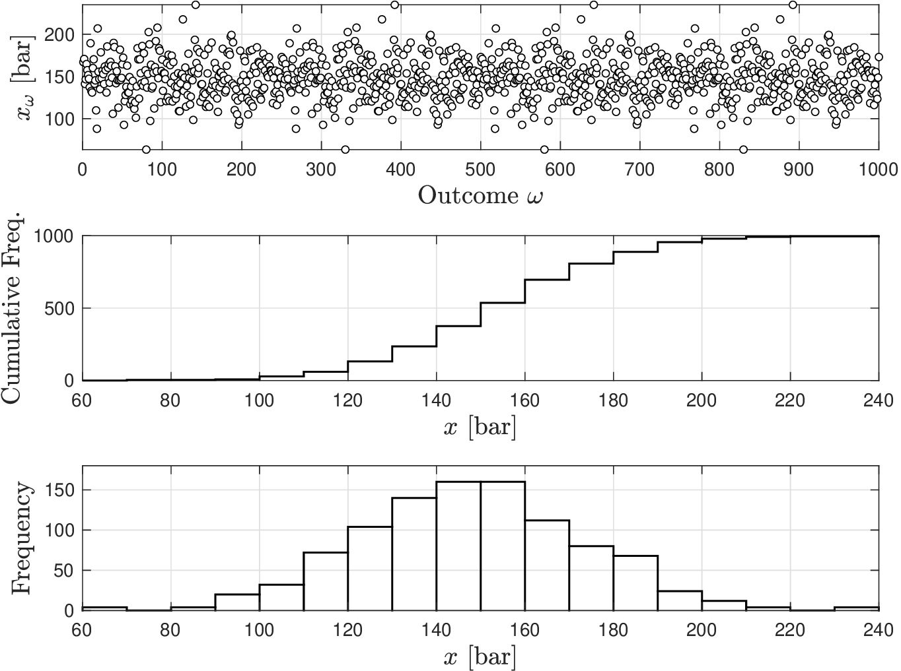
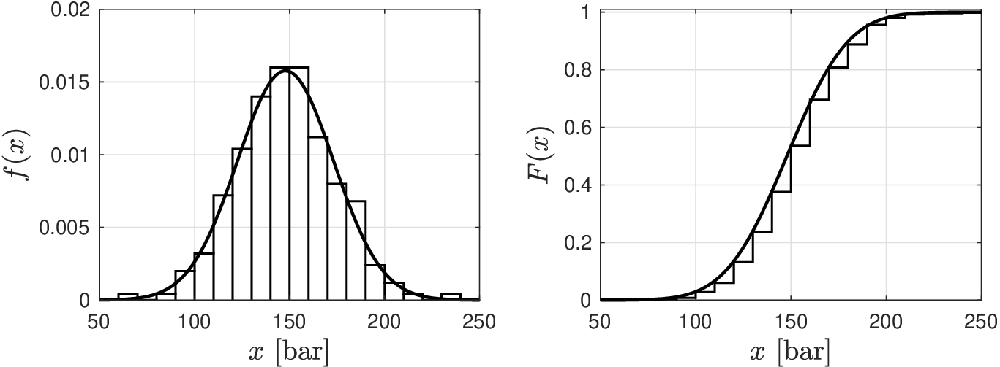
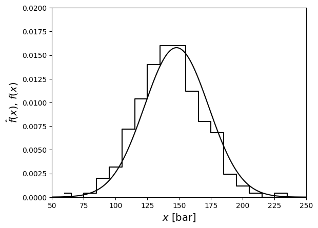
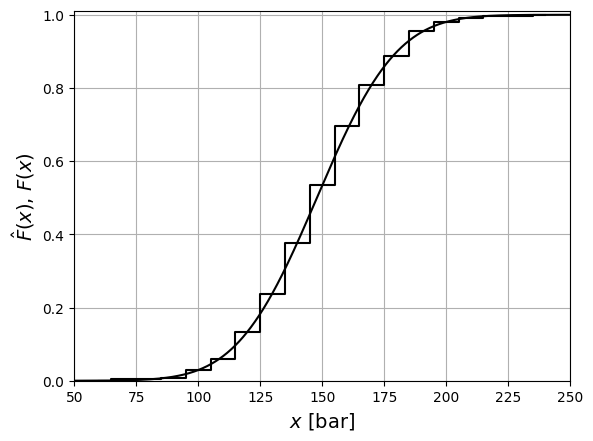
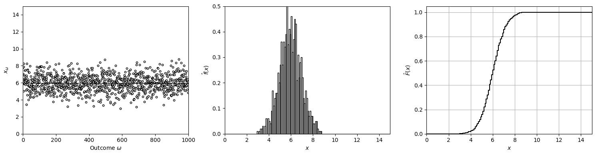
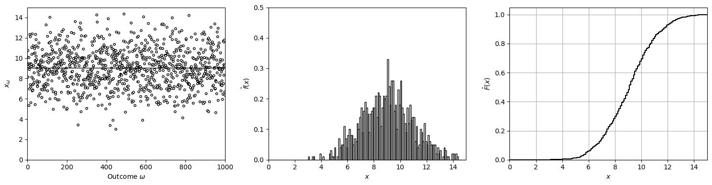
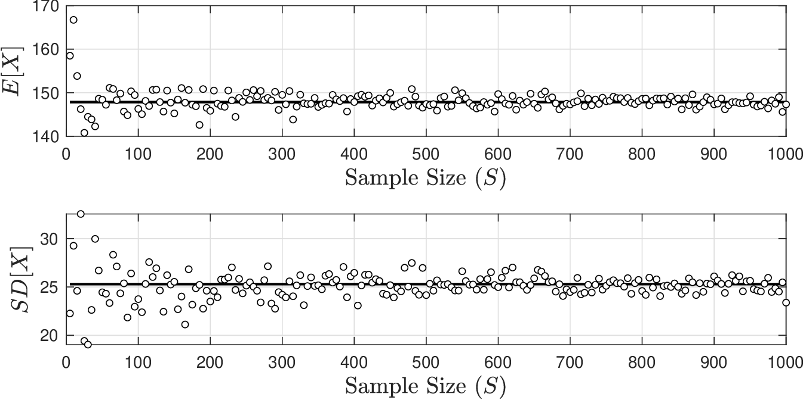
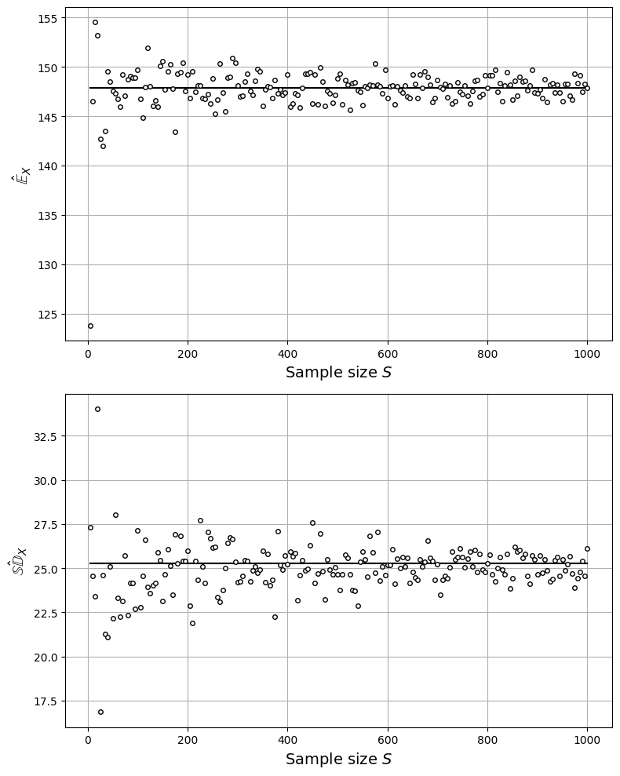
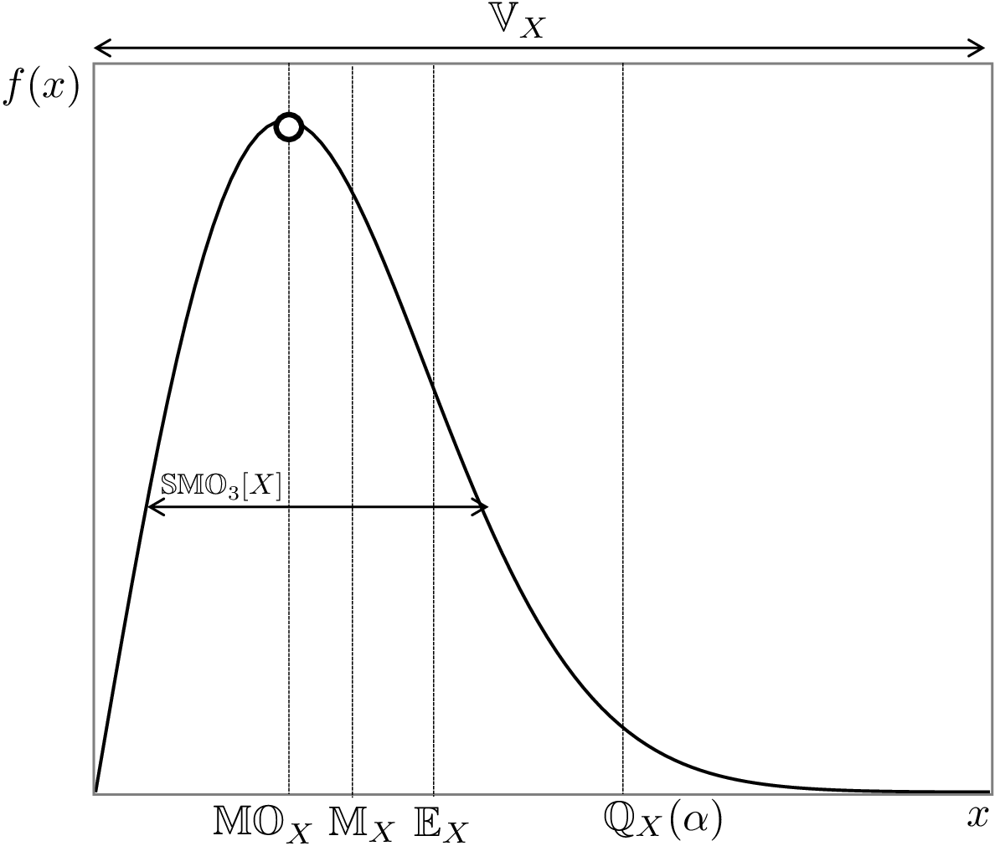
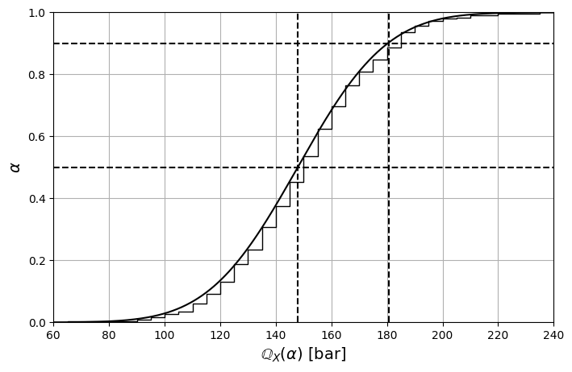

# From Data to Models

* In practical situations, we have access to observations (data) of our system.
* Our goal is to use such data to gain knowledge (understanding) of our system.
* Our knowledge will be extracted from data in the form of *models* of two types:
   * *Structural models*: provide a characterization of structural dependencies between variables in our system (mechanistic or empirical)
   * *Random variable (uncertainty) models*: provide a characterization of behavior that cannot be explained by structural models

   **Important:** Both models are necessary to make proper predictions and decisions.

* We will begin our discussion with random variable (RV) models.
* Assume that we have available observations (data) $$x_\omega,\; \omega \in \mathcal{S}$$.


* What type of an RV model are the observations following?
* How to obtain a cdf $$F(x)$$ and pdf $$f(x)$$ for an RV model from available data?


* Goal is to use available data $$x_\omega$$ to postulate a *theoretical* RV model  $$X$$.
* RV $$X$$ is a *model* of a random phenomenon that generates the observed data.
* Many models are available to capture diverse phenomena seen in real life.
* A widely used model is that of a Gaussian RV.
* Model assumes that $$X$$ is continuous, has domain $$\mathcal{D}=(-\infty, \infty)$$, and has pdf:

  $$
  f(x)=\frac{1}{\sqrt{2\pi\sigma^2}}e^{-\frac{(x-\mu)^2}{2\sigma^2}},\quad x\in \mathcal{D},
  $$

   where $$\mu,\sigma\in \mathbb{R}_+$$ are parameters of the model.

* Parameters define behavior of the RV and can be “tuned" to match our data.
* The cdf associated to the Gaussian model is:

  $$
  F(x)=\frac{1}{2}\left(1+\textrm{erf}\left(\frac{(x-\mu)/\sigma}{\sqrt{2}}\right)\right),\quad x\in \mathcal{D},
  $$

* **What other theoretical models do you know?**

* Our goal is to investigate whether the available observations $$x_\omega,\; \omega \in \mathcal{S}$$ follow the pdf and cdf of a theoretical model that we postulate.
* To verify hypothesis, we use the data to  construct *empirical* approximations for the pdf $$f(x)$$ and cdf $$F(x)$$ of the theoretical model and verify if these match.
* Empirical approximations (a.k.a data-driven or sample-based approximations) are denoted as $$\hat{f}(x)$$ and $$\hat{F}(x)$$ and these are used to *estimate*  $$f(x)$$ and $$F(x)$$.

The approach to construct $$\hat{f}(x)$$ and $$\hat{F}(x)$$ from data (for a continuous RV) can be summarized as follows:

1. Construct *empirical* domain $$\hat{\mathcal{D}}$$; this is the domain covered by observations $$x_\omega,\,\omega \in \mathcal{S}$$. This gives us an approximation of the domain $$\mathcal{D}$$ of the RV  model. Discretize the domain $$\hat{\mathcal{D}}$$ into bins of size $$\Delta x$$.
1. Construct an empirical cdf:

   $$
   \hat{F}(x)=\frac{1}{S}\sum_{\omega \in \mathcal{S}}\mathbf{1}[x_\omega\leq x],\quad x\in \hat{\mathcal{D}}
   $$

   This is the number of observations $$x_\omega$$ that take a value below $$x$$ (normalized by $$S$$).

   The number of  observations is known as the *cumulative frequency* and is given by:

   $$
   \sum_{\omega \in \mathcal{S}}\mathbf{1}[x_\omega\leq x]
   $$

1. Construct the empirical pdf:

   $$
   \begin{aligned}
   \hat{f}(x)&=\frac{\displaystyle\frac{1}{S}\sum_{\omega \in \mathcal{S}}\mathbf{1}[x\leq x_\omega\leq x+\Delta x]}{\Delta x}
   \end{aligned}
   $$

   where $$\Delta x$$ is the size of the bin interval.

   The number of observations  in $$[x,x+\Delta x]$$ is known as the *frequency* and is given by:

   $$
   \sum_{\omega \in \mathcal{S}}\mathbf{1}[x\leq x_\omega\leq x+\Delta x]
   $$


The procedure to obtain the empirical pdf/cdf of a discrete RV is easier, as the domain does not need to be discretized.


## Example: Gibbs Reactor

Here are $$S=$$1,000 observations $$x_\omega$$ along with the frequency and cumulative frequency.

<figure></figure>

* Obtain empirical cdf by normalizing cumulative frequency with $$S=1000$$
* Obtain empirical pdf by normalizing frequency with $$S=1000$$ and $$\Delta x=10$$

  <figure></figure>

* Empirical pdf and cdf match the pdf and cdf of a Gaussian RV model.
* We conclude that our random phenomenon (pressure) behaves as a Gaussian RV.

#### Python implementation: Empirical pdf/cdf versus a Gaussian model

Normalizing by $$S$$ (and by $$\Delta x$$ for the pdf) gives the empirical cdf and pdf

$$
\hat{F}(x)=\frac{1}{S}\sum_{\omega \in \mathcal{S}}\mathbf{1}[x_\omega\leq x],\qquad
\hat{f}(x)=\frac{1}{S\,\Delta x}\sum_{\omega \in \mathcal{S}}\mathbf{1}[x\leq x_\omega\leq x+\Delta x].
$$

We compare them with the pdf and cdf of a Gaussian model with parameters $$\mu,\sigma$$
fitted to the data.

```python
F_hat = cum_freq / S
f_hat = freq / (S * dx)

mu, sigma = norm.fit(x_omega)        # Gaussian parameters (mu, sigma)
x_plot = np.linspace(50, 250, 1000)

plt.step(x_grid, f_hat, color='black', where='mid')
plt.plot(x_plot, norm.pdf(x_plot, mu, sigma), 'black', linewidth=1.5)
plt.xlabel('$x$ [bar]', fontsize=14)
plt.ylabel(r'$\hat{f}(x)$, $f(x)$', fontsize=14)
plt.axis([50, 250, 0, 0.02])
plt.show()
```

<figure></figure>

```python
plt.step(x_grid, F_hat, color='black', where='mid')
plt.plot(x_plot, norm.cdf(x_plot, mu, sigma), 'black', linewidth=1.5)
plt.xlabel('$x$ [bar]', fontsize=14)
plt.ylabel(r'$\hat{F}(x)$, $F(x)$', fontsize=14)
plt.grid(True)
plt.axis([50, 250, 0, 1.01])
plt.show()
```

<figure></figure>

## Summarizing Statistics (Basic)

* Pdf and cdf are *functions* that fully characterize an RV $$X$$. However, in practice, we might be interested in using values (and not functions) to describe $$X$$.
* This is done by using *summarizing statistics* (a.k.a. descriptive statistics).  Popular summarizing statistics are the expected value and variance:


For a discrete RV we have:

* *Expected Value (measure of magnitude):* $$\mathbb{E}_X=\sum_{x\in {\mathcal{D}}_X}x{f}(x)$$
* *Variance and Standard Deviation (measure of variability/uncertainty):*

  $$
  \mathbb{V}_X=\sum_{x\in {\mathcal{D}}_X}f(x)(x-\mathbb{E}_X)^2,\qquad \mathbb{SD}_X=\sqrt{\mathbb{V}_X}
  $$



For a continuous RV we have:

* *Expected Value (measure of magnitude):*  $$\mathbb{E}_X=\displaystyle \int_{x\in {\mathcal{D}}_X}x{f}(x)dx$$
* *Variance and Standard Deviation (measure of variability/uncertainty):*

  $$
  \begin{aligned}
  \mathbb{V}_X&=\int_{x\in {\mathcal{D}}_X}\displaystyle f(x)(x-\mathbb{E}_X)^2dx,\qquad \mathbb{SD}_X=\sqrt{\mathbb{V}_X}
  \end{aligned}
  $$


#### Python implementation


Notebook [`ch1_mean_var_descriptors.ipynb`](https://colab.research.google.com/github/vzavala/StatsBook-GitBook/blob/main/notebooks/ch1_mean_var_descriptors.ipynb) — open it in Colab and run the cells alongside this section.


Mean and variance as descriptors of magnitude and variability
(Victor Z and Ugochukwu Ikegwu, UW-Madison, 2024).

| Slides | Python | Meaning |
|---|---|---|
| $$x_\omega$$, $$S$$ | `x_omega`, `S` | realizations and their number |
| $$\hat{\mathbb{E}}_X$$, $$\hat{\mathbb{V}}_X$$, $$\hat{\mathbb{SD}}_X$$ | `E_hat`, `V_hat`, `SD_hat` | empirical mean, variance, SD |
| $$\hat{f}(x)$$, $$\hat{F}(x)$$ | `f_hat` (histogram), `F_hat` | empirical pdf and cdf |

```python
import numpy as np
import matplotlib.pyplot as plt
```

Two data sets: $$\mathbb{E}_X=6,\ \mathbb{SD}_X=1$$ and $$\mathbb{E}_X=9,\ \mathbb{SD}_X=2$$.
The expected value measures magnitude; the variance measures variability.

```python
np.random.seed(0)  # reproducibility
S = 1000
dx = 0.1
x_grid = np.arange(0, 15 + dx, dx)

for E_X, SD_X in ((6, 1), (9, 2)):
    x_omega = np.random.normal(E_X, SD_X, S)
    E_hat = np.sum(x_omega) / S                       # (1/S) sum x_omega
    V_hat = np.sum((x_omega - E_hat)**2) / S          # (1/S) sum (x_omega - E_hat)^2
    SD_hat = np.sqrt(V_hat)
    F_hat = np.array([np.mean(x_omega <= x_k) for x_k in x_grid])

    fig, axs = plt.subplots(1, 3, figsize=(15, 4))
    axs[0].scatter(np.arange(S), x_omega, marker='o', s=10, color='white', edgecolor='black')
    axs[0].plot([0, S], [E_hat, E_hat], 'k-', linewidth=1)
    axs[0].set_xlabel(r'Outcome $\omega$')
    axs[0].set_ylabel(r'$x_\omega$')
    axs[0].axis([0, S, 0, 15])
    axs[1].hist(x_omega, bins=x_grid, density=True, edgecolor='black', facecolor='none', linewidth=1)
    axs[1].set_xlabel('$x$')
    axs[1].set_ylabel(r'$\hat{f}(x)$')
    axs[1].axis([0, 15, 0, 0.5])
    axs[2].step(x_grid, F_hat, color='black', where='post')
    axs[2].set_xlabel('$x$')
    axs[2].set_ylabel(r'$\hat{F}(x)$')
    axs[2].axis([0, 15, 0, 1.05])
    axs[2].grid(True)
    plt.tight_layout()
    plt.show()
    print(f"E_hat = {E_hat:.2f},  V_hat = {V_hat:.2f},  SD_hat = {SD_hat:.2f}")
```

<figure></figure>

```
E_hat = 5.95,  V_hat = 0.97,  SD_hat = 0.99
```

<figure></figure>

```
E_hat = 9.03,  V_hat = 3.75,  SD_hat = 1.94
```

## Summarizing Statistics (Sample Approximations)

Need theoretical pdf of $$X$$ to compute expected value, variance, and SD (theoretical statistics).

However, if we have data $$x_\omega,\,\omega \in \mathcal{S}$$, we can approximate theoretical  statistics by using empirical estimates:


* *Empirical Mean:*

  $$
  \begin{aligned}
  \hat{\mathbb{E}}_X&=\frac{1}{S}\sum_{\omega \in \mathcal{S}}x_\omega
  \end{aligned}
  $$

* *Empirical Variance and Standard Deviation:*

  $$
  \hat{\mathbb{V}}_X:=\frac{1}{S}\sum_{\omega \in \mathcal{S}}(x_\omega-\hat{\mathbb{E}}_X)^2,\qquad \hat{\mathbb{SD}}_X=\sqrt{\hat{\mathbb{V}}_X}
  $$


Intuition tells us that approx improve as we accumulate data  (as $$S$$ becomes large).  We will see later that this is indeed the case.

Statistics can be related to model parameters (e.g., for a Gaussian: $$\mathbb{E}_X=\mu$$ and $$\mathbb{V}_X=\sigma^2$$). As such, empirical estimates of statistics can be used to obtain parameters.

## Example: Gibbs Reactor

Use reactor pressure data to compute empirical estimates for the mean $$\hat{\mathbb{E}}_X$$ and standard deviation $$\hat{\mathbb{SD}}_X$$ (we explore effect of using increasing amounts of data $$S$$).

<figure></figure>

Empirical mean and SD converge to the theoretical values $$\mathbb{E}_X=148$$ and $$\mathbb{SD}_X=25$$

Estimates are not accurate for small sample sizes.

#### Python implementation: Convergence of the empirical mean and SD

Empirical mean and standard deviation from $$S$$ observations:

$$
\hat{\mathbb{E}}_X=\frac{1}{S}\sum_{\omega \in \mathcal{S}}x_\omega,\qquad
\hat{\mathbb{SD}}_X=\sqrt{\frac{1}{S}\sum_{\omega \in \mathcal{S}}(x_\omega-\hat{\mathbb{E}}_X)^2}
$$

We draw samples of increasing size $$S$$ and compare against the values of the
fitted model, $$\mathbb{E}_X=\mu$$ and $$\mathbb{SD}_X=\sigma$$.

```python
np.random.seed(1)  # reproducibility
S_values = np.arange(5, 1001, 5)
E_hat = np.zeros(len(S_values))
SD_hat = np.zeros(len(S_values))

for j, S_j in enumerate(S_values):
    x_sample = np.random.choice(x_omega, size=S_j, replace=True)
    E_hat[j] = np.mean(x_sample)
    SD_hat[j] = np.sqrt(np.var(x_sample))

fig, axs = plt.subplots(2, 1, figsize=(8, 10))
axs[0].plot(S_values, mu * np.ones(len(S_values)), 'k-', linewidth=1.5)
axs[0].plot(S_values, E_hat, 'ko', markerfacecolor='w', markersize=4)
axs[0].set_xlabel('Sample size $S$', fontsize=14)
axs[0].set_ylabel(r'$\hat{\mathbb{E}}_X$', fontsize=14)
axs[0].grid(True)
axs[1].plot(S_values, sigma * np.ones(len(S_values)), 'k-', linewidth=1.5)
axs[1].plot(S_values, SD_hat, 'ko', markerfacecolor='w', markersize=4)
axs[1].set_xlabel('Sample size $S$', fontsize=14)
axs[1].set_ylabel(r'$\hat{\mathbb{SD}}_X$', fontsize=14)
axs[1].grid(True)
plt.tight_layout()
plt.show()
print(f"E_X = mu = {mu:.1f} bar,  SD_X = sigma = {sigma:.1f} bar")
```

<figure></figure>

```
E_X = mu = 147.9 bar,  SD_X = sigma = 25.3 bar
```

## Summarizing Statistics (Quantiles)

An important family of summarizing statistics are the quantiles (a.k.a. percentiles).

* The quantile is the inverse function of the cdf and, as such, it might be easier to explain it from this perspective.
* Consider the following equation for some $$\alpha \in [0,1]$$:

  $$
  F_X(x)=\mathbb{P}(X\leq x)=\alpha
  $$

* A value $$x$$ that satisfies equation is the $$\alpha$$-quantile of RV $$X$$ and is denoted as $$\mathbb{Q}_X(\alpha)$$.
* This means that we can express the quantile as:

  $$
  \mathbb{Q}_X(\alpha)=F^{-1}_X(\alpha)
  $$

Some important observations about quantiles:

* Since cdf can have a “staircase" form, there might be multiple values of $$x$$ satisfying $$F_X(x)=\alpha$$. Consequently, $$\alpha$$-quantile might be not be unique.
* Typically,  the definition of the quantile is refined by looking for the smallest or center values of $$x$$ satisfying $$F_X(x)\geq \alpha$$.
* Quantiles are related to other summarizing statistics for interest. For instance:
   * $$\mathbb{Q}_{X}(0.5)$$ is the *center value* of $$X$$ (a.k.a. the median and denoted as $$\mathbb{M}_X$$)
   * $$\mathbb{Q}_X(1)=\displaystyle\max_{x\in \mathcal{D}_X }x$$ is the maximum value of $$X$$
   * $$\mathbb{Q}_{X}(0)=\displaystyle \min_{x\in \mathcal{D}_X }x$$ is the minimum value of $$X$$
* We can use empirical cdf $$\hat{F}_X(x)$$ to estimate empirical quantiles $$\hat{\mathbb{Q}}_X(\alpha)$$.

## Summarizing Statistics (Mode and Moments)

* The mode of an RV is the outcome of maximum probability:

  $$
  \mathbb{MO}_X\in \mathop{\textrm{argmax}}_{x\in \mathcal{D}_X}f_X(x).
  $$

   Some RVs are unimodal (one peak) and some are multimodal (multiple peaks).

* *Central moments* are an important family of summarizing statistics
   * The central moments of $$X$$ are given by:

     $$
     \mathbb{CMO}_k[X]=\mathbb{E}[(X-\mathbb{E}[X])^k], \qquad k=1,2,3,4,...,
     $$

      Note that the second ($$k=2$$) central moment is the variance.

   * The standardized moments of $$X$$ are given by:

     $$
     \mathbb{SMO}_k[X]=\frac{\mathbb{E}[(X-\mathbb{E}[X])^k]}{\mathbb{SD}[X]^k}, \qquad k=1,2,3,4,...,
     $$

      The third ($$k=3$$) standardized moment is known as *skewness* and the fourth ($$k=4$$) is known as *kurtosis*.  Skewness is a measure of symmetry of the pdf is while kurtosis is a measure of the nature of the tails of the pdf.

<figure><figcaption><p>Features of the probability density function that different summarizing statistics capture.</p></figcaption></figure>

#### Python implementation: Quantiles and moments

The $$\alpha$$-quantile is the inverse of the cdf, $$\mathbb{Q}_X(\alpha)=F_X^{-1}(\alpha)$$.
We estimate $$\hat{\mathbb{Q}}_X(0.5)$$ (the median $$\mathbb{M}_X$$) and
$$\hat{\mathbb{Q}}_X(0.9)$$ from the data and show them on the empirical cdf $$\hat{F}_X$$.

```python
x_grid = np.arange(60, 245, 5)
F_hat = np.array([np.sum(x_omega <= x_k) / S for x_k in x_grid])   # empirical cdf

Q_hat_50 = np.quantile(x_omega, 0.5)   # median M_X
Q_hat_90 = np.quantile(x_omega, 0.9)

plt.figure(figsize=(8, 5))
plt.step(x_grid, F_hat, where='post', linewidth=1, color='black')
plt.plot(x_plot, norm.cdf(x_plot, mu, sigma), 'black', linewidth=1.5)
for alpha, Q in ((0.5, Q_hat_50), (0.9, Q_hat_90)):
    plt.plot([60, 240], [alpha, alpha], 'k--')
    plt.plot([Q, Q], [0, 1], 'k--')
plt.axis([60, 240, 0, 1])
plt.grid(True)
plt.xlabel(r'$\mathbb{Q}_X(\alpha)$ [bar]', fontsize=14)
plt.ylabel(r'$\alpha$', fontsize=14)
plt.show()
print(f"Q_hat(0.5) = {Q_hat_50:.1f} bar,  Q_hat(0.9) = {Q_hat_90:.1f} bar")
```

<figure></figure>

```
Q_hat(0.5) = 147.9 bar,  Q_hat(0.9) = 180.6 bar
```

Central moments $$\mathbb{CMO}_k[X]=\mathbb{E}[(X-\mathbb{E}[X])^k]$$ and standardized
moments $$\mathbb{SMO}_k[X]=\mathbb{CMO}_k[X]/\mathbb{SD}[X]^k$$; $$\mathbb{SMO}_3$$ is the
skewness and $$\mathbb{SMO}_4$$ the kurtosis.

```python
from scipy.stats import moment

CMO = {k: moment(x_omega, moment=k) for k in (1, 2, 3, 4)}   # central moments CMO_k
SD_X = np.sqrt(CMO[2])
SMO_3 = CMO[3] / SD_X**3      # skewness
SMO_4 = CMO[4] / SD_X**4      # kurtosis (scipy.stats.kurtosis returns SMO_4 - 3)

for k in CMO:
    print(f"CMO_{k}[X] = {CMO[k]:.4g}")
print(f"Skewness SMO_3[X] = {SMO_3:.4f}")
print(f"Kurtosis SMO_4[X] = {SMO_4:.4f}")
```

```
CMO_1[X] = 0
CMO_2[X] = 638.8
CMO_3[X] = 1540
CMO_4[X] = 1.366e+06
Skewness SMO_3[X] = 0.0954
Kurtosis SMO_4[X] = 3.3469
```
