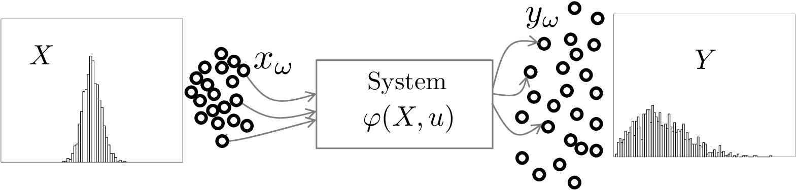
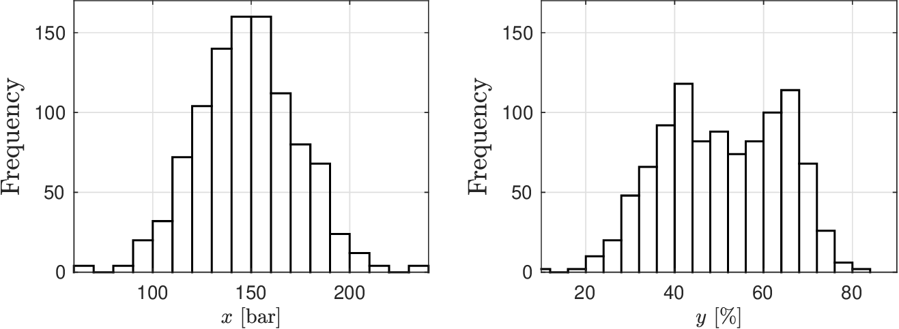
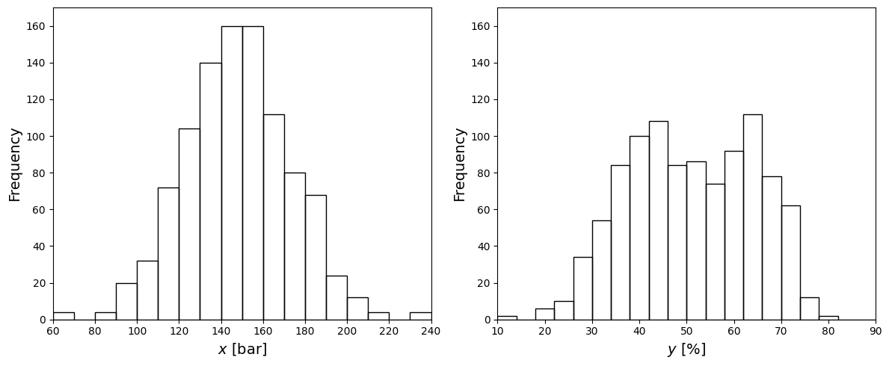
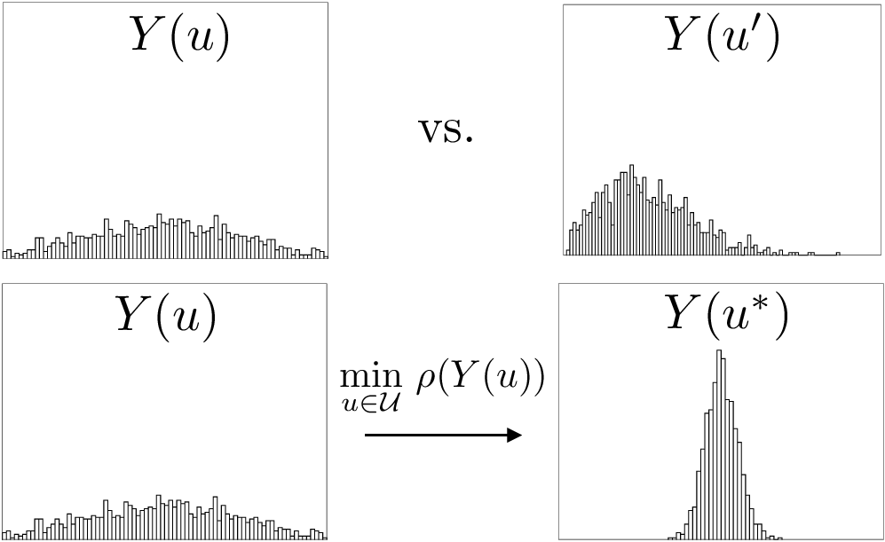
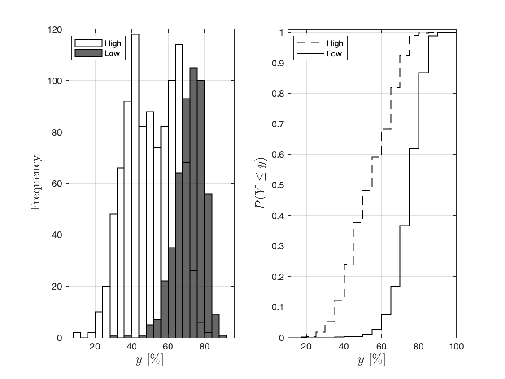
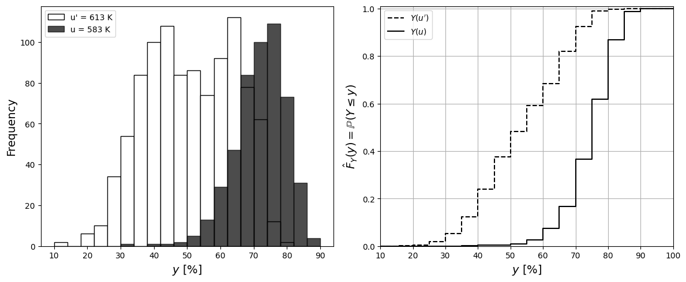

# From Knowledge to Decisions

We now have a characterization of a given random phenomenon (our RV model $$X$$) affecting a system of interest and we would like to exploit this to make decisions.

In this context, it is important to make a couple of important observations:


* Uncertainty *propagates* through systems in complex ways.
* Uncertainty can be *mitigated* via design or control decisions.


## Uncertainty Propagation and Mitigation

* Consider propagation of $$X$$ through system $$\varphi(X,u)$$:

  $$
  Y=\varphi(X,u)
  $$

   where $$u$$ is a mitigating action (decision) and $$Y$$ is the system output.

* We make the following observations:


* Output $$Y$$ is an RV if the input $$X$$ is an RV.
* Nature of $$Y$$ (its cdf, pdf, and domain) depends on system $$\varphi$$. Some systems magnify uncertainty and variability while others might damp it.
* Nature of $$Y$$ depends on action $$u$$.  Can use action to mitigate/manipulate uncertainty of $$Y$$.


<figure><figcaption><p>Illustration of propagation of a random variable $$X$$ through a system. The propagation results in a  random output $$Y$$ that has different characteristics (e.g., higher variability/uncertainty.</p></figcaption></figure>

Having data $$x_\omega,\; \omega \in \mathcal{S}$$ and a system model $$\varphi$$, we can characterize cdf, pdf, domain, and summarizing statistics of $$Y$$ using the following simulation procedure:


1. For a given decision $$u$$, perform simulations of the form:

   $$
   y_\omega=\varphi(x_\omega,u),\; \omega \in \mathcal{S}
   $$

1. Use $$y_\omega$$ to compute sample approximations of quantities of interest for $$Y$$ such as:
   * Sample mean:

     $$
     \hat{\mathbb{E}}_Y=\frac{1}{S}\sum_{\omega \in \mathcal{S}}y_\omega=\frac{1}{S}\sum_{\omega \in \mathcal{S}}\varphi(x_\omega,u)
     $$

   * Sample variance:

     $$
     \hat{\mathbb{V}}_Y=\frac{1}{S}\sum_{\omega \in \mathcal{S}}(y_\omega-\hat{\mathbb{E}}_Y)^2
     $$

   * Empirical cdf:

     $$
     \hat{F}_Y(y)=\frac{1}{S}\sum_{\omega \in \mathcal{S}}\mathbf{1}[y_\omega \leq y]
     $$


The above procedure is known as *Monte Carlo (MC) simulation* and is widely used to estimate diverse quantities of interest for RVs.

## Example: Gibbs Reactor

* Empirical pdf and cdf for pressure (input $$X$$) and conversion (output $$Y$$).
* Note change in behavior of $$Y$$; pdf of $$X$$ is unimodal, while pdf of $$Y$$ is bimodal.

  <figure></figure>

* Complex behavior of the conversion pdf is the result of strong nonlinear behavior

#### Python implementation: Propagation of pressure to conversion

The conversion is the output $$Y=\varphi(X,u)$$ of the reactor; each realization
$$y_\omega=\varphi(x_\omega,u)$$ comes with a pressure realization $$x_\omega$$.
We compare the empirical pdfs of input $$X$$ and output $$Y$$.

```python
y_high = 100 * data_high.iloc[:, 1].to_numpy()   # y_omega at u' (conversion, %)

fig, axs = plt.subplots(1, 2, figsize=(12, 5))
axs[0].hist(x_omega, bins=np.arange(60, 250, 10), edgecolor='black', facecolor='none', linewidth=1)
axs[0].set_xlabel('$x$ [bar]', fontsize=14)
axs[0].set_ylabel('Frequency', fontsize=14)
axs[0].axis([60, 240, 0, 170])
axs[1].hist(y_high, bins=np.arange(10, 94, 4), edgecolor='black', facecolor='none', linewidth=1)
axs[1].set_xlabel('$y$ [%]', fontsize=14)
axs[1].set_ylabel('Frequency', fontsize=14)
axs[1].axis([10, 90, 0, 170])
plt.tight_layout()
plt.show()
```

<figure></figure>

## Decision-Making under Uncertainty

We would like now to find a decision $$u$$ that manipulates $$Y(u)=\varphi(X,u)$$ in some desirable way (e.g., minimizes uncertainty/variance).

Consider the questions:


* If we have a couple of competing decisions $$u$$ and $$u'$$ giving rise to random outputs $$Y(u)$$ and $$Y(u')$$. How can we tell which one is better?
* How can we find the best possible decision $$u$$? What do we mean by the “best"?


## Decision-Making Under Uncertainty

<figure><figcaption><p>Paradigms for decision-making under uncertainty. Comparison between decisions $$u,u'$$ and associated outputs $$Y(u),Y(u')$$ (top). Find best decision $$u^*$$ that shapes $$Y(u^*)$$ in a desirable way (bottom).</p></figcaption></figure>

## Decision-Making under Uncertainty

* If we assume *deterministic setting*  (no uncertainty), then $$Y(u)$$ and $$Y(u')$$ will each take a single value $$y(u)$$ and $$y(u')$$ and one would select, *unambigously*,  the one with smaller (or larger) value. For instance, one would select $$u$$ over $$u'$$ if $$y(u)\leq y(u')$$.
* In a *setting under uncertainty* this is no longer possible because $$Y(u)$$ and $$Y'(u)$$ have multiple possible outcomes ($$Y(u)$$ and $$Y'(u)$$ are RV models)
* Concept of “better" under uncertainty is ambiguous and the mathematical statement $$Y(u)\leq Y(u')$$ does not even make sense.
* Does $$Y(u)\leq Y(u')$$ mean that all outcomes of $$Y(u)$$ are lower than those $$Y(u')$$? Does it mean that a subset of outcomes are lower?
* When making a decision under uncertainty, need to capture information embedded in $$Y(u)$$ and $$Y(u')$$.
* This requires comparing RVs consistently; e.g., by using their cdfs or by using *risk measures* (summarizing statistics).

## Example: Gibbs Reactor

* Can counteract variability in pressure $$X$$ by operating at modifying temperature ($$u$$).
* We compare empirical pdf and cdf for conversion at low $$Y(u)$$ and high $$Y(u')$$ temp
* Should we operate at low or high temp?
* By comparing cdfs, we can see that operating at low temp is *consistently* more likely to achieve higher yields.

  <figure></figure>

#### Python implementation: Comparing decisions u and u'

Outputs $$Y(u)$$ at low temperature $$u=583$$ K and $$Y(u')$$ at high temperature
$$u'=613$$ K. We compare their empirical pdfs and cdfs
$$\hat{F}_Y(y)=\frac{1}{S}\sum_{\omega}\mathbf{1}[y_\omega\leq y]$$.

```python
u_low, u_high = 583, 613
y_low = 100 * data_low.iloc[:, 1].to_numpy()     # y_omega at u

def F_hat_of(y_data, y_grid):
    """Empirical cdf  F_hat(y) = (1/S) sum_omega 1[y_omega <= y]."""
    return np.array([np.mean(y_data <= y_k) for y_k in y_grid])

y_grid = np.arange(10, 105, 5)

fig, ax = plt.subplots(1, 2, figsize=(12, 5))
ax[0].hist(y_high, bins=np.arange(10, 94, 4), edgecolor='black', facecolor='white', label=f"u' = {u_high} K")
ax[0].hist(y_low, bins=np.arange(10, 94, 4), edgecolor='black', facecolor='black', alpha=0.7, label=f"u = {u_low} K")
ax[0].set_xlabel('$y$ [%]', fontsize=14)
ax[0].set_ylabel('Frequency', fontsize=14)
ax[0].legend(loc='upper left')
ax[1].step(y_grid, F_hat_of(y_high, y_grid), where='post', color='black', linestyle='--', label="$Y(u')$")
ax[1].step(y_grid, F_hat_of(y_low, y_grid), where='post', color='black', linestyle='-', label='$Y(u)$')
ax[1].set_xlabel('$y$ [%]', fontsize=14)
ax[1].set_ylabel(r'$\hat{F}_Y(y)=\mathbb{P}(Y\leq y)$', fontsize=14)
ax[1].grid(True)
ax[1].axis([10, 100, 0, 1.01])
ax[1].legend(loc='upper left')
plt.tight_layout()
plt.show()
```

<figure></figure>

## Decision-Making under Uncertainty

* We might not only be interested in comparing decisions, but we might want to find the *best* possible decision.
* To decide what is “best”, we select a measure of the output $$Y(u)$$ (a summarizing statistic) that we denote as $$\rho(Y(u))$$.
* We find best decision by solving optimization problem:

  $$
  \mathop{\textrm{min}}_{u\in \mathcal{U}}\; \rho(Y(u)).
  $$

* $$\mathcal{U}$$ is set of possible decisions that we can choose from.  In Gibbs reactor example, $$\mathcal{U}=\{583,613\}$$.
* If we select $$\rho(Y(u))=\mathbb{SD}[Y(u)]/\mathbb{E}[Y(u)]$$, optimization problem finds decision $$u$$ such that $$Y(u)$$ minimizes the *coefficient of variation* (CV).
* In Gibbs reactor, operating at a low temp yields a CV of $$0.07$$, while operating at high temp yields $$0.10$$ (optimal decision is $$u^*=583$$ K).
* We will see later that $$\rho(Y(u))$$ is a risk measure that aims to model attitudes towards risk by decision-makers.

#### Python implementation: Best decision by coefficient of variation

Use the risk measure $$\rho(Y(u))=\mathbb{SD}[Y(u)]/\mathbb{E}[Y(u)]$$ (coefficient of
variation) and pick $$u^*\in\mathcal{U}=\{583, 613\}$$ that minimizes it.

```python
def rho(y_data):
    """Coefficient of variation CV = SD[Y] / E[Y]."""
    return np.std(y_data) / np.mean(y_data)

U = {u_low: y_low, u_high: y_high}
for u, y_u in U.items():
    print(f"u = {u} K:  E_hat[Y] = {np.mean(y_u):.1f} %,  SD_hat[Y] = {np.std(y_u):.1f} %,  CV = {rho(y_u):.3f}")
u_star = min(U, key=lambda u: rho(U[u]))
print(f"Optimal decision u* = {u_star} K")
```

```
u = 583 K:  E_hat[Y] = 71.9 %,  SD_hat[Y] = 7.7 %,  CV = 0.108
u = 613 K:  E_hat[Y] = 50.9 %,  SD_hat[Y] = 13.3 %,  CV = 0.262
Optimal decision u* = 583 K
```
