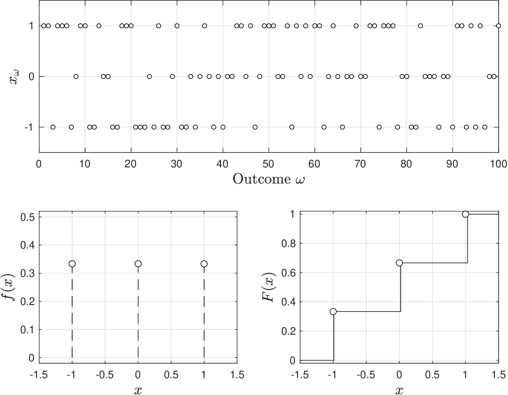
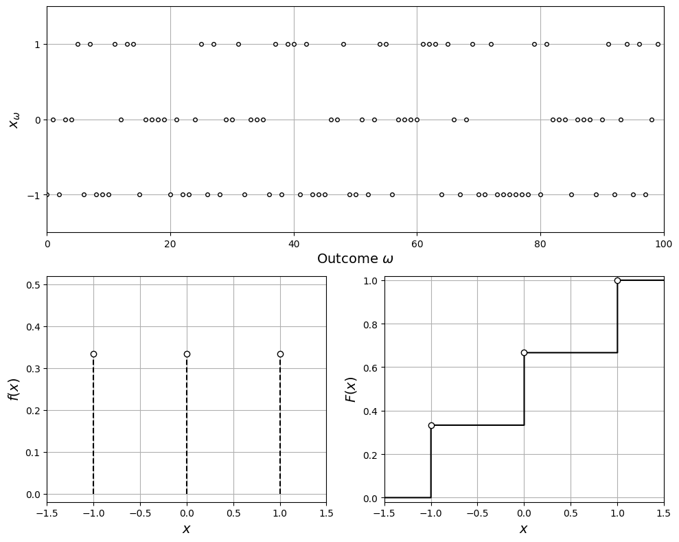
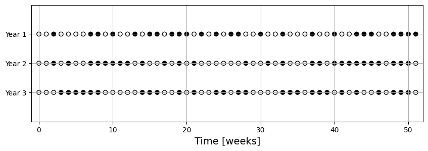

# Discrete Uniform

The (discrete) uniform RV is simplest model that one can think of to model phenomena.

Model inspired by the fact that, in many applications, we often have limited data to characterize phenomenon.

* Imagine all we know is that realizations of RV can take discrete values $$k=a,a+1,a+2,...,b-1,b$$ and that these values are equally likely.
* Accordingly, pdf is given by:

  $$
  \mathbb{P}(X=x)=f(x)=\frac{1}{n},\; x\in \mathcal{D}.
  $$

   with domain $$\mathcal{D}=\{a,a+1,a+2,...,b-1,b\}$$ and $$n=b-a+1$$.

* We express fact that $$X$$ follows a uniform model as $$X\sim \mathcal{U}(a,b)$$, where $$a,b\in \mathbb{Z}$$ are model parameters (adjusted to match data).
* Cdf for uniform RV model is given by:

  $$
  \mathbb{P}(X\leq x)=F(x)=\frac{ x -a +	1}{n},\; x\in \mathcal{D}.
  $$

* Mean of uniform RV is:

  $$
  \begin{aligned}
  \mathbb{E}_X&=\sum_{x\in \mathcal{D}}f(x)\cdot x=\sum_{x=a}^b\frac{1}{n}x\\
  &=\frac{1}{n}\left(a+(a+1)+(a+2)+\cdots+(b-2)+(b-1)+b\right)\\
  &=\frac{1}{2}(a+b)
  \end{aligned}
  $$

* Median of RV is value at which $$F(x)=1/2$$ and thus:

  $$
  \frac{1}{2}=\frac{ x -a +	1}{n}.
  $$

   This occurs at $$\mathbb{M}_X=\frac{1}{2}(a+b)$$.

* Variance of RV is:

  $$
  \mathbb{V}_X=\sum_{x\in \mathcal{D}}f(x)\cdot (x-\mathbb{E}_X)^2=\frac{1}{n}\sum_{x=a}^b\left(x-\frac{1}{2}(a+b)\right)^2=\frac{1}{12}({n^2-1}).
  $$

* Uniform model has many applications and is used in sampling (data collection) schemes (e.g., want equally-likely samples).

<figure><figcaption><p>Pdf and cdf for a uniform random variable with $$a=-1,b=1$$.</p></figcaption></figure>

<details>

<summary>Python: reproduce this figure (ch2_compare_uniformd.ipynb)</summary>

Pdf and cdf of a discrete uniform RV $$X\sim\mathcal{U}(a,b)$$ with $$a=-1,b=1$$
(Victor Z and David Cole, UW-Madison, 2024).
Python names: `a`, `b`, `n` $$=b-a+1$$, domain `D`, pdf `f`, cdf `F`, realizations `x_omega`.

```python
import numpy as np
import matplotlib.pyplot as plt

a, b = -1, 1
D = np.arange(a, b + 1)         # domain {a, ..., b}
n = b - a + 1
f = np.ones(n) / n              # f(x) = 1/n

np.random.seed(0)
S = 100
x_omega = np.random.randint(a, b + 1, S)   # realizations

x = np.linspace(-2, 2, 1000)
F = np.array([np.sum(f[D <= x_k]) for x_k in x])   # F(x) = (x - a + 1)/n on D

plt.figure(figsize=(10, 8))
plt.subplot(2, 2, (1, 2))
plt.plot(x_omega, 'ko', markerfacecolor='w', markersize=4)
plt.xlabel(r'Outcome $\omega$', fontsize=14)
plt.ylabel(r'$x_\omega$', fontsize=14)
plt.grid(True)
plt.yticks([-1, 0, 1])
plt.axis([0, S, -1.5, 1.5])

plt.subplot(2, 2, 3)
plt.vlines(D, 0, f, colors='k', linestyles='--')
plt.scatter(D, f, marker='o', facecolors='w', edgecolors='black', zorder=3)
plt.grid(True)
plt.xlabel('$x$', fontsize=14)
plt.ylabel('$f(x)$', fontsize=14)
plt.axis([-1.5, 1.5, -0.02, 0.52])

plt.subplot(2, 2, 4)
plt.step(x, F, where='post', color='black')
plt.scatter(D, np.cumsum(f), marker='o', facecolors='w', edgecolors='black', zorder=3)
plt.grid(True)
plt.xlabel('$x$', fontsize=14)
plt.ylabel('$F(x)$', fontsize=14)
plt.axis([-1.5, 1.5, -0.02, 1.02])
plt.tight_layout()
plt.show()
```

<figure></figure>

Open in Colab: [`ch2_compare_uniformd.ipynb`](https://colab.research.google.com/github/vzavala/StatsBook-GitBook/blob/main/notebooks/ch2_compare_uniformd.ipynb)

</details>

## Example Discrete Uniform

* Have machine that appears to fail randomly and you have collected weekly data for over 3 years (156 weeks).
* You have not identified any pattern but you have noticed that the machine has not failed 79 out of 156 weeks.
   * Is it suitable to model machine status as a uniform RV?
   * If so, what would be parameters?

     <figure><figcaption><p>Failures (dark dots) recorded over three years.</p></figcaption></figure>

* Define machine status as $$X=0$$ when it fails and $$X=1$$ when it works.
* We thus have $$\mathcal{D}=\{0,1\}$$ and thus $$a=0$$, $$b=1$$ and $$n=2$$; i.e., $$X\sim \mathcal{U}(0,1)$$.
* For uniform RV model we have that $$\mathbb{P}(X=x)=1/n$$ for all $$x\in \mathcal{D}$$ and thus $$\mathbb{P}(X=0)=1/2$$ and $$\mathbb{P}(X=1)=1/2$$.
* From data we see that empirical pdf is:

  $$
  \begin{aligned}
  \hat{\mathbb{P}}(X=0)&=79/156=0.5064\\
  \hat{\mathbb{P}}(X=1)&=(156-79)/156=0.4936.
  \end{aligned}
  $$

* Data suggests that machine status follows behavior of $$\mathcal{U}(0,1)$$ (it is equally likely that it fails or works).

#### Python implementation: Machine status as a uniform RV


Notebook [`ch2_example_uniform.ipynb`](https://colab.research.google.com/github/vzavala/StatsBook-GitBook/blob/main/notebooks/ch2_example_uniform.ipynb) — open it in Colab and run the cells alongside this section.


Machine status as a uniform (and Bernoulli) RV (Victor Z and David Cole, UW-Madison, 2024).

| Slides | Python | Meaning |
|---|---|---|
| $$X$$, $$x_\omega$$ | `x_omega` | weekly status: $$0$$ = fails, $$1$$ = works |
| $$S$$ | `S` | number of weeks observed (156) |
| $$a$$, $$b$$, $$n$$ | `a`, `b`, `n` | uniform parameters, $$n=b-a+1$$ |
| $$\hat{\mathbb{P}}(X=x)$$ | `P_hat[x]` | empirical pdf |

```python
import numpy as np
import matplotlib.pyplot as plt
```

Three years of weekly records ($$S=156$$) in which the machine failed in 79 weeks.

```python
np.random.seed(0)  # reproducibility
S = 156
n_fail = 79
x_omega = np.ones(S, dtype=int)                                   # 1 = works
x_omega[np.random.choice(S, n_fail, replace=False)] = 0           # 0 = fails

weeks = np.arange(52)
plt.figure(figsize=(10, 3))
for year in range(3):
    status = x_omega[52*year:52*(year+1)]
    plt.scatter(weeks, np.full(52, 3 - year), c=np.where(status == 0, 'black', 'white'), edgecolors='black')
plt.yticks([1, 2, 3], ['Year 3', 'Year 2', 'Year 1'])
plt.xlabel('Time [weeks]', fontsize=14)
plt.grid(True)
plt.axis([-1, 52, 0, 4])
plt.show()
```

<figure></figure>

Uniform model with $$\mathcal{D}=\{0,1\}$$: $$a=0$$, $$b=1$$, $$n=2$$, so $$\mathbb{P}(X=x)=1/n=1/2$$.
Compare with the empirical pdf $$\hat{\mathbb{P}}(X=x)=\frac{1}{S}\sum_{\omega}\mathbf{1}[x_\omega=x]$$.

```python
a, b = 0, 1
n = b - a + 1
P_hat = {x: np.mean(x_omega == x) for x in (0, 1)}
print(f"Uniform model: P(X=0) = P(X=1) = 1/n = {1/n}")
print(f"Empirical:     P_hat(X=0) = {P_hat[0]:.4f},  P_hat(X=1) = {P_hat[1]:.4f}")
```

```
Uniform model: P(X=0) = P(X=1) = 1/n = 0.5
Empirical:     P_hat(X=0) = 0.5064,  P_hat(X=1) = 0.4936
```
