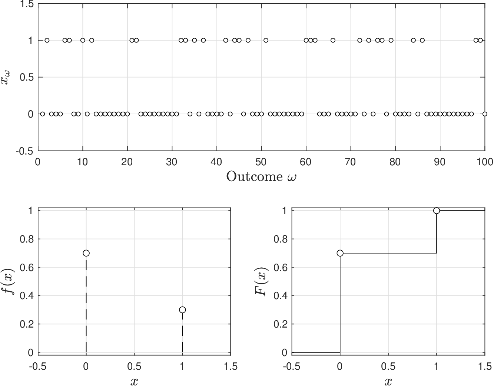
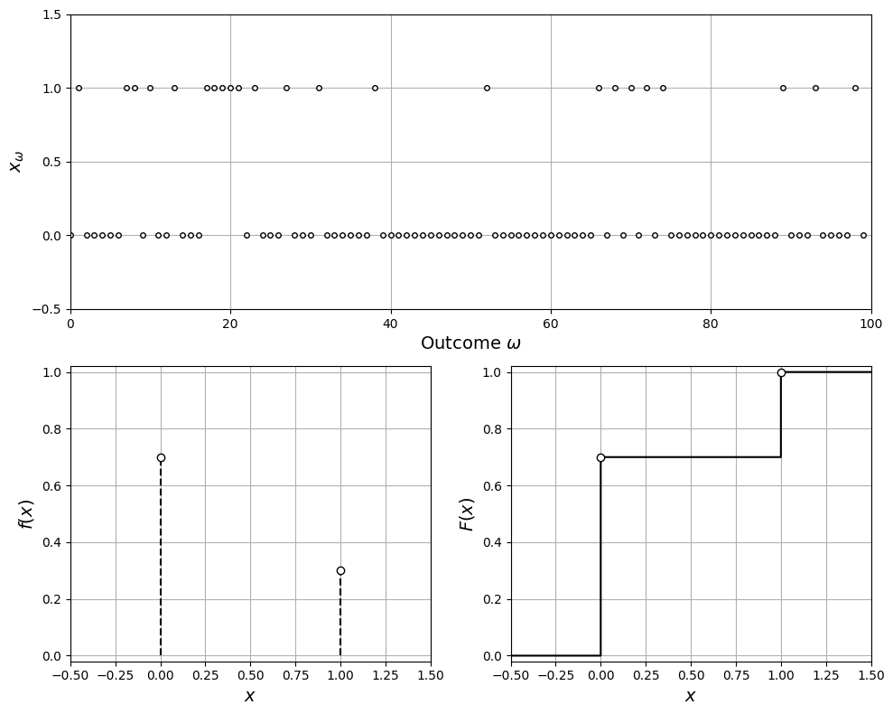

# Bernoulli

* Another simple RV model is the Bernoulli RV.
* You run an experiment with two possible outcomes $$Y$$ (yes) or $$N$$ (no).
* We have $$X=1$$ if outcome is $$Y$$ and $$X=0$$ if outcome is $$N$$.
* Define $$p\in [0,1]$$ as probability of outcome $$Y$$ and thus probability of $$N$$ is $$(1-p)$$.
* Domain is thus $$\mathcal{D}=\{0,1\}$$ and pdf is:

  $$
  \begin{aligned}
  f(x)=\left\{\begin{array}{cc}(1-p) &\textrm{if }\;x=0\\ p&\textrm{if }\;x=1\end{array}\right.
  \end{aligned}
  $$

   Pdf can be written in compact form:

  $$
  f(x)=p^{\mathbf{1}[x=1]}(1-p)^{\mathbf{1}[x=0]}.
  $$

* We say $$X$$ follows a Bernoulli model as $$X\sim \mathcal{B}(p)$$, where $$p$$ is the parameter.
* Mean and variance of this RV are:

  $$
  \begin{aligned}
  \mathbb{E}_X&=\sum_{x\in \mathcal{D}}x\cdot f(x)=0\cdot(1-p)+1\cdot p=p\\
  \mathbb{V}_X&=\sum_{x\in \mathcal{D}}(x-\mathbb{E}_X)^2\cdot f(x)= p\cdot (1-p).
  \end{aligned}
  $$

* Bernoulli RV is used in sampling and forms basis of more sophisticated RVs.

<figure><figcaption><p>Pdf and cdf for Bernoulli random variable with 𝑝 = 0.3.</p></figcaption></figure>

<details>

<summary>Python: reproduce this figure (ch2_compare_bernoulli.ipynb)</summary>

Pdf and cdf of a Bernoulli RV $$X\sim\mathcal{B}(p)$$ with $$p=0.3$$
(Victor Z and J E Umaña, UW-Madison, 2024).
Python names: `p`, domain `D`, pdf `f`, cdf `F`, realizations `x_omega`.

```python
import numpy as np
import matplotlib.pyplot as plt
from scipy.stats import bernoulli

p = 0.3
D = np.array([0, 1])
f = np.array([1 - p, p])        # f(x) = p^1[x=1] (1-p)^1[x=0]

x = np.linspace(-1, 2, 1000)
F = np.array([np.sum(f[D <= x_k]) for x_k in x])

np.random.seed(0)
S = 100
x_omega = bernoulli.rvs(p, size=S)

plt.figure(figsize=(10, 8))
plt.subplot(2, 2, (1, 2))
plt.plot(x_omega, 'ko', markerfacecolor='w', markersize=4)
plt.xlabel(r'Outcome $\omega$', fontsize=14)
plt.ylabel(r'$x_\omega$', fontsize=14)
plt.grid(True)
plt.yticks([-0.5, 0, 0.5, 1, 1.5])
plt.axis([0, S, -0.5, 1.5])

plt.subplot(2, 2, 3)
plt.vlines(D, 0, f, colors='k', linestyles='--')
plt.scatter(D, f, marker='o', facecolors='w', edgecolors='k', zorder=3)
plt.grid(True)
plt.xlabel('$x$', fontsize=14)
plt.ylabel('$f(x)$', fontsize=14)
plt.axis([-0.5, 1.5, -0.02, 1.02])

plt.subplot(2, 2, 4)
plt.step(x, F, 'k-', where='post')
plt.scatter(D, np.cumsum(f), marker='o', facecolors='w', edgecolors='k', zorder=3)
plt.grid(True)
plt.xlabel('$x$', fontsize=14)
plt.ylabel('$F(x)$', fontsize=14)
plt.axis([-0.5, 1.5, -0.02, 1.02])
plt.tight_layout()
plt.show()
```

<figure></figure>

Open in Colab: [`ch2_compare_bernoulli.ipynb`](https://colab.research.google.com/github/vzavala/StatsBook-GitBook/blob/main/notebooks/ch2_compare_bernoulli.ipynb)

</details>

## Example Bernoulli

* Consider the previous machine status problem and the following questions:
   * Is it suitable to model the machine status as a Bernoulli RV?
   * If so, what would be its parameters?
   * What makes this different than a uniform RV?
* Define status as $$X=0$$ when fails and $$X=1$$ when works (domain is $$\mathcal{D}=\{0,1\}$$).
* For a Bernoulli RV, we must have that $$\mathbb{P}(X=0)=p$$ and $$\mathbb{P}(X=1)=1-p$$.
* From our data we have:

  $$
  \begin{aligned}
  \hat{\mathbb{P}}(X=0)&=79/156=0.5064\\
  \hat{\mathbb{P}}(X=1)&=(156-79)/156=0.4936.
  \end{aligned}
  $$

* Machine status thus seems to behave as a Bernoulli RV $$\mathcal{B}(0.5)$$.
* In this example, uniform and Bernoulli models are identical.
* Uniform model is a generalization of Berrnoulli model.

#### Python implementation: Machine status as a Bernoulli RV

For a Bernoulli RV $$X\sim\mathcal{B}(p)$$, $$\mathbb{E}_X=p$$, so the empirical mean
$$\hat{\mathbb{E}}_X$$ estimates $$p$$; here $$X=1$$ means the machine works.

```python
p_hat = np.mean(x_omega)                  # E_hat[X] = p_hat
print(f"p_hat = {p_hat:.4f}  ->  X ~ B({p_hat:.2f})")
print(f"E_X = p = {p_hat:.4f},  V_X = p(1-p) = {p_hat*(1-p_hat):.4f}")
```

```
p_hat = 0.4936  ->  X ~ B(0.49)
E_X = p = 0.4936,  V_X = p(1-p) = 0.2500
```
