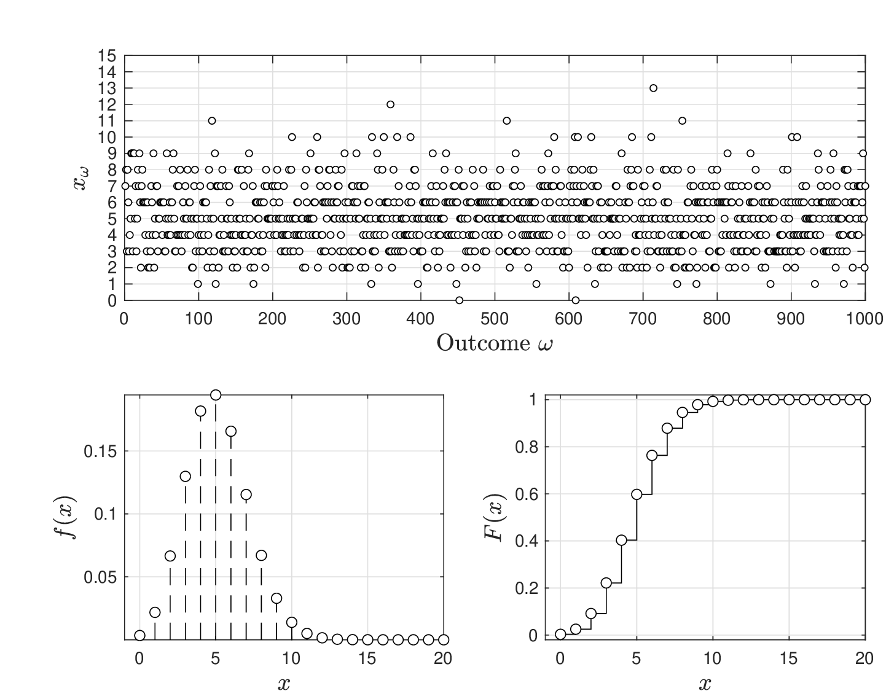
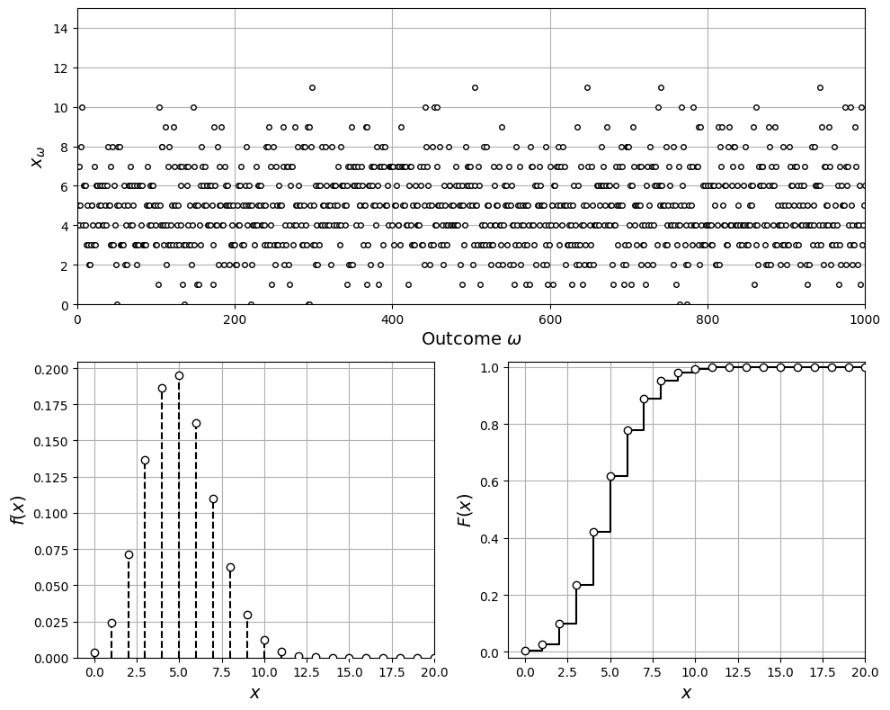

# Hypergeometric

* Arises in applications in which one draws random samples from a population.
* For instance, in a manufacturing, we choose a set of products to inspect for quality control.
* Main issue is that population can be large and we cannot afford to inspect all.
* We want to select a subset and infer from this behavior of general population.
* Assume population is composed of mutually exclusive groups $$Y$$ or $$N$$.
* Total units in population is $$N_t$$ and define total number of units of type $$Y$$ as $$N_y$$. We thus have that $$(N_t-N_y)$$ are of type $$N$$.
* The fraction of $$Y$$ items is thus $$p=N_y/N_t$$.
* We draw sample of $$n$$ items and check how many items are of type $$Y$$.
* The RV $$X$$ is the number of items of type $$Y$$ in our sample.

* Total number of distinct ways of choosing $$n$$ items from the population is:

  $$
  \begin{aligned}
  N_\Omega=\left(\begin{array}{c}N_t\\ n\end{array}\right)=\frac{N_t!}{n!\cdot (N_t-n)!}.
  \end{aligned}
  $$

   This is the size of sample set $$\Omega$$ (in general an extremely large number).

* For instance, for $$N_t=100$$ and $$n=10$$ we have $$N_\Omega=1.73\times 10^{13}$$.
* Probability of obtaining $$x$$ items of type $$Y$$ in sample is given by pdf:

  $$
  \begin{aligned}
  f(x)=\frac{\left(\begin{array}{c}N_y\\x\end{array}\right)\cdot \left(\begin{array}{c}N_t-N_y\\n-x\end{array}\right)}{\left(\begin{array}{c}N_t\\n\end{array}\right)},\quad x\in \mathcal{D}.
  \end{aligned}
  $$

   where the domain is $$\mathcal{D}=\{\max(0,n+N_y-N_t),...,\min(n,N_y)\}$$.

* Hypergeometric RV is denoted as $$X\sim \mathcal{H}(N_y,N_t,n,p)$$.

* Below is pdf and cdf of a hypergeometric RV for $$N_t=500$$, $$N_y=50$$, and $$n=50$$
* Fraction of items of type $$Y$$ in population is  $$p=N_y/N_t=0.1$$.
* Pdf grows quickly with $$x$$, reaches peak (mode) at $$x=5$$ and then decays rapidly.
* This indicates that it is most likely to find exactly 5 items of type $$Y$$.
* More likely to find 5 items of type $$Y$$ than 1 item of type $$Y$$ in our sample.

<figure></figure>

<details>

<summary>Python: reproduce this figure (ch2_compare_hypergeometric.ipynb)</summary>

Pdf and cdf of a hypergeometric RV $$X\sim\mathcal{H}(N_y,N_t,n,p)$$ with $$N_t=500$$,
$$N_y=50$$, $$n=50$$ (Victor Z and David Cole, UW-Madison, 2024).

| Slides | Python | Meaning |
|---|---|---|
| $$N_t$$, $$N_y$$ | `N_t`, `N_y` | population size and number of type-$$Y$$ items |
| $$n$$ | `n` | sample size |
| $$p=N_y/N_t$$ | `p` | fraction of type-$$Y$$ items |
| $$\mathcal{D}$$, $$f(x)$$, $$F(x)$$ | `D`, `f`, `F` | domain, pdf, cdf |

```python
import numpy as np
import matplotlib.pyplot as plt
from scipy.special import comb
from scipy.stats import hypergeom

N_t, N_y, n = 500, 50, 50
p = N_y / N_t
D = np.arange(max(0, n + N_y - N_t), min(n, N_y) + 1)    # domain

# f(x) = C(N_y, x) C(N_t - N_y, n - x) / C(N_t, n)
f = comb(N_y, D) * comb(N_t - N_y, n - D) / comb(N_t, n)
F = np.cumsum(f)

np.random.seed(0)
S = 1000
x_omega = hypergeom.rvs(N_t, N_y, n, size=S)   # scipy order: (population, type-Y, sample)

print(f"mode = {D[np.argmax(f)]},  E_X = n p = {n*p}")

plt.figure(figsize=(10, 8))
plt.subplot(2, 2, (1, 2))
plt.plot(x_omega, 'ko', markerfacecolor='w', markersize=4)
plt.xlabel(r'Outcome $\omega$', fontsize=14)
plt.ylabel(r'$x_\omega$', fontsize=14)
plt.grid(True)
plt.axis([0, S, 0, 15])

plt.subplot(2, 2, 3)
plt.vlines(D, 0, f, colors='k', linestyles='--')
plt.scatter(D, f, facecolor='w', edgecolor='k', zorder=3)
plt.grid(True)
plt.xlabel('$x$', fontsize=14)
plt.ylabel('$f(x)$', fontsize=14)
plt.axis([-1, 20, 0, max(f) * 1.05])

plt.subplot(2, 2, 4)
plt.step(D, F, 'k-', where='post')
plt.scatter(D, F, facecolor='w', edgecolor='k', zorder=3)
plt.grid(True)
plt.xlabel('$x$', fontsize=14)
plt.ylabel('$F(x)$', fontsize=14)
plt.axis([-1, 20, -0.02, 1.02])
plt.tight_layout()
plt.show()
```

```
mode = 5,  E_X = n p = 5.0
```

<figure></figure>

Open in Colab: [`ch2_compare_hypergeometric.ipynb`](https://colab.research.google.com/github/vzavala/StatsBook-GitBook/blob/main/notebooks/ch2_compare_hypergeometric.ipynb)

</details>

* Expected value of $$X$$ (average number of items $$Y$$ in our sample) is:

  $$
  \mathbb{E}_X=n\cdot p.
  $$

* Value $$n$$ is known (we control this) but $$p$$ is usually not known  (need to sample the entire population to determine $$N_y$$, this would be expensive).
* Parameter $$p$$ can be estimated from empirical estimates of $$\mathbb{E}_X$$.
* For instance, assume you pick different samples $$S$$ (each of size $$n$$) and record the number of items of type $$Y$$ in each sample (given by $$x_\omega,\,\omega \in \mathcal{S}$$).
* Empirical mean is $$\hat{\mathbb{E}}_X=\frac{1}{S}\sum_{\omega \in \mathcal{S}}x_\omega$$ and thus we can estimate $$p$$ as:

  $$
  \hat{p}=\hat{\mathbb{E}}_X/n.
  $$

* Variance of the hypergeometric RV is given by:

  $$
  \mathbb{V}_X=n\cdot p\cdot (1-p)\cdot \frac{N_t-n}{n-1}
  $$

* Note that variance is zero if $$n=N_t$$, why?
* If we pick all items $$n=N_t$$ then there is no variability in the number of items of type $$Y$$ that we observe.
* In general, variance will decrease as $$n$$ approaches $$N_t$$.
* Can you estimate $$p$$ from the empirical variance $$\hat{\mathbb{V}}_X$$?

## Example Hypergeometric

Cannot afford to monitor machine status every week for 3 years (time-consuming)

* If you inspect the machine 5 times (selected at random)... What is the probability that the machine will be in failure mode 5 out of 5 times that you inspected?
* if you inspect the machine 10 times (selected at random)... What is the probability that the machine will be in failure mode 10 out of 10 times that you inspected?

We inspect at random, it is thus appropriate to model number of failures as $$X\sim \mathcal{H}(N_y,N_t,p,n)$$.

* We define $$N_t=176$$, $$N_y=79$$, $$p=N_y/N_t\approx 0.50$$, and $$n=5$$.
* Probability that machine is in failure mode 5 out of 5 times inspected is:

  $$
  \mathbb{P}(X=5)=f(5)=0.1312.
  $$

* Probability of observing 10 out of 10 failures is:

  $$
  \begin{aligned}
  \mathbb{P}(X=10)&=f(10)=8\times 10^{-4}.
  \end{aligned}
  $$

#### Python implementation


Notebook [`ch2_example_hypergeometric.ipynb`](https://colab.research.google.com/github/vzavala/StatsBook-GitBook/blob/main/notebooks/ch2_example_hypergeometric.ipynb) — open it in Colab and run the cells alongside this section.


Inspecting the machine at random (Victor Z and David Cole, UW-Madison, 2024).

| Slides | Python | Meaning |
|---|---|---|
| $$N_t$$ | `N_t` | weeks in the record (population) |
| $$N_y$$ | `N_y` | weeks in failure mode |
| $$p=N_y/N_t$$ | `p` | fraction of failure weeks |
| $$n$$ | `n` | number of inspections |
| $$f(x)=\mathbb{P}(X=x)$$ | `f(x, n)` | hypergeometric pdf |

```python
import numpy as np
from scipy.stats import hypergeom

N_t = 156   # weeks in 3 years
N_y = 79    # weeks the machine was in failure mode
p = N_y / N_t

def f(x, n):
    """Hypergeometric pdf f(x) for n inspections (scipy order: N_t, N_y, n)."""
    return hypergeom.pmf(x, N_t, N_y, n)

print(f"p = N_y/N_t = {p:.3f}")
```

```
p = N_y/N_t = 0.506
```

Probability that the machine is in failure mode in all $$n$$ inspections,
$$\mathbb{P}(X=n)=f(n)$$, for $$n=5$$ and $$n=10$$ (and, for contrast, in none of them).

```python
for n in (5, 10):
    print(f"n = {n:2d}:  P(X={n}) = f({n}) = {f(n, n):.4g},   P(X=0) = f(0) = {f(0, n):.4g}")
```

```
n =  5:  P(X=5) = f(5) = 0.03123,   P(X=0) = f(0) = 0.02738
n = 10:  P(X=10) = f(10) = 0.0008222,   P(X=0) = f(0) = 0.0006261
```
