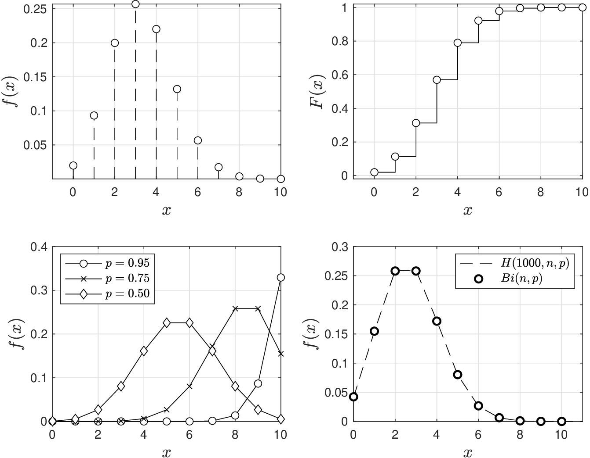
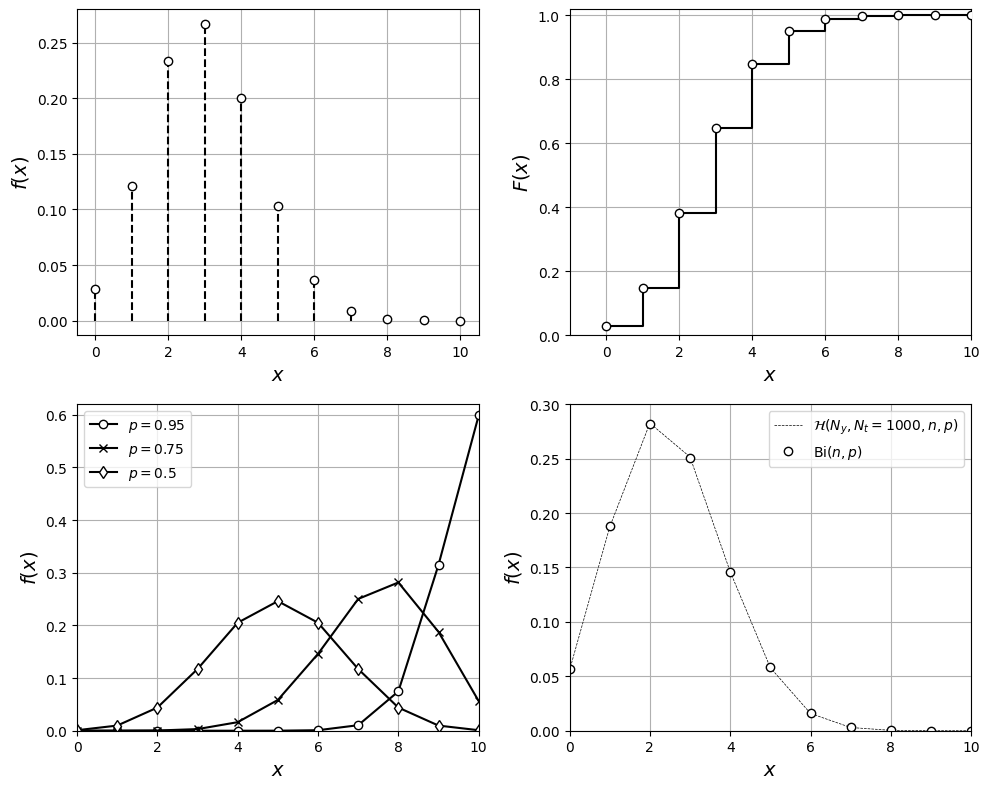
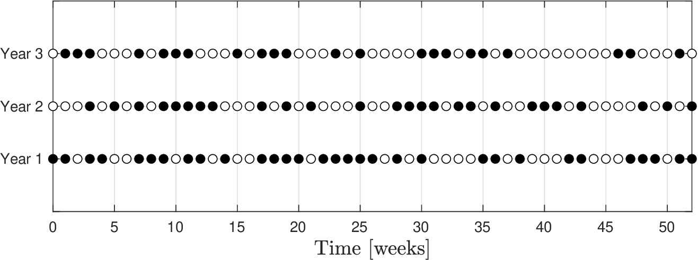

# Binomial

* In Bernoulli setting, a trial has possible outcomes $$Y$$ (yes) or $$N$$ (no).
* Imagine we perform a *sequence* of $$n$$ Bernoulli trials and record number of times that outcomes are of type $$Y$$. Each trial is *independent* of the others.
* Binomial RV $$X$$ counts number of trials of type $$Y$$ in our $$n$$ trials.
* Domain is $$\mathcal{D}=\{0,1,...,n\}$$ and probability that number of $$Y$$ trials is $$x$$ is:

  $$
  \begin{aligned}
  f(x)=\left(\begin{array}{c}n\\ x\end{array}\right)\cdot p^x\cdot (1-p)^{(n-x)},\quad x\in \mathcal{D}.
  \end{aligned}
  $$

* We denote Binomial RV as $$X\sim \textrm{Bi}(n,p)$$.
* Expected value and variance are:

  $$
  \begin{aligned}
  \mathbb{E}_X&=n\cdot p,\qquad \mathbb{V}_X=n\cdot p\cdot(1-p).
  \end{aligned}
  $$

* Binomial RV is a generalization of Bernoulli RV; $$\textrm{Bi}(1,p)=\mathcal{B}(p)$$.
* Consider sequence of independent Bernoulli RVs $$X_1,X_2,...,X_n$$ (each with probability $$p$$), then $$X=\sum_{i=1}^nX_i$$ is a binomial RV $$X\sim \textrm{Bi}(n,p)$$.
* Binomial RV is limiting case of a hypergeometric RV in the sense that:

  $$
  \lim_{N_t\to\infty} \mathcal{H}(N_y,N_t,n,p)=\textrm{Bi}(n,p).
  $$

   i.e., binomial setting is equivalent to hypergeometric setting when size of the population is large.

* In hypergeometric setting, we choose $$n$$ items at once while in binomial setting we choose $$n$$ items by choosing one item at a time (resetting system each time).
* Intuitively, when population $$N_t$$ is large, size of the sample does not matter as much and picking $$n$$ items at once or as an independent sequence is equivalent.

<figure></figure>

*Pdf and cdf for binomial RV with $$n=10$$ and $$p=0.3$$ (top). Binomial pdf for different $$p$$ (bottom-left). Convergence of hypergeometric pdf to binomial pdf for $$N=1000$$ (bottom-right).*

<details>

<summary>Python: reproduce this figure (ch2_compare_binomial.ipynb)</summary>

Pdf and cdf of a binomial RV $$X\sim\mathrm{Bi}(n,p)$$, and convergence of
$$\mathcal{H}(N_y,N_t,n,p)$$ to $$\mathrm{Bi}(n,p)$$ for large $$N_t$$
(Victor Z and J E Umaña, UW-Madison, 2024).
Python names: `n`, `p`, domain `D`, pdf `f`, cdf `F`, population `N_t`, `N_y`.

```python
import numpy as np
import matplotlib.pyplot as plt
from scipy.stats import binom, hypergeom

n, p = 10, 0.3
D = np.arange(0, n + 1)
f = binom.pmf(D, n, p)     # C(n,x) p^x (1-p)^(n-x)
F = binom.cdf(D, n, p)

plt.figure(figsize=(10, 8))
plt.subplot(221)
plt.vlines(D, 0, f, colors='k', linestyles='--')
plt.scatter(D, f, marker='o', facecolors='w', edgecolors='black', zorder=3)
plt.grid(True)
plt.xlabel('$x$', fontsize=14)
plt.ylabel('$f(x)$', fontsize=14)

plt.subplot(222)
plt.step(D, F, where='post', color='black')
plt.scatter(D, F, marker='o', facecolors='w', edgecolors='black', zorder=3)
plt.grid(True)
plt.xlabel('$x$', fontsize=14)
plt.ylabel('$F(x)$', fontsize=14)
plt.axis([-1, 10, 0, 1.02])

plt.subplot(223)
for p_k, mk in zip([0.95, 0.75, 0.5], ["o-", "x-", "d-"]):
    plt.plot(D, binom.pmf(D, n, p_k), mk, color='k', markerfacecolor='w', label=f'$p={p_k}$')
plt.grid(True)
plt.xlabel('$x$', fontsize=14)
plt.ylabel('$f(x)$', fontsize=14)
plt.axis([0, 10, 0, 0.62])
plt.legend(loc='upper left', fontsize=10)

# hypergeometric H(N_y, N_t, n, p) approaches Bi(n, p) when N_t is large
plt.subplot(224)
p_H, N_t = 0.25, 1000
N_y = round(p_H * N_t)
D_H = np.arange(max(n + N_y - N_t, 0), min(n, N_y) + 1)
plt.plot(D_H, hypergeom.pmf(D_H, N_t, N_y, n), 'k--', linewidth=0.5, label=r'$\mathcal{H}(N_y,N_t=1000,n,p)$')
plt.plot(D, binom.pmf(D, n, p_H), 'ko', markerfacecolor='w', label=r'$\mathrm{Bi}(n,p)$')
plt.grid(True)
plt.xlabel('$x$', fontsize=14)
plt.ylabel('$f(x)$', fontsize=14)
plt.axis([0, 10, 0, 0.3])
plt.legend(loc='upper right', fontsize=10)
plt.tight_layout()
plt.show()
```

<figure></figure>

Open in Colab: [`ch2_compare_binomial.ipynb`](https://colab.research.google.com/github/vzavala/StatsBook-GitBook/blob/main/notebooks/ch2_compare_binomial.ipynb)

</details>

## Example Binomial

Consider machine status problem; recall we have established that status is $$\mathcal{B}(0.5)$$.

* What is probability of finding 2 failures in a sequence of 10 times?
* What is probability of finding 10 failures in a sequence of 10 times?
* What is average number of failures in a sequence of 10 times?

  <figure><figcaption><p>Failures (dark dots) recorded over three years.</p></figcaption></figure>

Status is a Benoulli RV with $$p=0.5$$ and thus number of failures $$n$$-sequence is $$\textrm{Bi}(n,p)$$.

* Probability of finding 2 failures in a sequence of $$n=10$$ times is:

  $$
  \mathbb{P}(X=2)=f(2)=0.0439.
  $$

* Probability of finding 10 failures is:

  $$
  \mathbb{P}(X=10)=f(10)=9.76\times 10^{-4}
  $$

* Average number of failures is:

  $$
  \mathbb{E}_X=n\cdot p=10\cdot 0.5=5
  $$

#### Python implementation


Notebook [`ch2_example_binomial.ipynb`](https://colab.research.google.com/github/vzavala/StatsBook-GitBook/blob/main/notebooks/ch2_example_binomial.ipynb) — open it in Colab and run the cells alongside this section.


Failures in a sequence of $$n=10$$ weeks (Victor Z and J E Umaña, UW-Madison, 2024).
The weekly status is $$\mathcal{B}(p)$$ with $$p=0.5$$, so the number of failures in
$$n$$ weeks is $$X\sim\mathrm{Bi}(n,p)$$ with pdf $$f(x)=\binom{n}{x}p^x(1-p)^{n-x}$$.
Python names: `n`, `p`, pdf `f(x)`, `E_X`.

```python
from scipy.stats import binom

n, p = 10, 0.5

def f(x):
    """Binomial pdf f(x) = C(n, x) p^x (1-p)^(n-x)."""
    return binom.pmf(x, n, p)

print(f"P(X=2)  = f(2)  = {f(2):.4f}")
print(f"P(X=10) = f(10) = {f(10):.3g}")
E_X = n * p
print(f"E_X = n p = {E_X:g}")
```

```
P(X=2)  = f(2)  = 0.0439
P(X=10) = f(10) = 0.000977
E_X = n p = 5
```
