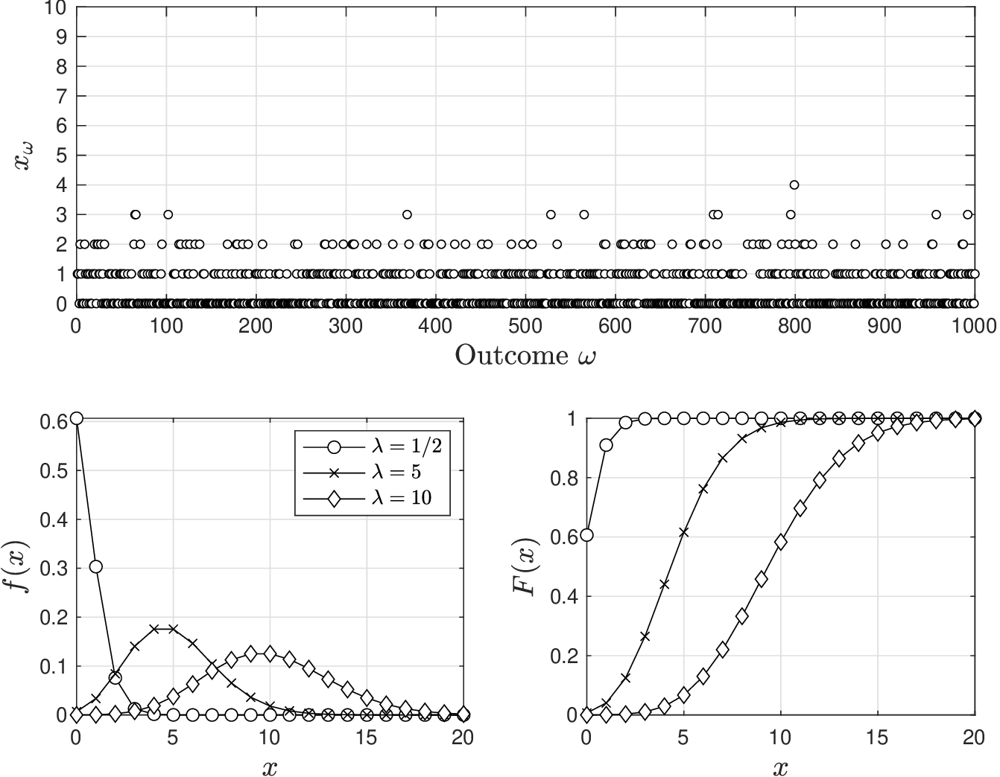
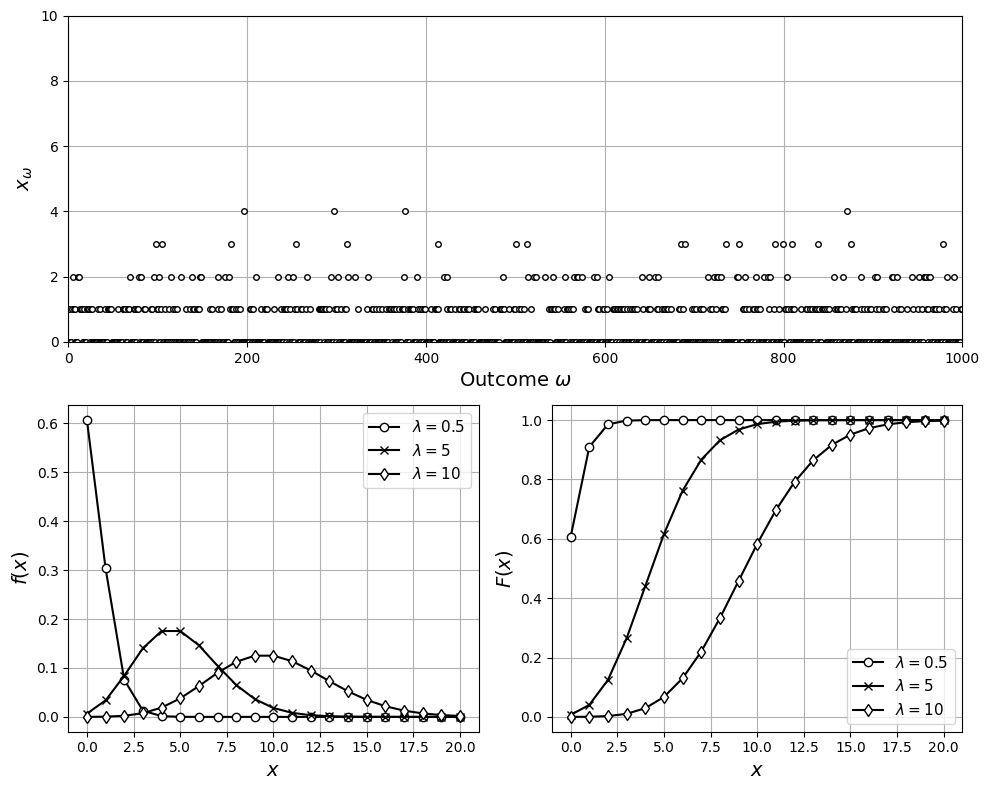
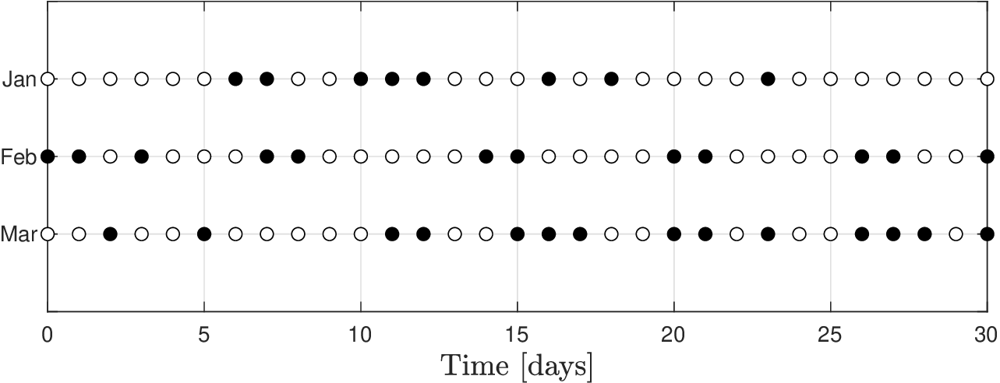
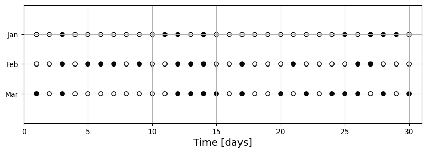

# Poisson

* Poisson RV model is important generalization of binomial RV.
* In binomial setting, we consider sequence of $$n$$ Bernoulli trials and record number of occurrences of type $$Y$$.
* Imagine trials are taken at consecutive times $$z_1,z_2,...,z_n$$ and define $$\Delta z$$ as time between trials (sampling interval).
* If we have continuous time interval $$[0,z]$$ (of total length $$z$$), then number of trials in interval is $$n=z/\Delta z$$.

* Poisson setting is limiting case of $$\Delta z\to 0$$ ($$n\to \infty$$); specifically, we seek to understand probability of occurrences over infinitesimally small sampling intervals.
* Understanding behavior over small intervals is important because we might miss occurrences if sampling interval $$\Delta z$$ is long.
* Poisson RV gives number of occurrences of type $$Y$$ in interval of length $$z$$.
* Domain is $$\mathcal{D}=\{0,1,2,...,\infty\}$$ and pdf:

  $$
  f(x)=\frac{\lambda^x e^{-\lambda }}{x!},\quad x\in \mathcal{D}.
  $$

   Denote Poisson RV as $$X\sim \mathcal{P}(\lambda)$$ with parameter $$\lambda\in \mathbb{R}_+$$.

* Expected value and variance are:

  $$
  \begin{aligned}
  \mathbb{E}_X&=\lambda\\
  \mathbb{V}_X&=\lambda.
  \end{aligned}
  $$

* Parameter $$\lambda$$ is average number of occurrences found in interval.
* Parameter $$\lambda$$ is also often expressed as:

  $$
  \lambda=\eta\cdot z
  $$

   where $$\eta \in \mathbb{R}_+$$ is intensity (average occurrences per unit of interval length).

* Poisson RV has a property known as self-reproducibility. If $$X_i\sim \mathcal{P}(\lambda_i),\,i=1,2,...,n$$ are independent, their sum is also a Poisson RV:

  $$
  \sum_{i=1}^nX_i\sim \mathcal{P}(\lambda)
  $$

   with $$\lambda=\sum_{i=1}^n\lambda_i$$.

<figure><figcaption><p>Pdf and cdf for Poisson random variable.</p></figcaption></figure>

<details>

<summary>Python: reproduce this figure (ch2_compare_poisson.ipynb)</summary>

Pdf and cdf of a Poisson RV $$X\sim\mathcal{P}(\lambda)$$ for several $$\lambda$$
(Victor Z and David Cole, UW-Madison, 2024).
Python names: `lam` for $$\lambda$$ (`lambda` is reserved in Python), realizations `x_omega`.

```python
import numpy as np
import matplotlib.pyplot as plt
from scipy.stats import poisson

lam_values = [1/2, 5, 10]
x = np.arange(0, 21)

np.random.seed(0)
S = 1000
x_omega = poisson.rvs(1/2, size=S)

plt.figure(figsize=(10, 8))
plt.subplot(2, 2, (1, 2))
plt.plot(x_omega, 'ko', markerfacecolor='w', markersize=4)
plt.xlabel(r'Outcome $\omega$', fontsize=14)
plt.ylabel(r'$x_\omega$', fontsize=14)
plt.grid(True)
plt.axis([0, S, 0, 10])

for sub, fun, label in ((3, poisson.pmf, '$f(x)$'), (4, poisson.cdf, '$F(x)$')):
    plt.subplot(2, 2, sub)
    for lam, mk in zip(lam_values, ["o-", "x-", "d-"]):
        plt.plot(x, fun(x, lam), mk, color='k', markerfacecolor='w', label=rf'$\lambda={lam}$')
    plt.grid(True)
    plt.xlabel('$x$', fontsize=14)
    plt.ylabel(label, fontsize=14)
    plt.legend(fontsize=11)
plt.tight_layout()
plt.show()
```

<figure></figure>

Open in Colab: [`ch2_compare_poisson.ipynb`](https://colab.research.google.com/github/vzavala/StatsBook-GitBook/blob/main/notebooks/ch2_compare_poisson.ipynb)

</details>

## Example Poisson

* Experimental reactor is equipped with automated cooling system.
* Pump of cooling agent is not reliable (cavitates); failures have been recorded daily for last three months.
* Assuming number of failures per month is Poisson, determine:
   * Is it more probable that the pump does not fail in a month or that the pump fails daily?
   * Probability that the pump fails an average number of times.

     <figure><figcaption><p>Pump failures (dark dots) recorded over three months.</p></figcaption></figure>

* From data, number of failures per month are $$x_{Jan}=8$$,$$x_{Feb}=12$$, $$x_{Mar}=14$$.
* From these values we obtain empirical mean:

  $$
  \hat{\mathbb{E}}_X=\frac{1}{3}(8+12+14)=11.3
  $$

* For Poisson RV, we know that $$\mathbb{E}_X=\lambda$$ and we thus we estimate $$\hat{\lambda}=11.3$$.
* Use Poisson RV model to determine that:

  $$
  \begin{aligned}
  \mathbb{P}(X=0)&=\frac{\lambda^0 e^{-\lambda }}{0!}=1.23\times 10^{-5}\\
  \mathbb{P}(X=30)&=\frac{\lambda^{30} e^{-\lambda }}{30!}=1.82\times 10^{-6}.
  \end{aligned}
  $$

   More probable that pump does not fail in a month (than failing daily).

* Probability that the pump fails average number of times is:

  $$
  \begin{aligned}
  \mathbb{P}(X=11)=\frac{\lambda^{11} e^{-\lambda }}{11!}=0.12.
  \end{aligned}
  $$

   We evaluated at $$x=11$$ (and not $$x=11.3$$) because domain $$\mathcal{D}$$ contains integers.

#### Python implementation


Notebook [`ch2_example_poisson.ipynb`](https://colab.research.google.com/github/vzavala/StatsBook-GitBook/blob/main/notebooks/ch2_example_poisson.ipynb) — open it in Colab and run the cells alongside this section.


Pump failures as a Poisson RV (Victor Z and David Cole, UW-Madison, 2024).

| Slides | Python | Meaning |
|---|---|---|
| $$z$$ | `z` | interval length (days in a month) |
| $$x_{Jan},x_{Feb},x_{Mar}$$ | `x_omega` | failures recorded per month |
| $$\hat{\mathbb{E}}_X$$, $$\hat{\lambda}$$ | `E_hat`, `lam_hat` | empirical mean and estimate of $$\lambda$$ |
| $$f(x)=\lambda^x e^{-\lambda}/x!$$ | `f(x)` | Poisson pdf |

```python
import numpy as np
import matplotlib.pyplot as plt
from scipy.stats import poisson
```

Daily records for three months with $$x_{Jan}=8$$, $$x_{Feb}=12$$, $$x_{Mar}=14$$ failures.

```python
np.random.seed(0)  # reproducibility
z = 30
days = np.arange(1, z + 1)
x_omega = np.array([8, 12, 14])            # failures in Jan, Feb, Mar

plt.figure(figsize=(10, 3))
for k, (month, x_k) in enumerate(zip(['Jan', 'Feb', 'Mar'], x_omega)):
    failed = np.zeros(z, dtype=bool)
    failed[np.random.choice(z, x_k, replace=False)] = True
    plt.scatter(days, np.full(z, 3 - k), c=np.where(failed, 'black', 'white'), edgecolors='black')
plt.yticks([1, 2, 3], ['Mar', 'Feb', 'Jan'])
plt.xlabel('Time [days]', fontsize=14)
plt.grid(True)
plt.axis([0, z + 1, 0, 4])
plt.show()
```

<figure></figure>

Since $$\mathbb{E}_X=\lambda$$, estimate $$\hat{\lambda}=\hat{\mathbb{E}}_X=\frac{1}{3}(8+12+14)$$ and
evaluate $$\mathbb{P}(X=0)$$, $$\mathbb{P}(X=30)$$, and $$\mathbb{P}(X=11)$$.

```python
E_hat = np.mean(x_omega)
lam_hat = E_hat

def f(x):
    """Poisson pdf f(x) = lam^x e^(-lam) / x!  with lam = lam_hat."""
    return poisson.pmf(x, lam_hat)

print(f"lam_hat = E_hat = {lam_hat:.1f}")
print(f"P(X=0)  = {f(0):.3g}")
print(f"P(X=30) = {f(30):.3g}")
print(f"P(X=11) = {f(11):.3f}")
```

```
lam_hat = E_hat = 11.3
P(X=0)  = 1.2e-05
P(X=30) = 1.93e-06
P(X=11) = 0.119
```
