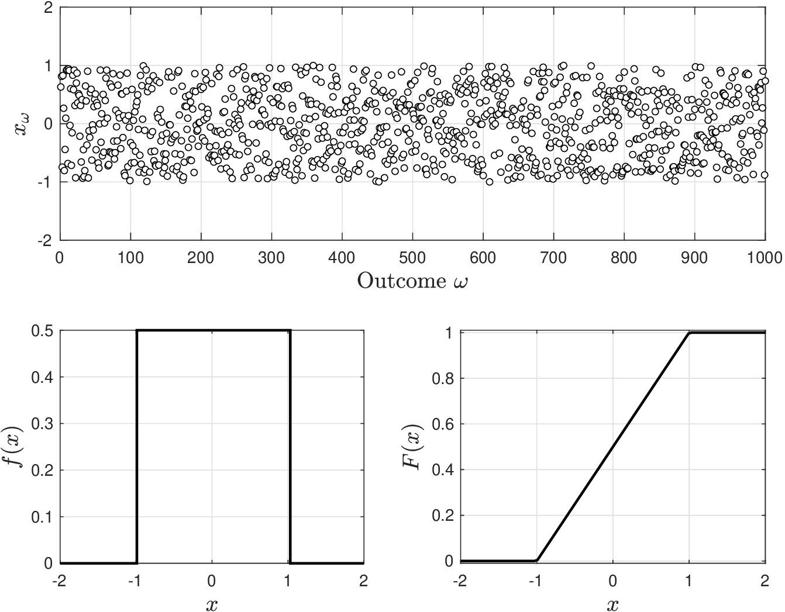
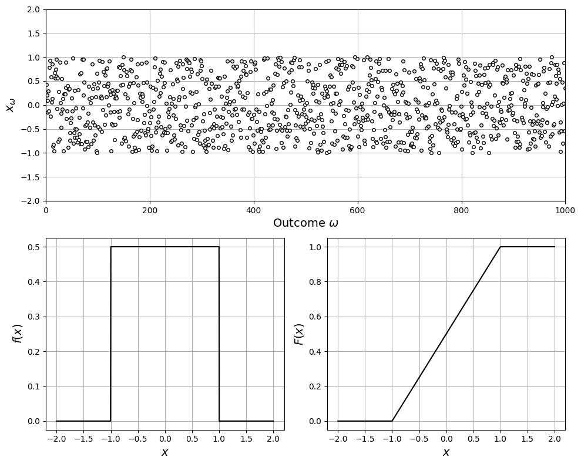

# Uniform (Continuous)

* A continuous uniform RV was a pdf of the form:

  $$
  f(x)=\frac{1}{b-a}, \; x\in \mathcal{D}
  $$

   where domain $$\mathcal{D}=[a,b]$$ is continuous.

* RV is denoted as $$X\sim \mathcal{U}_c(a,b)$$.
* Cdf is:

  $$
  F(x)=\frac{x-a}{b-a}, \; x\in \mathcal{D}
  $$

* Recall that pdf is derivative of cdf (it is the slope of the cdf); consequently, cdf has constant slope $$f(x)=1/(b-a)$$.
* Below we show an example of a pdf/cdf of a uniform RV along with realizations.

<figure></figure>

<details>

<summary>Python: reproduce this figure (ch2_compare_uniformc.ipynb)</summary>

Pdf and cdf of a continuous uniform RV $$X\sim\mathcal{U}_c(a,b)$$ with $$a=-1,b=1$$
(Victor Z and David Cole, UW-Madison, 2024).
Python names: `a`, `b`, pdf `f`, cdf `F`, realizations `x_omega`.
In `scipy.stats.uniform`, `loc` $$=a$$ and `scale` $$=b-a$$.

```python
import numpy as np
import matplotlib.pyplot as plt
from scipy.stats import uniform

a, b = -1, 1
x = np.linspace(-2, 2, 1000)
f = uniform.pdf(x, loc=a, scale=b - a)    # 1/(b-a) on [a, b]
F = uniform.cdf(x, loc=a, scale=b - a)    # (x-a)/(b-a) on [a, b]

np.random.seed(0)
S = 1000
x_omega = np.random.uniform(a, b, S)

plt.figure(figsize=(10, 8))
plt.subplot(2, 2, (1, 2))
plt.plot(x_omega, 'ko', markerfacecolor='w', markersize=4)
plt.xlabel(r'Outcome $\omega$', fontsize=14)
plt.ylabel(r'$x_\omega$', fontsize=14)
plt.grid(True)
plt.axis([0, S, -2, 2])
plt.subplot(2, 2, 3)
plt.plot(x, f, color='black', linewidth=1.5)
plt.grid(True)
plt.xlabel('$x$', fontsize=14)
plt.ylabel('$f(x)$', fontsize=14)
plt.subplot(2, 2, 4)
plt.plot(x, F, color='black', linewidth=1.5)
plt.grid(True)
plt.xlabel('$x$', fontsize=14)
plt.ylabel('$F(x)$', fontsize=14)
plt.tight_layout()
plt.show()
```

<figure></figure>

Open in Colab: [`ch2_compare_uniformc.ipynb`](https://colab.research.google.com/github/vzavala/StatsBook-GitBook/blob/main/notebooks/ch2_compare_uniformc.ipynb)

</details>

* Mean of the RV is:

  $$
  \begin{aligned}
  \mathbb{E}[X]&=\int_{a}^b\frac{1}{b-a}xdx\\
  &=\frac{1}{2}\frac{1}{b-a}(b^2-a^2)\\
  &=\frac{1}{2}(a+b)
  \end{aligned}
  $$

* From cdf we note that $$\alpha$$-quantiles are values $$x$$ satisfying:

  $$
  \alpha=F(x)=\frac{x-a}{b-a}
  $$

   we thus have that $$\mathbb{Q}_X(\alpha)=a +\alpha\,(b-a)$$.

* Mode (point maximizing $$f(x)$$)  is not unique because pdf is flat function.
* Variance for this RV is:

  $$
  \mathbb{V}[X]=\frac{1}{b-a}\int_{a}^b\left(x-\frac{1}{2}(a+b)\right)^2dx=\frac{1}{12}(b-a)^2.
  $$

   When range $$[b,a]$$ is wide we have that  variance (uncertainty) is large.

## Example: Setting up an Alarm

Consider Gibbs reactor and consider situation in which there is no pressure data recorded; all that you know is that,  historically, pressure has remained in the range $$63-234$$ bar.

* Is it adequate to model pressure as a uniform RV?
* Thermodynamics tells us that we will have unacceptably low conversions at pressures below 100 bar. What is  probability that reactor will exhibit low conversions?
* Reactor vessel is 30-yr old and you are unsure if it can tolerate high pressures for much longer. To be safe, you want to design an alarm system; you want to set a threshold that triggers alarm only 1% of the time. What is such threshold value?

* We only know that pressure is in continuous range $$[63,234]$$ bar, we thus have no reason to doubt that it is equally likely to find pressure anywhere in the range. Consequently, uniform RV is an adequate model with $$b=234$$ and $$a=63$$.
* Probability that reactor exhibits low conversion is:

  $$
  \mathbb{P}(X\leq 100)=\frac{100-63}{234-63}= 0.21.
  $$

* Want to find value $$x$$ such that $$\mathbb{P}(X>x)=0.01$$. This is equivalent to find $$x$$ such that $$\mathbb{P}(X\leq x)=0.99$$ (find $$x$$ such that $$F(x)=0.99$$):

  $$
  0.99=\frac{x-63}{234-63}
  $$

   Solving for $$x$$ we get that a threshold of 232.3 bar activates alarm 1% of the time.

* Note that threshold value is quantile:

  $$
  \mathbb{Q}_X(0.99)=63 + 0.99\cdot (234-63)=232.3.
  $$

#### Python implementation


Notebook [`ch2_example_alarm.ipynb`](https://colab.research.google.com/github/vzavala/StatsBook-GitBook/blob/main/notebooks/ch2_example_alarm.ipynb) — open it in Colab and run the cells alongside this section.


Setting up a pressure alarm with a uniform model $$X\sim\mathcal{U}_c(a,b)$$, $$a=63$$, $$b=234$$ bar
(written for the book to accompany the slide example).
Python names: `a`, `b`, cdf `F(x)`, quantile `Q(alpha)`.

```python
from scipy.stats import uniform

a, b = 63, 234   # bar
X = uniform(loc=a, scale=b - a)

def F(x):
    """Cdf F(x) = (x - a)/(b - a)."""
    return X.cdf(x)

def Q(alpha):
    """Quantile Q_X(alpha) = a + alpha (b - a)."""
    return X.ppf(alpha)

print(f"P(X <= 100) = F(100) = {F(100):.2f}")
print(f"Alarm threshold Q_X(0.99) = {Q(0.99):.1f} bar  (check: a + 0.99(b-a) = {a + 0.99*(b-a):.1f})")
```

```
P(X <= 100) = F(100) = 0.22
Alarm threshold Q_X(0.99) = 232.3 bar  (check: a + 0.99(b-a) = 232.3)
```
