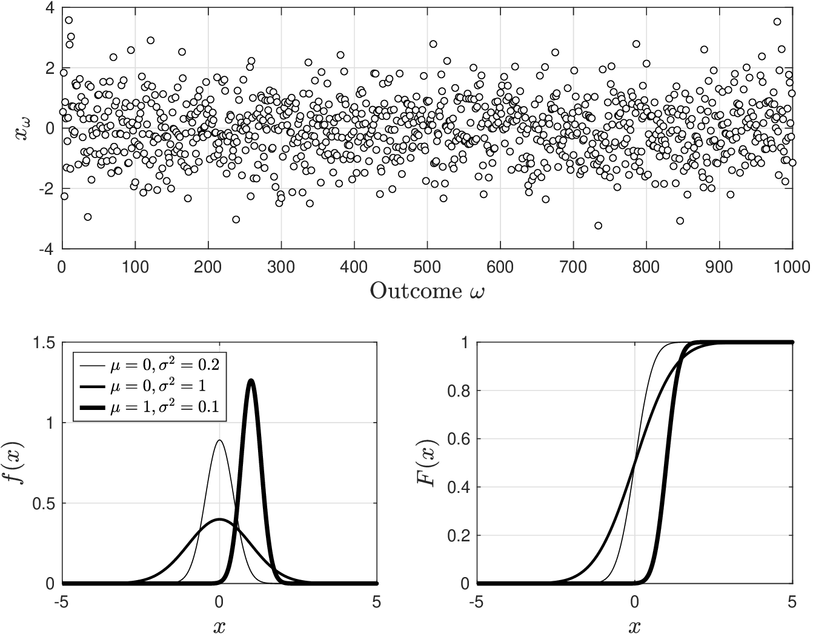
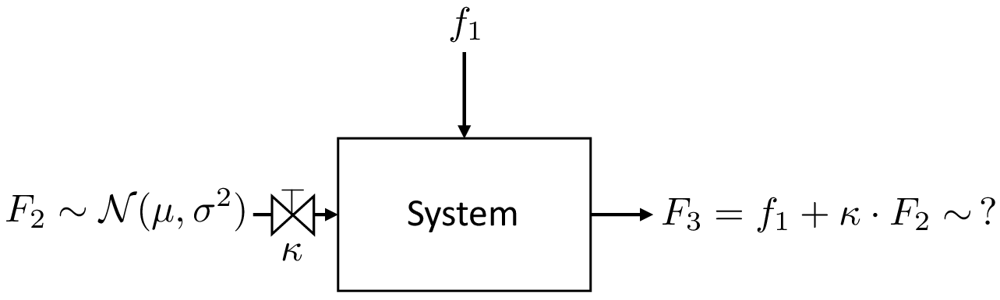
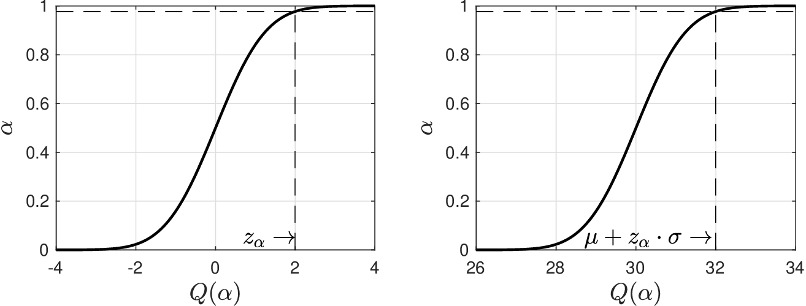
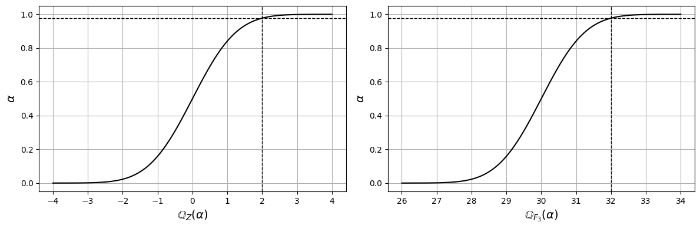
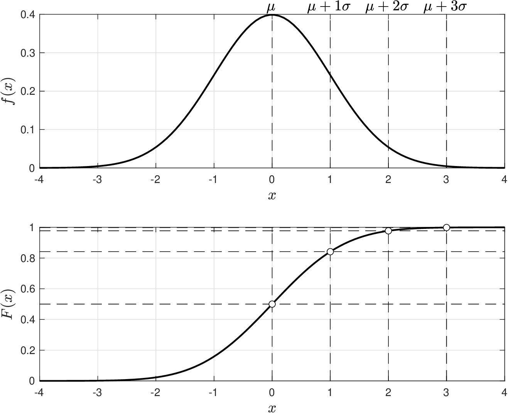
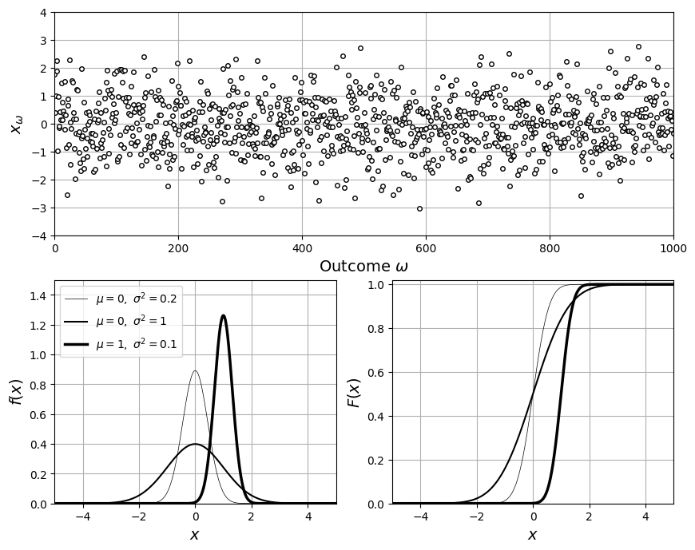
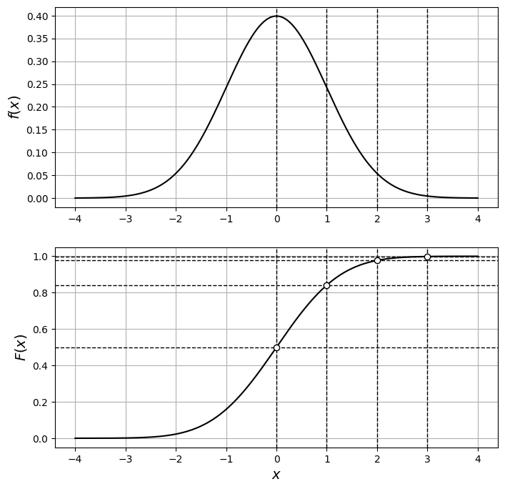
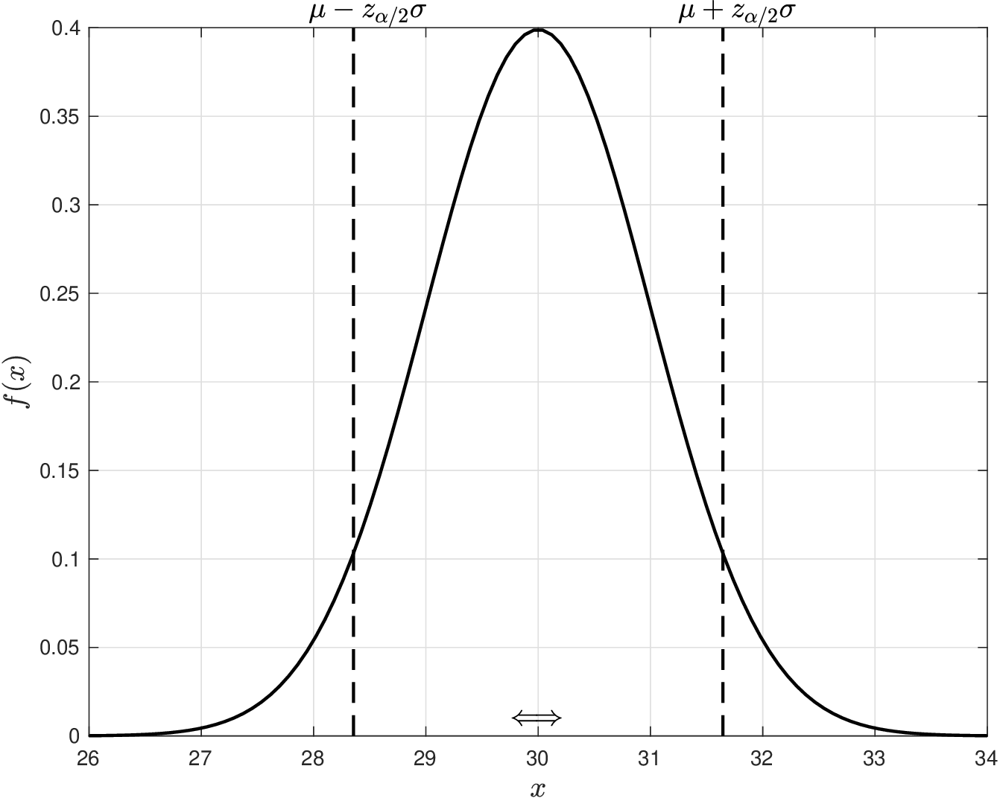
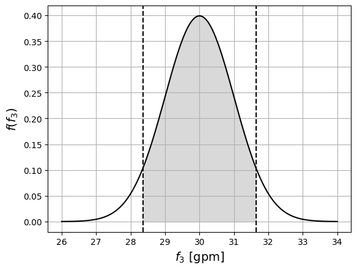

# Gaussian

* Many random phenomena follow the behavior of a normal RV (a.k.a. Gaussian RV).
* A Gaussian RV is continuous and has an associated pdf:

  $$
  f(x)=\frac{1}{\sqrt{2\pi\sigma^2}}e^{\frac{-(x-\mu)^2}{2\sigma^2}}, \quad  x\in \mathcal{D}.
  $$

   with domain $$\mathcal{D}=(-\infty,\infty)$$.

* Parameters $$\mu\in \mathbb{R},\sigma\in \mathbb{R}_+$$ are specific to application of interest.
* We express the fact that $$X$$ is Gaussian as $$X\sim \mathcal{N}(\mu,\sigma^2)$$.

* Pdf tells us the behavior captured by a Gaussian RV:
   * Probability of an outcome $$x$$ decays exponentially fast as we move from $$\mu$$
   * Outcome of maximum probability (most likely outcome) is $$\mu$$
   * Speed of the decay is dictated by $$\sigma$$
   * Decay in probability is symmetric around $$\mu$$
* Gaussian model assumes that an outcome $$x$$ can take any value in domain $$(-\infty,\infty)$$.
* This introduces complications, as many phenomena involve variables that cannot take negative values (e.g., mass) or infinite values (e.g., temperatures).
* Gaussian RVs can model a wide range of phenomena (e.g., diffusion).
* Many phenomena have Gaussian RV as limiting case (we will show this later).

## Gaussian RV

* Here are the pdfs for $$\mathcal{N}(\mu,\sigma)$$ for different values of $$\mu$$ and $$\sigma$$.
* What do you observe?
* What happens when $$\sigma^2\to 0$$?

  <figure></figure>

## Example: Diffusion Phenomena

* Gaussian RV naturally emerges in “diffusion-like” phenomena
* What is density of particles at location $$x$$ in domain $$(-\infty,\infty)$$ and at a given time $$t\in [0,T]$$?
* One can show that such density, denoted as $$f(x,t)$$, solves the diffusion equation:

  $$
  \frac{\partial f(x,t)}{\partial t}=D\frac{\partial^2 f(x,t)}{\partial x^2}
  $$

   with boundary conditions:

  $$
  \begin{aligned}
  f(x,t)=0,\quad x\in \{-\infty,\infty\}\\
  \int_{-\infty}^{\infty}f(x,t)dx=1,\quad t\in [0,T]
  \end{aligned}
  $$

* Solution is:

  $$
  f(x,t)=\frac{1}{\sqrt{2 \pi \sigma^2}}e^{-\frac{x^2}{2\sigma(t)^2}},\quad  x\in (-\infty,\infty)
  $$

   with$$\sigma^2=2Dt$$.

* Particles position at any time is random and given by $$X(t)\sim\mathcal{N}(0,\sigma^2)$$
* How does uncertainty change with diffusivity $$D$$ and time $$t$$?

## Gaussian

Gaussian RV $$X\sim \mathcal{N}(\mu,\sigma^2)$$ has many useful properties. For instance:


* It expected value and variance are $$\mathbb{E}_X=\mu$$ and $$\mathbb{V}_X=\sigma^2$$.
* Any linear transformation $$Y=a+bX$$ yields a Gaussian $$Y\sim \mathcal{N}(a+b\mu,b^2\sigma^2)$$.
* This implies that $$\mathbb{E}_Y=a+b\mathbb{E}_X$$ and $$\mathbb{V}_Y=b^2\mathbb{V}_X$$.
* Cdf of $$Y=a+bX$$ satisfies $$F_Y(y)=F_X(x)$$ for all $$y=a+bx$$.


Think about implications from an estimation and uncertainty propagation perspective:


* We can estimate  $$\mu$$ and $$\sigma$$ from data as $$\mu =\hat{\mathbb{E}}_X$$ and $$\sigma^2= \hat{\mathbb{V}}_X$$. This is sufficient to estimate Gaussian model.
* Any linear propagation $$Y=\varphi(X)=a+bX$$ will generate a Gaussian output. Moreover, system will shrink variability of $$X$$ if $$b<1$$ and will magnify it if $$b>1$$.


## Example: Gaussian Mixing Problem

* We have input flow  $$f_1=10$$ (gpm) that can be measured with high accuracy so it is OK to assume this to be deterministic.
* We have another input flow $$F_2$$ (gpm) that cannot be measured with high accuracy and is thus modeled as an RV $$\mathcal{N}(20,1)$$.
* Uncertain flow $$F_2$$ can be controlled using a valve with coefficient $$\kappa \in [0,1]$$.

  <figure></figure>


* What type of RV is output flow $$F_3=f_1+\kappa\cdot F_2$$? What is its mean and std dev?
* How does uncertainty in $$F_3$$ change $$\kappa\to 0$$ and $$\kappa\to 1$$? Why?


* We have that $$F_3=10+\kappa F_2$$ and is thus $$F_3$$ a linear transformation of $$F_2$$
* We thus have that $$F_3\sim\mathcal{N}(10+\kappa\cdot 20,\kappa^2\cdot 1)$$

## Gaussian

Cdf of a Gaussian RV is given by:


$$
F_X(x)=\frac{1}{2}\left(1+\textrm{erf}\left(\frac{(x-\mu)/\sigma}{\sqrt{2}}\right)\right)\;
$$

where $$\textrm{erf}:\mathbb{R}\to \mathbb{R}$$ is the error function:

$$
\textrm{erf}\left(\frac{(x-\mu)/\sigma}{\sqrt{2}}\right)=\frac{2}{\sqrt{\pi}}\int_0^{\frac{(x-\mu)/\sigma}{\sqrt{2}}}e^{-t^2}dt
$$


Computing cdf involves evaluating an integral that depends on $$\mu$$ and $$\sigma$$.

* Fortunately, one can exploit properties of Gaussian RVs to avoid this issue.
* $$Z=(X-\mu)/\sigma$$ is a linear transformation of $$X\sim \mathcal{N}(\mu,\sigma^2)$$ and thus $$Z\sim \mathcal{N}(0,1)$$.
* Scaling a Gaussian $$X$$ using its mean $$\mu$$ and SD $$\sigma$$ is known as *standardization*.
* Now note that pdf and cdf of $$Z$$ are simply:

  $$
  \begin{aligned}
  f_Z(z)&=\frac{1}{\sqrt{2\pi}}e^{-\frac{1}{2}z^2}\\
  F_Z\left(z\right)&=\frac{1}{2}\left(1+\textrm{erf}\left(\frac{z}{\sqrt{2}}\right)\right),\; \quad \textrm{erf}\left(\frac{z}{\sqrt{2}}\right)=\frac{2}{\sqrt{\pi}}\int_0^{\frac{z}{\sqrt{2}}}e^{-t^2}dt
  \end{aligned}
  $$

   which do not depend on parameters.

* $$Z$$ is known as the standard normal RV $$\mathcal{N}(0,1)$$.

* From linear transformation we have that $$F_X(x)=F_Z(z)$$ holds for any $$z=(x-\mu)/\sigma$$ and we can thus evaluate $$F_X(x)$$ at $$x$$ by transforming $$x$$ into $$z$$ and then evaluate $$F_Z(z)$$.
* Since $$F_Z(z)$$ does not depend on any parameters, it can be precomputed (values of $$F_Z(z)$$ are available in software packages).
* We can compute $$\mathbb{Q}_X(\alpha)$$ by using pre-computed quantiles of $$Z$$, $$z_\alpha:=\mathbb{Q}_Z(\alpha)$$.
* Relationship between quantiles of $$X$$ and $$Z$$ is obtained directly from the linear transformation $$x=\mu+\sigma z$$:

  $$
  \mathbb{Q}_X(\alpha)=\mu+\sigma \cdot \mathbb{Q}_Z(\alpha).
  $$

* Values $$z_\alpha$$ are known as the critical values of the standard normal.
* As with cdf, critical values are available in software packages.

## Example: Mixing Problem

* Recall $$F_3\sim\mathcal{N}(10+\kappa\cdot 20,\kappa^2\cdot 1)$$
* Consider $$\kappa=1$$ and thus flow $$F_3\sim\mathcal{N}(30,1)$$

  <figure><figcaption><p>Quantile functions for 𝒩(0, 1) (left) and 𝒩(30, 1) (right).</p></figcaption></figure>

* Quantile of $$\mathcal{N}(0,1)$$ at $$\alpha=0.977$$ is  $$z_\alpha=2$$
* Quantile of  $$\mathcal{N}(\mu,\sigma)$$ should be $$\mu+2\cdot \sigma=32$$.  Confirm this is true from plot

#### Python implementation: Quantiles of the output flow


Notebook [`ch2_mixing_gaussians.ipynb`](https://colab.research.google.com/github/vzavala/StatsBook-GitBook/blob/main/notebooks/ch2_mixing_gaussians.ipynb) — open it in Colab and run the cells alongside this section.


Gaussian mixing problem (Victor Z and J E Umaña, UW-Madison, 2024).

| Slides | Python | Meaning |
|---|---|---|
| $$f_1$$ | `f1` | deterministic input flow (10 gpm) |
| $$F_2\sim\mathcal{N}(20,1)$$ | `mu_2`, `sigma_2` | uncertain input flow |
| $$\kappa$$ | `kappa` | valve coefficient |
| $$F_3=f_1+\kappa F_2$$ | `mu_3`, `sigma_3` | output flow, $$\mathcal{N}(10+20\kappa,\kappa^2)$$ |
| $$z_\alpha=\mathbb{Q}_Z(\alpha)$$ | `z_alpha` | standard-normal quantile |

```python
import numpy as np
import matplotlib.pyplot as plt
from scipy.stats import norm

f1 = 10
mu_2, sigma_2 = 20, 1
kappa = 1

# linear transformation: F3 = f1 + kappa F2 ~ N(f1 + kappa mu_2, kappa^2 sigma_2^2)
mu_3 = f1 + kappa * mu_2
sigma_3 = abs(kappa) * sigma_2
print(f"F3 ~ N({mu_3}, {sigma_3**2})")
```

```
F3 ~ N(30, 1)
```

$$\mathbb{Q}_X(\alpha)=\mu+\sigma\,\mathbb{Q}_Z(\alpha)$$: with $$\alpha=0.977$$, $$z_\alpha=2$$ and the
quantile of $$F_3$$ is $$\mu+2\sigma=32$$.

```python
alpha = 0.977
z_alpha = norm.ppf(alpha)                  # Q_Z(alpha)
Q_F3 = mu_3 + sigma_3 * z_alpha            # Q_X(alpha) = mu + sigma z_alpha
print(f"z_alpha = {z_alpha:.3f},  Q_F3(alpha) = {Q_F3:.3f}  (direct: {norm.ppf(alpha, mu_3, sigma_3):.3f})")

fig, axs = plt.subplots(1, 2, figsize=(12, 4))
z = np.linspace(-4, 4, 400)
axs[0].plot(z, norm.cdf(z), 'k', linewidth=1.5)
axs[0].axhline(alpha, color='k', ls='--', lw=1)
axs[0].axvline(z_alpha, color='k', ls='--', lw=1)
axs[0].set_xlabel(r'$\mathbb{Q}_Z(\alpha)$', fontsize=14)
axs[0].set_ylabel(r'$\alpha$', fontsize=14)
x = np.linspace(mu_3 - 4*sigma_3, mu_3 + 4*sigma_3, 400)
axs[1].plot(x, norm.cdf(x, mu_3, sigma_3), 'k', linewidth=1.5)
axs[1].axhline(alpha, color='k', ls='--', lw=1)
axs[1].axvline(Q_F3, color='k', ls='--', lw=1)
axs[1].set_xlabel(r'$\mathbb{Q}_{F_3}(\alpha)$', fontsize=14)
axs[1].set_ylabel(r'$\alpha$', fontsize=14)
for ax in axs:
    ax.grid(True)
plt.tight_layout()
plt.show()
```

```
z_alpha = 1.995,  Q_F3(alpha) = 31.995  (direct: 31.995)
```

<figure></figure>

## Gaussian

* Imagine that you precomputed $$F_Z(k)=\mathbb{P}(Z\leq k)$$ for $$k=0,1,2,3,...$$. We have:

  $$
  \begin{aligned}
  \mathbb{P}(Z\leq 0)=50.0\%&\Longleftrightarrow\mathbb{P}(X\leq \mu)=50.0\%\\
  \mathbb{P}(Z\leq 1)=84.1\%&\Longleftrightarrow\mathbb{P}(X\leq \mu+\sigma)=84.1\%\\
  \mathbb{P}(Z\leq 2)=97.7\%&\Longleftrightarrow\mathbb{P}(X\leq \mu+2\sigma)=97.7\%\\
  \mathbb{P}(Z\leq 3)=99.9\%&\Longleftrightarrow\mathbb{P}(X\leq \mu+3\sigma)=99.9\%
  \end{aligned}
  $$

  <figure></figure>

* Standarization allows us to easily determine probability that $$X$$ is in specific ranges.

<details>

<summary>Python: reproduce this figure (ch2_compare_gaussians.ipynb)</summary>

Gaussian RVs $$X\sim\mathcal{N}(\mu,\sigma^2)$$ for different $$\mu,\sigma$$
(Victor Z and J E Umaña, UW-Madison, 2024).
Python names: `mu`, `sigma`, realizations `x_omega`. Note that `scipy.stats.norm`
takes the standard deviation $$\sigma$$ (not $$\sigma^2$$) as `scale`.

```python
import numpy as np
import matplotlib.pyplot as plt
from scipy.stats import norm

mu = [0, 0, 1]
sigma = [np.sqrt(1/5), np.sqrt(1), np.sqrt(1/10)]
lw = [0.5, 1.5, 2.5]
x = np.linspace(-5, 5, 1000)

np.random.seed(0)
S = 1000
x_omega = np.random.normal(0, 1, S)

plt.figure(figsize=(10, 8))
plt.subplot(2, 2, (1, 2))
plt.plot(x_omega, 'ko', markerfacecolor='w', markersize=4)
plt.xlabel(r'Outcome $\omega$', fontsize=14)
plt.ylabel(r'$x_\omega$', fontsize=14)
plt.axis([0, S, -4, 4])
plt.grid(True)
plt.subplot(2, 2, 3)
for k in range(len(mu)):
    plt.plot(x, norm.pdf(x, mu[k], sigma[k]), 'k-', linewidth=lw[k],
             label=rf'$\mu={mu[k]},\ \sigma^2={sigma[k]**2:.3g}$')
plt.grid(True)
plt.legend(loc='upper left', fontsize=10)
plt.xlabel('$x$', fontsize=14)
plt.ylabel('$f(x)$', fontsize=14)
plt.axis([-5, 5, 0, 1.5])
plt.subplot(2, 2, 4)
for k in range(len(mu)):
    plt.plot(x, norm.cdf(x, mu[k], sigma[k]), 'k-', linewidth=lw[k])
plt.grid(True)
plt.xlabel('$x$', fontsize=14)
plt.ylabel('$F(x)$', fontsize=14)
plt.axis([-5, 5, 0, 1.02])
plt.show()
```

<figure></figure>

Levels $$\mu+k\sigma$$, $$k=0,1,2,3$$, and their probabilities
$$\mathbb{P}(X\leq\mu+k\sigma)=F_Z(k)$$ for the standard normal $$Z$$.

```python
mu, sigma = 0, 1
x = np.linspace(mu - 4*sigma, mu + 4*sigma, 400)
fig, axs = plt.subplots(2, 1, figsize=(8, 8))
axs[0].plot(x, norm.pdf(x, mu, sigma), 'k', linewidth=1.5)
axs[1].plot(x, norm.cdf(x, mu, sigma), 'k', linewidth=1.5)
for k in range(4):
    q = mu + k * sigma
    axs[0].axvline(q, color='k', ls='--', lw=1)
    axs[1].axvline(q, color='k', ls='--', lw=1)
    axs[1].axhline(norm.cdf(q), color='k', ls='--', lw=1)
    axs[1].scatter(q, norm.cdf(q), facecolors='w', edgecolors='k', zorder=3)
    print(f"P(Z <= {k}) = F_Z({k}) = {norm.cdf(k):.3f}")
axs[0].set_ylabel('$f(x)$', fontsize=14)
axs[1].set_ylabel('$F(x)$', fontsize=14)
axs[1].set_xlabel('$x$', fontsize=14)
for ax in axs:
    ax.grid(True)
plt.show()
```

```
P(Z <= 0) = F_Z(0) = 0.500
P(Z <= 1) = F_Z(1) = 0.841
P(Z <= 2) = F_Z(2) = 0.977
P(Z <= 3) = F_Z(3) = 0.999
```

<figure></figure>

Open in Colab: [`ch2_compare_gaussians.ipynb`](https://colab.research.google.com/github/vzavala/StatsBook-GitBook/blob/main/notebooks/ch2_compare_gaussians.ipynb)

</details>

* Standarization also allows us to determine *confidence regions* for $$X$$.
* Assume probability level $$\alpha \in [0,1]$$; we can show that critical value $$z$$ satisfying

  $$
  \mathbb{P}(-z\leq Z\leq z)=1-\alpha
  $$

   is $$z=\mathbb{Q}_Z(1-\frac{\alpha}{2})$$; for simplicity, we denote this quantile as $$z_{\frac{\alpha}{2}}$$.

* In other words, we have that:

  $$
  \mathbb{P}(-z_{\frac{\alpha}{2}}\leq Z\leq z_{\frac{\alpha}{2}})=1-\alpha
  $$

* Using linear transformation property we obtain:

  $$
  \mathbb{P}(\mu-z_{\frac{\alpha}{2}}\cdot \sigma\leq X\leq \mu+z_{\frac{\alpha}{2}}\cdot\sigma)=1-\alpha.
  $$

* i.e.; probability of finding $$X\sim\mathcal{N}(\mu,\sigma^2)$$ in region $$[\mu\pm z_{\frac{\alpha}{2}}\cdot \sigma]$$ is $$1-\alpha$$.
* This gives idea of how confident we are of finding $$X$$ in a region around mean.
* Confidence region is important in many topics (e.g., hypothesis testing).

## Example: Mixing Problem

* In what region (around mean) do we expect $$F_3\sim\mathcal{N}(30,1)$$ to be with 90% prob?

  <figure></figure>

* We have $$1-\alpha=0.9$$ and thus $$\alpha=0.1$$ and $$\mathbb{Q}_Z(1-\frac{\alpha}{2})=1.644$$.
* We thus have $$F_3\in [30-1.64\cdot 1,30+1.64\cdot 1]=[28.36,31.64]$$ with 90% prob.

#### Python implementation: 90% confidence region

$$\mathbb{P}(\mu-z_{\alpha/2}\sigma\leq X\leq \mu+z_{\alpha/2}\sigma)=1-\alpha$$ with
$$z_{\alpha/2}=\mathbb{Q}_Z(1-\alpha/2)$$; for 90% probability, $$\alpha=0.1$$.

```python
alpha = 0.10
z_alpha_2 = norm.ppf(1 - alpha/2)
lower, upper = mu_3 - z_alpha_2 * sigma_3, mu_3 + z_alpha_2 * sigma_3
print(f"z_alpha/2 = {z_alpha_2:.3f};  F3 in [{lower:.2f}, {upper:.2f}] with {100*(1-alpha):.0f}% probability")

plt.plot(x, norm.pdf(x, mu_3, sigma_3), 'black', linewidth=1.5)
plt.axvline(lower, color='k', ls='--')
plt.axvline(upper, color='k', ls='--')
plt.fill_between(x, norm.pdf(x, mu_3, sigma_3), where=(x >= lower) & (x <= upper), color='0.85')
plt.xlabel('$f_3$ [gpm]', fontsize=14)
plt.ylabel('$f(f_3)$', fontsize=14)
plt.grid(True)
plt.show()
```

```
z_alpha/2 = 1.645;  F3 in [28.36, 31.64] with 90% probability
```

<figure></figure>
