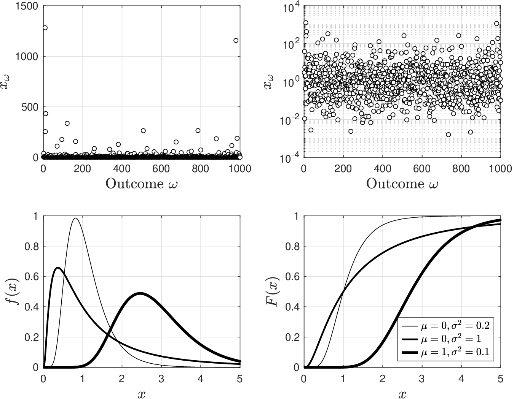
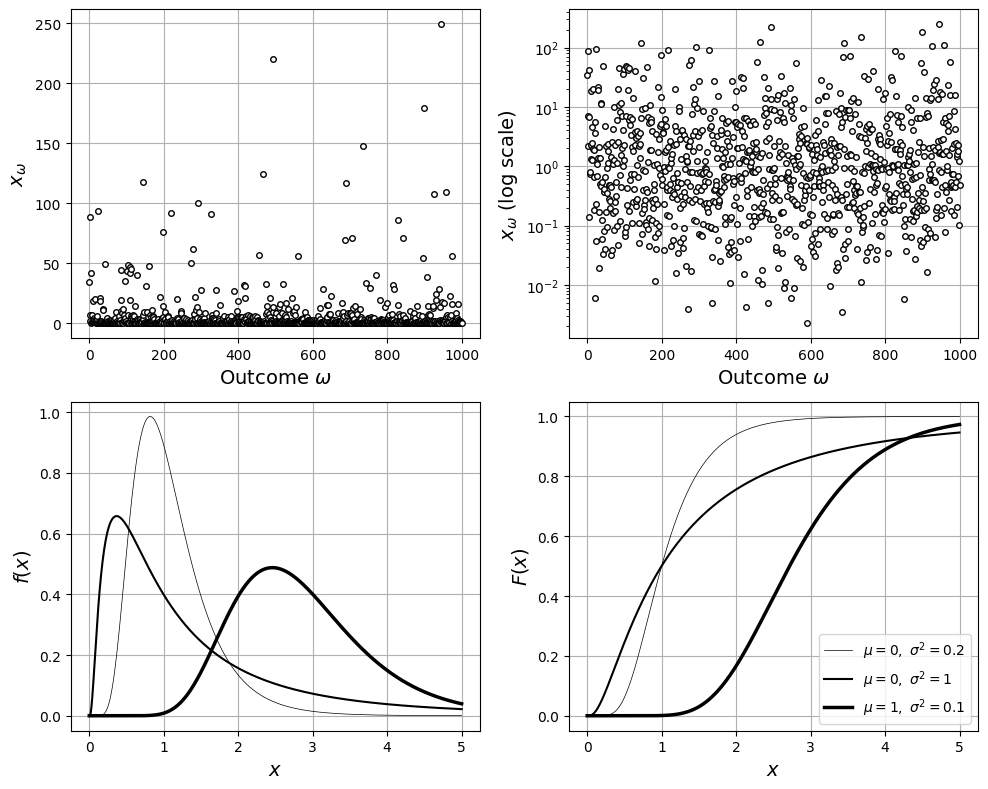
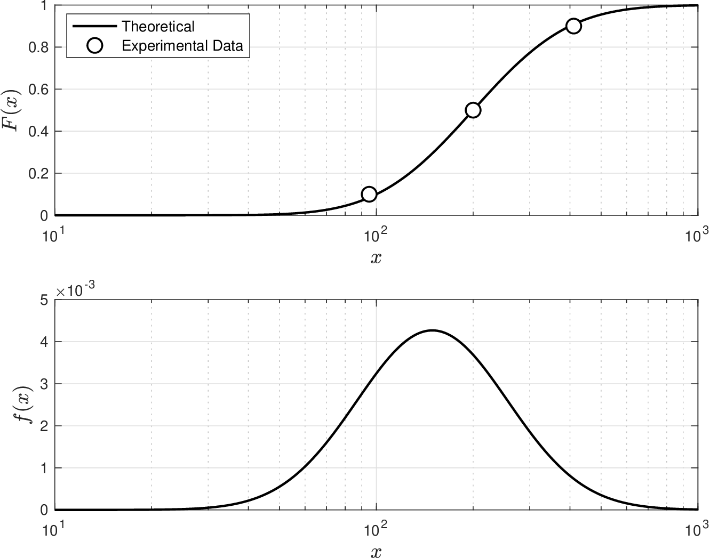
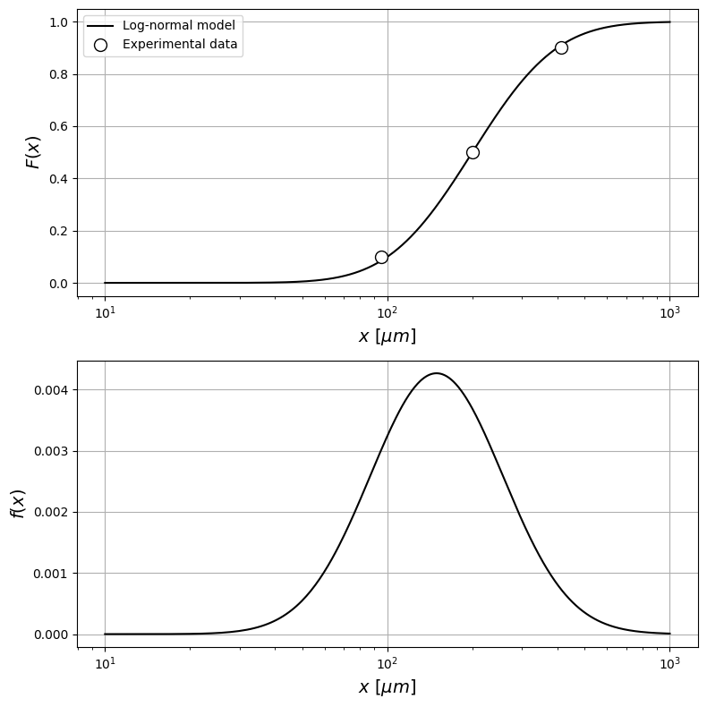

# Log-Normal

* Log-normal RV helps describe phenomena that span *multiple scales*.
* RV is related to normal RV (via a logarithmic transformation) and has pdf:

  $$
  f(x)=\frac{1}{x\sqrt{2\pi\sigma^2}}\exp\left[{-\frac{(\log(x)-\mu)^2}{2\sigma^2}}\right],\; x\in \mathcal{D}.
  $$

   with hyperprameters $$\mu\in \mathbb{R}$$ and $$\sigma\in \mathbb{R}_+$$.

* Domainis $$\mathcal{D}=(0,\infty)$$ (cannot take negative values)
* Median and quantiles are:

  $$
  \begin{aligned}
  \mathbb{M}_X&=\exp(\mu)\\
  \mathbb{Q}_X(\alpha)&=\exp\left(\mu+ \sigma\cdot \sqrt{2}\cdot \textrm{erf}^{-1}(2\cdot \alpha-1)\right).
  \end{aligned}
  $$

<figure></figure>

<details>

<summary>Python: reproduce this figure (ch2_compare_lognormals.ipynb)</summary>

Log-normal RVs for several $$(\mu,\sigma)$$ (Victor Z and David Cole, UW-Madison, 2024).
In `scipy.stats.lognorm`, the shape `s` is $$\sigma$$ and `scale` is $$e^{\mu}$$ (the median $$\mathbb{M}_X$$).

```python
import numpy as np
import matplotlib.pyplot as plt
from scipy.stats import lognorm

mu = [0, 0, 1]
sigma = [np.sqrt(1/5), np.sqrt(1), np.sqrt(1/10)]
lw = [0.5, 1.5, 2.5]
x = np.linspace(0.001, 5, 1000)

np.random.seed(0)
S = 1000
x_omega = np.random.lognormal(mean=0, sigma=2, size=S)

plt.figure(figsize=(10, 8))
plt.subplot(2, 2, 1)
plt.plot(x_omega, 'ko', markerfacecolor='w', markersize=4)
plt.xlabel(r'Outcome $\omega$', fontsize=14)
plt.ylabel(r'$x_\omega$', fontsize=14)
plt.grid(True)
plt.subplot(2, 2, 2)
plt.semilogy(x_omega, 'ko', markerfacecolor='w', markersize=4)
plt.xlabel(r'Outcome $\omega$', fontsize=14)
plt.ylabel(r'$x_\omega$ (log scale)', fontsize=14)
plt.grid(True)
for sub, fun, label in ((3, lognorm.pdf, '$f(x)$'), (4, lognorm.cdf, '$F(x)$')):
    plt.subplot(2, 2, sub)
    for k in range(len(mu)):
        plt.plot(x, fun(x, sigma[k], scale=np.exp(mu[k])), 'k-', linewidth=lw[k],
                 label=rf'$\mu={mu[k]},\ \sigma^2={sigma[k]**2:.2g}$')
    plt.grid(True)
    plt.xlabel('$x$', fontsize=14)
    plt.ylabel(label, fontsize=14)
plt.legend(loc='lower right', fontsize=10)
plt.tight_layout()
plt.show()
```

<figure></figure>

Open in Colab: [`ch2_compare_lognormals.ipynb`](https://colab.research.google.com/github/vzavala/StatsBook-GitBook/blob/main/notebooks/ch2_compare_lognormals.ipynb)

</details>

## Example: Particle Size Distribution in Pharma Products

* In pharma industry, particle characterization of powder materials is crucial in drug product development and quality control of solid oral dosage forms.
* Particle size
   distribution (PSD) affects product performance (e.g., dissolution and bioavailability).

* Laser diffraction was used to characterize PSD for 1000 kg of product

  <figure></figure>

* Address the following questions:
   * Does PSD follow a lognormal RV?
   * If so, what are the parameters of RV? What is PSD?
   * Product is considered to be acceptable if particle sizes are in $$[250,400]$$ $$\mu m$$.
   * How many kg of the batch are in the acceptable range?

* From data at size 200 $$\mu m$$,  we have that probability of finding a particle with size below this value is 50%. This is empirical median (obtained from experimental data).
* If PSD is lognormal, median should be $$\mathbb{M}_X=\exp(\mu)=200$$ and from here we estimate that $$\mu=\log\,200$$.
* From data we observe that probability of finding particle size below 400 $$\mu m$$ is 90%. Under our model hypothesis, we thus have that:

  $$
  \mathbb{Q}_X(\alpha)=\exp\left(\mu+ \sigma\cdot \sqrt{2}\cdot \textrm{erf}^{-1}(2\cdot \alpha-1)\right).
  $$

   Solving for $$\sigma$$ we have that

  $$
  \sigma =\frac{\log \mathbb{Q}_X(\alpha)-\mu}{\sqrt{2}\cdot \textrm{erf}^{-1}(2\cdot \alpha-1)}
  $$

   Substituting terms we find estimate $$\sigma=0.54$$.

* Use parameters to obtain the cdf of the PSD and we see this matches  data well.
* Having parameters, we can also obtain pdf (note that the particle size spans two orders of magnitude)
* Probability that the particle size is in the acceptable range is:

  $$
  \mathbb{P}(250\leq X\leq 400)=F(400)-F(250)=0.24.
  $$

   i.e., 24% of our product is acceptable ($$1000\cdot 0.24=240$$ kg is acceptable).

#### Python implementation


Notebook [`ch2_example_lognormal.ipynb`](https://colab.research.google.com/github/vzavala/StatsBook-GitBook/blob/main/notebooks/ch2_example_lognormal.ipynb) — open it in Colab and run the cells alongside this section.


Particle size distribution as a log-normal RV (Victor Z and David Cole, UW-Madison, 2024).

| Slides | Python | Meaning |
|---|---|---|
| $$\mathbb{M}_X$$ | `M_X` | median particle size (200 $$\mu m$$) |
| $$\mathbb{Q}_X(\alpha)$$, $$\alpha$$ | `Q_alpha`, `alpha` | 90% quantile (400 $$\mu m$$) |
| $$\mu$$, $$\sigma$$ | `mu`, `sigma` | log-normal parameters |
| $$F(x)$$, $$f(x)$$ | `F`, `f` | cdf and pdf |

```python
import numpy as np
import matplotlib.pyplot as plt
from scipy.stats import lognorm
from scipy.special import erfinv
```

From the data: $$\mathbb{M}_X=e^{\mu}=200$$, so $$\mu=\log 200$$; and $$\mathbb{Q}_X(0.9)=400$$, so

$$
\sigma=\frac{\log \mathbb{Q}_X(\alpha)-\mu}{\sqrt{2}\,\mathrm{erf}^{-1}(2\alpha-1)}.
$$

```python
M_X = 200
mu = np.log(M_X)
alpha, Q_alpha = 0.9, 400
sigma = (np.log(Q_alpha) - mu) / (np.sqrt(2) * erfinv(2*alpha - 1))
print(f"mu = log(200) = {mu:.3f},  sigma = {sigma:.2f}")

X = lognorm(s=sigma, scale=np.exp(mu))   # scipy: s = sigma, scale = exp(mu)
```

```
mu = log(200) = 5.298,  sigma = 0.54
```

```python
x = np.linspace(10, 1000, 1000)
F_data = [0.1, 0.5, 0.9]                 # experimental cdf values
x_data = [95, 200, 411]

fig, axs = plt.subplots(2, 1, figsize=(8, 8))
axs[0].semilogx(x, X.cdf(x), color='black', linewidth=1.5, label='Log-normal model')
axs[0].plot(x_data, F_data, 'o', markerfacecolor='white', markeredgecolor='black', markersize=10, label='Experimental data')
axs[0].set_ylabel('$F(x)$', fontsize=14)
axs[0].legend(loc='upper left')
axs[1].semilogx(x, X.pdf(x), color='black', linewidth=1.5)
axs[1].set_ylabel('$f(x)$', fontsize=14)
for ax in axs:
    ax.grid(True)
    ax.set_xlabel(r'$x$ [$\mu m$]', fontsize=14)
plt.tight_layout()
plt.show()
```

<figure></figure>

Acceptable fraction $$\mathbb{P}(250\leq X\leq 400)=F(400)-F(250)$$ of a 1000 kg batch.

```python
P_ok = X.cdf(400) - X.cdf(250)
print(f"P(250 <= X <= 400) = {P_ok:.2f}  ->  {1000*P_ok:.0f} kg acceptable")
```

```
P(250 <= X <= 400) = 0.24  ->  240 kg acceptable
```
