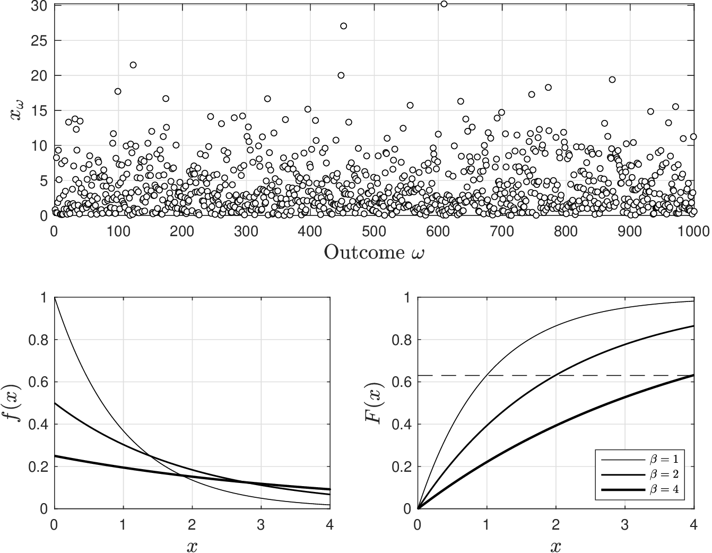
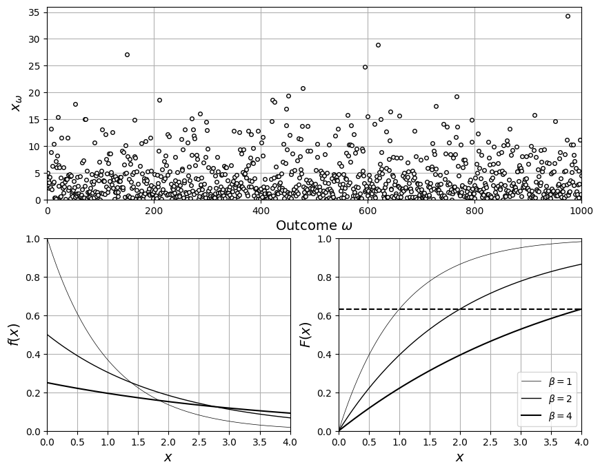
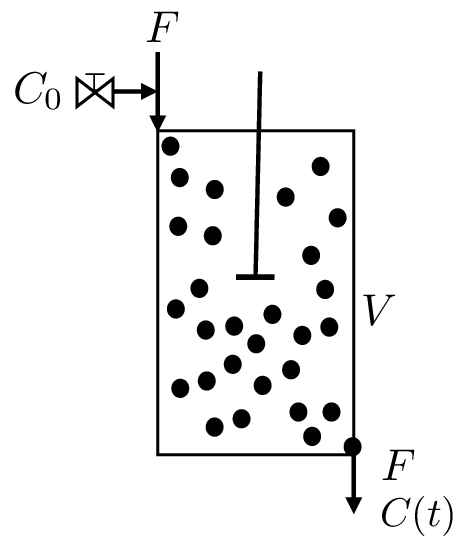
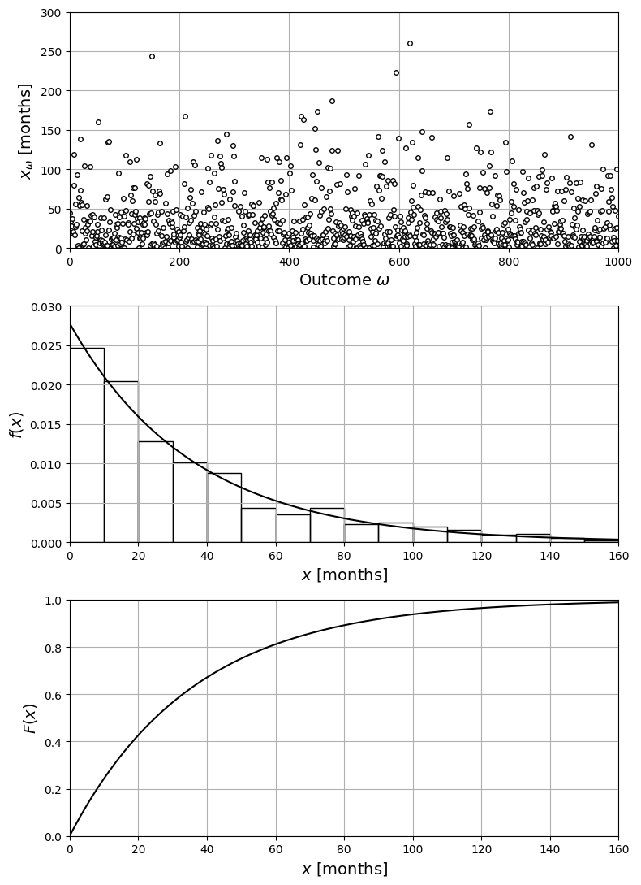

# Exponential

* Exponential RV has domain $$\mathcal{D}=(0,\infty)$$ and pdf:

  $$
  f(x)=\frac{1}{\beta}e^{-x/\beta},\quad x\in \mathcal{D}.
  $$

* Only parameter is $$\beta \in \mathbb{R}_+$$ (a.k.a. scale value).
* Reciprocal $$\eta=1/\beta$$ is known as intensity and thus pdf can also be written as $$f(x)=\eta e^{-\eta\cdot x}$$.
* Express fact that $$X$$ is exponential as $$X\sim \textrm{Exp}(\beta)$$.

## Exponential RV

* Pdf of exponential RV tells us that:
   * Probability of finding $$X$$ away from zero decays exponentially fast at rate $$\eta$$
   * There is *zero* probability of finding $$X$$ below zero (pdf is asymmetric).
* Cdf is $$F(x)=1-e^{-x/\beta}$$ and note $$1-F(x)=e^{-x/\beta}$$.
* Expected value and variance are $$\mathbb{E}_X=\beta$$ and $$\mathbb{V}_X=\beta^2$$.
* This RV is often used to model time-dependent phenomena (e.g., *failures*).
* For instance, $$X$$ can be used to model time that we have to wait until we observe first occurrence of an event (e.g., engine fails).
* In this context, we know average waiting time ($$\mathbb{E}_X=\beta$$) but actual time is unknown.
* Parameter $$\eta=1/\beta$$ can be interpreted as event rate (how frequently they occur).

## Exponential

* Pdfs and cdfs for $$\textrm{Exp}(\beta)$$ for different values of $$\beta$$.

  <figure></figure>


How to determine $$\beta$$ from cdf?


* Note that $$F(x)=1-e^{-1}=0.63$$ when $$x=\beta$$.  This is known as characteristic time.

<details>

<summary>Python: reproduce this figure (ch2_compare_exponentials.ipynb)</summary>

Exponential RVs $$X\sim\mathrm{Exp}(\beta)$$ for $$\beta=1,2,4$$ (Victor Z and J E Umaña, UW-Madison, 2024).
`scipy.stats.expon` uses `scale` $$=\beta$$ (the intensity is $$\eta=1/\beta$$).
The dashed line marks $$F(\beta)=1-e^{-1}=0.63$$.

```python
import numpy as np
import matplotlib.pyplot as plt
from scipy.stats import expon

beta = [1, 2, 4]
lw = [0.5, 1, 1.5]
x = np.linspace(0, 4, 1000)

np.random.seed(0)
S = 1000
x_omega = np.random.exponential(scale=4, size=S)

plt.figure(figsize=(10, 8))
plt.subplot(2, 2, (1, 2))
plt.plot(x_omega, 'ko', markerfacecolor='w', markersize=4)
plt.xlabel(r'Outcome $\omega$', fontsize=14)
plt.ylabel(r'$x_\omega$', fontsize=14)
plt.axis([0, S, 0, 36])
plt.grid(True)
plt.subplot(2, 2, 3)
for k in range(len(beta)):
    plt.plot(x, expon.pdf(x, scale=beta[k]), 'k', linewidth=lw[k])
plt.grid(True)
plt.xlabel('$x$', fontsize=14)
plt.ylabel('$f(x)$', fontsize=14)
plt.axis([0, 4, 0, 1])
plt.subplot(2, 2, 4)
for k in range(len(beta)):
    plt.plot(x, expon.cdf(x, scale=beta[k]), 'k', linewidth=lw[k], label=rf'$\beta={beta[k]}$')
plt.axhline(1 - np.exp(-1), color='k', ls='--')
plt.grid(True)
plt.legend(loc='lower right', fontsize=10)
plt.xlabel('$x$', fontsize=14)
plt.ylabel('$F(x)$', fontsize=14)
plt.axis([0, 4, 0, 1])
plt.show()
```

<figure></figure>

Open in Colab: [`ch2_compare_exponentials.ipynb`](https://colab.research.google.com/github/vzavala/StatsBook-GitBook/blob/main/notebooks/ch2_compare_exponentials.ipynb)

</details>

## Example: Residence Time in Mixing System

* Mixed system with volume $$V$$ and input/output flow $$F$$
* At time $$t=0$$ we inject tracer so that input concentration is $$C_0$$.
* Tracer concentration in system at time $$t$$ is $$C(t)$$


For how long will a tracer particle reside in the system?  What factors influence this time?


<figure></figure>

* Material balance reveals that:

  $$
  f_T(t)=\frac{C(t)}{C_0}= \frac{1}{\tau}e^{-t/\tau}\;\; \textrm{with}\;\; \tau=V/F
  $$

* Interpret $$T$$ as random time required for a particle to exit system (residence time)
* Pdf of $$T$$ is $$f_T(t)$$ is interpreted as fraction of injected particles exiting at time $$T=t$$
* Balance suggests that $$T\sim\textrm{Exp}(\tau)$$

* Mean residence time is $$\mathbb{E}[T]=\tau=V/F$$ and variance is $$\mathbb{V}[T]=(V/F)^2$$.
* What is effect of $$V$$ and $$F$$ on uncertainty?
* Fraction of particles that have exited up to time $$t$$ is $$\mathbb{P}(T\leq t)=F_T(t)$$.
* $$F_T(t)=\displaystyle\int_{0}^tf_T(t')dt'=(1-e^{-t/\tau})$$ and thus $$F(0)=0$$ and $$F(\infty)=1$$.
* Fraction of particles that remain in system at time $$t$$  is $$\mathbb{P}(T>t)=1-F_T(t)=e^{-t/\tau}$$
* Function $$\mathbb{P}(T>t)$$ is known as the “survival function".

#### Python implementation


Notebook [`ch2_example_exponential.ipynb`](https://colab.research.google.com/github/vzavala/StatsBook-GitBook/blob/main/notebooks/ch2_example_exponential.ipynb) — open it in Colab and run the cells alongside this section.


**Additional example: failure time of an adhesive** (Victor Z and J E Umaña, UW-Madison, 2024).
The time to failure is $$X\sim\mathrm{Exp}(\beta)$$ with average $$\mathbb{E}_X=\beta=36$$ months.
The probability that the material survives 12 months is the survival function
$$\mathbb{P}(X>12)=1-F(12)=e^{-12/\beta}$$.
Python names: `beta`, realizations `x_omega`, pdf/cdf from `scipy.stats.expon(scale=beta)`.

```python
import numpy as np
import matplotlib.pyplot as plt
from scipy.stats import expon

beta = 3 * 12            # months (scale; intensity eta = 1/beta)
X = expon(scale=beta)

np.random.seed(0)
S = 1000
x_omega = X.rvs(size=S)

x = np.linspace(0, 160, 400)
fig, axs = plt.subplots(3, 1, figsize=(8, 11))
axs[0].plot(x_omega, 'ko', markerfacecolor='w', markersize=4)
axs[0].set_xlabel(r'Outcome $\omega$', fontsize=14)
axs[0].set_ylabel(r'$x_\omega$ [months]', fontsize=14)
axs[0].axis([0, S, 0, 300])
axs[1].hist(x_omega, bins=np.arange(0, 161, 10), density=True, edgecolor='black', facecolor='none')
axs[1].plot(x, X.pdf(x), 'k', linewidth=1.5)
axs[1].set_xlabel('$x$ [months]', fontsize=14)
axs[1].set_ylabel('$f(x)$', fontsize=14)
axs[1].axis([0, 160, 0, 0.03])
axs[2].plot(x, X.cdf(x), 'k', linewidth=1.5)
axs[2].set_xlabel('$x$ [months]', fontsize=14)
axs[2].set_ylabel('$F(x)$', fontsize=14)
axs[2].axis([0, 160, 0, 1])
for ax in axs:
    ax.grid(True)
plt.tight_layout()
plt.show()

print(f"P(X > 12) = 1 - F(12) = {X.sf(12):.4f}  (e^(-12/beta) = {np.exp(-12/beta):.4f})")
```

<figure></figure>

```
P(X > 12) = 1 - F(12) = 0.7165  (e^(-12/beta) = 0.7165)
```
