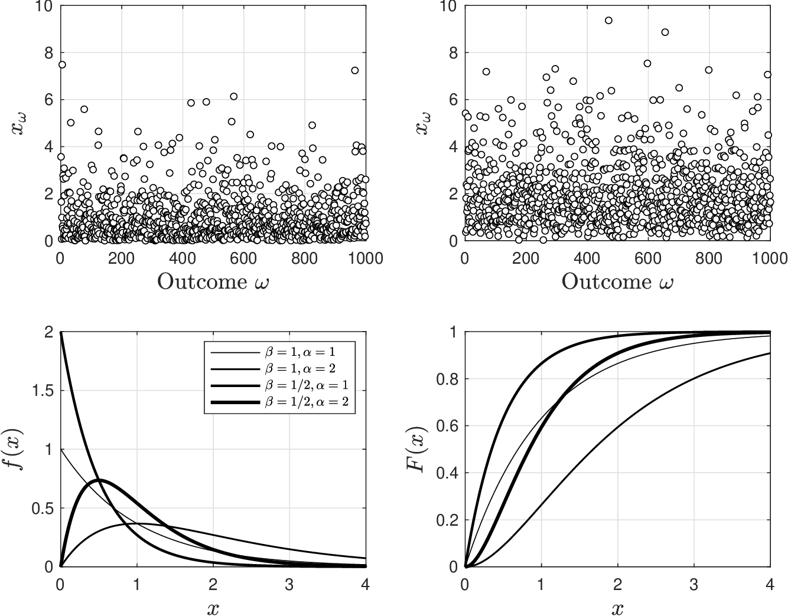
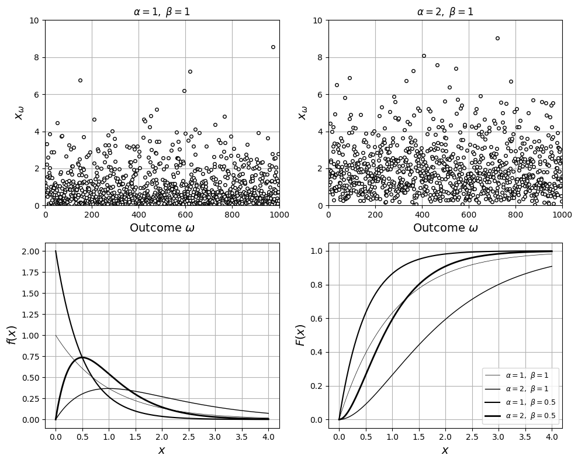

# Gamma

Gamma RV is a generalization of exponential RV that has domain $$\mathcal{D}=[0,\infty)$$ and pdf:

$$
f(x)=\frac{1}{\beta^\alpha \Gamma(\alpha)}e^{-x/\beta}x^{\alpha-1},\; x\in \mathcal{D}
$$

* Pdf has parameters $$\alpha,\beta\in \mathbb{R}_+$$
* $$\Gamma(\alpha)$$ is the gamma function; for integer $$\alpha\geq 1$$ we have $$\Gamma(\alpha)=(\alpha-1)!$$.
* We express fact that $$X$$ is a Gamma RV as $$X\sim \textrm{Gamma}(\alpha,\beta)$$
* For integer $$\alpha$$, the cdf of the Gamma RV takes the form:

  $$
  F(x)=1-\sum_{k=0}^{\alpha-1}\frac{1}{k!}\left(\frac{x}{\beta}\right)^ke^{-x/\beta}
  $$

* In context of time phenomena, RV generalizes exponential in that it models amount of time that we have to wait until we observe the $$\alpha$$-th occurrence of an event.
* Consequently, $$\alpha$$=1 means first event (as in exponential RV).
* This RV has applications not only in temporal but also in spatial phenomena.
* For instance, it can be used to model distance traveled until we find $$\alpha$$-th occurrence of certain type of atom in a chain or crack in a pipeline.

* Here are pdfs and cdfs for $$\textrm{Gamma}(\alpha,\beta)$$ for different values of $$\alpha,\beta$$.

  <figure></figure>

* Note same as exponential for $$\alpha=1$$.
* Note emergence of peaks due to competing effects for $$\alpha=2$$.

<details>

<summary>Python: reproduce this figure (ch2_compare_gammas.ipynb)</summary>

Gamma RVs $$X\sim\mathrm{Gamma}(\alpha,\beta)$$ (Victor Z and J E Umaña, UW-Madison, 2024).
`scipy.stats.gamma` uses shape `a` $$=\alpha$$ and `scale` $$=\beta$$.

```python
import numpy as np
import matplotlib.pyplot as plt
from scipy.stats import gamma

alpha = [1, 2, 1, 2]
beta = [1, 1, 0.5, 0.5]
lw = [0.5, 1, 1.5, 2]
x = np.linspace(0, 4, 1000)

np.random.seed(0)
S = 1000
plt.figure(figsize=(10, 8))
for sub, a_k in ((1, 1), (2, 2)):
    x_omega = gamma.rvs(a_k, scale=1, size=S)
    plt.subplot(2, 2, sub)
    plt.plot(x_omega, 'ko', markerfacecolor='w', markersize=4)
    plt.xlabel(r'Outcome $\omega$', fontsize=14)
    plt.ylabel(r'$x_\omega$', fontsize=14)
    plt.title(rf'$\alpha={a_k},\ \beta=1$')
    plt.grid(True)
    plt.axis([0, S, 0, 10])
for sub, fun, label in ((3, gamma.pdf, '$f(x)$'), (4, gamma.cdf, '$F(x)$')):
    plt.subplot(2, 2, sub)
    for k in range(len(alpha)):
        plt.plot(x, fun(x, a=alpha[k], scale=beta[k]), 'k', linewidth=lw[k],
                 label=rf'$\alpha={alpha[k]},\ \beta={beta[k]}$')
    plt.grid(True)
    plt.xlabel('$x$', fontsize=14)
    plt.ylabel(label, fontsize=14)
plt.legend(loc='lower right', fontsize=9)
plt.tight_layout()
plt.show()
```

<figure></figure>

Open in Colab: [`ch2_compare_gammas.ipynb`](https://colab.research.google.com/github/vzavala/StatsBook-GitBook/blob/main/notebooks/ch2_compare_gammas.ipynb)

</details>

## Example: Service Time

* You run warehouse logistics for your company and are responsible for making sure that queue of electric forklift trucks at charging stations remains under  control.
* Average charging rate at a station is 0.25 trucks/hr (average charge time is 4 hours).
* Charge time is random because there is variability in state-of-charge and age of batteries and average charge time is quite long because you need to protect them.

You are interested in addressing the following questions:


* If queue has 2 trucks, what is prob that next truck will wait more than 3 hours?
* What is prob if queue has 3 trucks?
* What is prob of waiting more than 4 hours if queue has 1 truck?
* You buy brand new batteries and this allows you to cut down average charging time to 2 hours. What is  prob of waiting more than 3 hours if queue has 1 truck?


* Use $$X$$ to denote waiting time of next truck and let Poisson event represent completion of truck charging.
* Prob that waiting time for next truck is more than 3 hours is $$\mathbb{P}(X>3)$$.
* This is the prob that the charging of the 2 trucks in the queue *cannot* be completed in the next 3 hours.
* $$X$$ is thus time to wait until we observe 2 Poisson events (two charge completions)

* Average waiting time is  $$\beta=1/0.25=4$$ hr. We use:

  $$
  P(X>x)=1-F(x)=\sum_{k=0}^{\alpha-1}\frac{1}{k!}\left(\frac{x}{\beta}\right)^ke^{-x/\beta}
  $$

   with $$x=3$$ (hr) that $$\alpha=2$$ and $$\beta=4$$ (hr) and thus:

  $$
  \begin{aligned}
  P(X>3)&=\sum_{k=0}^{1}\frac{1}{k!}\left(\frac{3}{4}\right)^ke^{-3/4}\\
  &=\frac{1}{0!}\left(\frac{3}{4}\right)^0e^{-3/4}+\frac{1}{1!}\left(\frac{3}{4}\right)^1e^{-3/4}=e^{-3/4}+(3/4)e^{-3/4}\\
  &=0.826.
  \end{aligned}
  $$

* If there are 3 trucks in queue we expect a higher probability. Indeed, set $$\alpha=3$$:

  $$
  \begin{aligned}
  P(X>3)&=\sum_{k=0}^{2}\frac{1}{k!}\left(\frac{3}{4}\right)^ke^{-3/4}=0.959.
  \end{aligned}
  $$

#### Python implementation


Notebook [`ch2_example_service_time.ipynb`](https://colab.research.google.com/github/vzavala/StatsBook-GitBook/blob/main/notebooks/ch2_example_service_time.ipynb) — open it in Colab and run the cells alongside this section.


Waiting time at a charging station as a Gamma RV (written for the book to accompany the
slide example). With $$\alpha$$ trucks in the queue and average charge time $$\beta$$,

$$
\mathbb{P}(X>x)=1-F(x)=\sum_{k=0}^{\alpha-1}\frac{1}{k!}\left(\frac{x}{\beta}\right)^k e^{-x/\beta}.
$$

Python names: `alpha`, `beta`, `x`; `P_exceed(x, alpha, beta)` implements the sum above.

```python
from math import exp, factorial
from scipy.stats import gamma

def P_exceed(x, alpha, beta):
    """P(X > x) for X ~ Gamma(alpha, beta) with integer alpha."""
    return sum((x/beta)**k * exp(-x/beta) / factorial(k) for k in range(alpha))

cases = [  # (description, x [hr], alpha [trucks], beta [hr])
    ("2 trucks in queue, wait > 3 hr", 3, 2, 4),
    ("3 trucks in queue, wait > 3 hr", 3, 3, 4),
    ("1 truck in queue,  wait > 4 hr", 4, 1, 4),
    ("1 truck, new batteries (beta = 2 hr), wait > 3 hr", 3, 1, 2),
]
for text, x, alpha, beta in cases:
    print(f"{text:52s} P = {P_exceed(x, alpha, beta):.3f}   "
          f"(scipy: {gamma.sf(x, alpha, scale=beta):.3f})")
```

```
2 trucks in queue, wait > 3 hr                       P = 0.827   (scipy: 0.827)
3 trucks in queue, wait > 3 hr                       P = 0.959   (scipy: 0.959)
1 truck in queue,  wait > 4 hr                       P = 0.368   (scipy: 0.368)
1 truck, new batteries (beta = 2 hr), wait > 3 hr    P = 0.223   (scipy: 0.223)
```
