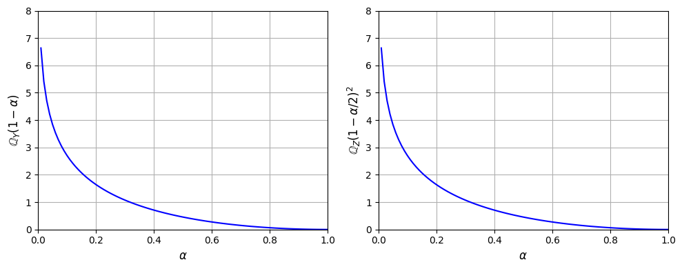
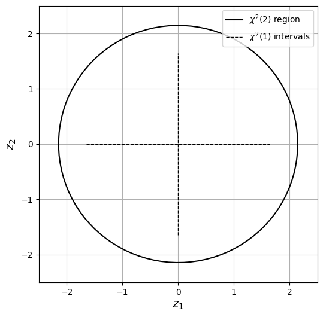

# Chi-Squared

Chi-Square RV has pdf of the form:

$$
f(x)=\frac{1}{2^{r/2}\Gamma(r/2)}e^{-x/2}x^{r/2-1},\; x\in \mathcal{D}.
$$

with domain $$\mathcal{D}=[0,\infty)$$.

* Pdf has only one parameter $$r\in \mathbb{Z}_+$$ (a.k.a degrees of freedom).
* We express fact that $$X$$ is a chi-squared RV as $$X\sim \chi^2(r)$$
* This is a Gamma RV with $$\beta=2$$ and $$\alpha=r/2$$ (for a positive integer $$r$$).

* Expected value and variance can be derived from those of the Gamma RV.
* Crucial property of a chi-squared RV is that it is related to standard normal RV. In particular, one can show that:

  $$
  \sum_{i=1}^rX_i^2\sim \chi^2(r)
  $$

   if $$X_i\sim \mathcal{N}(0,1)$$ and $$X_i$$ are independent. This property will be useful later on.

* From relationship with $$\mathcal{N}(0,1)$$ we can show that $$\mathbb{Q}_Y(1-\alpha)$$ of $$Y\sim\chi^2(1)$$ is equal to $$\mathbb{Q}_Z(1-\alpha/2)^2$$ of $$Z\sim \mathcal{N}(0,1)$$.
* This is because $$\mathbb{P}(-z\leq Z\leq z)=\mathbb{P}(Y\leq z)$$ with $$Y=Z^2$$.

<details>

<summary>Python: reproduce this figure (ch2_compare_chisq.ipynb)</summary>

Chi-squared RVs $$X\sim\chi^2(r)$$ as Gamma RVs with $$\beta=2$$, $$\alpha=r/2$$
(Victor Z and J E Umaña, UW-Madison, 2024).

```python
import numpy as np
import matplotlib.pyplot as plt
from scipy.stats import gamma, chi2, norm

x = np.linspace(0, 4, 1000)
plt.figure(figsize=(10, 4))
for sub, fun, label in ((1, gamma.pdf, '$f(x)$'), (2, gamma.cdf, '$F(x)$')):
    plt.subplot(1, 2, sub)
    for r in (1, 2, 3, 4):
        plt.plot(x, fun(x, r/2, scale=2), linewidth=1.5, label=f'$r={r}$')   # = chi2(r)
    plt.grid(True)
    plt.xlabel('$x$', fontsize=12)
    plt.ylabel(label, fontsize=12)
    plt.axis([0, 4, 0, 1])
plt.legend(loc='lower right', fontsize=9)
plt.tight_layout()
plt.show()
```

<figure></figure>

$$\mathbb{Q}_Y(1-\alpha)$$ for $$Y\sim\chi^2(1)$$ equals $$\mathbb{Q}_Z(1-\alpha/2)^2$$ for $$Z\sim\mathcal{N}(0,1)$$.

```python
alpha = np.linspace(0.01, 1, 100)
plt.figure(figsize=(10, 4))
plt.subplot(1, 2, 1)
plt.plot(alpha, chi2.ppf(1 - alpha, df=1), 'b-', linewidth=1.5)
plt.ylabel(r'$\mathbb{Q}_Y(1-\alpha)$', fontsize=12)
plt.subplot(1, 2, 2)
plt.plot(alpha, norm.ppf(1 - alpha/2)**2, 'b-', linewidth=1.5)
plt.ylabel(r'$\mathbb{Q}_Z(1-\alpha/2)^2$', fontsize=12)
for k in (1, 2):
    plt.subplot(1, 2, k)
    plt.grid(True)
    plt.xlabel(r'$\alpha$', fontsize=12)
    plt.axis([0, 1, 0, 8])
plt.tight_layout()
plt.show()
```

<figure></figure>

Open in Colab: [`ch2_compare_chisq.ipynb`](https://colab.research.google.com/github/vzavala/StatsBook-GitBook/blob/main/notebooks/ch2_compare_chisq.ipynb)

</details>

## Example: Computing Confidence Intervals

* Consider output flow $$F_3\sim \mathcal{N}(30,1)$$.
* Compute 90% confidence interval for $$F_3$$ using quantile of Chi-Squared RV.
* Confidence interval is $$\mu\pm z_{\alpha/2}\sigma$$ with $$z_{\alpha/2}=\mathbb{Q}_Z(1-\alpha/2)$$ and $$Z\sim \mathcal{N}(0,1)$$.
* Instead of using $$Z\sim \mathcal{N}(0,1)$$, here we compute $$z_{\alpha/2}$$ using $$Y\sim \chi^2(1)$$ as:

  $$
  \mathbb{Q}_{Z}(1-\frac{1}{2})=z_{\alpha/2}=\sqrt{\mathbb{Q}_Y(1-\alpha)}
  $$

* We use numerical package to compute $$\mathbb{Q}_Y(1-0.1)=2.71$$ and thus $$z_{\alpha/2}=\sqrt{2.71}=1.64$$.
* Confidence interval is $$[30\pm 1\cdot 1.64]=[28.36,31.64]$$ gpm. This is the same confidence interval computed previously using the Gaussian RV model.

#### Python implementation: 90% interval for the mixer output


Notebook [`ch2_example_chisquare.ipynb`](https://colab.research.google.com/github/vzavala/StatsBook-GitBook/blob/main/notebooks/ch2_example_chisquare.ipynb) — open it in Colab and run the cells alongside this section.


Confidence intervals and regions from chi-squared quantiles (Victor Z and J E Umaña, UW-Madison, 2024).

| Slides | Python | Meaning |
|---|---|---|
| $$F_3\sim\mathcal{N}(\mu,\sigma^2)$$ | `mu`, `sigma` | output flow of the mixer |
| $$\alpha$$ | `alpha` | probability outside the interval |
| $$Y\sim\chi^2(1)$$, $$\mathbb{Q}_Y(1-\alpha)$$ | `Q_Y` | chi-squared quantile |
| $$z_{\alpha/2}=\sqrt{\mathbb{Q}_Y(1-\alpha)}$$ | `z_alpha_2` | critical value |

```python
import sys
import numpy as np
import matplotlib.pyplot as plt
from scipy.stats import chi2, norm

mu, sigma = 30, 1
alpha = 0.1
Q_Y = chi2.ppf(1 - alpha, df=1)            # Q_Y(1 - alpha), Y ~ chi2(1)
z_alpha_2 = np.sqrt(Q_Y)                   # equals Q_Z(1 - alpha/2)
print(f"Q_Y(0.9) = {Q_Y:.2f},  z_alpha/2 = {z_alpha_2:.2f}  (normal: {norm.ppf(1 - alpha/2):.2f})")
print(f"90% interval: [{mu - z_alpha_2*sigma:.2f}, {mu + z_alpha_2*sigma:.2f}] gpm")
```

```
Q_Y(0.9) = 2.71,  z_alpha/2 = 1.64  (normal: 1.64)
90% interval: [28.36, 31.64] gpm
```

#### Python implementation: Going further: a 2D confidence ellipse from chi2(2)

For a 2D standard normal $$Z=(Z_1,Z_2)$$, $$Z^T\Sigma^{-1}Z\sim\chi^2(2)$$, so the region
$$\{z: z^T\Sigma^{-1}z\leq \mathbb{Q}_{\chi^2(2)}(1-\alpha)\}$$ holds $$Z$$ with probability $$1-\alpha$$.
(Multivariate Gaussians are covered in Chapter 3.) The `ellipse` helper is in `Support/ellipse.py`.

```python
sys.path.append(path + 'Support')
from ellipse import ellipse

mu_vec = np.array([0, 0])
Sigma = np.array([[1, 0], [0, 1]])
level = chi2.ppf(1 - alpha, 2)                       # chi2(2) quantile
xe, ye, _, _, _ = ellipse(np.linalg.inv(Sigma), level, 100, mu_vec)
r1 = np.sqrt(chi2.ppf(1 - alpha, 1))                 # 1D interval half-width

plt.figure(figsize=(6, 6))
plt.plot(xe, ye, 'k', linewidth=1.5, label=r'$\chi^2(2)$ region')
plt.plot([-r1, r1], [0, 0], 'k--', linewidth=1.0, label=r'$\chi^2(1)$ intervals')
plt.plot([0, 0], [-r1, r1], 'k--', linewidth=1.0)
plt.xlabel('$z_1$', fontsize=14)
plt.ylabel('$z_2$', fontsize=14)
plt.axis([-2.5, 2.5, -2.5, 2.5])
plt.legend(loc='upper right')
plt.grid(True)
plt.show()

np.random.seed(1)
S = 1000
z_omega = np.random.multivariate_normal(mu_vec, Sigma, S)
inside = np.einsum('ij,jk,ik->i', z_omega - mu_vec, np.linalg.inv(Sigma), z_omega - mu_vec) <= level
print(f"{inside.sum()} of {S} samples fall in the ellipse (expected about {S*(1-alpha):.0f})")
```

<figure></figure>

```
897 of 1000 samples fall in the ellipse (expected about 900)
```
