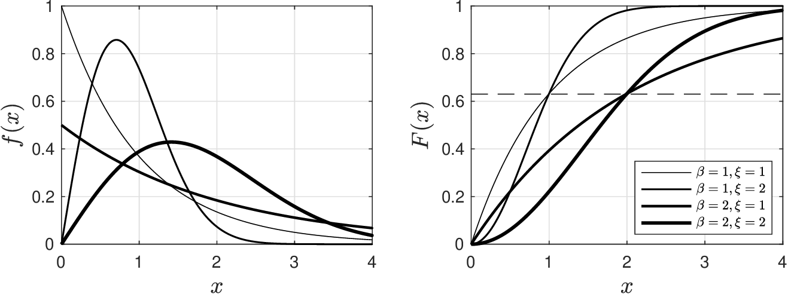
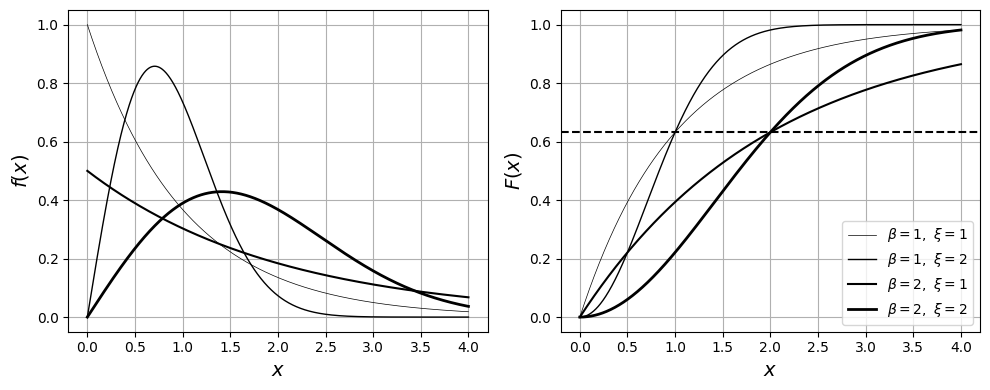
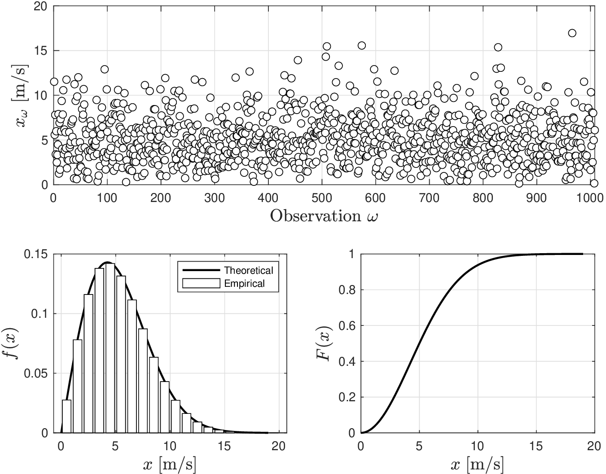
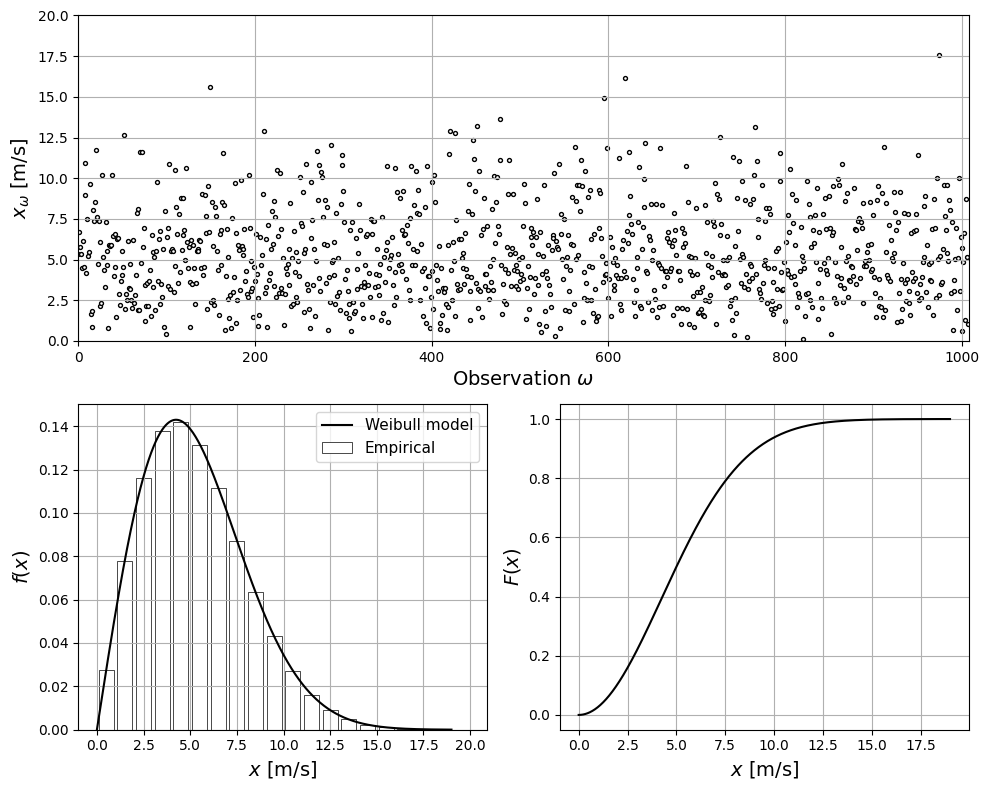

# Weibull

Weibull RV is a generalization of exponential RV that has a domain $$\mathcal{D}=[0,\infty)$$ and pdf:

$$
f(x)=\frac{\xi}{\beta}\left(\frac{x}{\beta}\right)^{\xi-1}\exp\left[{-\left(\frac{x}{\beta}\right)^\xi}\right],\; x\in \mathcal{D}.
$$

* Pdf has parameters $$\beta,\xi\in \mathbb{R}_+$$ (a.k.a scale and shape).
* We express fact that $$X$$ is a Weibull RV as $$X\sim \textrm{Weibull}(\xi,\beta)$$.
* One recovers an exponential RV when $$\xi=1$$.

* Expected value and variance are:

  $$
  \begin{aligned}
  \mathbb{E}_X&=\beta\Gamma(1+1/\xi)\\
  \mathbb{V}_X&=\beta^2\left(\Gamma(1+2/\xi)+\Gamma(1+1/\xi)^2\right)
  \end{aligned}
  $$

* Cdf has nice form $$F(x)=1-e^{-(x/\beta)^\xi}$$ ($$\xi,\beta$$ are often inferred from cdf).
* Note also that $$\mathbb{P}(X\leq \beta)=1-e^{-1}=0.63$$ *for any* $$\xi$$. This property is useful for estimating $$\beta$$ from the empiricial cdf.
* Because cdf has a nice exponential form, quantile function is explicit:

  $$
  \mathbb{Q}_X(\alpha)=\beta \left(-\log(1-\alpha)\right)^{1/\xi}.
  $$

   From here, we determine that median is $$\mathbb{M}_X=\beta(\log\,2)^{1/\xi}$$.

* Weibull is *de facto* model used in failure analysis and many phenomena have Weibull-like RVs as limiting case.

* Pdfs and cdfs for $$\textrm{Weibull}(\beta,\xi)$$ for different values of $$\beta,\xi$$.

  <figure></figure>

* Same as exponential for $$\xi=1$$.
* Note emergence of peaks due to competing effects for $$\xi=2$$.
* Note $$\mathbb{P}(X\leq \beta)=0.63$$ for any $$\xi$$ (this differentiates it from Gamma RV).

<details>

<summary>Python: reproduce this figure (ch2_compare_weibull.ipynb)</summary>

Weibull RVs $$X\sim\mathrm{Weibull}(\xi,\beta)$$ (Victor Z and David Cole, UW-Madison, 2024).
`scipy.stats.weibull_min` takes the **shape** $$\xi$$ first and the **scale** $$\beta$$ as `scale`.
The dashed line marks $$F(\beta)=1-e^{-1}=0.63$$ for any $$\xi$$.

```python
import numpy as np
import matplotlib.pyplot as plt
from scipy.stats import weibull_min

beta = [1, 1, 2, 2]     # scale
xi = [1, 2, 1, 2]       # shape
lw = [0.5, 1, 1.5, 2]
x = np.linspace(0, 4, 1000)

plt.figure(figsize=(10, 4))
for sub, fun, label in ((1, weibull_min.pdf, '$f(x)$'), (2, weibull_min.cdf, '$F(x)$')):
    plt.subplot(1, 2, sub)
    for k in range(len(beta)):
        plt.plot(x, fun(x, xi[k], scale=beta[k]), color='black', linewidth=lw[k],
                 label=rf'$\beta={beta[k]},\ \xi={xi[k]}$')
    plt.grid(True)
    plt.xlabel('$x$', fontsize=14)
    plt.ylabel(label, fontsize=14)
plt.axhline(1 - np.exp(-1), color='k', ls='--')
plt.legend(fontsize=10, loc='lower right')
plt.tight_layout()
plt.show()
```

<figure></figure>

Open in Colab: [`ch2_compare_weibull.ipynb`](https://colab.research.google.com/github/vzavala/StatsBook-GitBook/blob/main/notebooks/ch2_compare_weibull.ipynb)

</details>

## Example: Modeling Wind Conditions

* Wind is rather unpredictable but it is known that the 10-min wind speed (time average over 10 minutes) follows a Weibull distribution (see Figure).
* Information on wind speed distribution is used in planning studies to determine how much wind power can be extracted using wind turbines at a given location. .

  <figure></figure>

Use the pdf and cdf to determine the following:


* Scale and shape parameters for 10-min wind speed.
* Average and most likely wind speed at this location. Which of these statistics would you use to recommend?
* Wind turbines extract high power when wind speed is [10-20 m/s]. Over what fraction of the time will the turbine operate in this high-power range at this location?


* We have that $$F(x)=0.63$$ occurs at $$x=$$6 m/s (this gives $$\beta$$).
* $$F(x)=0.5$$ occurs at $$x=5$$ m/s; we thus have $$\mathbb{M}_X=5$$ and $$5=\beta(\log\,2)^{1/\xi}$$.
* Applying logarithms we obtain:

  $$
  \begin{aligned}
  \log\,5&=\log(\beta) + (1/\xi)\log(\log\,2)
  \end{aligned}
  $$

   Solving for $$\xi$$ we obtain $$\xi=2$$.

* The  average 10-min windspeed (in m/s) is

  $$
  \mathbb{E}_X=6\cdot\Gamma(1+1/2)=5.3.
  $$

   while the most likely value (the mode, also in m/s) is:

  $$
  \mathbb{MO}_X=6\cdot\left(\frac{2-1}{2}\right)^{1/2}=4.2.
  $$

   Mode has a more intuitive interpretation (most likely wind speed value).

* Probability that 10-min wind speed is in [10-20] m/s  is given by:

  $$
  \begin{aligned}
  \mathbb{P}(10\leq X\leq 20)&=(1-e^{-(20/\beta)^\xi})-(1-e^{-(10/\beta)^\xi})=0.06
  \end{aligned}
  $$

   Wind turbine will only operate 6% of the time in the high-power range.

#### Python implementation


Notebook [`ch2_example_weibull.ipynb`](https://colab.research.google.com/github/vzavala/StatsBook-GitBook/blob/main/notebooks/ch2_example_weibull.ipynb) — open it in Colab and run the cells alongside this section.


10-min wind speed as a Weibull RV (Victor Z and David Cole, UW-Madison, 2024).

| Slides | Python | Meaning |
|---|---|---|
| $$\beta$$, $$\xi$$ | `beta`, `xi` | scale [m/s] and shape [-] |
| $$\mathbb{M}_X$$ | `M_X` | median wind speed |
| $$\mathbb{E}_X$$, $$\mathbb{MO}_X$$ | `E_X`, `MO_X` | mean and mode |
| $$x_\omega$$ | `x_omega` | simulated 10-min wind speeds |

```python
import numpy as np
import matplotlib.pyplot as plt
from scipy.stats import weibull_min
from scipy.special import gamma as Gamma
```

From the empirical cdf: $$F(x)=0.63$$ at $$x=6$$ m/s gives $$\beta=6$$; the median $$\mathbb{M}_X=5$$
and $$\log 5=\log\beta+(1/\xi)\log(\log 2)$$ give $$\xi$$.

```python
beta = 6.0
M_X = 5.0
xi = np.log(np.log(2)) / (np.log(M_X) - np.log(beta))
print(f"xi from the median: {xi:.2f}  ->  use xi = 2")
xi = 2.0
X = weibull_min(xi, scale=beta)    # scipy: shape xi first, scale beta
```

```
xi from the median: 2.01  ->  use xi = 2
```

```python
x_bins = np.arange(0.5, 20, 1)     # measured frequencies (% of time) per 1 m/s bin
f_data = np.array([2.75, 7.8, 11.6, 13.79, 14.20, 13.15, 11.14, 8.72, 6.34, 4.30, 2.73, 1.62,
                   0.91, 0.48, 0.24, 0.11, 0.05, 0.02, 0.01, 0.001]) / 100
x = np.linspace(0, 19, 1000)

np.random.seed(0)
S = 24 * 7 * 6
x_omega = X.rvs(size=S)

fig = plt.figure(figsize=(10, 8))
gs = fig.add_gridspec(2, 2)
ax1 = fig.add_subplot(gs[0, :])
ax1.scatter(np.arange(S), x_omega, s=8, edgecolor='black', facecolor='white')
ax1.set_xlim([0, S])
ax1.set_ylim([0, 20])
ax1.set_xlabel(r'Observation $\omega$', fontsize=14)
ax1.set_ylabel(r'$x_\omega$ [m/s]', fontsize=14)
ax2 = fig.add_subplot(gs[1, 0])
ax2.bar(x_bins, f_data, edgecolor='black', facecolor='white', linewidth=0.5, label='Empirical')
ax2.plot(x, X.pdf(x), 'black', linewidth=1.5, label='Weibull model')
ax2.set_xlabel('$x$ [m/s]', fontsize=14)
ax2.set_ylabel('$f(x)$', fontsize=14)
ax2.legend(fontsize=11)
ax3 = fig.add_subplot(gs[1, 1])
ax3.plot(x, X.cdf(x), 'black', linewidth=1.5)
ax3.set_xlabel('$x$ [m/s]', fontsize=14)
ax3.set_ylabel('$F(x)$', fontsize=14)
for ax in (ax1, ax2, ax3):
    ax.grid(True)
plt.tight_layout()
plt.show()
```

<figure></figure>

$$\mathbb{E}_X=\beta\,\Gamma(1+1/\xi)$$, $$\mathbb{MO}_X=\beta\left(\frac{\xi-1}{\xi}\right)^{1/\xi}$$, and
$$\mathbb{P}(10\leq X\leq 20)=F(20)-F(10)$$.

```python
E_X = beta * Gamma(1 + 1/xi)
MO_X = beta * ((xi - 1) / xi) ** (1/xi)
P_high = X.cdf(20) - X.cdf(10)
print(f"E_X  = {E_X:.1f} m/s  (scipy mean: {X.mean():.1f})")
print(f"MO_X = {MO_X:.1f} m/s")
print(f"P(10 <= X <= 20) = {P_high:.2f}")
```

```
E_X  = 5.3 m/s  (scipy mean: 5.3)
MO_X = 4.2 m/s
P(10 <= X <= 20) = 0.06
```
