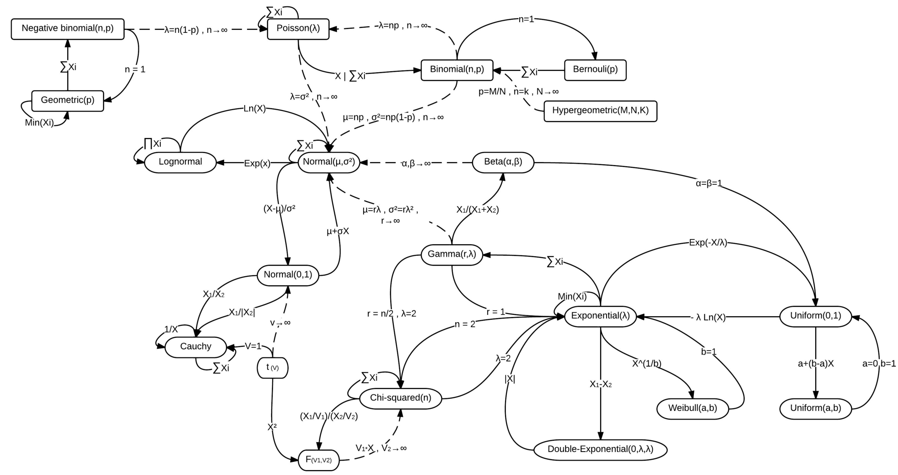

# Families of Random Variables

* Exponential, Gamma, Chi-squared, and Weibull RVs are interrelated.
* In fact, these are captured by generalized Gamma model with pdf:

  $$
  F_X(x)=\frac{1}{\beta^{\alpha\xi}\Gamma(\alpha)}\exp\left[-\left(\frac{x-\delta}{\beta}\right)^\xi\right]\xi(x-\delta)^{\alpha\xi-1},\quad x\in [0,\infty).
  $$

* These RVs are known as the Gamma family.
* There are three major families of continuous RVs:
   * Gaussian family (includes Gaussian, LogNormal, and Raleigh)
   * Gamma family (includes exponential, Gamma, Chi-Squared, and Weibull)
   * Ratio family (includes Cauchy, Uniform, Beta, Fisher, Student)

* One family for discrete RVs: includes Uniform (discrete), Bernoulli, Binomial, and Poisson.
* Each family models different phenomena, important to understand their origin (just like with physical models).
* Some RVs are limiting cases, generalizations, or transformations of others.
* A detailed discussion of all RV types and properties is beyond our scope.
* Here, we have only discussed some RVs to highlight their rich behavior.


**Important:** Pay attention to the origin of these RV models. As with mechanistic models, understanding their origin gives insights into what phenomena might exhibit similar characteristics (e.g., do not model a diffusion-like system using a Gamma RV).


<figure></figure>
