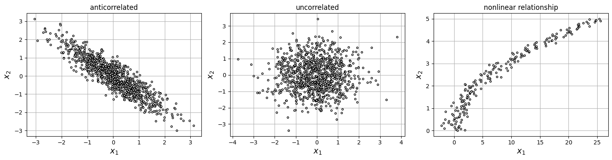
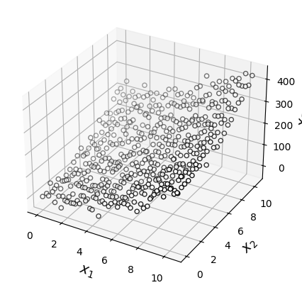
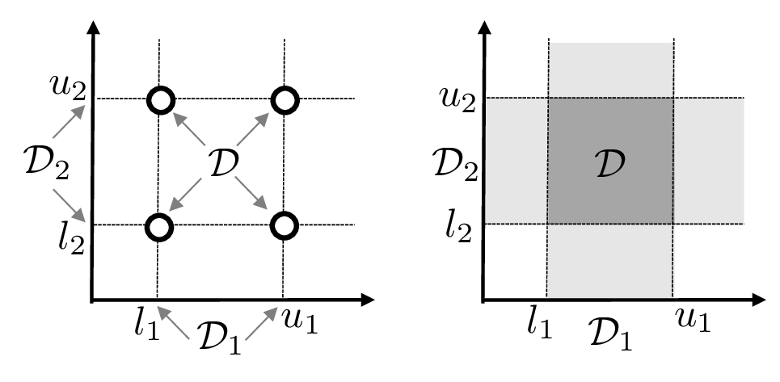
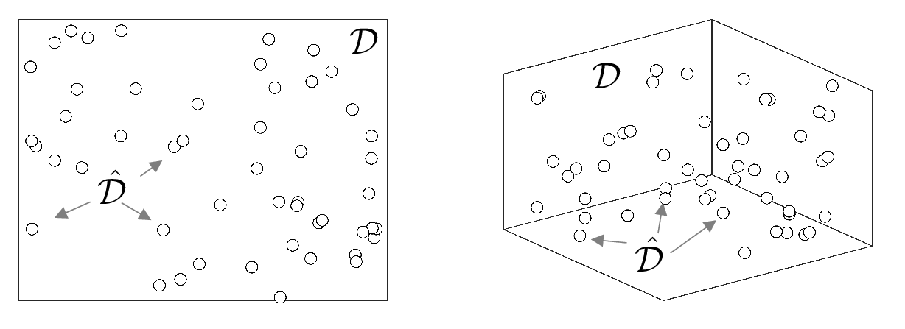
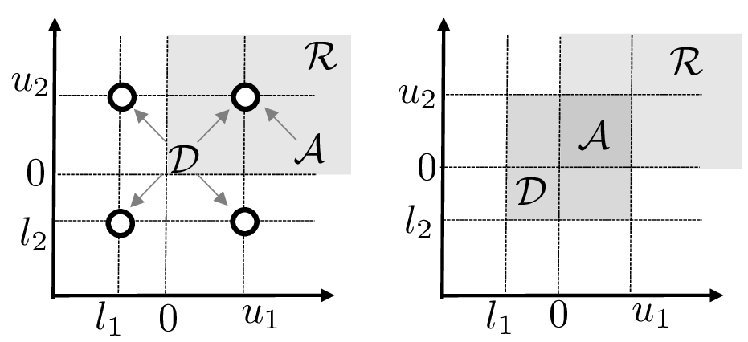
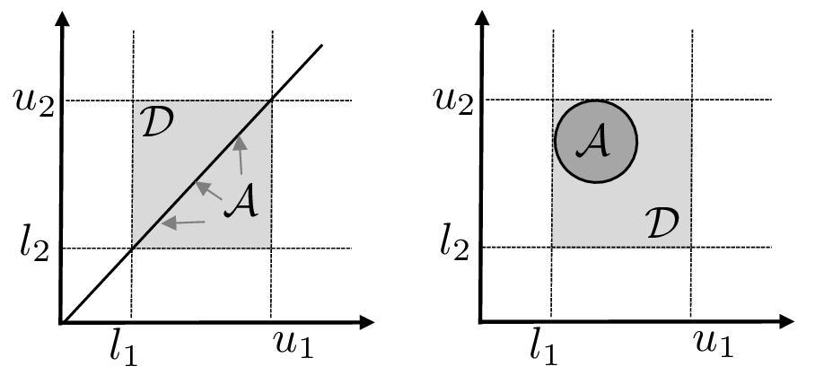
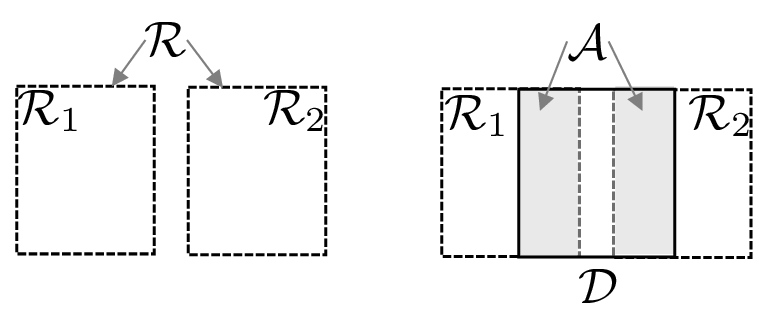
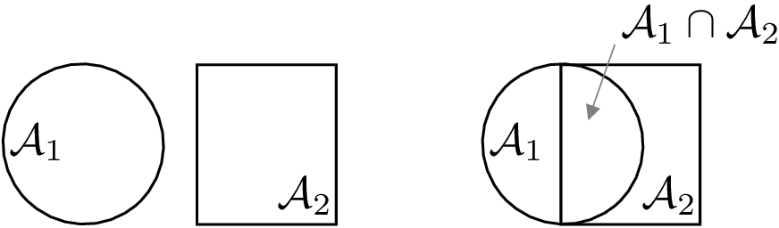
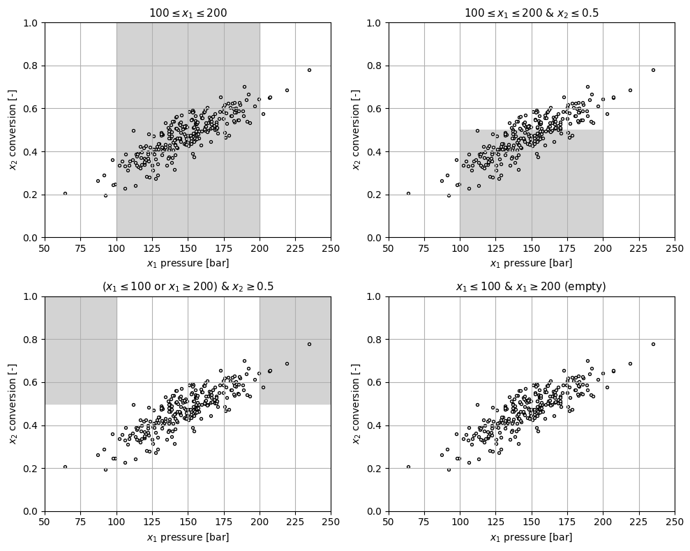

# Multivariate Random Variables

* We have assumed $$X$$ is univ and thus realization $$\omega\in \Omega$$ generates a scalar observation $$x_\omega \in \mathbb{R}$$.  This implies $$\mathcal{D}$$ is unidim.
* Consider multiv $$X=(X_1,X_2,...,X_n)$$, in which realization $$\omega\in \Omega$$ generates an observation vector $$x_\omega=(x_{\omega,1},x_{\omega,2},...,x_{\omega,n})\in \mathbb{R}^n$$. This implies $$\mathcal{D}$$ is multidim.

Questions that we are interested in answering are:


* Are there any connections between RVs? Is there a clear trend that suggests they vary together? Do they vary independently of one another?
* How strong are connections?
* How does knowledge of one resolves uncertainty of the other?
* How to analyze connections between many RVs? (e.g., $$n$$ is in the hundreds)?


These questions are relevant from a *decision-making* standpoint:


* If data suggests that RVs are related, is there a hidden *mechanistic* relationship?
* Can we exploit such relationships to develop *predictive* models and make decisions?


Elements of multivariate RV are similar to those of univariate RV but dependence and independence introduce a number of new concepts.

As in univariate case, our goal will also be to understand if our data seems to follow the behavior of a multivariate RV model.

Unfortunately, there are extremely few multivariate RV models that are of practical use. So most multivariate analysis is data-driven, but this provides key insights.

#### Python implementation


Notebook [`ch3_examples_multidatasets.ipynb`](https://colab.research.google.com/github/vzavala/StatsBook-GitBook/blob/main/notebooks/ch3_examples_multidatasets.ipynb) — open it in Colab and run the cells alongside this section.


Examples of multivariate data sets (Victor Z, UW-Madison, 2024): realizations
$$x_\omega=(x_{\omega,1},x_{\omega,2})$$ (`x_omega[:, 0]`, `x_omega[:, 1]`) that are
anticorrelated, uncorrelated, and nonlinearly related, and a 3D data set.

```python
import numpy as np
import matplotlib.pyplot as plt

np.random.seed(0)
S = 1000
fig, axs = plt.subplots(1, 3, figsize=(15, 4))
for ax, Sigma, title in ((axs[0], [[1, -0.9], [-0.9, 1]], 'anticorrelated'),
                         (axs[1], [[1, 0], [0, 1]], 'uncorrelated')):
    x_omega = np.random.multivariate_normal([0, 0], Sigma, S)
    ax.plot(x_omega[:, 0], x_omega[:, 1], 'ko', markerfacecolor='w', markersize=3)
    ax.set_title(title)
x1 = np.linspace(0, 5, 200)
x2 = x1**2 + np.random.normal(0, 1, 200)
axs[2].plot(x2, x1, 'ko', markerfacecolor='w', markersize=3)
axs[2].set_title('nonlinear relationship')
for ax in axs:
    ax.set_xlabel('$x_1$', fontsize=14)
    ax.set_ylabel('$x_2$', fontsize=14)
    ax.grid(True)
plt.tight_layout()
plt.show()
```

<figure></figure>

```python
x1, x2 = np.meshgrid(np.arange(0, 11, 0.5), np.arange(0, 11, 0.5))
x3 = 2 * x1**2 + 2 * x2**2 + 20 * np.random.normal(0, 1, x1.shape)
ax = plt.figure(figsize=(6, 5)).add_subplot(projection='3d')
ax.scatter(x1, x2, x3, c='w', edgecolors='k', marker='o')
ax.set_xlabel('$x_1$', fontsize=14)
ax.set_ylabel('$x_2$', fontsize=14)
ax.set_zlabel('$x_3$', fontsize=14)
plt.show()
```

<figure></figure>

## Domains and Subdomains

* Multivariate RVs give rise to data and functions that live in multiple dimensions.
* Domains of multiv RVs can take complex shapes (e.g., cubes, ellipses, polyhedra).
* Understanding domains helps visualize and analyze data over high dimensions.
* Understanding domains also helps understand events and decision-making logic.
* For simplicity, we focus on $$X=(X_1,X_2)$$.
* Here, $$\omega \in \Omega$$ of $$X=(X_1,X_2)$$ generates pair $$x_\omega=(x_{\omega,1},x_{\omega,2})\in \mathbb{R}^2$$.
* For example, a reactor experiment generates data on pressure and conversion.

* Domain of $$X=(X_1,X_2)$$ is $$\mathcal{D}\subseteq \mathbb{R}^2$$ and results from:

  $$
  \mathcal{D}=\mathcal{D}_{X_1}\times \mathcal{D}_{X_2}
  $$

   where $$\mathcal{D}_{X_1}\subseteq \mathbb{R}$$ is domain of the $$X_1$$ and $$\mathcal{D}_{X_2}\subseteq\mathbb{R}$$ is domain of $$X_2$$.

* For *discrete* $$X$$, $$\mathcal{D}_1$$ and $$\mathcal{D}_2$$ are discrete. If $$\mathcal{D}_1=\{l_1,u_1\}$$ and $$\mathcal{D}_2=\{l_2,u_2\}$$, then:

  $$
  \mathcal{D}=\mathcal{D}_{1}\times \mathcal{D}_{2}=\{(l_1,l_2),(l_1,u_2),(u_1,l_2),(u_2,l_2)\}.
  $$

* For *continuous* $$X$$, $$\mathcal{D}_1$$ and $$\mathcal{D}_2$$ are continuous.   If $$\mathcal{D}_1=[l_1,u_1]$$ and $$\mathcal{D}_2=[l_2,u_2]$$:

  $$
  \mathcal{D}=\mathcal{D}_{1}\times \mathcal{D}_{2}=[l_1,u_1]\times [l_2,u_2].
  $$

<figure><figcaption><p>Domains for 2D discrete (left) and continuous (right) RV.</p></figcaption></figure>

* *Empirical approx* of $$\mathcal{D}$$ is $$\hat{\mathcal{D}}$$, this is region occupied by available data $$x_\omega,\; \omega \in \mathcal{S}$$.
* Many observations might be needed to cover multidimensional domain.
* For example, in 3D, domain of $$X=(X_1,X_2,X_3)$$ can be a cube.
* Large portions of actual domain might remain unobserved.
* Important to have model to know what is possible beyond available data.

  <figure><figcaption><p>Empirical (observed) and theoretical 2D and 3D domains.</p></figcaption></figure>

* Subdomains $$\mathcal{A}\subseteq \mathcal{D}$$ define *events* associated with $$X$$.
* For example, $$\mathbb{P}(X\in \mathcal{A})$$ is probability of event $$X\in \mathcal{A}$$.
* Imagine we want probability of event $$X\in \mathcal{R}=\{X_1\geq 0\,\&\,X_2\geq 0\}$$ (e.g., prob that $$X$$ takes non-negative values).
* To construct subdomain $$\mathcal{A}\subseteq\mathcal{D}$$ that captures event defined by $$\mathcal{R}$$, we note that any observation $$x_\omega \in \mathcal{A}$$ must satisfy $$x_\omega \in \mathcal{R}$$ *and* $$x_\omega \in \mathcal{D}$$. Consequently:

  $$
  \begin{aligned}
  \mathcal{A}&=\mathcal{R}\cap\mathcal{D}\\
  &=\left\{\{X_1\geq 0\,\&\,x_2\geq 0\}\;\&\;\{l_1 \leq X_1 \leq u_1\;\&\; l_2 \leq X_2 \leq u_2\}\right\}\\
  &=\{X_1\geq 0\;\&\;X_2\geq 0\;\&\; l_1 \leq X_1 \leq u_1\;\&\; l_2 \leq X_2 \leq u_2\}.
  \end{aligned}
  $$

   Symbol $$``\cap"$$ denotes *set intersection* and captures $$``\&"$$ logic

* In other words, event $$\mathcal{A}$$ must satisfy all the restrictions imposed by $$\mathcal{R}$$ and $$\mathcal{D}$$.
* This means domain $$\mathcal{A}$$ is more restrictive than domain $$\mathcal{D}$$  and thus $$\mathcal{A}\subseteq \mathcal{D}$$.

<figure></figure>

*Subdomain $$\mathcal{A}$$ of $$\mathcal{D}$$ for discrete (left) and continuous (right) RV.*

* Different types of events $$\mathcal{A}$$ capture different *logic*.
* For instance, we can build subdomain $$\mathcal{A}$$ that enforces constraint that $$\{X_1=X_2\}$$ (to compute probability that $$X_1=X_2$$).
* Can also build a subdomain $$\mathcal{A}$$ that enforces constraint that $$\{X_1^2+X_2^2\leq 1\}$$ (to compute probability that $$X$$ is in a circular region).

  <figure></figure>

  *Examples of subdomains $$\mathcal{A}\subseteq \mathcal{D}$$ capturing different constraints.*

* When making decisions, we are interested in events that capture “*or*” logic.
* Want prob that $$X$$ is in $$\mathcal{R}_1=\{X_1\geq 0\,\&\,X_2\geq 0\}$$ *or* that it is in $$\mathcal{R}_2=\{X_1\leq -1\,\&\,X_2\leq -1\}$$.
* Build subdomain $$\mathcal{A}$$ by defining $$\mathcal{R}=\mathcal{R}_1\cup\mathcal{R}_2$$, where $$\cup$$ is *set union*.
* Here, $$\mathbb{P}(X\in \mathcal{R})$$ indicates probability that $$X\in \mathcal{R}_1$$ or that $$X\in \mathcal{R}_2$$.
* $$\mathcal{A}$$ must be a subdomain of $$\mathcal{D}$$, we achieve this by enforcing $$\mathcal{A}=\mathcal{R}\cap \mathcal{D}$$ ($$X$$ is in $$\mathcal{R}$$ and $$\mathcal{D}$$).

  <figure></figure>

  *Union of $$\mathcal{R}_1$$ and $$\mathcal{R}_2$$ to obtain $$\mathcal{R}=\mathcal{R}_1\cup\mathcal{R}_2$$ (left). Intersection of $$\mathcal{R}$$ with $$\mathcal{D}$$ to obtain event $$\mathcal{A}=\mathcal{R}\cap\mathcal{D}$$ (right).*

* In decision-making, we also often want probability that $$\mathcal{A}_1$$ occurs given knowledge that $$\mathcal{A}_2$$ has occurred.
* This is captured by *conditional probability* $$\mathbb{P}(\mathcal{A}_1|\mathcal{A}_2)$$:

  $$
  \mathbb{P}(\mathcal{A}_1|\mathcal{A}_2)=\frac{\mathbb{P}(\mathcal{A}_1\cap \mathcal{A}_2)}{\mathbb{P}(\mathcal{A}_2)}.
  $$

* $$\mathbb{P}(\mathcal{A}_1\cap \mathcal{A}_2)$$ is *joint* prob and $$\mathbb{P}(\mathcal{A}_2)$$ is marginal prob of $$\mathcal{A}_2$$ (similar for $$\mathcal{A}_1$$).
* Expression also written as $$\mathbb{P}(\mathcal{A}_1\cap \mathcal{A}_2)=\mathbb{P}(\mathcal{A}_1|\mathcal{A}_2)\cdot \mathbb{P}(\mathcal{A}_2)$$.
* Intuitively, if $$\mathcal{A}_2$$ has occurred and overlap $$\mathcal{A}_1\cap \mathcal{A}_2$$ is large, then there is a high probability that $$\mathcal{A}_1$$ also occurs.
* If event $$\mathcal{A}_2$$ does not affect occurrence of $$\mathcal{A}_1$$ (events are *independent*) then

  $$
  \mathbb{P}(\mathcal{A}_1\cap \mathcal{A}_2)=\mathbb{P}(\mathcal{A}_1)\cdot \mathbb{P}(\mathcal{A}_2)
  $$

* Disjoint events have an empty overlap $$\mathcal{A}_1\cap \mathcal{A}_2=\emptyset$$.

<figure><figcaption><p>Overlapping (joint) events (right) and non-overlapping (disjoint) events (left).</p></figcaption></figure>

* One can use the facts that:

  $$
  \begin{aligned}
  \mathbb{P}(\mathcal{A}_1\cap \mathcal{A}_2)&=\mathbb{P}(\mathcal{A}_1|\mathcal{A}_2)\cdot \mathbb{P}(\mathcal{A}_2)\\
  \mathbb{P}(\mathcal{A}_1\cap \mathcal{A}_2)&=\mathbb{P}(\mathcal{A}_2|\mathcal{A}_1)\cdot \mathbb{P}(\mathcal{A}_1)
  \end{aligned}
  $$

   to establish that:

  $$
  \mathbb{P}(\mathcal{A}_1|\mathcal{A}_2)=\frac{\mathbb{P}(\mathcal{A}_2|\mathcal{A}_1)\mathbb{P}(\mathcal{A}_1)}{\mathbb{P}(\mathcal{A}_2)}.
  $$

* This is an important result in statistics known as *Bayes' Rule*.

#### Python implementation


Notebook [`ch3_gibbs_subdomains.ipynb`](https://colab.research.google.com/github/vzavala/StatsBook-GitBook/blob/main/notebooks/ch3_gibbs_subdomains.ipynb) — open it in Colab and run the cells alongside this section.


Subdomains (events) for the Gibbs reactor data (Victor Z, UW-Madison, 2024).
Realizations $$x_\omega=(x_{\omega,1},x_{\omega,2})$$ of pressure $$X_1$$ (`x1`) and conversion
$$X_2$$ (`x2`). Each panel shades an event $$\mathcal{A}=\mathcal{R}\cap\mathcal{D}$$:
an "and" event, a narrower "and" event, an "or" event ($$\mathcal{R}_1\cup\mathcal{R}_2$$),
and an impossible event (empty set).

```python
import numpy as np
import matplotlib.pyplot as plt

data = np.loadtxt(path+'Data/gibbs_hightemp_class.dat')
S = len(data)
np.random.seed(1)
x1 = data[:, 1] + np.random.normal(0, 1, S)       # pressure [bar]
x2 = data[:, 2] + np.random.normal(0, 0.05, S)    # conversion [-]

events = [
    ("$100\\leq x_1\\leq 200$", [((100, 200), (0, 1))]),
    ("$100\\leq x_1\\leq 200$ & $x_2\\leq 0.5$", [((100, 200), (0, 0.5))]),
    ("($x_1\\leq 100$ or $x_1\\geq 200$) & $x_2\\geq 0.5$", [((0, 100), (0.5, 1)), ((200, 250), (0.5, 1))]),
    ("$x_1\\leq 100$ & $x_1\\geq 200$ (empty)", []),
]
fig, axs = plt.subplots(2, 2, figsize=(10, 8))
for ax, (title, boxes) in zip(axs.ravel(), events):
    for (a1, b1), (a2, b2) in boxes:
        ax.fill_between([a1, b1], a2, b2, color='lightgrey')
    ax.scatter(x1, x2, s=8, color='black', facecolors='white')
    ax.set_title(title, fontsize=11)
    ax.set_xlabel('$x_1$ pressure [bar]')
    ax.set_ylabel('$x_2$ conversion [-]')
    ax.axis([50, 250, 0, 1])
    ax.grid(True)
plt.tight_layout()
plt.show()
```

<figure></figure>
