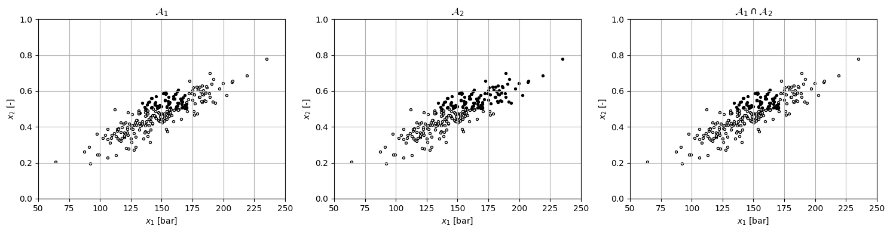
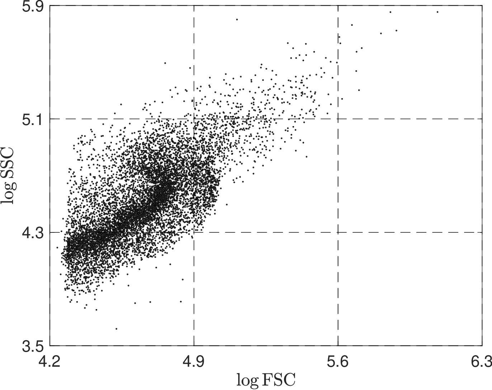
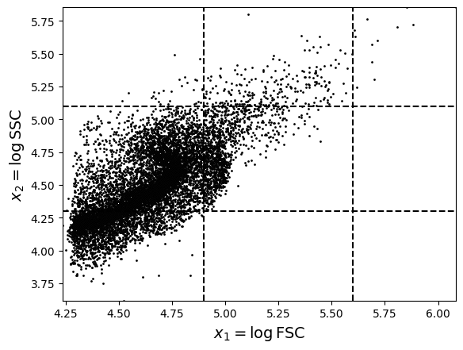
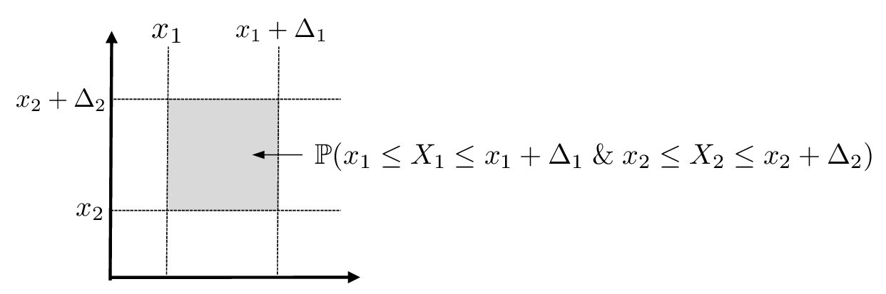
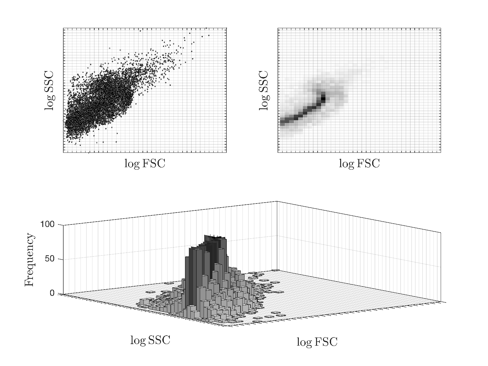
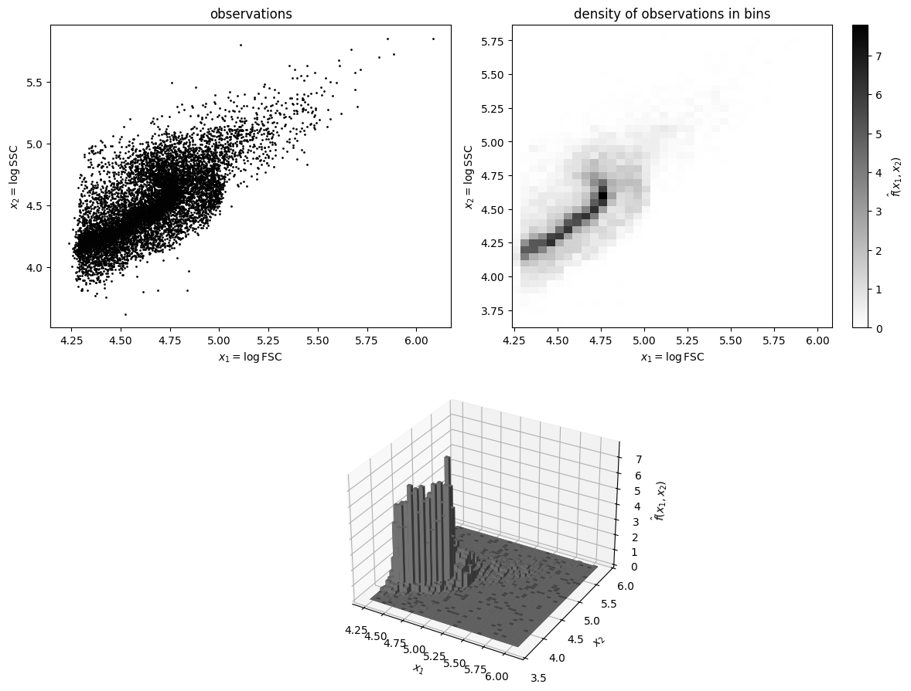
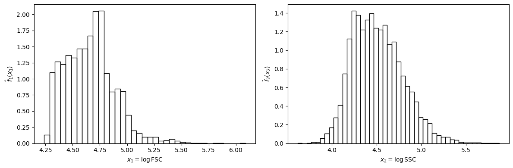

# Joint PDFs and CDFs

* *Joint pdf* is used to quantify prob of events associated with $$X=(X_1,X_2)$$:

  $$
  \begin{aligned}
  f(x_1,x_2)&=\mathbb{P}(X_1=x_1\,\&\, X_2=x_2),\;\; (x_1,x_2)\in\mathcal{D}.
  \end{aligned}
  $$

* For discrete $$X$$, this is interpreted as probability of joint event in which $$X_1$$ takes value  $$x_1$$ *and* $$X_2$$ takes value $$x_2$$.
* For continuous $$X$$, this is interpreted as probability that $$(X_1,X_2)$$ is in an infinitesimal neighborhood around $$(x_1,x_2)$$.
* Joint pdf for continuous $$X$$ must satisfy:

  $$
  \begin{aligned}
  &f(x_1,x_2)\geq 0,\; (x_1,x_2)\in \mathcal{D}\\
  &\int_{(x_1,x_2)\in \mathcal{D}}f(x_1,x_2)dx_1dx_2=1.
  \end{aligned}
  $$

   For discrete RV we replace integral with double summation.

* Joint pdf used to compute probability of events $$\mathcal{A}\subseteq \mathcal{D}$$. For a continuous RV:

  $$
  \begin{aligned}
  \mathbb{P}(X\in \mathcal{A})&=\int_{(x_1,x_2)\in \mathcal{A}}f(x_1,x_2)dx_1dx_2.
  \end{aligned}
  $$

* Joint pdf is *density* of points at a point in subdomain $$\mathcal{A}$$.
* Probability $$\mathbb{P}(X\in \mathcal{A})$$ is *total density* of points in $$\mathcal{A}$$.
* This $$\mathbb{P}(X\in \mathcal{A})$$ measures size (in terms of density) of subdomain $$\mathcal{A}$$; i.e., the larger the subdomain, the higher the probability of being in it.

* We are often interested in events associated with *box* subdomains $$\mathcal{A}\subseteq\mathcal{D}$$:

  $$
  \begin{aligned}
  \mathcal{A}&=\{a_1 \leq x_1\leq b_1\; \& \;  a_2 \leq x_2\leq b_2\}\\
  &=\{x_1\in[a_1,b_1]\; \& \; x_2\in [a_2,b_2]\}.
  \end{aligned}
  $$

* For continuous RVs, probability of being in such a box is:

  $$
  \begin{aligned}
  \mathbb{P}(X\in \mathcal{A})&=\int_{(x_1,x_2)\in \mathcal{A}}f(x_1,x_2)dx_1dx_2\\
  &=\int_{a_1}^{b_1}\int_{a_2}^{b_2}f(x_1,x_2)dx_1dx_2.
  \end{aligned}
  $$

## Empirical Event Probabilities

* The probability of an event is computed by using the joint pdf; for a continuous RV:

  $$
  \mathbb{P}(X\in \mathcal{A})=\int_{x\in \mathcal{A}}f(x)dx.
  $$

* In many practical situations, we do not have the joint pdf, but all we have available is data $$x_\omega,\,\omega \in \mathcal{S}$$.
* It is rather straightforward to compute empirical estimates for all pdfs, cdfs, and  probabilities discussed by using data. For instance:

  $$
  \begin{aligned}
  \hat{\mathbb{P}}(X\in \mathcal{A})&=\frac{1}{S}\sum_{\omega \in \mathcal{S}}\mathbf{1}[x_{\omega}\in \mathcal{A}]\\
  \hat{\mathbb{P}}(X\in \mathcal{A}_1\cap \mathcal{A}_2)&=\frac{1}{S}\sum_{\omega \in \mathcal{S}}\mathbf{1}[x_{\omega}\in \mathcal{A}_1\; \&\; x_\omega\in \mathcal{A}_2]\\
  \hat{\mathbb{P}}(X\in \mathcal{A}_1\cup \mathcal{A}_2)&=\frac{1}{S}\sum_{\omega \in \mathcal{S}}\mathbf{1}[x_{\omega}\in \mathcal{A}_1\;\textrm{or}\; x_\omega\in \mathcal{A}_2]\\
  \hat{\mathbb{P}}(X\in \mathcal{A}_1|X\in \mathcal{A}_2)&=\frac{\hat{\mathbb{P}}(X\in\mathcal{A}_1\;\&\; X\in \mathcal{A}_2)}{\hat{\mathbb{P}}(X\in \mathcal{A}_2)}.
  \end{aligned}
  $$

#### Python implementation


Notebook [`ch3_gibbs_conditional.ipynb`](https://colab.research.google.com/github/vzavala/StatsBook-GitBook/blob/main/notebooks/ch3_gibbs_conditional.ipynb) — open it in Colab and run the cells alongside this section.


Empirical event probabilities for the Gibbs reactor (Victor Z, UW-Madison, 2024).

| Slides | Python | Meaning |
|---|---|---|
| $$x_{\omega,1}$$, $$x_{\omega,2}$$ | `x1`, `x2` | pressure [bar], conversion [-] |
| $$\mathcal{A}_1$$, $$\mathcal{A}_2$$ | `in_A1`, `in_A2` | indicators $$\mathbf{1}[x_\omega\in\mathcal{A}_i]$$ |
| $$\hat{\mathbb{P}}(X\in\mathcal{A}_1\cap\mathcal{A}_2)$$ | `P_A1_and_A2` | empirical joint probability |
| $$\hat{\mathbb{P}}(X\in\mathcal{A}_1\mid X\in\mathcal{A}_2)$$ | `P_A1_given_A2` | empirical conditional probability |

Events: $$\mathcal{A}_1=\{x_1\leq 170\ \&\ x_2\geq 0.5\}$$ and $$\mathcal{A}_2=\{x_1\geq 120\ \&\ x_2\geq 0.5\}$$.

```python
import numpy as np
import matplotlib.pyplot as plt

data = np.loadtxt(path+'Data/gibbs_hightemp_class.dat')
S = len(data)
np.random.seed(1)
x1 = data[:, 1] + np.random.randn(S)          # pressure
x2 = data[:, 2] + np.random.randn(S) * 0.05   # conversion

in_A1 = (x1 <= 170) & (x2 >= 0.5)
in_A2 = (x1 >= 120) & (x2 >= 0.5)

fig, axs = plt.subplots(1, 3, figsize=(15, 4))
for ax, mask, title in ((axs[0], in_A1, r'$\mathcal{A}_1$'), (axs[1], in_A2, r'$\mathcal{A}_2$'),
                        (axs[2], in_A1 & in_A2, r'$\mathcal{A}_1\cap\mathcal{A}_2$')):
    ax.scatter(x1[~mask], x2[~mask], s=8, c='white', edgecolors='black')
    ax.scatter(x1[mask], x2[mask], s=8, c='black')
    ax.set_title(title)
    ax.set_xlabel('$x_1$ [bar]')
    ax.set_ylabel('$x_2$ [-]')
    ax.axis([50, 250, 0, 1])
    ax.grid(True)
plt.tight_layout()
plt.show()
```

<figure></figure>

$$\hat{\mathbb{P}}(X\in\mathcal{A})=\frac{1}{S}\sum_\omega\mathbf{1}[x_\omega\in\mathcal{A}]$$ and
$$\hat{\mathbb{P}}(X\in\mathcal{A}_1|X\in\mathcal{A}_2)=\hat{\mathbb{P}}(X\in\mathcal{A}_1\cap\mathcal{A}_2)/\hat{\mathbb{P}}(X\in\mathcal{A}_2)$$.

```python
P_A1 = np.mean(in_A1)
P_A2 = np.mean(in_A2)
P_A1_and_A2 = np.mean(in_A1 & in_A2)
P_A1_or_A2 = np.mean(in_A1 | in_A2)
P_A1_given_A2 = P_A1_and_A2 / P_A2
P_A2_given_A1 = P_A1_and_A2 / P_A1
print(f"P_hat(A1) = {P_A1:.3f},  P_hat(A2) = {P_A2:.3f}")
print(f"P_hat(A1 & A2) = {P_A1_and_A2:.3f},  P_hat(A1 or A2) = {P_A1_or_A2:.3f}")
print(f"P_hat(A1 | A2) = {P_A1_given_A2:.3f},  P_hat(A2 | A1) = {P_A2_given_A1:.3f}")
print(f"Bayes' rule check: P(A2|A1) P(A1) / P(A2) = {P_A2_given_A1 * P_A1 / P_A2:.3f}")
```

```
P_hat(A1) = 0.252,  P_hat(A2) = 0.420
P_hat(A1 & A2) = 0.252,  P_hat(A1 or A2) = 0.420
P_hat(A1 | A2) = 0.600,  P_hat(A2 | A1) = 1.000
Bayes' rule check: P(A2|A1) P(A1) / P(A2) = 0.600
```

## Example: Lifetime of Thermostat

* Thermostat relies on sensor (thermocouple) and computing processor that processes sensor data and sends feedback signals to air conditioning unit.
* Thermostat fails to operate if any of these components fail.
* Time to failure of components is $$(X_1,X_2)$$ has joint pdf:

  $$
  f(x_1,x_2)=\frac{1}{\mu_1\cdot \mu_2}e^{-(x_1/\mu_1+x_2/\mu_2)}
  $$

   with $$\mathcal{D}=\{0\leq x_1\leq \infty\; \&\; 0\leq x_2\leq \infty\}$$ and $$\mu_1=1$$ and $$\mu_2=10$$ years.


* Compute probability that both components last less than 1 year.
* Compute probability that of event that $$X_1\geq 1$$ and $$X_2\geq 2$$.


* Probability that both components last less than 1 year corresponds to $$\mathcal{A}=\{0\leq x_1\leq 1\;\& \; 0\leq x_2\leq 1\}$$.
* Clearly, $$\mathcal{A}\subseteq\mathcal{D}$$ and probability is:

  $$
  \begin{aligned}
  \mathbb{P}(X\in \mathcal{A})&=\int_{0}^{1}\int_{0}^{1}f(x_1,x_2)dx_1dx_2\\
  &=0.064
  \end{aligned}
  $$

* To compute probability that $$X_1\geq 1$$ and $$X_2\geq 2$$, we construct event $$\mathcal{A}=\{1\leq x_1\leq \infty\; \&\; 2\leq x_2\leq \infty\}$$ and we have that:

  $$
  \begin{aligned}
  \mathbb{P}(X\in \mathcal{A})&=\int_{1}^{\infty}\int_{2}^{\infty}f(x_1,x_2)dx_1dx_2\\
  &=0.30.
  \end{aligned}
  $$

#### Python implementation: Probabilities of box events


Notebook [`ch3_thermostat_lifetime.ipynb`](https://colab.research.google.com/github/vzavala/StatsBook-GitBook/blob/main/notebooks/ch3_thermostat_lifetime.ipynb) — open it in Colab and run the cells alongside this section.


Lifetime of a thermostat (written for the book to accompany the slide examples).
Sensor and processor lifetimes $$(X_1,X_2)$$ have joint pdf
$$f(x_1,x_2)=\frac{1}{\mu_1\mu_2}e^{-(x_1/\mu_1+x_2/\mu_2)}$$ on $$[0,\infty)^2$$ with
$$\mu_1=1$$ and $$\mu_2=10$$ years.

| Slides | Python | Meaning |
|---|---|---|
| $$\mu_1$$, $$\mu_2$$ | `mu_1`, `mu_2` | mean lifetimes [yr] |
| $$f(x_1,x_2)$$, $$F(t_1,t_2)$$ | `f`, `F` | joint pdf and cdf |
| $$f_1$$, $$f_2$$, $$F_1$$, $$F_2$$ | `f_1`, `f_2`, `F_1`, `F_2` | marginal pdfs and cdfs |
| $$f(x_1\mid x_2)$$ | `f_1g2` | conditional pdf ("1 given 2") |
| $$\mathbb{P}(X\in\mathcal{A})$$ | `P_A` | probability of event $$\mathcal{A}$$ |

```python
import numpy as np
from scipy.integrate import dblquad, quad

mu_1, mu_2 = 1.0, 10.0

def f(x1, x2):
    """Joint pdf f(x1, x2)."""
    return np.exp(-(x1/mu_1 + x2/mu_2)) / (mu_1 * mu_2)

def P_box(a1, b1, a2, b2):
    """P(a1 <= X1 <= b1 & a2 <= X2 <= b2) by numerical integration of f."""
    val, _ = dblquad(lambda x2, x1: f(x1, x2), a1, b1, a2, b2)
    return val

print(f"P(X1 <= 1 & X2 <= 1) = {P_box(0, 1, 0, 1):.3f}")
print(f"P(X1 >= 1 & X2 >= 2) = {P_box(1, np.inf, 2, np.inf):.2f}")
```

```
P(X1 <= 1 & X2 <= 1) = 0.060
P(X1 >= 1 & X2 >= 2) = 0.30
```

## Example: Flow Cytometry

* A microemulsion with 10,000 droplets is passed through a flow cytometer.
* Cytometer reports side scatter (SSC) and front scatter (FSC) values for droplets.
* For simplicity, the SSC and FSC values are assumed to belong to three possible categories - low ($$L$$), medium ($$M$$), and high ($$H$$). In other words, the FSC and SSC are treated as discrete RVs.
* Use data to obtain the joint pdf for the FSC and SSC.
* Determine what is the most likely category that the droplets belong to.

  <figure></figure>

* Define RV $$X=(X_1,X_2)$$ with $$X_1$$=FSC and $$X_2$$=SSC; the individual domains of the RVs are $$\mathcal{D}_1=\{L,M,H\}$$ and $$\mathcal{D}_2=\{L,M,H\}$$, and the joint domain is:

  $$
  \begin{aligned}
  \mathcal{D}&=\mathcal{D}_1\times \mathcal{D}_2\\
  &=\{(L,L),(L,M),(L,H),(M,L),(M,M),(M,H),(H,L),(H,M),(H,H)\}.
  \end{aligned}
  $$

* To obtain joint pdf, we count number of droplets (observations) in each value of the domain and normalize them by the total number of observations $$S=10,000$$.
* The (empirical) joint pdf can expressed as a matrix of the form:

  $$
  \begin{aligned}
  \hat{f}(x_1,x_2)=
  \begin{array}{|c|c|c|c|}
  \hline
  & L & M &  H\\
  \hline
  H &  0.0028   & 0.0239   & 0.0012\\
  \hline
  M & 0.5994  &  0.1114   &      0\\
  \hline
  L &0.2613     &    0    &     0\\
  \hline
  \end{array}
  \end{aligned}
  $$

   Here, the rows correspond to  SSC values and columns to the FSC values.

* One can confirm that all the entries in the matrix add up to one.
* Most likely category is $$(L,M)$$, which as a joint pdf $$\hat{\mathbb{P}}(X_1=L,X_2=M)=0.5994$$. This means that 5,994 droplets lie on this category.

#### Python implementation


Notebook [`ch3_flow_cytometer_discrete.ipynb`](https://colab.research.google.com/github/vzavala/StatsBook-GitBook/blob/main/notebooks/ch3_flow_cytometer_discrete.ipynb) — open it in Colab and run the cells alongside this section.


Flow cytometry data treated as a discrete 2D RV (Victor Z, UW-Madison, 2024).

| Slides | Python | Meaning |
|---|---|---|
| $$X_1$$ (FSC), $$X_2$$ (SSC) | `x1`, `x2` | log front and side scatter of each droplet |
| $$S$$ | `S` | number of droplets |
| $$\mathcal{D}_1=\mathcal{D}_2=\{L,M,H\}$$ | `edges_1`, `edges_2` | bin edges of the three categories |
| $$\hat{f}(x_1,x_2)$$ | `f_hat` | empirical joint pdf (rows: SSC, columns: FSC) |
| $$\hat{f}_1$$, $$\hat{f}_2$$ | `f1_hat`, `f2_hat` | empirical marginal pdfs |
| $$\hat{f}(x_1\mid x_2)$$, $$\hat{f}(x_2\mid x_1)$$ | `f_hat_1g2`, `f_hat_2g1` | empirical conditional pdfs |

```python
import numpy as np
import matplotlib.pyplot as plt

data = np.loadtxt(path+'Data/flow_cytometer.dat')
S = len(data)
x1 = data[:, 0]   # FSC
x2 = data[:, 1]   # SSC
print(f"S = {S} droplets;  FSC in [{x1.min():.4f}, {x1.max():.4f}],  SSC in [{x2.min():.4f}, {x2.max():.4f}]")
```

```
S = 10000 droplets;  FSC in [4.2365, 6.0834],  SSC in [3.6191, 5.8543]
```

Count droplets in each of the 9 categories $$(x_1,x_2)\in\mathcal{D}_1\times\mathcal{D}_2$$ and
divide by $$S$$.

```python
edges_1 = [4.2, 4.9, 5.6, 6.3]   # FSC: L, M, H
edges_2 = [3.5, 4.3, 5.1, 5.9]   # SSC: L, M, H
counts, _, _ = np.histogram2d(x2, x1, bins=(edges_2, edges_1))   # rows: SSC, cols: FSC
f_hat = counts / S

labels = ['L', 'M', 'H']
print("f_hat(x1, x2)  (rows SSC = H, M, L; columns FSC = L, M, H)")
for i in (2, 1, 0):
    print(f"  SSC={labels[i]}: " + "  ".join(f"{f_hat[i, j]:.4f}" for j in range(3)))
print("sum =", f_hat.sum())
i, j = np.unravel_index(np.argmax(f_hat), f_hat.shape)
print(f"Most likely category: (FSC, SSC) = ({labels[j]}, {labels[i]}),  f_hat = {f_hat[i, j]:.4f}")

plt.plot(x1, x2, 'ko', markerfacecolor='w', markersize=1)
for e in edges_2:
    plt.axhline(e, color='k', ls='--')
for e in edges_1:
    plt.axvline(e, color='k', ls='--')
plt.xlabel(r'$x_1=\log \mathrm{FSC}$', fontsize=14)
plt.ylabel(r'$x_2=\log \mathrm{SSC}$', fontsize=14)
plt.xlim(x1.min(), x1.max())
plt.ylim(x2.min(), x2.max())
plt.show()
```

```
f_hat(x1, x2)  (rows SSC = H, M, L; columns FSC = L, M, H)
  SSC=H: 0.0028  0.0239  0.0012
  SSC=M: 0.5996  0.1116  0.0000
  SSC=L: 0.2609  0.0000  0.0000
sum = 1.0
Most likely category: (FSC, SSC) = (L, M),  f_hat = 0.5996
```

<figure></figure>

Marginals add the joint pdf over the other variable; conditionals divide the joint pdf by a marginal:
$$\hat{f}(x_1|x_2)=\hat{f}(x_1,x_2)/\hat{f}_2(x_2)$$.

```python
f1_hat = f_hat.sum(axis=0)          # marginal of FSC (sum over SSC rows)
f2_hat = f_hat.sum(axis=1)          # marginal of SSC
with np.errstate(invalid='ignore', divide='ignore'):
    f_hat_1g2 = f_hat / f2_hat[:, None]     # each row sums to one
    f_hat_2g1 = f_hat / f1_hat[None, :]     # each column sums to one
print("f1_hat (FSC: L, M, H):", np.round(f1_hat, 4))
print("f2_hat (SSC: L, M, H):", np.round(f2_hat, 4))
print("f_hat(x1 | x2):\n", np.round(f_hat_1g2, 4))
print("f_hat(x2 | x1):\n", np.round(f_hat_2g1, 4))
```

```
f1_hat (FSC: L, M, H): [0.8633 0.1355 0.0012]
f2_hat (SSC: L, M, H): [0.2609 0.7112 0.0279]
f_hat(x1 | x2):
 [[1.     0.     0.    ]
 [0.8431 0.1569 0.    ]
 [0.1004 0.8566 0.043 ]]
f_hat(x2 | x1):
 [[0.3022 0.     0.    ]
 [0.6945 0.8236 0.    ]
 [0.0032 0.1764 1.    ]]
```

## Joint PDFs and CDFs

* *Joint cdf* for $$X=(X_1,X_2)$$ is:

  $$
  \begin{aligned}
  F(x_1,x_2)&=\mathbb{P}(X_1\leq x_1\,\&\, X_2\leq x_2),\; \;(x_1,x_2)\in\mathcal{D}
  \end{aligned}
  $$

* For continuous $$X$$:

  $$
  \begin{aligned}
  F(t_1,t_2)&=\int_{(x_1,x_2)\in \mathcal{F}}f(x_1,x_2)dx_1dx_2
  \end{aligned}
  $$

   with domain $$\mathcal{F}=\mathcal{D}\cap \{x_1\leq t_1\;\&\;x_2\leq t_2\}$$ and:

  $$
  f(x_1,x_2)=\frac{\partial}{\partial x_2}\left(\frac{\partial F(x_1,x_2)}{\partial x_1}\right)=\frac{\partial^2F(x_1,x_2)}{\partial x_1\partial x_2},\;\; (x_1,x_2)\in\mathcal{D}.
  $$

* Interpretation of derivative as limit of an infinitesimal small domain is:

  $$
  f(x_1,x_2)=\lim_{\Delta x_2\to 0}\frac{1}{\Delta x_2}\left({\frac{dF(x_1,x_2+\Delta x_2)}{dx_1}-\frac{dF(x_1,x_2)}{dx_1}}\right)
  $$

   where

  $$
  \begin{aligned}
  \frac{dF(x_1,x_2+\Delta x_2)}{dx_1}&=\lim_{\Delta x_1\to 0} \frac{F(x_1+\Delta x_1,x_2+\Delta x_2)-F(x_1,x_2+\Delta x_2)}{\Delta x_1}\\
  \frac{dF(x_1,x_2)}{dx_1}&=\lim_{\Delta x_1\to 0} \frac{F(x_1+\Delta x_1,x_2)-F(x_1,x_2)}{\Delta x_1}.
  \end{aligned}
  $$

* This suggests discrete approximation:

  $$
  \begin{aligned}
  f(x_1,x_2)\approx \frac{1}{\Delta x_1\Delta x_2}
  &\left[\;\;{F}(x_1+\Delta x_1,x_2+\Delta x_2)-{F}(x_1,x_2+\Delta x_2)\right.\\
  &\;\left.\;\; {F}(x_1,x_2)-{F}(x_1+\Delta x_1,x_2)\right].
  \end{aligned}
  $$

* One can show that this reduces to:

  $$
  \begin{aligned}
  f(x_1,x_2)\Delta x_1\Delta x_2\approx \mathbb{P}(x_1\leq X_1\leq x_1+\Delta x_1\; \&\; x_2\leq X_2\leq x_2+\Delta x_2).
  \end{aligned}
  $$

* Joint pdf thus gives prob that $$X$$ is in box $$[x_1,x_1+\Delta x_1]\times [x_2,x_2+\Delta x_2]$$.

  <figure></figure>

## Example: Lifetime of Thermostat

Determine cdf for thermostat and prob that lifetime of sensor *and* processor  is $$\leq 1 yr$$.

* Domain is $$\mathcal{D}=\{0\leq x_1\leq \infty\;\&\; 0\leq x_2\leq \infty\}$$.
* We have $$\mathcal{F}=\mathcal{D}\cap \{x_1\leq t_1\,\&\,x_2\leq t_2\}$$ and thus $$\mathcal{F}=\{0\leq x_1\leq t_1\;\&\; 0\leq x_2\leq t_2\}$$.
* Cdf is:

  $$
  \begin{aligned}
  F(t_1,t_2)&=\int_{0}^{t_1}\int_{0}^{t_2}f(x_1,x_2)dx_1dx_2\\
  &=\left(e^{-0/\mu_1}-e^{-t_1/\mu_1}\right)\left(e^{-0/\mu_2}-e^{-t_2/\mu_2}\right)\\
  &=\left(1-e^{-t_1/\mu_1}\right)\left(1-e^{-t_2/\mu_2}\right).
  \end{aligned}
  $$

* We use this to compute $$\mathbb{P}(X_1\leq t_1\; \&\; X_2\leq t_2)=F(t_1,t_2)=0.06$$.
* Prob  that both components fail before one year is rather small.

#### Python implementation: Joint cdf

$$F(t_1,t_2)=\left(1-e^{-t_1/\mu_1}\right)\left(1-e^{-t_2/\mu_2}\right)$$; we check it against
the integral of the joint pdf.

```python
def F(t1, t2):
    return (1 - np.exp(-t1/mu_1)) * (1 - np.exp(-t2/mu_2))

print(f"F(1, 1) = {F(1, 1):.3f}   (integral: {P_box(0, 1, 0, 1):.3f})")
```

```
F(1, 1) = 0.060   (integral: 0.060)
```

## Joint PDFs and CDFs

* As in univariate case, we can construct *empirical* approximations for pdf and cdf.
* Given data $$x_\omega,\; \omega \in \mathcal{S}$$, empirical approx of cdf is:

  $$
  \begin{aligned}
  \hat{F}(t_1,t_2)&=\hat{\mathbb{P}}(X_1\leq t_1\,\&\,X_2\leq t_2)\\
  &=\frac{1}{S}\sum_{\omega \in \mathcal{S}}\mathbf{1}[x_{\omega,1} \leq t_1 \,\&\, x_{\omega,2} \leq t_2],\;\; \; (t_1,t_2)\in \hat{\mathcal{D}}.
  \end{aligned}
  $$

* Indicator is equal to one if observation $$x_\omega$$ satisfies $$x_{\omega,1} \leq t_1$$ and  $$x_{\omega,2} \leq t_2$$.
* Can obtain empirical pdf by using a approximation of cdf:

  $$
  \begin{aligned}
  \hat{f}(x_1,x_2)\approx \frac{1}{\Delta x_1\Delta x_2}\hat{\mathbb{P}}(x_1\leq X_1\leq x_1+\Delta x_1\; \&\; x_2\leq X_2\leq x_2+\Delta x_2)
  \end{aligned}
  $$

## Example: Flow Cytometry

* Treating the FSC and SSC as discrete facilitates analysis but more appropriate to treat these as continuous.
* Use flow cytometer data to obtain an empirical joint pdf of FSC and SSC.
* To construct the approximation, we first determine the empirical domain covered by the observations.  From the data, we find:

  $$
  \begin{aligned}
  \hat{\mathcal{D}}=\{4.2365\leq X_1\leq 6.0834\; \&\; 3.6191\leq X_2\leq 5.8543 \}.
  \end{aligned}
  $$

* We partition (discretize) box by using bins of size $$\Delta x_1=\Delta x_2=0.05$$.
* This gives 46 bins in SSC domain and 38 bins in FSC domain (total of $$1748$$ bins).
* To construct empirical pdf, we count number of observations in each of bins.

<figure><figcaption><p>Top-left: Scatter plot showing observations. Top-right: Density of observations in bins (darker is denser). Bottom: Empirical pdf shown as 2D histogram.</p></figcaption></figure>

#### Python implementation


Notebook [`ch3_flow_cytometer_empirical.ipynb`](https://colab.research.google.com/github/vzavala/StatsBook-GitBook/blob/main/notebooks/ch3_flow_cytometer_empirical.ipynb) — open it in Colab and run the cells alongside this section.


Empirical joint pdf of flow cytometry data (Victor Z, UW-Madison, 2024).

| Slides | Python | Meaning |
|---|---|---|
| $$x_{\omega,1}$$ (FSC), $$x_{\omega,2}$$ (SSC) | `x1`, `x2` | realizations |
| $$\hat{\mathcal{D}}$$ | `x1.min()`, ... | empirical domain (bounding box of the data) |
| $$\Delta x_1=\Delta x_2$$ | `dx` | bin size (0.05) |
| $$\hat{f}(x_1,x_2)$$ | `f_hat` | empirical joint pdf |

```python
import numpy as np
import matplotlib.pyplot as plt

data = np.loadtxt(path+'Data/flow_cytometer.dat')
S = len(data)
x1, x2 = data[:, 0], data[:, 1]      # FSC, SSC
print(f"D_hat = {{{x1.min():.4f} <= X1 <= {x1.max():.4f}  &  {x2.min():.4f} <= X2 <= {x2.max():.4f}}}")
```

```
D_hat = {4.2365 <= X1 <= 6.0834  &  3.6191 <= X2 <= 5.8543}
```

$$\hat{f}(x_1,x_2)\approx\frac{1}{\Delta x_1\Delta x_2}\hat{\mathbb{P}}(x_1\leq X_1\leq x_1+\Delta x_1\ \&\ x_2\leq X_2\leq x_2+\Delta x_2)$$

```python
dx = 0.05
edges_1 = np.arange(x1.min(), x1.max() + dx, dx)
edges_2 = np.arange(x2.min(), x2.max() + dx, dx)
counts, _, _ = np.histogram2d(x1, x2, bins=[edges_1, edges_2])
f_hat = counts / (S * dx * dx)
print(f"{len(edges_1)-1} x {len(edges_2)-1} bins;  integral of f_hat = {f_hat.sum() * dx * dx:.3f}")

fig = plt.figure(figsize=(12, 9))
ax1 = fig.add_subplot(221)
ax1.plot(x1, x2, 'ko', markerfacecolor='w', markersize=1)
ax1.set_title('observations')
ax2 = fig.add_subplot(222)
im = ax2.imshow(f_hat.T, extent=[edges_1[0], edges_1[-1], edges_2[0], edges_2[-1]],
                cmap='gray_r', origin='lower', aspect='auto')
fig.colorbar(im, ax=ax2, label=r'$\hat{f}(x_1,x_2)$')
ax2.set_title('density of observations in bins')
for ax in (ax1, ax2):
    ax.set_xlabel(r'$x_1=\log \mathrm{FSC}$')
    ax.set_ylabel(r'$x_2=\log \mathrm{SSC}$')
ax3 = fig.add_subplot(212, projection='3d')
X1, X2 = np.meshgrid(edges_1[:-1], edges_2[:-1], indexing='ij')
ax3.bar3d(X1.ravel(), X2.ravel(), 0, dx, dx, f_hat.ravel(), color='gray', shade=True)
ax3.set_xlabel(r'$x_1$')
ax3.set_ylabel(r'$x_2$')
ax3.set_zlabel(r'$\hat{f}(x_1,x_2)$')
plt.tight_layout()
plt.show()
```

```
37 x 45 bins;  integral of f_hat = 1.000
```

<figure></figure>

Empirical marginal pdfs $$\hat{f}_1(x_1)$$ and $$\hat{f}_2(x_2)$$.

```python
fig, axs = plt.subplots(1, 2, figsize=(12, 4))
axs[0].hist(x1, bins=edges_1, density=True, edgecolor='black', facecolor='none')
axs[0].set_xlabel(r'$x_1=\log \mathrm{FSC}$')
axs[0].set_ylabel(r'$\hat{f}_1(x_1)$')
axs[1].hist(x2, bins=edges_2, density=True, edgecolor='black', facecolor='none')
axs[1].set_xlabel(r'$x_2=\log \mathrm{SSC}$')
axs[1].set_ylabel(r'$\hat{f}_2(x_2)$')
plt.tight_layout()
plt.show()
```

<figure></figure>
