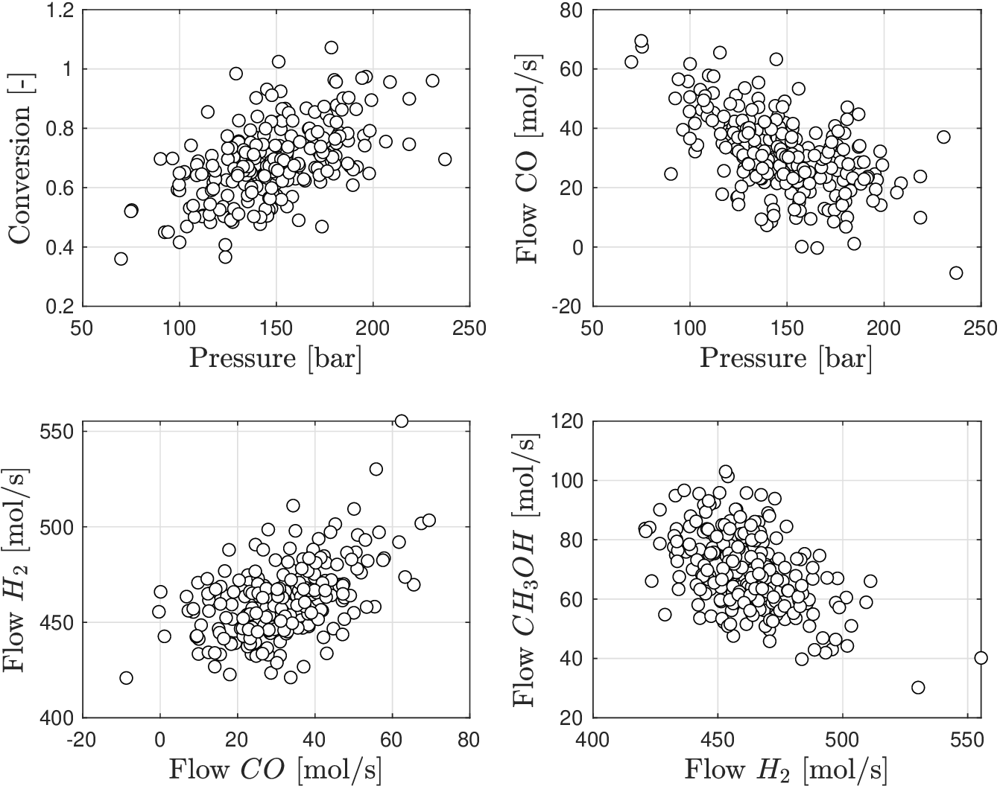
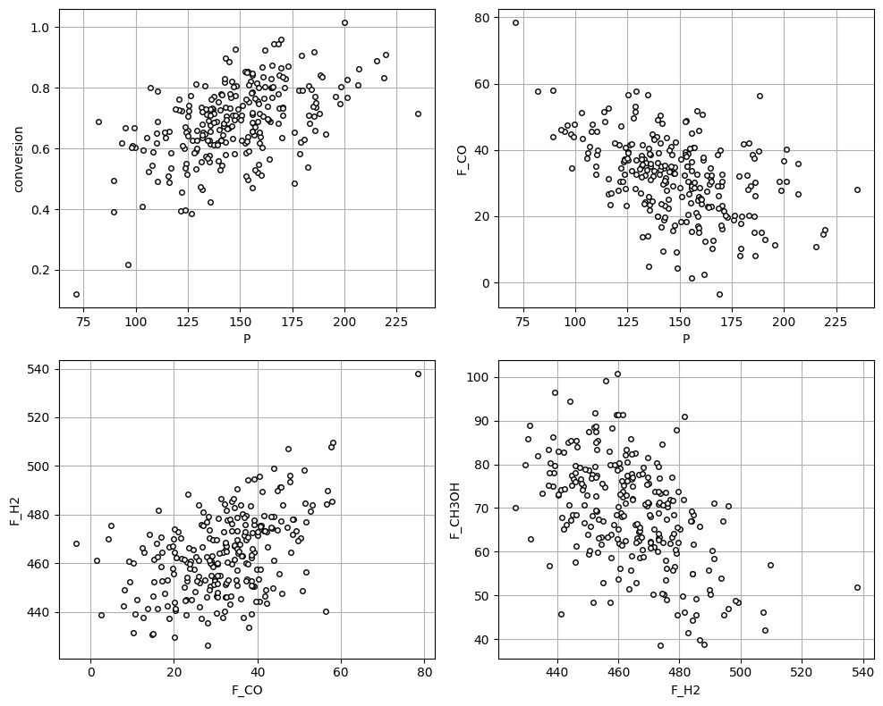

# Summarizing Statistics

As with univariate RVs, we are often interested in characterizing multivariate RVs by using summarizing statistics.  A few new concepts will emerge in this discussion.

* For continuous RV, *joint expectation* of $$X=(X_1,X_2)$$ is vector $$\mathbb{E}[X]\in\mathbb{R}^2$$:

  $$
  \begin{aligned}
  \mathbb{E}[X]=\mathbb{E}\left[\begin{array}{c}X_1\\ X_2 \end{array}\right].
  \end{aligned}
  $$

* This vector is computed as:

  $$
  \begin{aligned}
  \mathbb{E}[X]&=\int_{x\in \mathcal{D}}xf(x)dx.
  \end{aligned}
  $$

* If we write $$x=(x_1,x_2)$$, we can express expected value as:

  $$
  \begin{aligned}
  \mathbb{E}[X]&=\int_{(x_1,x_2)\in \mathcal{D}}\left[\begin{array}{c}x_1\\ x_2\end{array}\right]f(x_1,x_2)dx_1dx_2.
  \end{aligned}
  $$

* We can thus write $$\mathbb{E}[X]=(\mathbb{E}[X_1],\mathbb{E}[X_2])$$ with:

  $$
  \begin{aligned}
  \mathbb{E}[X_1]&=\int_{(x_1,x_2)\in \mathcal{D}}x_1f(x_1,x_2)dx_1dx_2\\
  \mathbb{E}[X_2]&=\int_{(x_1,x_2)\in \mathcal{D}}x_2f(x_1,x_2)dx_1dx_2.
  \end{aligned}
  $$

* We highlight difference between joint expectations $$\mathbb{E}[X_1]$$ and $$\mathbb{E}[X_2]$$ and marginal expectations of $$X_1$$ and $$X_2$$.
* The *marginal expectations* are given by:

  $$
  \begin{aligned}
  \mathbb{E}_m[X_1]&=\int_{x_1\in \mathcal{D}_1}x_1f_1(x_1)dx_1\\
  \mathbb{E}_m[X_2]&=\int_{x_2\in \mathcal{D}_2}x_2f_2(x_2)dx_2.
  \end{aligned}
  $$

   In some special situations, joint and marginal expectations are the same (e.g., $$X_1$$ and $$X_2$$ are independent).

* Joint expectation of scalar function $$\varphi:\mathbb{R}^2\to \mathbb{R}$$ of $$X$$ is a scalar value:

  $$
  \mathbb{E}[\varphi(X)]=\int_{(x_1,x_2)\in \mathcal{D}}\varphi(x_1,x_2)f(x_1,x_2)dx_1dx_2
  $$

* *Conditional* expectation of $$X_1$$ (given $$X_2=x_2$$) is:

  $$
  \begin{aligned}
  \mathbb{E}[X_1|X_2=x_2]&=\int_{x_1\in \mathcal{D}_1}x_1f(x_1|x_2)dx_1.
  \end{aligned}
  $$

* Joint expectation of $$n$$-dim $$X=(X_1,X_2,...,X_n)$$ is vector $$\mathbb{E}[X]\in \mathbb{R}^{n}$$:

  $$
  \begin{aligned}
  \mathbb{E}[X]=\left[\begin{array}{c}\mathbb{E}[X_1]\\\mathbb{E}[X_2]\\ \vdots\\ \mathbb{E}[X_n]\end{array}\right].
  \end{aligned}
  $$

   where:

  $$
  \mathbb{E}[X_i]=\int_{x\in\mathcal{D}}x_if(x)dx,\; i=1,...,n
  $$

* It is possible to compute expectations that are conditional on events. For example:

  $$
  \mathbb{E}[\varphi(X)|X\in \mathcal{A}]=\int_{x\in \mathcal{A}}\varphi(x)f(x)dx,
  $$

For univ $$X$$, we seek to understand variability of RV because this is a measure of its uncertainty.

For multiv $$X$$, we seek to understand variability of $$X_1$$ and $$X_2$$ and to understand how $$X_1$$ and $$X_2$$ vary together.

* *Covariance* of $$X=(X_1,X_2)$$ is matrix $$\textrm{Cov}(X)\in \mathbb{R}^{2\times 2}$$:

  $$
  \textrm{Cov}[X]=\mathbb{E}\left[(X-\mathbb{E}[X])(X-\mathbb{E}[X])^T\right]
  $$

   It is important to highlight that here we use the *joint expectation*.

* To simplify, we define $$m=\mathbb{E}[X]$$ with entries $$(m_1,m_2)$$ and thus:

  $$
  \begin{aligned}
  \textrm{Cov}[X]&=\mathbb{E}\left[(X-m)(X-m)^T\right]\\
  &=\mathbb{E}\left[ \left[\begin{array}{c}X_1-m_1\\ X_2 -m_2\end{array}\right] \left[X_1-m_1\; X_2 -m_2\right] \right]\\
  &=\left[ \begin{array}{cc}\mathbb{E}[(X_1-m_1)^2] &\mathbb{E}[ (X_1-m_1)(X_2-m_2)]\\ \mathbb{E}[(X_2-m_2)(X_1-m_1)]& \mathbb{E}[(X_2-m_2)^2]\end{array}\right]
  \end{aligned}
  $$

* We define the individual entries of the matrix as follows:

  $$
  \begin{aligned}
  \textrm{Cov}[X]_{11}&=\mathbb{E}[ (X_1-m_1)^2]\\
  \textrm{Cov}[X]_{12}&=\mathbb{E}[ (X_1-m_1)(X_2-m_2)]\\
  \textrm{Cov}[X]_{21}&=\mathbb{E}[ (X_2-m_2)(X_1-m_1)]\\
  \textrm{Cov}[X]_{22}&=\mathbb{E}[ (X_2-m_2)^2].
  \end{aligned}
  $$

* Note $$\textrm{Cov}[X]_{12}=\textrm{Cov}[X]_{21}$$ (covariance matrix is *symmetric*) and

  $$
  \begin{aligned}
  \textrm{Cov}[X]_{11}&=\mathbb{V}[X_1]\\
  \textrm{Cov}[X]_{22}&=\mathbb{V}[X_2].
  \end{aligned}
  $$

* The covariance matrix is also positive semi-definite (all its eigenvalues are non-negative).
* Variance $$\textrm{Cov}[X]_{11}$$ tells us how, on average, $$X_1$$ varies around $$m_1$$; $$\textrm{Cov}[X]_{22}$$ tells us how, on average, $$X_2$$ varies around $$m_2$$.

* Covariance $$\textrm{Cov}[X]_{12}=\textrm{Cov}[X]_{21}$$ tells us how, *on average*, $$X_1$$ varies with $$X_2$$:
   * If $$\textrm{Cov}[X]_{12}>0$$ indicates that $$X_1$$ and $$X_2$$ move in the same direction (on average).
   * If $$\textrm{Cov}[X]_{12}<0$$  indicates that $$X_1$$ and $$X_2$$ move in opposite directions (on average).
   * If $$\textrm{Cov}[X]_{12}=0$$  indicates that $$X_1$$ and $$X_2$$ do not move together (on average).  Does this imply independence?
* *Covariance* $$\textrm{Cov}[X]_{12}$$ is measure of *interdependence* between RVs (connectivity).
* For instance, if $$X_2=\alpha X_1$$, then $$\textrm{Cov}[X]_{12}=\alpha \mathbb{V}[X_1]$$.
* **Important:** Physical connections between RVs are encoded in covariance.

* *Autocorrelation* matrix is a summarizing statistic used to measure variability:

  $$
  \begin{aligned}
  \textrm{ACorr}[X]=\mathbb{E}[XX^T]=\left[\begin{array}{cc}\mathbb{E}[X_1X_1]&\mathbb{E}[X_1X_2]\\
  \mathbb{E}[X_2X_1]&\mathbb{E}[X_2X_2]
  \end{array}\right]
  \end{aligned}
  $$

   Definition similar to covariance but do not use expected value as reference.

* Autocorrelation matrix is related to covariance matrix as:

  $$
  \begin{aligned}
  \textrm{Cov}(X)=\textrm{ACorr}[X]-\mathbb{E}[X]\mathbb{E}[X]^T.
  \end{aligned}
  $$

* *Pearson* correlation matrix is defined as:

  $$
  \textrm{PCorr}[X]=D^{-1}\textrm{Cov}[X] D^{-1}
  $$

   where $$D=\sqrt{\textrm{diag}(\textrm{Cov}[X])}$$.

* Can show that entries of Pearson matrix satisfy:

  $$
  \begin{aligned}
  \textrm{PCorr}[X]_{11}&=1\\
  \textrm{PCorr}[X]_{12}&\in [-1,1]\\
  \textrm{PCorr}[X]_{21}&\in [-1,1]\\
  \textrm{PCorr}[X]_{22}&=1.
  \end{aligned}
  $$

* Generalizing covariance and correlation to $$n$$-dimensional case is straightforward.
* Covariance of $$X=(X_1,X_2,...,X_n)$$ is:

  $$
  \begin{aligned}
  \textrm{Cov}[X]=\left[\begin{array}{ccccc} \textrm{Cov}[X]_{11}&\textrm{Cov}[X]_{12}&\cdots &\textrm{Cov}[X]_{1n}\\
  \textrm{Cov}[X]_{21}&\textrm{Cov}[X]_{22}&\cdots &\textrm{Cov}[X]_{2n}\\
  \vdots&\vdots&\ddots&\vdots\\
  \textrm{Cov}[X]_{n1}&\textrm{Cov}[X]_{n2}&\cdots &\textrm{Cov}[X]_{nn}
  \end{array}\right]
  \end{aligned}
  $$

   where:

  $$
  \textrm{Cov}[X]_{ij}=\mathbb{E}[(X_i-\mathbb{E}[X_i])(X_j-\mathbb{E}[X_j])],\; i,j=1,...,n.
  $$

* Peason correlation of $$X=(X_1,X_2,...,X_n)$$ is:

  $$
  \begin{aligned}
  \textrm{PCorr}[X]=\left[\begin{array}{ccccc}1&\textrm{PCorr}[X]_{12}&\cdots &\textrm{PCorr}[X]_{1n}\\
  \textrm{PCorr}[X]_{21}&1&\cdots &\textrm{PCorr}[X]_{2n}\\
  \vdots&\vdots&\ddots&\vdots\\
  \textrm{Pcorr}[X]_{n1}&\textrm{PCorr}[X]_{n2}&\cdots &1
  \end{array}\right]
  \end{aligned}
  $$

   where:

  $$
  \begin{aligned}
  \textrm{PCorr}[X]_{ij}&=\frac{\textrm{Cov}[X]_{ij}}{\mathbb{SD}[X_i]\mathbb{SD}[X_j]},\; i=1,...,n,\; j=1,...,n.
  \end{aligned}
  $$

* We can use data to compute empirical estimates for covariance and correlation matrices.
* Imagine we have observations $$x_\omega=(x_{\omega,1},x_{\omega,2},...,x_{\omega,n}),\,\omega \in \mathcal{S}$$ of $$X$$.
* Empirical covariance matrix (also known as the sample covariance matrix) is:

  $$
  \begin{aligned}
  \hat{\textrm{Cov}}[X]_{ij}&=\frac{1}{S}\sum_{\omega \in \mathcal{S}}(x_{\omega,i}-\hat{m}_i)(x_{\omega,j}-\hat{m}_j),\; i,j=1,...,n
  \end{aligned}
  $$

   where

  $$
  \begin{aligned}
  \hat{m}_i&=\hat{\mathbb{E}}[X_i]=\frac{1}{S}\sum_{\omega \in \mathcal{S}}x_{\omega,i},\; i=1,...,n.
  \end{aligned}
  $$

* Here, $$\hat{m}_i$$ are empirical expectations of $$X_i,\,i=1,...,n$$.

## Example: Covariance and Correlation for Gibbs Reactor

* Revisit reactor under which the reaction $$CO+2H_2\leftrightarrow CH_3OH$$ takes place.
* Recall that this reaction is favored at high pressure.
* Have data available for $$n=5$$ RVs: pressure, conversion, output flow for reactants ($$CO$$, $$H_2$$) and for product $$CH_3OH$$.

Consider the following questions:


* Do you expect positive or negative corr between conversion and pressure?
* Do you expect positive or negative corr between pressure and output flow of $$CO$$?
* How are the output flows for $$CO$$, $$H_2$$, and $$CH_3OH$$ related?


* Without even looking at the data, our physical understanding of reactor gives us so intuition as to how the variables are connected between each other.
* We know that reaction is favored by high pressure and thus expect that conversion is positively correlated with pressure.
* From conservation laws, we also know that output flows of reactants decrease as we increase the output flow of product (with higher conversion).
* We thus expect that output flow of $$CO$$ is negatively correlated with pressure (knowledge of one variable is encoded in another variable).

Interdependencies are confirmed visually from data but trends hidden by noise.

<figure></figure>

* Use data for computing sample covariance and Pearson correlation matrices.
* Covariance matrix is:

  $$
  \begin{aligned}
  \hat{\textrm{Cov}}[X]=\left[\begin{array}{rrrrr}
  776.94   &       1.83    &   -195.91   &    -396.57      &  181.45\\
  1.83    &      0.02   &      -0.54    &     -1.11      &    0.40\\
  -195.91     &    -0.54   &     163.81   &     117.59      &  -58.17\\
  -396.57    &     -1.11   &     117.59   &     338.35    &   -116.12\\
  181.45     &     0.40   &     -58.17   &    -116.12    &    161.70
  \end{array}\right].
  \end{aligned}
  $$

* Rows and columns are arranged as: 1) pressure, 2) conversion, and 3,4,5) output flows of $$CO$$, $$H_2$$, and $$CH_3OH$$.
* Sample correlation matrix is:

  $$
  \begin{aligned}
  \hat{\textrm{PCorr}}[X]=\left[\begin{array}{rrrrrr}
  1.00     &     0.53      &   -0.55    &     -0.77   &       0.51\\
  0.53     &     1.00     &    -0.34    &     -0.49    &      0.25\\
  -0.55    &     -0.34   &       1.00    &      0.50     &    -0.36\\
  -0.77    &     -0.49    &      0.50    &      1.00     &    -0.50\\
  0.51     &     0.25      &   -0.36     &    -0.50   &       1.00
  \end{array}\right]
  \end{aligned}
  $$

* Sample covariance and correlation matrix confirm physical intuition.

#### Python implementation: Sample covariance and correlation


Notebook [`ch3_gibbs_covariance.ipynb`](https://colab.research.google.com/github/vzavala/StatsBook-GitBook/blob/main/notebooks/ch3_gibbs_covariance.ipynb) — open it in Colab and run the cells alongside this section.


Covariance and correlation for the Gibbs reactor (Victor Z, UW-Madison, 2024).

| Slides | Python | Meaning |
|---|---|---|
| $$x_\omega\in\mathbb{R}^5$$, $$S$$ | `x_omega` (S x 5), `S` | pressure, conversion, outflows of CO, H$$_2$$, CH$$_3$$OH |
| $$\hat{m}_i=\hat{\mathbb{E}}[X_i]$$ | `m_hat` | empirical means |
| $$\hat{\mathrm{Cov}}[X]$$ | `Cov_hat` | sample covariance (with $$1/S$$) |
| $$\hat{\mathrm{PCorr}}[X]=D^{-1}\hat{\mathrm{Cov}}[X]D^{-1}$$ | `PCorr_hat`, `D` | Pearson correlation |

```python
import numpy as np
import matplotlib.pyplot as plt
import pandas as pd

names = ['P', 'conversion', 'F_CO', 'F_H2', 'F_CH3OH']
x_omega = np.loadtxt(path+'Data/gibbs_covariance.dat')
S, n = x_omega.shape

np.random.seed(1)   # measurement noise (results differ slightly from the Matlab version)
x_omega = x_omega + np.random.normal(0, 1, (S, n)) * np.array([10, 0.1, 10, 10, 10])

fig, axs = plt.subplots(2, 2, figsize=(10, 8))
for ax, (i, j) in zip(axs.ravel(), [(0, 1), (0, 2), (2, 3), (3, 4)]):
    ax.plot(x_omega[:, i], x_omega[:, j], 'ko', markerfacecolor='w', markersize=4)
    ax.set_xlabel(names[i])
    ax.set_ylabel(names[j])
    ax.grid(True)
plt.tight_layout()
plt.show()
```

<figure></figure>

$$\hat{\mathrm{Cov}}[X]_{ij}=\frac{1}{S}\sum_{\omega}(x_{\omega,i}-\hat{m}_i)(x_{\omega,j}-\hat{m}_j)$$.
(`np.cov` divides by $$S-1$$ unless `bias=True`.)

```python
m_hat = x_omega.mean(axis=0)
Cov_hat = (x_omega - m_hat).T @ (x_omega - m_hat) / S
assert np.allclose(Cov_hat, np.cov(x_omega, rowvar=False, bias=True))

D = np.diag(np.sqrt(np.diag(Cov_hat)))
PCorr_hat = np.linalg.inv(D) @ Cov_hat @ np.linalg.inv(D)
assert np.allclose(PCorr_hat, np.corrcoef(x_omega, rowvar=False))

pd.options.display.float_format = '{:.2f}'.format
print("Cov_hat[X] =")
print(pd.DataFrame(Cov_hat, index=names, columns=names))
print("\nPCorr_hat[X] =")
print(pd.DataFrame(PCorr_hat, index=names, columns=names))
print("\neigenvalues of Cov_hat (all >= 0):", np.round(np.linalg.eigvalsh(Cov_hat), 3))
```

```
Cov_hat[X] =
                 P  conversion    F_CO    F_H2  F_CH3OH
P           701.09        1.74 -149.44 -332.61   168.97
conversion    1.74        0.02   -0.50   -1.02     0.38
F_CO       -149.44       -0.50  142.50   95.84   -37.57
F_H2       -332.61       -1.02   95.84  278.81  -102.95
F_CH3OH     168.97        0.38  -37.57 -102.95   147.41

PCorr_hat[X] =
               P  conversion  F_CO  F_H2  F_CH3OH
P           1.00        0.52 -0.47 -0.75     0.53
conversion  0.52        1.00 -0.33 -0.48     0.25
F_CO       -0.47       -0.33  1.00  0.48    -0.26
F_H2       -0.75       -0.48  0.48  1.00    -0.51
F_CH3OH     0.53        0.25 -0.26 -0.51     1.00

eigenvalues of Cov_hat (all >= 0): [1.10000e-02 8.07870e+01 1.04620e+02 1.11341e+02 9.73072e+02]
```
