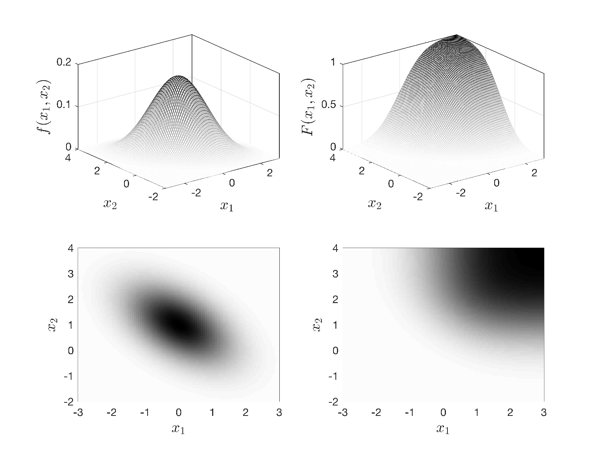
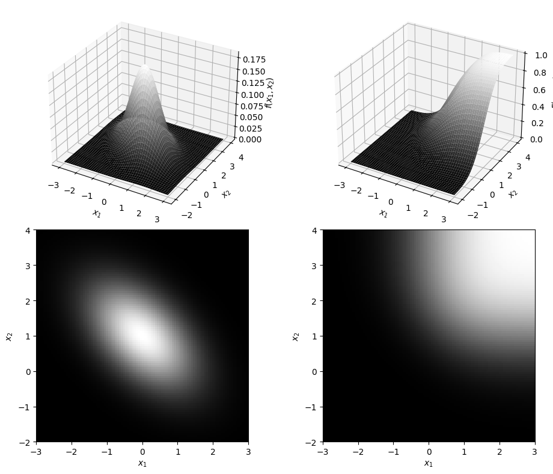
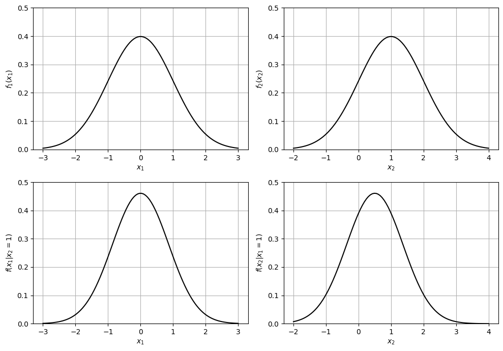
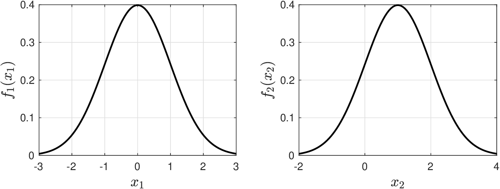
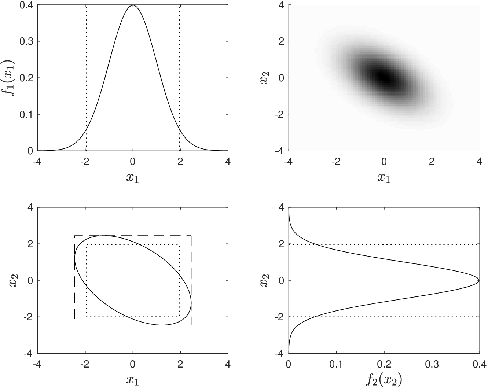
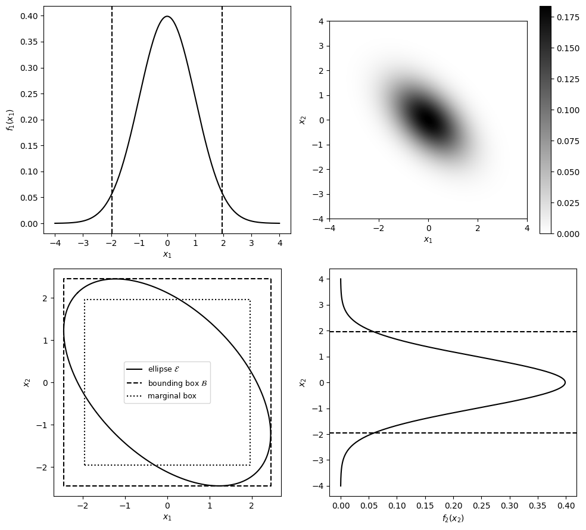
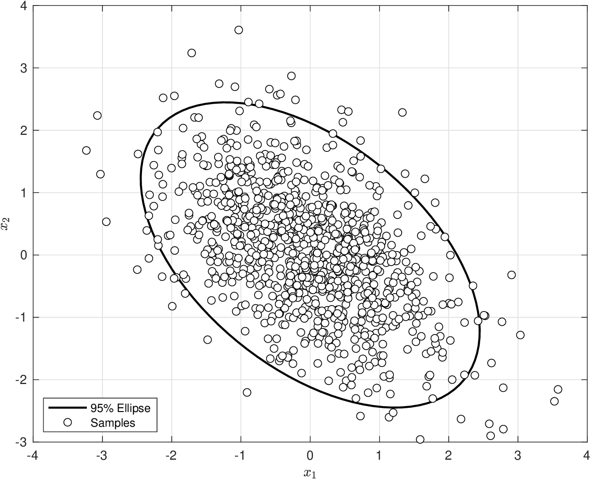
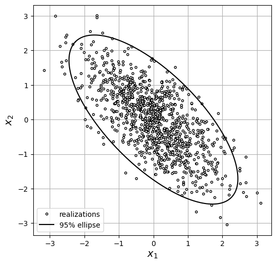

# Multivariate Gaussian

## Multivariate Gaussian Model

* By far, the most used multivariate RV model is the *Gaussian* RV model.
* Joint pdf of an $$n$$-dimensional Gaussian $$X\sim \mathcal{N}(\mu,\Sigma)$$ is:

  $$
  \begin{aligned}
  f_X(x)&=\frac{1}{(2\pi)^{n/2}|\Sigma|^{1/2}}\exp\left(-\frac{1}{2}(x-\mu)^T\Sigma^{-1}(x-\mu)\right), \; x\in \mathcal{D},
  \end{aligned}
  $$

* Parameters of this model are $$\mu\in \mathbb{R}^n$$ (a vector) and $$\Sigma\in \mathbb{R}^{n\times n}$$ (a matrix).
* *Domain* of Gaussian $$X$$ is $$\mathcal{D}=(-\infty,\infty)^n\subseteq \mathbb{R}^n$$.
* Gaussian RV has key property that $$\mu=\mathbb{E}[X]$$ and $$\Sigma=\textrm{Cov}[X]$$.

<figure><figcaption><p>Joint pdf and joint cdf for multivariate Gaussian and 2D projections.</p></figcaption></figure>

* Pdf becomes concentrated (dense) in center (indicating a higher pdf value).
* Density forms ellipsoidal regions (diffuses as moving from center).

<details>

<summary>Python: reproduce this figure (ch3_compare_multigaussians.ipynb)</summary>

Joint, marginal, and conditional pdfs of $$X\sim\mathcal{N}(\mu,\Sigma)$$ with $$\mu=(0,1)$$ and
$$\Sigma=\begin{bmatrix}1&-1/2\\-1/2&1\end{bmatrix}$$ (Victor Z, UW-Madison, 2024).
Python names: `mu`, `Sigma`, joint pdf/cdf `f`, `F`, marginals `f_1`, `f_2`,
conditional moments `mu_1g2`, `Sigma_1g2` ($$\mu_{1|2}$$, $$\Sigma_{1|2}$$) and `mu_2g1`, `Sigma_2g1`.

```python
import numpy as np
import matplotlib.pyplot as plt
from scipy.stats import norm, multivariate_normal

mu = np.array([0, 1])
Sigma = np.array([[1, -0.5], [-0.5, 1]])
X = multivariate_normal(mean=mu, cov=Sigma)

x1 = np.linspace(-3, 3, 100)
x2 = np.linspace(-2, 4, 100)
X1, X2 = np.meshgrid(x1, x2)
grid = np.dstack([X1, X2])
f = X.pdf(grid)
F = X.cdf(grid)

fig = plt.figure(figsize=(10, 8))
for k, (Z, label) in enumerate(((f, '$f(x_1,x_2)$'), (F, '$F(x_1,x_2)$'))):
    ax = fig.add_subplot(2, 2, k + 1, projection='3d')
    ax.plot_surface(X1, X2, Z, cmap='gray')
    ax.set_xlabel('$x_1$')
    ax.set_ylabel('$x_2$')
    ax.set_zlabel(label)
    ax2 = fig.add_subplot(2, 2, k + 3)
    ax2.imshow(Z, extent=[-3, 3, -2, 4], cmap='gray', origin='lower')
    ax2.set_xlabel('$x_1$')
    ax2.set_ylabel('$x_2$')
plt.tight_layout()
plt.show()
```

<figure></figure>

Marginals $$X_1\sim\mathcal{N}(\mu_1,\Sigma_{11})$$, $$X_2\sim\mathcal{N}(\mu_2,\Sigma_{22})$$ and conditionals with
$$\mu_{1|2}=\mu_1+\Sigma_{12}\Sigma_{22}^{-1}(x_2-\mu_2)$$, $$\Sigma_{1|2}=\Sigma_{11}-\Sigma_{12}\Sigma_{22}^{-1}\Sigma_{21}$$
(and symmetrically for $$2|1$$), evaluated at $$x_2=1$$ and $$x_1=1$$.

```python
f_1 = norm.pdf(x1, mu[0], np.sqrt(Sigma[0, 0]))
f_2 = norm.pdf(x2, mu[1], np.sqrt(Sigma[1, 1]))

x2_given, x1_given = 1.0, 1.0
mu_1g2 = mu[0] + Sigma[0, 1] / Sigma[1, 1] * (x2_given - mu[1])
Sigma_1g2 = Sigma[0, 0] - Sigma[0, 1] / Sigma[1, 1] * Sigma[1, 0]
mu_2g1 = mu[1] + Sigma[1, 0] / Sigma[0, 0] * (x1_given - mu[0])
Sigma_2g1 = Sigma[1, 1] - Sigma[1, 0] / Sigma[0, 0] * Sigma[0, 1]

fig, axs = plt.subplots(2, 2, figsize=(10, 7))
axs[0, 0].plot(x1, f_1, 'k'); axs[0, 0].set_ylabel('$f_1(x_1)$'); axs[0, 0].set_xlabel('$x_1$')
axs[0, 1].plot(x2, f_2, 'k'); axs[0, 1].set_ylabel('$f_2(x_2)$'); axs[0, 1].set_xlabel('$x_2$')
axs[1, 0].plot(x1, norm.pdf(x1, mu_1g2, np.sqrt(Sigma_1g2)), 'k')
axs[1, 0].set_ylabel('$f(x_1|x_2=1)$'); axs[1, 0].set_xlabel('$x_1$')
axs[1, 1].plot(x2, norm.pdf(x2, mu_2g1, np.sqrt(Sigma_2g1)), 'k')
axs[1, 1].set_ylabel('$f(x_2|x_1=1)$'); axs[1, 1].set_xlabel('$x_2$')
for ax in axs.ravel():
    ax.grid(True)
    ax.set_ylim(0, 0.5)
plt.tight_layout()
plt.show()
print(f"X1 | x2=1 ~ N({mu_1g2:.2f}, {Sigma_1g2:.2f}),   X2 | x1=1 ~ N({mu_2g1:.2f}, {Sigma_2g1:.2f})")
```

<figure></figure>

```
X1 | x2=1 ~ N(0.00, 0.75),   X2 | x1=1 ~ N(0.50, 0.75)
```

Open in Colab: [`ch3_compare_multigaussians.ipynb`](https://colab.research.google.com/github/vzavala/StatsBook-GitBook/blob/main/notebooks/ch3_compare_multigaussians.ipynb)

</details>

* For $$n=2$$, joint pdf can be written as:

  $$
  \begin{aligned}
  f(x_1,x_2)&=c\cdot \exp\left(-\frac{1}{2}\left[\begin{array}{c}x_1-\mu_1\\ x_2-\mu_2\end{array}\right]^T\left[\begin{array}{cc}\Sigma_{11}&\Sigma_{12}\\ \Sigma_{21}&\Sigma_{22}\end{array}\right]^{-1}\left[\begin{array}{c}x_1-\mu_1\\ x_2-\mu_2\end{array}\right]\right)
  \end{aligned}
  $$

   where:

  $$
  \begin{aligned}
  c=\frac{1}{2\pi\left|\begin{array}{cc}\Sigma_{11}&\Sigma_{12}\\ \Sigma_{21}&\Sigma_{22}\end{array}\right|^{1/2}}.
  \end{aligned}
  $$

* Recall $$\mathbb{E}[X]=\mu$$ and $$\textrm{Cov}[X]=\Sigma$$.
* If $$(X_1,X_2)$$ are independent, we have $$\Sigma_{12}=\Sigma_{21}=0$$ and thus:

  $$
  \begin{aligned}
  f(x_1,x_2)&=\frac{1}{\sqrt{2\pi\Sigma_{11}}}\exp \left(\frac{-(x_1-\mu_1)^2}{2\Sigma_{11}}\right)\cdot \frac{1}{\sqrt{2\pi\Sigma_{22}}}\exp \left(\frac{-(x_2-\mu_2)^2}{2\Sigma_{22}}\right)
  \end{aligned}
  $$

* Marginals of Gaussian $$X=(X_1,X_2)$$ are:

  $$
  \begin{aligned}
  f_1(x_1)&=\frac{1}{\sqrt{2\pi\Sigma_{11}}}\exp \left({\frac{-(x_1-\mu_1)^2}{2\Sigma_{11}}}\right)\\
  f_2(x_2)&=\frac{1}{\sqrt{2\pi\Sigma_{22}}}\exp \left({\frac{-(x_2-\mu_2)^2}{2\Sigma_{22}}}\right).
  \end{aligned}
  $$

* These correspond to pdfs of $$X_1\sim\mathcal{N}(\mu_1,\Sigma_{11})$$ and $$X_2\sim \mathcal{N}(\mu_2,\Sigma_{22})$$.
* Here are marginal pdfs for Gaussian with $$\mu=(0,1)$$ and $$\Sigma=\left[\begin{array}{cc}1 &-1/2\\ -1/2 & 1\end{array}\right]$$.

  <figure></figure>

* These correspond to pdfs of $$X_1\sim\mathcal{N}(0,1)$$ and $$X_2\sim \mathcal{N}(1,1)$$.

* Conditional pdfs of Gaussian $$X=(X_1,X_2)$$ are:

  $$
  \begin{aligned}
  f(x_1|x_2)&=\frac{1}{\sqrt{2\pi\Sigma_{1|2}}}\exp \left({\frac{-(x_1-\mu_{1|2})^2}{2\Sigma_{1|2}}}\right)\\
  f(x_2|x_1)&=\frac{1}{\sqrt{2\pi\Sigma_{2|1}}}\exp \left({\frac{-(x_2-\mu_{2|1})^2}{2\Sigma_{2|1}}}\right).
  \end{aligned}
  $$

   where:

  $$
  \begin{aligned}
  \mu_{1|2}&=\mu_1+\Sigma_{12}\Sigma_{22}^{-1}(x_2-\mu_2)\\
  \Sigma_{1|2}&=\Sigma_{11}-\Sigma_{12}\Sigma_{22}^{-1}\Sigma_{21}\\
  \mu_{2|1}&=\mu_2+\Sigma_{21}\Sigma_{11}^{-1}(x_1-\mu_1)\\
  \Sigma_{2|1}&=\Sigma_{22}-\Sigma_{21}\Sigma_{11}^{-1}\Sigma_{12}
  \end{aligned}
  $$

* We thus have $$X_1|X_2\sim \mathcal{N}(\mu_{1|2},\Sigma_{1|2})$$ and $$X_2|X_1\sim \mathcal{N}(\mu_{2|1},\Sigma_{2|1})$$.
* This provides important insights on how covariance between $$X_1$$ and $$X_2$$ affects to what degree knowledge of one resolves uncertainty of the other.

## Example:Uncertainty Reduction in Gibbs Reactor (Part I)

Pressure and conversion $$(X_1,X_2)$$ are Gaussian with covariance and correlation:

$$
\begin{aligned}
\textrm{Cov}[X]
&=\left[\begin{array}{rr}  776.94     &     1.83  \\
1.83   &       0.02\end{array}\right]\\
\textrm{PCorr}[X]
&=\left[\begin{array}{rr}  1     &     0.53  \\
0.53   &       1\end{array}\right].
\end{aligned}
$$


* How does having knowledge in pressure resolves uncertainty in conversion?
* How does having knowledge in conversion resolves uncertainty in pressure?


## Example:Uncertainty Reduction in Gibbs Reactor

* To quantify by how much is uncertainty in conversion reduced by having knowledge of pressure,  we compute variance of conditional pdf $$f(x_2|x_1)$$.
* Variance of $$X_2|X_1$$ is given by:

  $$
  \begin{aligned}
  \Sigma_{2|1}&=\Sigma_{22}-\Sigma_{21}\Sigma_{11}^{-1}\Sigma_{12}\\
  &=0.02-0.53\cdot (776.94)^{-1}\cdot 0.53\\
  &=0.019
  \end{aligned}
  $$

   This is a relative reduction of *5%*.

* To quantify how knowledge of conversion affects uncertainty in pressure, we obtain variance of $$X_1|X_2$$:

  $$
  \begin{aligned}
  \Sigma_{1|2}&=\Sigma_{11}-\Sigma_{12}\Sigma_{22}^{-1}\Sigma_{21}\\
  &=776.94-1.83\cdot (0.02)^{-1}\cdot 1.83\\
  &=609.49
  \end{aligned}
  $$

   This is a relative reduction of *21%*. Knowledge of conversion has a larger effect.

#### Python implementation: Conditional variance of pressure and conversion

For a Gaussian $$(X_1,X_2)$$ (pressure, conversion):
$$\Sigma_{2|1}=\Sigma_{22}-\Sigma_{21}\Sigma_{11}^{-1}\Sigma_{12}$$ and
$$\Sigma_{1|2}=\Sigma_{11}-\Sigma_{12}\Sigma_{22}^{-1}\Sigma_{21}$$.
We use the covariance values quoted on the slide. Note that the relative reduction
$$1-\Sigma_{2|1}/\Sigma_{22}=1-\Sigma_{1|2}/\Sigma_{11}=\rho^2$$ is the same in both directions.

```python
Sigma = np.array([[776.94, 1.83],
                  [1.83, 0.02]])     # Cov[X] for (pressure, conversion), from the slide
Sigma_2g1 = Sigma[1, 1] - Sigma[1, 0] / Sigma[0, 0] * Sigma[0, 1]
Sigma_1g2 = Sigma[0, 0] - Sigma[0, 1] / Sigma[1, 1] * Sigma[1, 0]
rho = Sigma[0, 1] / np.sqrt(Sigma[0, 0] * Sigma[1, 1])
print(f"Sigma_2|1 = {Sigma_2g1:.4f}  (reduction {1 - Sigma_2g1/Sigma[1, 1]:.0%})")
print(f"Sigma_1|2 = {Sigma_1g2:.2f}  (reduction {1 - Sigma_1g2/Sigma[0, 0]:.0%})")
print(f"rho = {rho:.2f},  rho^2 = {rho**2:.2f}")
```

```
Sigma_2|1 = 0.0157  (reduction 22%)
Sigma_1|2 = 609.50  (reduction 22%)
rho = 0.46,  rho^2 = 0.22
```

The same computation with the full data set: the variance of conversion given the
other four variables, $$\Sigma_{1|2}$$ with block $$1=$$ conversion and block $$2=$$ the rest.

```python
order = [1, 0, 2, 3, 4]               # conversion first
C = Cov_hat[np.ix_(order, order)]
Sigma_11, Sigma_12, Sigma_22 = C[0, 0], C[0, 1:], C[1:, 1:]
Sigma_1g2 = Sigma_11 - Sigma_12 @ np.linalg.solve(Sigma_22, Sigma_12)
print(f"V[conversion] = {Sigma_11:.4f},  V[conversion | other 4 variables] = {Sigma_1g2:.4f}")
```

```
V[conversion] = 0.0158,  V[conversion | other 4 variables] = 0.0111
```

## Multivariate Gaussian

* Propagation of a Gaussian through a linear model yields another Gaussian.
* Consider $$X\sim\mathcal{N}(\mu,\Sigma)$$ and $$Y=\varphi(X)=AX+b$$ with $$A\in \mathbb{R}^{p\times n}$$ and $$b\in \mathbb{R}^n$$.
* Can show that $$Y\sim \mathcal{N}(A\mu+b,A\Sigma A^T)$$.
* Property can be used to establish useful properties.
* For example, consider Gaussian *mixture* $$Y=X_1+X_2$$ with independent $$X_1\sim \mathcal{N}(\mu_1,\sigma_1^2)$$ and $$X_2\sim \mathcal{N}(\mu_2,\sigma_2^2)$$ .
* One can show that Gaussian mixture has form $$Y=AX$$ and that $$Y\sim\mathcal{N}(\mu_1+\mu_2,\sigma_1^2+\sigma_2^2)$$.

* Understanding geometry of multivariate Gaussian facilitates *data visualization*.
* We write the covariance between $$X_1$$ and $$X_2$$ as:

  $$
  \Sigma_{12}=\rho\cdot \sqrt{\Sigma_{11}\Sigma_{22}}
  $$

   where $$\rho=\textrm{PCorr}[X]_{12}$$ is Pearson correlation coefficient.

* With this, joint pdf can be expressed as:

  $$
  f(x_1,x_2)=\frac{1}{2\pi\sqrt{\Sigma_{11}\Sigma_{22}}}\exp\left(-E(x_1,x_2)\right)
  $$

   where:

  $$
  E(x_1,x_2)=\frac{1}{2(1-\rho^2)}\left[\frac{(x_1-\mu_1)^2}{\Sigma_{11}}+\frac{(x_2-\mu_2)^2}{\Sigma_{22}}-2\rho\frac{(x_1-\mu_1)(x_2-\mu_2)}{\sqrt{\Sigma_{11}\Sigma_{22}}}\right]
  $$

   If we fix $$f(x_1,x_2)$$ to a given value $$p$$, we can write:

  $$
  \ell=E(x_1,x_2)
  $$

   with $$\ell=-\log(p\cdot 2\pi\sqrt{\Sigma_{11}\Sigma_{22}})$$.


$$
E(x_1,x_2)=\frac{1}{2(1-\rho^2)}\left[\frac{(x_1-\mu_1)^2}{\Sigma_{11}}+\frac{(x_2-\mu_2)^2}{\Sigma_{22}}-2\rho\frac{(x_1-\mu_1)(x_2-\mu_2)}{\sqrt{\Sigma_{11}\Sigma_{22}}}\right]
$$


* Equation $$\ell=E(x_1,x_2)$$ defines an ellipse whose size scales with $$\ell$$.
* Ellipse $$\ell=E(x_1,x_2)$$ is centered around ($$\mu_1,\mu_2$$).
* Length of axis in $$x_1$$ direction is defined by $$\Sigma_{11}$$.
* Length of axis in $$x_2$$ direction is defined by $$\Sigma_{22}$$.
* Correlation between $$X_1$$ and $$X_2$$ defines *orientation of ellipse*:
   * If $$\rho>0$$ (positive correlation), ellipse is tilted to right
   * If $$\rho<0$$ (negative correlation), ellipse is tilted to left
   * If $$\rho=0$$, (no correlation), ellipse has no tilt.
* Correlation *does not* affect size of ellipsoid (only its orientation).

* Want *confidence regions* (regions over which we expect to find $$X$$ with a given prob).
* We want to determine  box region $$\mathcal{B}\subseteq \mathcal{D}$$ that contains $$X$$ with probability $$1-\alpha$$:

  $$
  \mathbb{P}(X\in \mathcal{B})=1-\alpha.
  $$

* For $$X\sim \mathcal{N}(\mu,\sigma^2)$$ (1D), box is a line interval:

  $$
  \mathcal{B}=\{\,x\in [\mu\pm \sqrt{\mathbb{Q}(1-\alpha)} \sigma]\}
  $$

   where $$\mathbb{Q}(1-\alpha)$$ is the $$(1-\alpha)$$-quantile of $$\chi^2(1)$$.

* Box tells us that a realization of $$\mathcal{N}(\mu,\sigma^2)$$ will land in $$\mathcal{B}$$ with  prob $$1-\alpha$$.

* For $$X=(X_1,X_2)$$ and $$X_1\sim \mathcal{N}(\mu_1,\sigma_1^2)$$ and $$X_2\sim \mathcal{N}(\mu_2,\sigma_2^2)$$ we can define box:

  $$
  \begin{aligned}
  \mathcal{B}=\{\,x_1\in [\mu_1\pm \sqrt{\mathbb{Q}(1-\alpha)}\sigma_1]\,\&\,x_2\in [\mu_2\pm \sqrt{\mathbb{Q}(1-\alpha)}\sigma_2]\}.
  \end{aligned}
  $$

* This is known as *marginal box* and does not capture correlations in $$X_1$$ and $$X_2$$.

* For $$X\sim \mathcal{N}(\mu,\Sigma)$$, we have seen that joint pdf has level sets that form ellipses.
* This means that realizations of $$X$$ concentrate in ellipses.
* We thus seek an *ellipsoidal* region $$\mathcal{E}\subseteq \mathcal{D}$$ that contains $$X$$ with some probability:

  $$
  \mathbb{P}(X\in \mathcal{E})=1-\alpha.
  $$

* One can show that the ellipsoidal region is given by:

  $$
  \mathcal{E}=\{(x-\mu)^T\Sigma^{-1}(x-\mu)\leq \mathbb{Q}(1-\alpha)\}
  $$

   where $$\mathbb{Q}(1-\alpha)$$ is the $$(1-\alpha)$$-quantile of $$\chi^2(n)$$.

* Can show that *tightest box* that encloses ellipsoid $$\mathcal{E}$$ is:

  $$
  \begin{aligned}
  \mathcal{B}=\{\,x_1\in [\mu_1\pm \sqrt{\mathbb{Q}(1-\alpha)}\sigma_1]\,\&\,x_2\in [\mu_2\pm \sqrt{\mathbb{Q}(1-\alpha)}\sigma_2]\,\}.
  \end{aligned}
  $$

   where $$\mathbb{Q}(1-\alpha)$$ is  $$(1-\alpha)$$-quantile of $$\chi^2(n)$$.

* Note difference of quantile with that of marginal box.
* Ellipsoid and bounding box capture correlations between RVs.

## Example: Geometry of 2D Gaussian Ellipsoid

We visualize joint pdf and marginal pdfs for $$\mu=(0,0)$$ and $$\Sigma=\left[\begin{array}{cc}1 &-1/2\\ -1/2 & 1\end{array}\right]$$.

<figure></figure>

* Ellipsoid is tilted to left (because $$\Sigma_{12}<0$$) and is centered at $$\mu=(0,0)$$.
* Axes along $$x_1$$ and $$x_2$$ directions have same length (because $$\Sigma_{11}=\Sigma_{22}$$).
* Marginal box does not capture its shape (its tilt) while the enclosing box does.

#### Python implementation


Notebook [`ch3_gaussian_geometry.ipynb`](https://colab.research.google.com/github/vzavala/StatsBook-GitBook/blob/main/notebooks/ch3_gaussian_geometry.ipynb) — open it in Colab and run the cells alongside this section.


Geometry of a 2D Gaussian (Victor Z, UW-Madison, 2024).

| Slides | Python | Meaning |
|---|---|---|
| $$\mu$$, $$\Sigma$$ | `mu`, `Sigma` | mean and covariance |
| $$1-\alpha$$ | `1 - alpha` | probability of the region (95%) |
| $$\mathbb{Q}(1-\alpha)$$ of $$\chi^2(n)$$ | `Q_n` | quantile defining the ellipse $$\mathcal{E}$$ and its bounding box $$\mathcal{B}$$ |
| $$\mathbb{Q}(1-\alpha)$$ of $$\chi^2(1)$$ | `Q_1` | quantile defining the marginal box |

The `ellipse` helper (`Support/ellipse.py`) returns the ellipse
$$\{(x-\mu)^T\Sigma^{-1}(x-\mu)= \mathbb{Q}\}$$ and its tightest bounding box.

```python
import sys
import numpy as np
import matplotlib.pyplot as plt
from scipy.stats import norm, chi2, multivariate_normal
sys.path.append(path + 'Support')
from ellipse import ellipse

mu = np.array([0, 0])
Sigma = np.array([[1, -0.5], [-0.5, 1]])
alpha, n = 0.05, 2

Q_n = chi2.ppf(1 - alpha, n)
x_e, y_e, _, _, bbox = ellipse(np.linalg.inv(Sigma), Q_n, 200, mu)     # ellipse E and box B

Q_1 = chi2.ppf(1 - alpha, 1)
half = np.sqrt(Q_1 * np.diag(Sigma))                                   # marginal box half-widths
mbox = mu + np.array([[-1, -1], [1, -1], [1, 1], [-1, 1], [-1, -1]]) * half
```

```python
x1 = np.linspace(-4, 4, 200)
x2 = np.linspace(-4, 4, 200)
X1, X2 = np.meshgrid(x1, x2)
f = multivariate_normal(mu, Sigma).pdf(np.dstack([X1, X2]))   # joint pdf (captures the correlation)
f_1 = norm.pdf(x1, mu[0], np.sqrt(Sigma[0, 0]))
f_2 = norm.pdf(x2, mu[1], np.sqrt(Sigma[1, 1]))

fig, axs = plt.subplots(2, 2, figsize=(10, 9))
axs[0, 0].plot(x1, f_1, 'k')
for v in (mbox[0, 0], mbox[1, 0]):
    axs[0, 0].axvline(v, color='k', ls='--')
axs[0, 0].set_xlabel('$x_1$'); axs[0, 0].set_ylabel('$f_1(x_1)$')
im = axs[0, 1].imshow(f, extent=[-4, 4, -4, 4], cmap='gray_r', origin='lower')
fig.colorbar(im, ax=axs[0, 1])
axs[0, 1].set_xlabel('$x_1$'); axs[0, 1].set_ylabel('$x_2$')
axs[1, 0].plot(x_e, y_e, 'k', label=r'ellipse $\mathcal{E}$')
axs[1, 0].plot(bbox[:, 0], bbox[:, 1], 'k--', label=r'bounding box $\mathcal{B}$')
axs[1, 0].plot(mbox[:, 0], mbox[:, 1], 'k:', label='marginal box')
axs[1, 0].set_xlabel('$x_1$'); axs[1, 0].set_ylabel('$x_2$')
axs[1, 0].legend(fontsize=9)
axs[1, 0].set_aspect('equal')
axs[1, 1].plot(f_2, x2, 'k')
for v in (mbox[0, 1], mbox[2, 1]):
    axs[1, 1].axhline(v, color='k', ls='--')
axs[1, 1].set_xlabel('$f_2(x_2)$'); axs[1, 1].set_ylabel('$x_2$')
plt.tight_layout()
plt.show()
print(f"chi2(2) quantile Q_n = {Q_n:.2f},  chi2(1) quantile Q_1 = {Q_1:.2f}")
```

<figure></figure>

```
chi2(2) quantile Q_n = 5.99,  chi2(1) quantile Q_1 = 3.84
```

We now present 95% ellipsoidal region and 1000 realizations from  Gaussian.

<figure></figure>

* We have that 942 out of $$\mathcal{S}=$$1000 realizations (94.2%)  lie inside ellipsoid
* Realizations inside ellipse satisfy constraint $$(x_\omega-\mu)^T\Sigma^{-1}(x_\omega-\mu)\leq \mathbb{Q}(1-\alpha)$$
* Fraction of realizations that are inside ellipsoid is not exactly 95%. Why?

#### Python implementation


Notebook [`ch3_gaussian_samples_ellipse.ipynb`](https://colab.research.google.com/github/vzavala/StatsBook-GitBook/blob/main/notebooks/ch3_gaussian_samples_ellipse.ipynb) — open it in Colab and run the cells alongside this section.


Realizations of a 2D Gaussian and the 95% ellipsoidal region (Victor Z, UW-Madison, 2019).
A realization $$x_\omega$$ (`x_omega[w]`) is inside $$\mathcal{E}$$ if
$$(x_\omega-\mu)^T\Sigma^{-1}(x_\omega-\mu)\leq\mathbb{Q}(1-\alpha)$$ (`Q`, the $$\chi^2(2)$$ quantile).

```python
import sys
import numpy as np
import matplotlib.pyplot as plt
from scipy.stats import chi2
sys.path.append(path + 'Support')
from ellipse import ellipse

mu = np.array([0, 0])
Sigma = np.array([[1, -0.7], [-0.7, 1]])
alpha = 0.05
Q = chi2.ppf(1 - alpha, 2)
x_e, y_e, _, _, _ = ellipse(np.linalg.inv(Sigma), Q, 200, mu)

np.random.seed(0)
S = 1000
x_omega = np.random.multivariate_normal(mu, Sigma, S)
Sigma_inv = np.linalg.inv(Sigma)
inside = np.array([(x_w - mu) @ Sigma_inv @ (x_w - mu) <= Q for x_w in x_omega])
print(f"{inside.sum()} of S = {S} realizations ({inside.mean():.1%}) lie inside the ellipse")

plt.figure(figsize=(6, 6))
plt.plot(x_omega[:, 0], x_omega[:, 1], 'ko', markerfacecolor='w', markersize=3, label='realizations')
plt.plot(x_e, y_e, 'k', linewidth=1.5, label='95% ellipse')
plt.xlabel('$x_1$', fontsize=14)
plt.ylabel('$x_2$', fontsize=14)
plt.legend(loc='lower left')
plt.gca().set_aspect('equal')
plt.grid(True)
plt.show()
```

```
954 of S = 1000 realizations (95.4%) lie inside the ellipse
```

<figure></figure>
