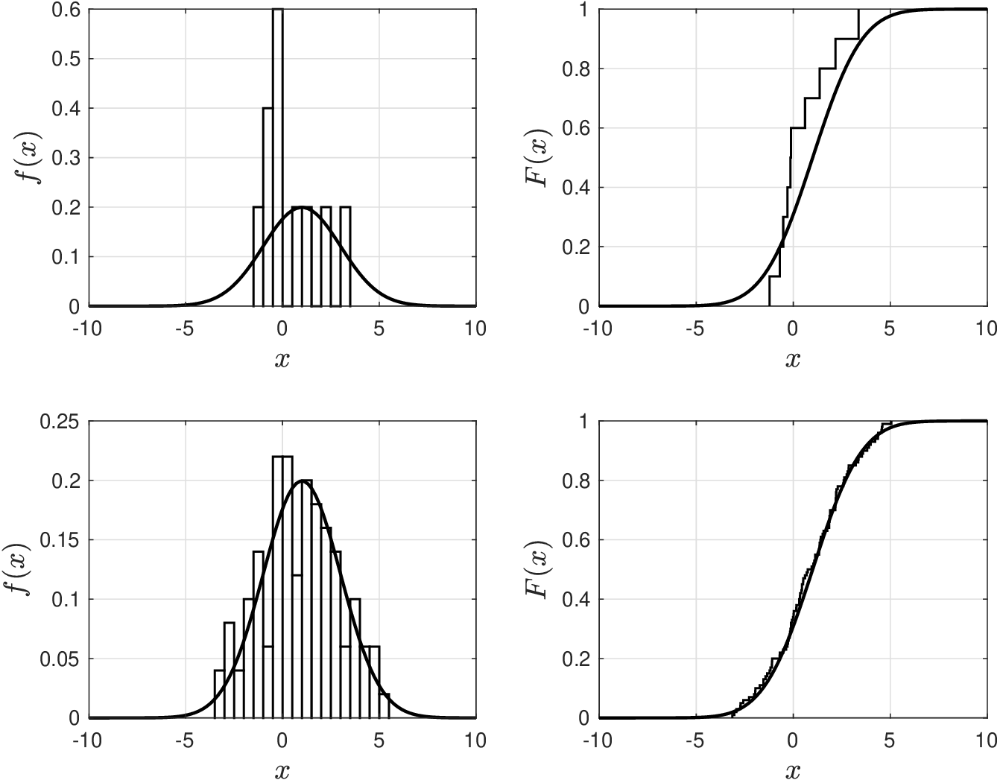
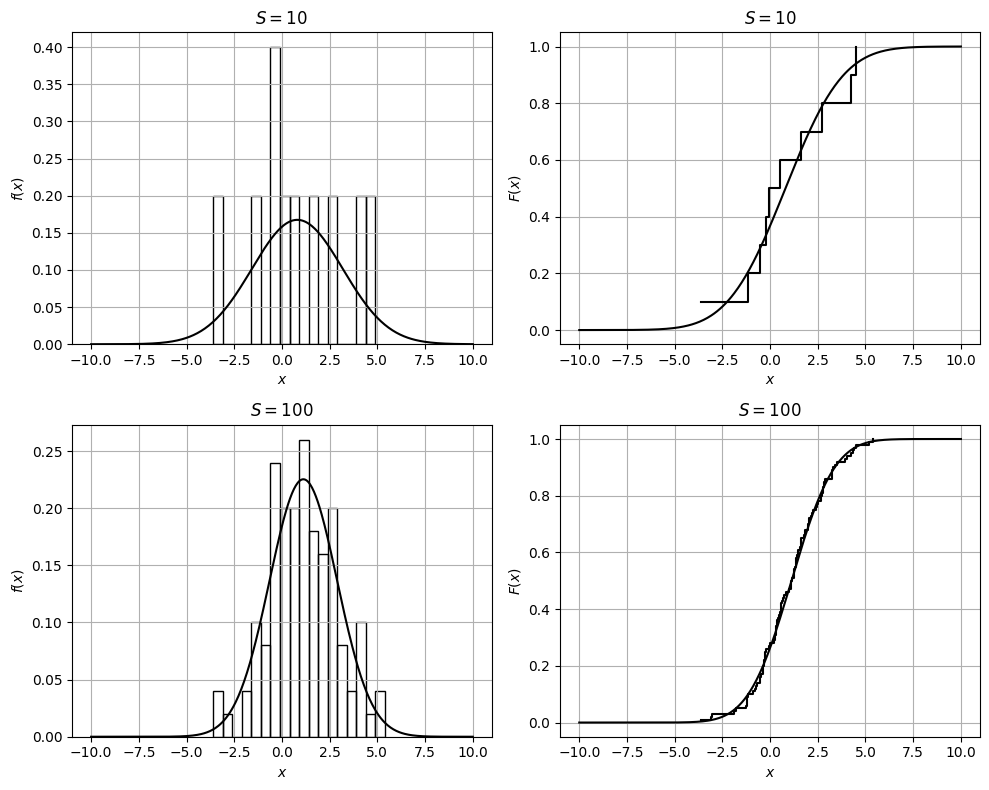
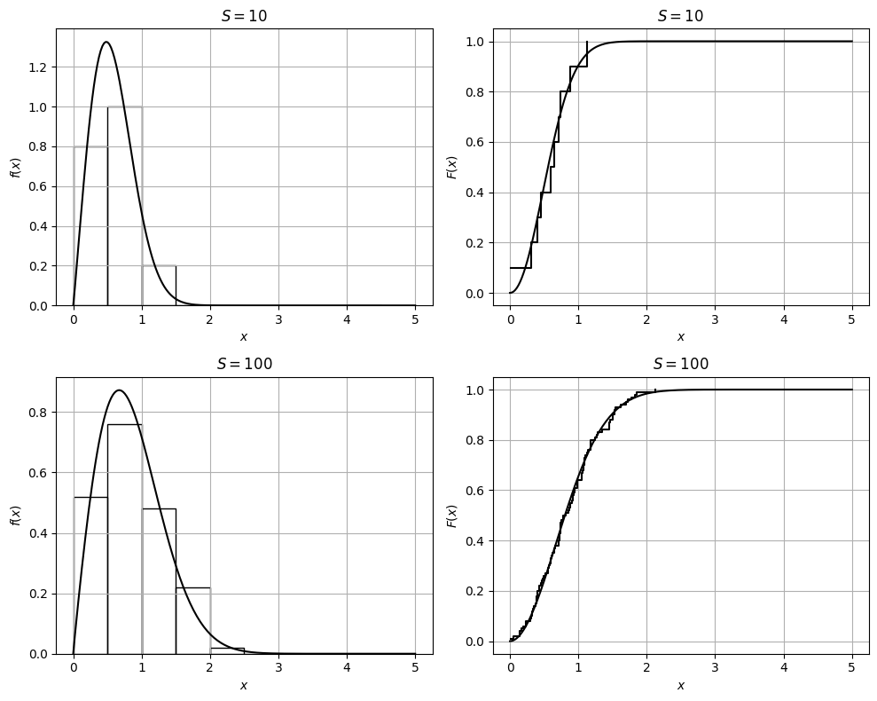

# Method of Moments

* Recall moments of $$X$$ (with pdf $$f_X(x|\theta)$$ and parameters $$\theta$$) are given by:

  $$
  \mathbb{CMO}_k(\theta):=\mathbb{E}[(X-\mathbb{E}_X)^k], \qquad k=1,2,...,N
  $$

* Here, we highlight dependence of moments on parameters $$\theta$$.
* Method of moments uses data $$x_\omega,\; \omega \in \mathcal{S}$$ to obtain sample approx:

  $$
  \begin{aligned}
  \hat{\mathbb{CMO}}_k&=\frac{1}{S}\sum_{\omega\in \mathcal{S}}(x_\omega-\hat{\mathbb{E}}_X)^k, \; k=1,2,...,N
  \end{aligned}
  $$

   where $$\hat{\mathbb{E}}_X=\frac{1}{S}\sum_{\omega\in \mathcal{S}}x_\omega$$ is sample mean.

* In this moment matching method we can use any type of moment that we find convenient (e.g., raw, central, standardized).

* Our objective is to find $$\theta$$ that solves matching equations:

  $$
  \mathbb{CMO}_k(\theta)=\hat{\mathbb{CMO}}_k,\; k=1,2,...,N
  $$

* In other words, we want to find $$\theta$$ that matches model to sample moments.
* For example, we can find the parameters by matching the model mean $$\mathbb{E}[X]$$ to the empirical $$\hat{\mathbb{E}}[X]$$ and the model variance $$\mathbb{V}[X]$$ to the empirical variance $$\hat{\mathbb{V}}[X]$$.
* We can leverage the properties of different models; for instance, for a Gaussian we know that $$\mathbb{E}[X]=\mu$$ and $$\mathbb{V}[X]=\sigma^2$$.

## Example: Method of Moments for Gaussian

* Want $$\theta=(\mu,\sigma^2)$$ for model $$X\sim \mathcal{N}(\mu,\sigma)$$ to see if  this matches data $$x_\omega,\; \omega \in \mathcal{S}$$.
* Gaussian model has property that $$\mu=\mathbb{E}_X$$ and $$\sigma^2=\mathbb{V}_X$$.
* Use data to obtain $$\hat{\mathbb{E}}_X=\frac{1}{S}\sum_{\omega\in\mathcal{S}}x_\omega$$ and $$\hat{\mathbb{V}}_X=\frac{1}{S}\sum_{\omega\in\mathcal{S}}(x_\omega-\hat{\mathbb{E}}_X)^2$$.
* From definition of first raw moment we have:

  $$
  \mathbb{CMO}_1(\theta)=\mathbb{E}[X]-\mu=0
  $$

   and this indicates that $$\hat{\mu}=\hat{\mathbb{E}}_X$$.

* From definition of second central moment we have $$\mathbb{CMO}_2(\theta)=\mathbb{V}_X=\sigma^2$$.
* Thus $$\mathbb{CMO}_2(\theta)=\hat{\mathbb{CMO}}_2$$ indicates that $$\hat{\sigma}^2=\hat{\mathbb{V}}_X$$.

## Example: Method Moments for Gaussian

* We used moment matching with $$S=10$$ and $$S=100$$ data points to estimate parameters. If we use $$S=10$$, the estimates are $$\hat{\mu}=0.45$$ and $$\hat{\sigma}=1.43$$;  if we use $$S=100$$, the estimates are $$\hat{\mu}=0.9$$ and $$\hat{\sigma}=2$$. The true parameters are $$\mu=1$$ and $$\sigma=2$$; we can thus see that we get closer as we increase $$S$$.

  <figure><figcaption><p>Empirical pdf/cdf for Gaussian RV obtained from data and model predictions obtained with estimated parameters. Results for $$S=10$$ (top row) and for $$S=100$$ (bottom row).</p></figcaption></figure>

#### Python implementation


Notebook [`ch4_gaussian_moments_example.ipynb`](https://colab.research.google.com/github/vzavala/StatsBook-GitBook/blob/main/notebooks/ch4_gaussian_moments_example.ipynb) — open it in Colab and run the cells alongside this section.


Method of moments for a Gaussian (Victor Z, UW-Madison, 2024).

| Slides | Python | Meaning |
|---|---|---|
| $$x_\omega$$, $$S$$ | `x_omega`, `S` | data and sample size |
| $$\hat{\mathbb{E}}_X$$, $$\hat{\mathbb{V}}_X$$ | `E_hat`, `V_hat` | sample mean and variance |
| $$\hat{\mu}=\hat{\mathbb{E}}_X$$, $$\hat{\sigma}^2=\hat{\mathbb{V}}_X$$ | `mu_hat`, `sigma_hat` | moment-matching estimates |

Data are drawn from $$\mathcal{N}(1, 2^2)$$; results differ slightly from the Matlab
version because the random samples differ.

```python
import numpy as np
import matplotlib.pyplot as plt
from scipy.stats import norm

mu_true, sigma_true = 1, 2
x = np.linspace(-10, 10, 400)

fig, axs = plt.subplots(2, 2, figsize=(10, 8))
for row, S in enumerate((10, 100)):
    np.random.seed(1)
    x_omega = np.random.normal(mu_true, sigma_true, S)

    E_hat = np.sum(x_omega) / S
    V_hat = np.sum((x_omega - E_hat)**2) / S
    mu_hat, sigma_hat = E_hat, np.sqrt(V_hat)      # match CMO_1 and CMO_2
    print(f"S = {S:3d}:  mu_hat = {mu_hat:.2f},  sigma_hat = {sigma_hat:.2f}")

    axs[row, 0].hist(x_omega, bins=np.arange(x_omega.min(), x_omega.max() + 0.5, 0.5),
                     density=True, edgecolor='black', facecolor='none')
    axs[row, 0].plot(x, norm.pdf(x, mu_hat, sigma_hat), 'k', linewidth=1.5)
    axs[row, 0].set_ylabel('$f(x)$')
    axs[row, 1].step(np.sort(x_omega), np.arange(1, S + 1) / S, where='post', color='black')
    axs[row, 1].plot(x, norm.cdf(x, mu_hat, sigma_hat), 'k', linewidth=1.5)
    axs[row, 1].set_ylabel('$F(x)$')
    for ax in axs[row]:
        ax.set_xlabel('$x$')
        ax.set_title(f'$S={S}$')
        ax.grid(True)
plt.tight_layout()
plt.show()
```

```
S =  10:  mu_hat = 0.81,  sigma_hat = 2.38
S = 100:  mu_hat = 1.12,  sigma_hat = 1.77
```

<figure></figure>

## Example: Method of Moments for Weibull

Now want to postulate $$\textrm{Weibull}(\xi,\beta)$$ and see if this matches data.

* We are given observations $$x_\omega,\; \omega \in \mathcal{S}$$.
* Sample mean is $$\hat{\mathbb{E}}_X=\frac{1}{S}\sum_{s\in\mathcal{S}}x_\omega$$ and variance $$\hat{\mathbb{V}}_X=\frac{1}{S}\sum_{s\in\mathcal{S}}(x_\omega-\hat{\mathbb{E}}_X)^2$$.
* We find $$\beta,\xi$$ that matches moments $$\mathbb{CMO}_1(\theta)$$ and $$\mathbb{CMO}_2(\theta)$$ (expected value and variance) to empirical counterparts.
* This is done by solving the matching equations for $$\beta$$ and $$\xi$$:

  $$
  \begin{aligned}
  \hat{\mathbb{E}}_X&=\beta\Gamma(1+1/\xi)\\
  \hat{\mathbb{V}}_X&=\beta^2\left(\Gamma(1+2/\xi)+\Gamma(1+1/\xi)^2\right)
  \end{aligned}
  $$

* This is challenging due to complex nature of $$\Gamma$$ function.  Is there another way?

#### Python implementation


Notebook [`ch4_weibull_moments_example.ipynb`](https://colab.research.google.com/github/vzavala/StatsBook-GitBook/blob/main/notebooks/ch4_weibull_moments_example.ipynb) — open it in Colab and run the cells alongside this section.


Method of moments for a Weibull RV (Victor Z, UW-Madison, 2023).
The matching equations

$$
\hat{\mathbb{E}}_X=\beta\,\Gamma(1+1/\xi),\qquad \hat{\mathbb{V}}_X=\beta^2\left(\Gamma(1+2/\xi)-\Gamma(1+1/\xi)^2\right)
$$

have no closed-form solution, so we solve them numerically for $$\theta=(\xi,\beta)$$.
Python names: `x_omega`, `E_hat`, `V_hat`, `xi_hat`, `beta_hat`; data come from
$$\mathrm{Weibull}(\xi=2,\beta=1)$$.

```python
import numpy as np
import matplotlib.pyplot as plt
from scipy.optimize import fsolve
from scipy.special import gamma as Gamma
from scipy.stats import weibull_min

def matching_error(theta, E_hat, V_hat):
    """Moment-matching residuals for theta = (xi, beta)."""
    xi, beta = theta
    E = beta * Gamma(1 + 1/xi)
    V = beta**2 * (Gamma(1 + 2/xi) - Gamma(1 + 1/xi)**2)
    return [E - E_hat, V - V_hat]

xi_true, beta_true = 2, 1
x = np.linspace(0, 5, 200)
fig, axs = plt.subplots(2, 2, figsize=(10, 8))
for row, S in enumerate((10, 100)):
    np.random.seed(1)
    x_omega = weibull_min.rvs(xi_true, scale=beta_true, size=S)
    E_hat, V_hat = np.mean(x_omega), np.var(x_omega)
    xi_hat, beta_hat = fsolve(matching_error, [1, 1], args=(E_hat, V_hat))
    print(f"S = {S:3d}:  E_hat = {E_hat:.3f}, V_hat = {V_hat:.3f}  ->  xi_hat = {xi_hat:.2f}, beta_hat = {beta_hat:.2f}")

    axs[row, 0].hist(x_omega, bins=np.arange(0, 5, 0.5), density=True, edgecolor='black', facecolor='none')
    axs[row, 0].plot(x, weibull_min.pdf(x, xi_hat, scale=beta_hat), 'k', linewidth=1.5)
    axs[row, 0].set_ylabel('$f(x)$')
    axs[row, 1].step(np.sort(x_omega), np.arange(1, S + 1) / S, where='post', color='black')
    axs[row, 1].plot(x, weibull_min.cdf(x, xi_hat, scale=beta_hat), 'k', linewidth=1.5)
    axs[row, 1].set_ylabel('$F(x)$')
    for ax in axs[row]:
        ax.set_xlabel('$x$')
        ax.set_title(f'$S={S}$')
        ax.grid(True)
plt.tight_layout()
plt.show()
```

```
S =  10:  E_hat = 0.588, V_hat = 0.088  ->  xi_hat = 2.08, beta_hat = 0.66
S = 100:  E_hat = 0.859, V_hat = 0.210  ->  xi_hat = 1.95, beta_hat = 0.97
```

<figure></figure>
