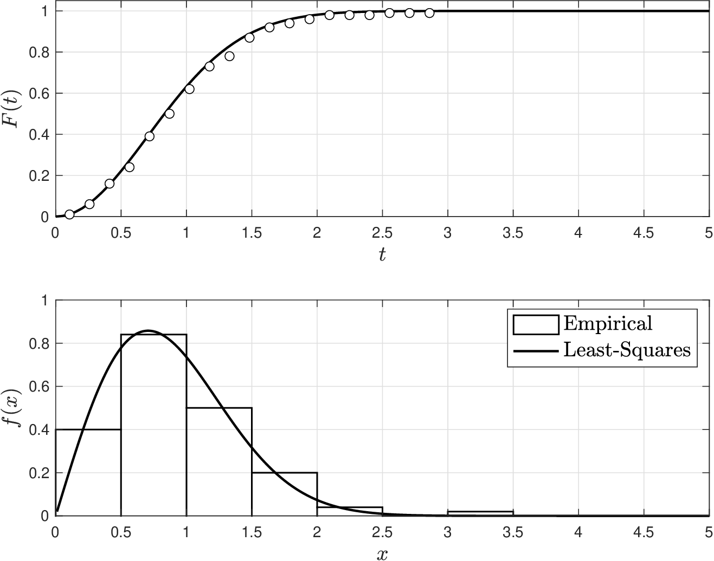
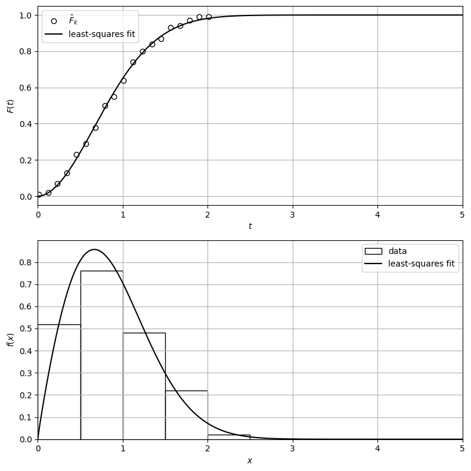

# Least-Squares Method

* Moment functions $$\mathbb{CMO}_k(\theta)$$ might be too complex for some RVs (e.g., Weibull).
* We can also use $$F_X(t|\theta)$$ (or other summarizing statistics) to find parameters.
* In LS, we find $$\theta$$ that best matches empirical estimates of cdf or statistics.
* Assume we use cdf and propose threshold values $$t_k, k=1,2,...,N$$ to compute:

  $$
  \hat{F}_k=\frac{1}{S}\sum_{\omega \in \mathcal{S}}\mathbf{1}[x_\omega\leq t_k],\; k=1,2,...,N
  $$

* We find parameters for the model $$F_X(t_k|\theta)$$ that solve LS problem:

  $$
  \min_\theta \frac{1}{2}\sum_{k=1}^N(F_X(t_k|\theta)-\hat{F}_k)^2
  $$

* This is an optimization problem that needs to be solved numerically.

## Example: Least-Squares for Weibull

* Want to estimate $$\theta=(\xi,\beta)$$ for model $$X\sim \textrm{Weibull}(\xi,\beta)$$.
* We are given data $$x_\omega,\; \omega \in \mathcal{S}$$ to obtain empirical cdf $$\hat{F}(t_k)$$ for $$t_k,\, k=1,...,N$$.
* Recall cdf of Weibull model is $$F_X(t|\theta)=(1-e^{-(t/\beta)^\xi})$$.
* We estimate parameters $$\theta$$ by solving LS problem:

  $$
  \min_\theta \frac{1}{2}\sum_{k=1}^N\left((1-e^{-(t_k/\beta)^\xi})-\hat{F}_k\right)^2
  $$

* We solve this problem using a numerical software package.

* Weibull model using the estimated parameters fits  data well.

  <figure></figure>

#### Python implementation


Notebook [`ch4_leastsquares_example.ipynb`](https://colab.research.google.com/github/vzavala/StatsBook-GitBook/blob/main/notebooks/ch4_leastsquares_example.ipynb) — open it in Colab and run the cells alongside this section.


Least-squares fit of a Weibull cdf (Victor Z, UW-Madison, 2024).

| Slides | Python | Meaning |
|---|---|---|
| $$x_\omega$$, $$S$$ | `x_omega`, `S` | data and sample size |
| $$t_k$$, $$N$$ | `t`, `N` | cdf thresholds |
| $$\hat{F}_k$$ | `F_hat` | empirical cdf at $$t_k$$ |
| $$\theta=(\xi,\beta)$$ | `theta = (xi, beta)` | Weibull shape and scale |
| $$F_X(t\mid\theta)$$ | `F_model(t, theta)` | model cdf $$1-e^{-(t/\beta)^\xi}$$ |

```python
import numpy as np
import matplotlib.pyplot as plt
from scipy.optimize import minimize
from scipy.stats import weibull_min

np.random.seed(1)
S = 100
xi_true, beta_true = 2, 1
x_omega = weibull_min.rvs(xi_true, scale=beta_true, size=S)

N = 20
t = np.linspace(x_omega.min(), x_omega.max(), N)[:-1]        # drop the last threshold (F_hat = 1)
F_hat = np.array([np.mean(x_omega <= t_k) for t_k in t])      # (1/S) sum 1[x_omega <= t_k]
```

Solve $$\min_\theta \frac{1}{2}\sum_{k=1}^N\left(F_X(t_k|\theta)-\hat{F}_k\right)^2$$ numerically.

```python
def F_model(t, theta):
    xi, beta = theta
    return 1 - np.exp(-(t / beta)**xi)

def LS(theta):
    return 0.5 * np.sum((F_model(t, theta) - F_hat)**2)

result = minimize(LS, x0=[1, 1], method='SLSQP', options={'ftol': 1e-10})
xi_hat, beta_hat = result.x
print(f"xi_hat = {xi_hat:.3f},  beta_hat = {beta_hat:.3f}")
```

```
xi_hat = 1.922,  beta_hat = 0.976
```

The Weibull cdf can also be linearized, $$\log(-\log(1-F))=\xi\log t-\xi\log\beta$$, which gives a
closed-form linear least-squares estimate.

```python
u, w = np.log(t), np.log(-np.log(1 - F_hat))
xi_lin = np.sum(u * (w - w.mean())) / np.sum(u * (u - u.mean()))
beta_lin = np.exp(-(w.mean() - xi_lin * u.mean()) / xi_lin)
print(f"linearized fit: xi = {xi_lin:.3f},  beta = {beta_lin:.3f}")
```

```
linearized fit: xi = 1.335,  beta = 0.945
```

```python
t_grid = np.linspace(0, 5, 200)
fig, axs = plt.subplots(2, 1, figsize=(8, 8))
axs[0].plot(t, F_hat, 'o', markerfacecolor='w', markeredgecolor='black', label=r'$\hat{F}_k$')
axs[0].plot(t_grid, F_model(t_grid, (xi_hat, beta_hat)), 'k', linewidth=1.5, label='least-squares fit')
axs[0].set_xlabel('$t$')
axs[0].set_ylabel('$F(t)$')
axs[0].legend()
axs[1].hist(x_omega, bins=np.arange(0, 5, 0.5), density=True, edgecolor='black', facecolor='none', label='data')
axs[1].plot(t_grid, weibull_min.pdf(t_grid, xi_hat, scale=beta_hat), 'k', linewidth=1.5, label='least-squares fit')
axs[1].set_xlabel('$x$')
axs[1].set_ylabel('$f(x)$')
axs[1].legend()
for ax in axs:
    ax.grid(True)
    ax.set_xlim(0, 5)
plt.tight_layout()
plt.show()
```

<figure></figure>
