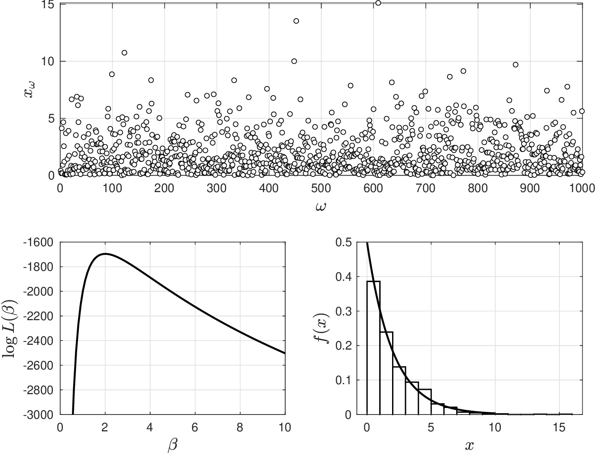
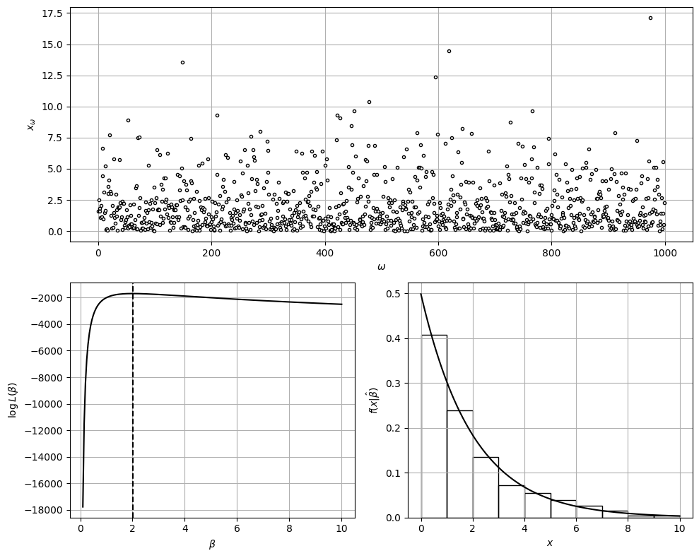

# Maximum Likelihood Estimation

* Maximum likelihood estimation (MLE) is a method that is conceptually similar LS in that tries to find the best possible set of parameters that match data.
* In MLE,  by “best" we mean parameters that are most probable (likely) given data.
* In LS, by “best" we mean parameters that best fit data (minimize error).
* We thus note that MLE has a natural statistical interpretation (while LS does not).

* Assume observations $$x_\omega,\, \omega \in \mathcal{S}$$ are collected at *random*.
* We thus have that observations are independent RVs.
* Postulate $$f(x|\theta)$$ and recall $$f(x_\omega|\theta)$$ is prob (likelihood) that $$X$$ takes value $$x_\omega$$.
* Find $$\theta$$ that maximizes *joint* probability that $$X$$ takes observations $$x_\omega,\,\omega \in \mathcal{S}$$.
* Joint probability is given by $$\prod_{\omega \in \mathcal{S}}f(x_\omega|\theta)$$.
* We thus find $$\theta$$ by solving maximization problem:

  $$
  \max_\theta\; L(\theta)=\prod_{\omega \in \mathcal{S}}f(x_\omega|\theta).
  $$

   Here, $$L(\theta)$$ is known as the likelihood function.

* It is often convenient to apply a log transformation to solve equivalent problem:

  $$
  \max_\theta\; \log L(\theta)=\sum_{\omega \in \mathcal{S}}\log f(x_\omega|\theta).
  $$

* Function $$\log L(\theta)$$ is known as the log likelihood function.
* Logarithmic transformation is used to avoid scaling issues (as pdf values are small).
* Maximization problem is equivalent to minimization problem:

  $$
  \min_\theta\; -\log L(\theta)=-\sum_{\omega \in \mathcal{S}}\log f(x_\omega|\theta).
  $$

* These problems can be solved by hand when pdf is simple but require numerical techniques when pdf is complex.

## Example: Estimation for Exponential using MLE

* Use MLE to estimate $$\beta$$ for model $$\textrm{Exp}(\beta)$$ from data $$x_\omega,\; \omega \in \mathcal{S}$$.
* Pdf of exponential RV is $$f(x|\beta)=\frac{1}{\beta}e^{-x/\beta}$$ and thus likelihood function is:

  $$
  \begin{aligned}
  L(\beta)&=\left(\frac{1}{\beta}e^{-x_1/\beta}\right)\left(\frac{1}{\beta}e^{-x_2/\beta}\right)\cdots\left(\frac{1}{\beta}e^{-x_S/\beta}\right)\\
  &=\frac{1}{\beta^S}\exp \left(-\frac{1}{\beta}\sum_{\omega=1}^Sx_\omega\right).
  \end{aligned}
  $$

* We find $$\beta$$ that maximizes log likelihood $$\log L(\beta)$$:

  $$
  \max_{\beta}\; \log L(\beta)=-S\log \beta -\frac{1}{\beta}\sum_{\omega=1}^Sx_\omega
  $$

* Value of $$\beta$$ that maximizes log likelihood satisfies $$\frac{\partial \log L(\beta)}{\partial \beta}=0$$.
* Best estimate is $$\displaystyle\hat{\beta}=\frac{1}{S}\sum_{\omega=1}^Sx_\omega$$; *best* estimate $$\hat{\beta}$$ is empirical mean $$\hat{\mathbb{E}}_X$$.

* From data provided we find that $$\hat{\beta}=\hat{\mathbb{E}}_X=2$$.
* Note that this is precisely location where $$\log L(\beta)$$ is maximized.
* Note that values of likelihood function $$L(\theta)$$ are extremely small.
* This is why using a log transformation of likelihood function is necessary.

  <figure></figure>

#### Python implementation


Notebook [`ch4_example_mle_exp.ipynb`](https://colab.research.google.com/github/vzavala/StatsBook-GitBook/blob/main/notebooks/ch4_example_mle_exp.ipynb) — open it in Colab and run the cells alongside this section.


Maximum likelihood estimation for an exponential RV (Victor Z, UW-Madison, 2014).

| Slides | Python | Meaning |
|---|---|---|
| $$x_\omega$$, $$S$$ | `x_omega`, `S` | data and sample size |
| $$\beta$$ | `beta` | grid of candidate scale values |
| $$\log L(\beta)=-S\log\beta-\frac{1}{\beta}\sum_\omega x_\omega$$ | `logL` | log likelihood |
| $$\hat{\beta}=\hat{\mathbb{E}}_X$$ | `beta_hat` | MLE |

```python
import numpy as np
import matplotlib.pyplot as plt
from scipy.stats import expon

np.random.seed(0)
S = 1000
x_omega = np.random.exponential(scale=2, size=S)

beta = np.linspace(0.1, 10, 200)
logL = -S * np.log(beta) - np.sum(x_omega) / beta
beta_hat = np.mean(x_omega)                # solves d logL / d beta = 0
print(f"beta_hat = {beta_hat:.3f}   (grid maximizer: {beta[np.argmax(logL)]:.3f})")
```

```
beta_hat = 2.007   (grid maximizer: 1.990)
```

```python
fig = plt.figure(figsize=(10, 8))
ax = fig.add_subplot(2, 1, 1)
ax.plot(x_omega, 'o', markerfacecolor='w', markeredgecolor='black', markersize=3)
ax.set_xlabel(r'$\omega$')
ax.set_ylabel(r'$x_\omega$')
ax = fig.add_subplot(2, 2, 3)
ax.plot(beta, logL, 'k-', linewidth=1.5)
ax.axvline(beta_hat, color='k', ls='--')
ax.set_xlabel(r'$\beta$')
ax.set_ylabel(r'$\log L(\beta)$')
ax = fig.add_subplot(2, 2, 4)
x = np.linspace(0, 10, 200)
ax.hist(x_omega, bins=np.arange(0, 11, 1), density=True, edgecolor='black', facecolor='none')
ax.plot(x, expon.pdf(x, scale=beta_hat), 'k-', linewidth=1.5)
ax.set_xlabel('$x$')
ax.set_ylabel(r'$f(x|\hat{\beta})$')
for a in fig.axes:
    a.grid(True)
plt.tight_layout()
plt.show()
```

<figure></figure>
