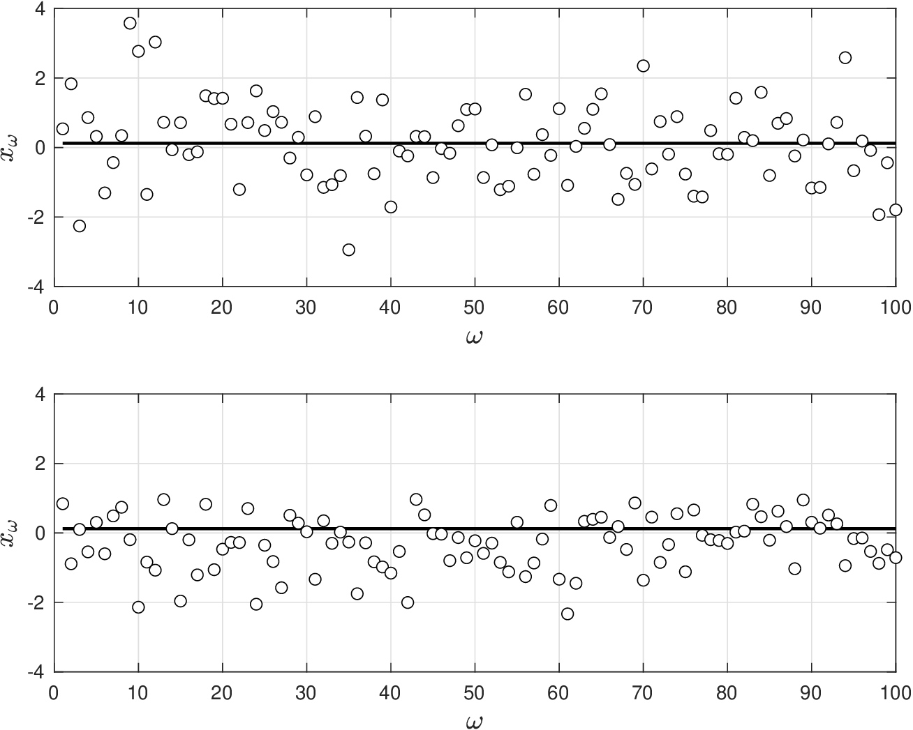
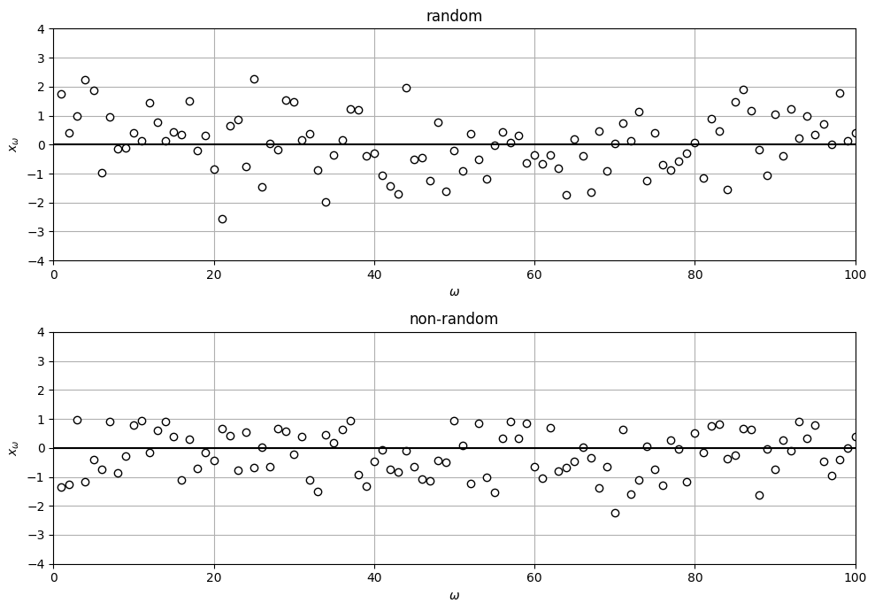

# Data Collection and Asymptotic Properties

* So far, we have assumed that we have data $$x_\omega,\; \omega \in \mathcal{S}$$.
* However, we have not discussed how this data is being *collected*.
* We also want to know how sample approximations and estimates $$\hat{\theta}$$ behave as we accumulate data.

We make following observations:


* Data $$x_\omega \in \mathcal{S}$$ is a set of observations of $$X$$ collected from a population $$\Omega$$ by a defined procedure; i.e., sampling is a data collection procedure.
* A data sample sequence $$x_\omega \in \mathcal{S}$$ is called *random* if each sample $$x_\omega$$ is drawn from same underlying pdf $$f_X(x)$$ and if it is drawn *independently* from  others; i.e., samples are independent and identically distributed (i.i.d).
* If sample $$x_\omega$$ is selected at random, the sample itself is an RV. Consequently, sometimes we denote a data sample sequence as a sequence of RVs $$X_\omega \in \mathcal{S}$$.


* Random sample $$X_\omega$$ has same probability $$1/S$$ of being selected and is *unbiased*.
* Lack of bias indicates that $$\mathbb{E}[X_\omega]=\mathbb{E}[X]$$ (drawing sample many times and averaging results gives expected value of underlying RV $$X$$).
* Random samples can be used to construct *approximation* techniques with powerful asymptotic properties.
* Collecting data at random is not as easy as it sounds, one must ensure that there is no bias in selecting a sample (i.e., there is no hidden mechanism).
* As humans, it is difficult to select something randomly (due to inherent biases).

## Example: Random and Non-Random Samples

* Random sequence $$X_\omega,\,\omega \in \mathcal{S}$$ generated by drawing random samples from $$X\sim \mathcal{N}(0,1)$$. Samples distribute evenly around mean $$\mathbb{E}[X]=0$$ and there is no bias.
* Nonrandom sequence $$X_\omega,\,\omega \in \mathcal{S}$$ is generated by drawing a random sample from $$\mathcal{N}(0,1)$$ and discarding it if it is above a value of one.
* This introduces a discrimination mechanism that biases sample.  Note samples do not distribute evenly around $$\mathbb{E}[X]=0$$ and there is a bias.

  <figure></figure>

#### Python implementation


Notebook [`ch4_random_sample.ipynb`](https://colab.research.google.com/github/vzavala/StatsBook-GitBook/blob/main/notebooks/ch4_random_sample.ipynb) — open it in Colab and run the cells alongside this section.


Random and non-random samples (Victor Z, UW-Madison, 2024).
A random sequence $$X_\omega$$ from $$\mathcal{N}(0,1)$$ (`x_random`) and a non-random one that
discards draws above one (`x_biased`). The bias is the average deviation from
$$\mathbb{E}[X]=0$$ (`E_X`).

```python
import numpy as np
import matplotlib.pyplot as plt

np.random.seed(0)
S = 100
E_X = 0
x_random = np.random.normal(0, 1, S)
draws = np.random.normal(0, 1, 2 * S)
x_biased = draws[draws <= 1][:S]           # discrimination mechanism: discard x > 1

print(f"bias (random)     = {np.mean(x_random - E_X):+.3f}")
print(f"bias (non-random) = {np.mean(x_biased - E_X):+.3f}")

fig, axs = plt.subplots(2, 1, figsize=(10, 7))
for ax, x_omega, title in ((axs[0], x_random, 'random'), (axs[1], x_biased, 'non-random')):
    ax.plot(np.arange(1, S + 1), x_omega, 'o', markerfacecolor='w', markeredgecolor='black')
    ax.axhline(E_X, color='k', linewidth=1.5)
    ax.set_title(title)
    ax.axis([0, S, -4, 4])
    ax.set_xlabel(r'$\omega$')
    ax.set_ylabel(r'$x_\omega$')
    ax.grid(True)
plt.tight_layout()
plt.show()
```

```
bias (random)     = +0.060
bias (non-random) = -0.214
```

<figure></figure>
