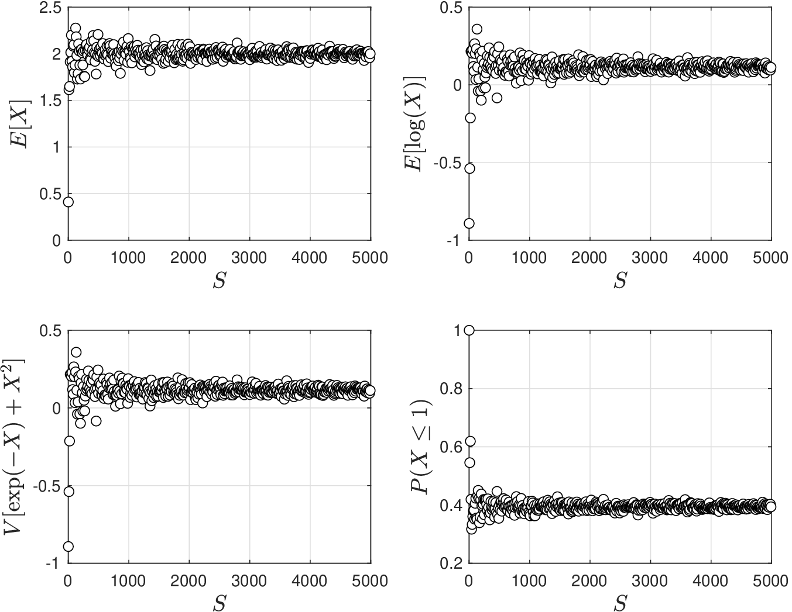
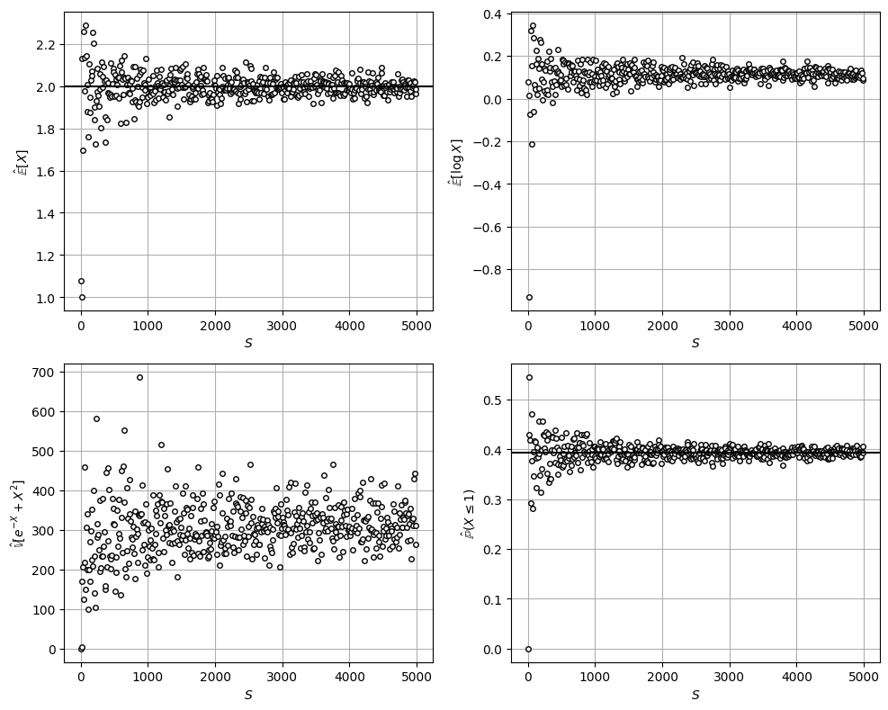

# Monte Carlo Approximations

* *Monte Carlo* (MC) is a computational technique that uses *random samples* to estimate properties of an RV and of its derived quantities (e.g., statistics).
* Consider a random sample $$x_\omega \in \mathcal{S}$$ of the multivariate $$X$$. MC uses the samples to compute a sample (empirical) approximation of an *expectation*:

  $$
  \hat{\mathbb{E}}^S_{\phi(X)}=\frac{1}{S}\sum_{\omega \in \mathcal{S}}\phi(x_\omega)\approx \mathbb{E}[\phi(X)]
  $$

   where $$\phi(X)$$ is vector-valued function of $$X$$.

* We recall that the true (theoretical) expectation for a continuous RV is given by:

  $$
  \mathbb{E}[\phi(X)]=\int_{x\in \mathcal{D}_X}\phi(x)f_X(x)dx,
  $$

   where $$f_X(x)$$ is the joint pdf of $$X$$.

* Computing expectation thus involves computing a multi-dimensional integral (operation cannot be carried out analytically).
* MC provides a numerical technique to approximate such an integral.

* Many quantities of interest can be expressed as expectation operations and thus can be computed via MC.
* Some examples include:
   * Expectation of $$X$$: $$\displaystyle\hat{\mathbb{E}}_X^S:=\frac{1}{S}\sum_{\omega \in \mathcal{S}}x_\omega\approx \mathbb{E}[X]$$
   * Variance of $$X$$: $$\displaystyle\hat{\mathbb{V}}_X^S:=\frac{1}{S}\sum_{\omega \in \mathcal{S}}(x_\omega-\hat{\mathbb{E}}_X^S)^2\approx \mathbb{V}[X]$$
   * CDF of $$X$$: $$\displaystyle\hat{F}_X^S(x):=\frac{1}{S}\sum_{\omega  \in \mathcal{S}}\mathbf{1}[x_\omega \leq x]\approx F_X(x)$$
   * Expectation of function $$\displaystyle\hat{\mathbb{E}}_\varphi^S:=\frac{1}{S}\sum_{\omega  \in \mathcal{S}}\varphi(x_\omega,u)\approx \mathbb{E}[{\varphi(X,u)}]$$.
   * Probability of event: $$\hat{\mathbb{P}}(X\in\mathcal{A}):=\frac{1}{S}\sum_{\omega  \in \mathcal{S}}\mathbf{1}[x_\omega \in  \mathcal{A}] \approx \mathbb{P}(X\in\mathcal{A})$$.
* Note dependence of empirical approxs on number of samples $$S$$.
* When empirical approx use data, these are called data-driven approxs.
* Empirical  approximations are also often called sample average approxs.

* Important questions related to MC approximations are:
   * Do the approximations become exact as we accumulate data?
   * How accurate are these approximations when we have a limited amount of data?
   * How much data do we need to obtain a desired accuracy?
   * How to approximation errors behave as we change our sample data?
* We will now explore tools to answer these questions; the use of these tools is enabled by the fact that samples are collected at random.
* As part of our discussion we will also see that RVs exhibit “universal" behavior as we accumulate data (i.e., as $$S\to \infty$$).

## Law of Large Numbers

* Lets assess quality of empirical approximations as $$S\to \infty$$.
* Consider an i.i.d. random sequence $$X_1,X_2,...,X_S$$ for univariate RV $$X$$. Since the samples are i.i.d, they have same underlying pdf with $$\mathbb{E}[X]$$.
* Since samples are random, they are unbiased $$\mathbb{E}[X_1]=\mathbb{E}[X_2]=\cdots=\mathbb{E}[X_S]=\mathbb{E}[X]$$.
* Consider now the MC approximation of $$\mathbb{E}[X]$$:

  $$
  \hat{\mathbb{E}}_X^S=\frac{1}{S}\sum_{\omega \in \mathcal{S}}X_\omega
  $$

   Because the samples $$X_\omega,\,\omega \in \mathcal{S}$$ are random, approx $$\hat{\mathbb{E}}_X^S$$ is also random (i.e., different samples give different approxs).

* There is thus inherent variability in approx $$\hat{\mathbb{E}}_X^S$$  (variability is a approx accuracy).
* Law of large numbers (LLN) indicates that:

  $$
  \lim_{S\to \infty}\hat{\mathbb{E}}_X^S=\mathbb{E}[X]
  $$

* LLN guarantees *stable long-run* behavior of sample averages.

## Example: Monte Carlo Approximations

* We generate random samples $$X_\omega,\; \omega \in \mathcal{S}$$ from $$X\sim \textrm{Weibull}(2,1)$$.
* Compute MC approxs for $$\mathbb{E}[X],\mathbb{E}[\log(X)]$$ and $$\mathbb{V}[\exp(X)+X^2]$$, and $$\mathbb{P}(X>\geq 1)$$  for different $$S$$.

  <figure></figure>

#### Python implementation


Notebook [`ch4_montecarlo_approx.ipynb`](https://colab.research.google.com/github/vzavala/StatsBook-GitBook/blob/main/notebooks/ch4_montecarlo_approx.ipynb) — open it in Colab and run the cells alongside this section.


Convergence of Monte Carlo approximations (Victor Z, UW-Madison, 2024).
Samples come from a Weibull RV with scale $$\beta=2$$ and shape $$\xi=1$$ (as in the slide figure;
the slide text writes "Weibull(2,1)" in Matlab's (scale, shape) order).

| Slides | Python | Meaning |
|---|---|---|
| $$S$$ | `S_values` | sample sizes |
| $$\hat{\mathbb{E}}^S_{\phi(X)}=\frac{1}{S}\sum_\omega\phi(x_\omega)$$ | `E_hat`, `E_log_hat` | MC estimates of $$\mathbb{E}[X]$$, $$\mathbb{E}[\log X]$$ |
| $$\hat{\mathbb{V}}^S$$ | `V_hat` | MC estimate of $$\mathbb{V}[e^{-X}+X^2]$$ |
| $$\hat{\mathbb{P}}(X\in\mathcal{A})$$ | `P_hat` | MC estimate of $$\mathbb{P}(X\leq 1)$$ |

We use $$e^{-X}$$ instead of $$e^{X}$$: with this RV, $$\mathbb{V}[e^{X}]$$ is infinite.

```python
import numpy as np
import matplotlib.pyplot as plt
from scipy.stats import weibull_min

xi, beta = 1, 2
X = weibull_min(xi, scale=beta)

np.random.seed(1)
S_values = np.arange(1, 5001, 10)
E_hat, E_log_hat, V_hat, P_hat = [], [], [], []
for S in S_values:
    x_omega = X.rvs(size=S)
    E_hat.append(np.mean(x_omega))
    E_log_hat.append(np.mean(np.log(x_omega)))
    V_hat.append(np.var(np.exp(-x_omega) + x_omega**2))
    P_hat.append(np.mean(x_omega <= 1))
```

```python
exact = {'E': X.mean(), 'P': X.cdf(1)}
fig, axs = plt.subplots(2, 2, figsize=(10, 8))
panels = [(E_hat, r'$\hat{\mathbb{E}}[X]$', exact['E']), (E_log_hat, r'$\hat{\mathbb{E}}[\log X]$', None),
          (V_hat, r'$\hat{\mathbb{V}}[e^{-X}+X^2]$', None), (P_hat, r'$\hat{\mathbb{P}}(X\leq 1)$', exact['P'])]
for ax, (vals, label, ref) in zip(axs.ravel(), panels):
    ax.plot(S_values, vals, 'o', markerfacecolor='w', markeredgecolor='black', markersize=4)
    if ref is not None:
        ax.axhline(ref, color='k')
    ax.set_xlabel('$S$')
    ax.set_ylabel(label)
    ax.grid(True)
plt.tight_layout()
plt.show()
print(f"exact E[X] = {exact['E']:.3f},  exact P(X <= 1) = {exact['P']:.3f}")
```

<figure></figure>

```
exact E[X] = 2.000,  exact P(X <= 1) = 0.393
```
