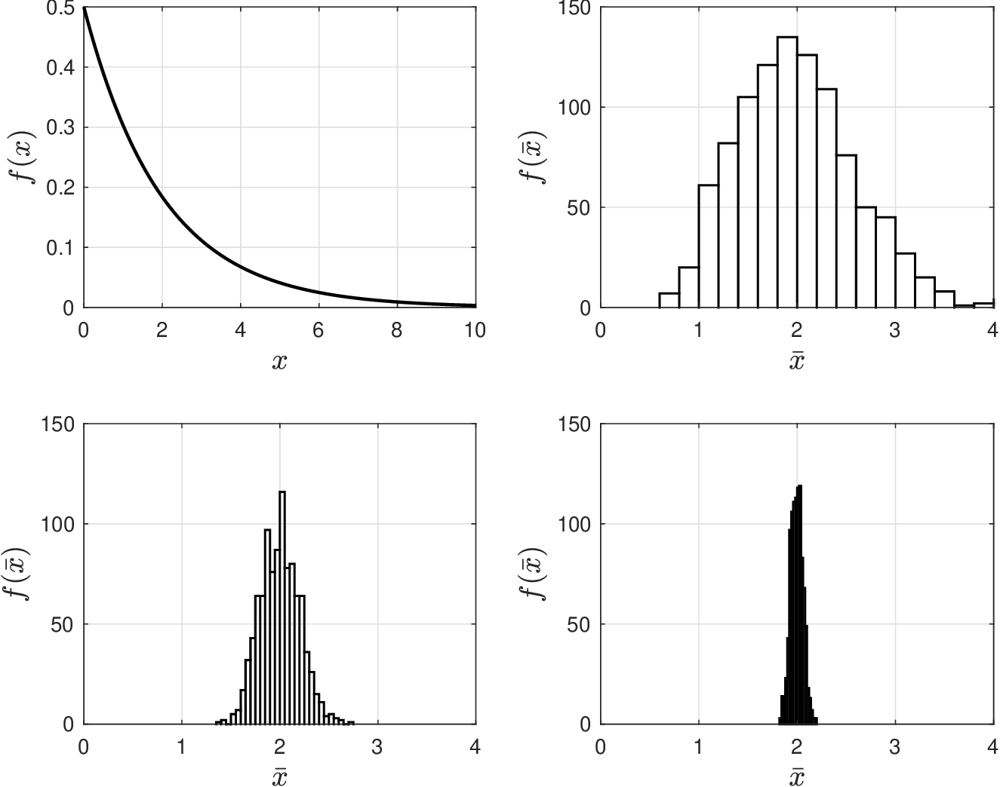
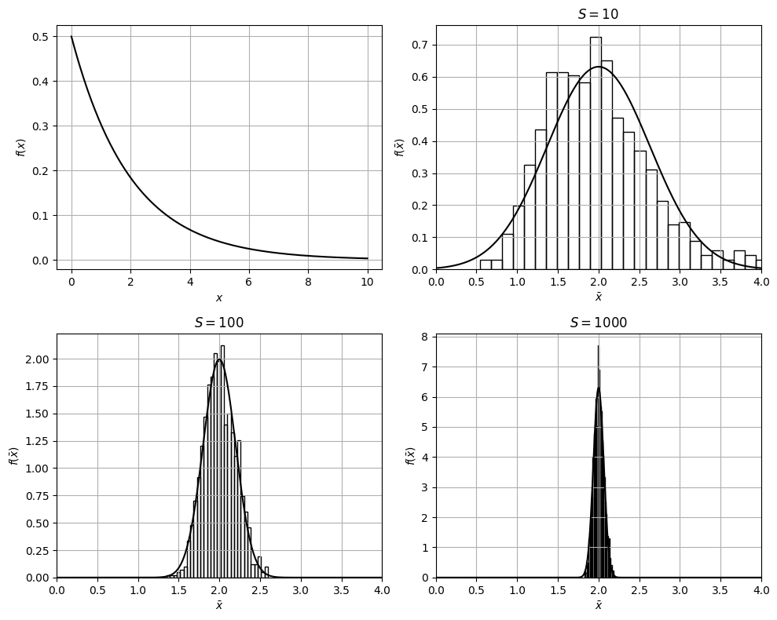

# Central Limit Theorem

* Now turn our attention to assessing accuracy of sample approx $$\hat{\mathbb{E}}_X^S$$.
* Because MC approx is an RV, accuracy is measured in terms of its uncertainty.
* If we want uncertainty of an RV, we need to know its underlying pdf.
* Obtaining pdf of $$\hat{\mathbb{E}}_X^S$$ can achieved by using a powerful result in statistics known as the central limit theorem (CLT).
* Consider a sample sequence $$X_1,X_2,...,X_S$$ that is i.i.d and that has *known* expected value $$e=\mathbb{E}[X]$$ and variance $$v^2=\mathbb{V}[X]$$.
* CLT states that:

  $$
  \lim_{S\to \infty}\hat{\mathbb{E}}_X^S\sim \mathcal{N}(e,v^2/S)
  $$

* CLT states that, *regardless* of the nature of $$X$$ (e.g., Weibull, Poisson), sample approximation $$\hat{\mathbb{E}}_X^S$$ will *always* behave as a Gaussian RV as $$S$$ increases.

* CLT states that expected value of $$\hat{\mathbb{E}}_X^S$$ is true value $$e$$.  In other words, $$\hat{\mathbb{E}}_X^S$$ is an unbiased estimate of $$e$$.
* CLT states that variance of $$\mathbb{V}[\hat{\mathbb{E}}_X^S]$$ is given by $$v^2/S$$ (std dev is $$v/\sqrt{S}$$) and that this shrinks with $$S$$. In other words, $$\hat{\mathbb{E}}_X^S$$ becomes more accurate as $$S$$ increases.
* Since we know that $$\hat{\mathbb{E}}_X^S\sim \mathcal{N}(e,v/\sqrt{S})$$ then we have pdf for $$\hat{\mathbb{E}}_X^S$$ and thus we can compute quantities of interest for it.
* For example, we can compute  $$1-\alpha$$ confidence intervals:

  $$
  \mathbb{E}_X\in \left[\hat{\mathbb{E}}_X^S\pm z_{\alpha/2}v/\sqrt{S}\right].
  $$

* Note that this interval shrinks as $$S$$ increases.
* CLT assumes that we know variance of $$X$$; as a result, we need to know these quantities to compute confidence interval.
* In practice, one often replaces this quantity with its MC approx (sample variance):

  $$
  \hat{v}^2=\frac{1}{S-1}\sum_{\omega\in\mathcal{S}}(x_\omega-\hat{\mathbb{E}}_X^S)^2.
  $$

## Example: Verifying the Central Limit Theorem

* We i.i.d. samples $$X_1,...,,X_S$$ from $$X\sim \textrm{Weibull}(2,1)$$ and compute $$\hat{\mathbb{E}}_X^S=\frac{1}{S}\sum_{\omega=1}X_\omega$$.
* We repeat procedure for different sets of samples and visualize pdf of $$\bar{X}=\hat{\mathbb{E}}_X^S$$.

  <figure><figcaption><p>Pdf for $$X\sim \textrm{Weibull}(2,1)$$ (top-left) and sample average $$\bar{X}$$ with $$S=10$$ (top-right), $$S=100$$ (bottom-left) and $$S=1000$$ (bottom-right).</p></figcaption></figure>

#### Python implementation


Notebook [`ch4_clt_example.ipynb`](https://colab.research.google.com/github/vzavala/StatsBook-GitBook/blob/main/notebooks/ch4_clt_example.ipynb) — open it in Colab and run the cells alongside this section.


Verifying the central limit theorem (Victor Z, UW-Madison, 2024).
$$X$$ is Weibull with scale $$\beta=2$$ and shape $$\xi=1$$ (as in the slide figure).

| Slides | Python | Meaning |
|---|---|---|
| $$S$$ | `S` | sample size of each average |
| $$\bar{X}=\hat{\mathbb{E}}^S_X$$ | `x_bar` | sample averages (one per repetition) |
| $$e=\mathbb{E}[X]$$, $$v^2=\mathbb{V}[X]$$ | `e`, `v2` | true mean and variance |
| $$\mathcal{N}(e, v^2/S)$$ | `norm(e, sqrt(v2/S))` | CLT limit |

`R` is the number of repetitions used to draw the histogram of $$\bar{X}$$.

```python
import numpy as np
import matplotlib.pyplot as plt
from scipy.stats import weibull_min, norm

xi, beta = 1, 2
X = weibull_min(xi, scale=beta)
e, v2 = X.mean(), X.var()
R = 1000

np.random.seed(0)
fig, axs = plt.subplots(2, 2, figsize=(10, 8))
x = np.linspace(0, 10, 400)
axs[0, 0].plot(x, X.pdf(x), 'black', linewidth=1.5)
axs[0, 0].set_xlabel('$x$')
axs[0, 0].set_ylabel('$f(x)$')
z = np.linspace(0, 4, 400)
for ax, S in zip((axs[0, 1], axs[1, 0], axs[1, 1]), (10, 100, 1000)):
    x_bar = X.rvs(size=(R, S)).mean(axis=1)               # R independent sample averages
    ax.hist(x_bar, bins=30, density=True, edgecolor='black', facecolor='none')
    ax.plot(z, norm.pdf(z, e, np.sqrt(v2 / S)), 'k', linewidth=1.5)  # CLT: N(e, v^2/S)
    ax.set_xlim(0, 4)
    ax.set_title(f'$S={S}$')
    ax.set_xlabel(r'$\bar{x}$')
    ax.set_ylabel(r'$f(\bar{x})$')
    print(f"S = {S:4d}:  mean(x_bar) = {x_bar.mean():.3f} (e = {e:.3f}),  "
          f"S * var(x_bar) = {S * x_bar.var():.3f} (v^2 = {v2:.3f})")
for ax in axs.ravel():
    ax.grid(True)
plt.tight_layout()
plt.show()
```

```
S =   10:  mean(x_bar) = 1.981 (e = 2.000),  S * var(x_bar) = 4.073 (v^2 = 4.000)
S =  100:  mean(x_bar) = 2.004 (e = 2.000),  S * var(x_bar) = 3.909 (v^2 = 4.000)
S = 1000:  mean(x_bar) = 2.003 (e = 2.000),  S * var(x_bar) = 3.929 (v^2 = 4.000)
```

<figure></figure>
