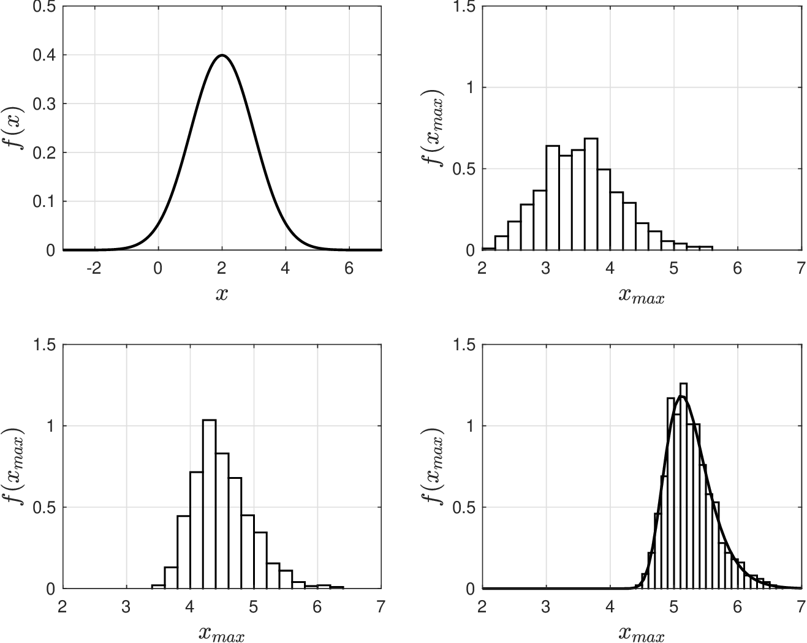
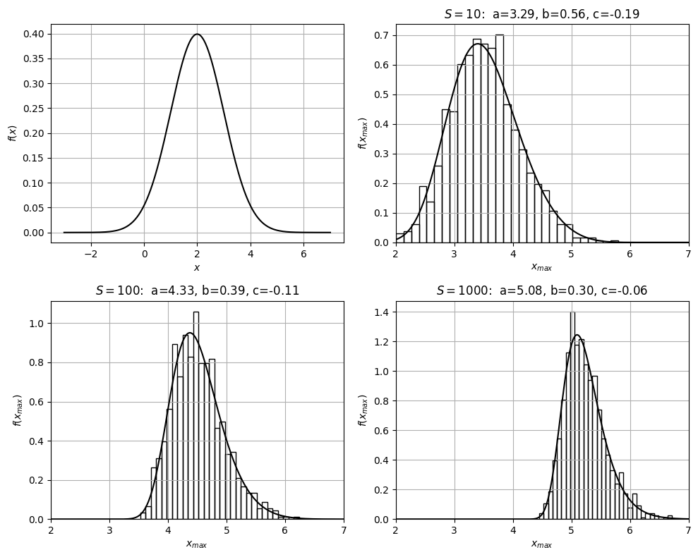

# Extreme Value Theorem

* In CLT we study limiting behavior of *sample average* $$\hat{\mathbb{E}}_X^S=\frac{1}{S}\sum_{\omega\in \mathcal{S}}X_\omega$$.
* What if we are interested in a different statistic? For instance, the *sample max*:

  $$
  X_{max}^S=\max\{X_1,X_2,\cdots, X_S\}
  $$

* *Extreme value theorem* (EVT) characterizes pdf of $$X_{max}^S$$ as $$S\to \infty$$.
* Consider, as before, an i.i.d. sequence $$X_1,X_2,...,X_S$$ for RV $$X$$. The EVT states:

  $$
  \lim_{S\to \infty}X_{max}^S\sim \textrm{GEV}(a,b,c)
  $$

   where $$\textrm{GEV}(a,b,c)$$ is generalized extreme value (GEV) RV with params $$a,b,c$$.

* GEV has cdf:

  $$
  \begin{aligned}
  F_{X_{max}}(x)= \begin{cases}\exp(-(1+c s)^{-1/c}) & c\neq0 \\ \exp(-\exp(-s)) & c = 0\end{cases}
  \end{aligned}
  $$

   where $$s=(x-a)/b$$ is a standarized variable.

* GEV is reverse Weibull (for $$c<0$$), Frechet (for $$c>0$$), and Gumbel (for $$c=0$$).
* Reverse Weibull is a variant of the two-parameter Weibull (explored before).
* GEV RV is used in failure analysis because sample max characterizes *extreme events*.
* This is relevant because such events often have small probabilities (are *rare* events).
* GEV thus gives a mechanism to estimate probabilities for rare events.

## Example: Verifying Extreme Value Theorem

* Collect i.i.d. samples $$X_1,...,,X_S$$ form $$X\sim \mathcal{N}(2,1)$$ and compute  $$X_{max}^S=\max\{X_1,\cdots, X_S\}$$.
* Repeat procedure for different sets of samples and visualize pdf of $$X_{max}^S$$.
* We do this for different $$S$$ to verify that pdf follows that of a GEV as we increase $$S$$.

  <figure><figcaption><p>Pdf for 𝑋 ∼ 𝒩(2, 1) (top-left) and sample max 𝑋ₘₐₓˢ with 𝑆 = 10 (top-right), 𝑆 = 100 (bottom-left) and 𝑆 = 1000 (bottom-right).</p></figcaption></figure>

#### Python implementation


Notebook [`ch4_evt_example.ipynb`](https://colab.research.google.com/github/vzavala/StatsBook-GitBook/blob/main/notebooks/ch4_evt_example.ipynb) — open it in Colab and run the cells alongside this section.


Verifying the extreme value theorem (Victor Z, UW-Madison, 2024).

| Slides | Python | Meaning |
|---|---|---|
| $$X\sim\mathcal{N}(2,1)$$ | `mu`, `sigma` | underlying RV |
| $$X^S_{max}=\max\{X_1,\dots,X_S\}$$ | `x_max` | sample maxima (one per repetition) |
| $$\mathrm{GEV}(a,b,c)$$ | `a`, `b`, `c` | location, scale, shape |

`scipy.stats.genextreme` uses the opposite sign for the shape: `c_scipy = -c`.
`R` is the number of repetitions.

```python
import numpy as np
import matplotlib.pyplot as plt
from scipy.stats import norm, genextreme

mu, sigma = 2, 1
R = 1000
np.random.seed(0)

fig, axs = plt.subplots(2, 2, figsize=(10, 8))
x = np.linspace(-3, 7, 400)
axs[0, 0].plot(x, norm.pdf(x, mu, sigma), 'black', linewidth=1.5)
axs[0, 0].set_xlabel('$x$')
axs[0, 0].set_ylabel('$f(x)$')
for ax, S in zip((axs[0, 1], axs[1, 0], axs[1, 1]), (10, 100, 1000)):
    x_max = np.random.normal(mu, sigma, (R, S)).max(axis=1)
    ax.hist(x_max, bins=30, density=True, edgecolor='black', facecolor='none')
    c_scipy, a, b = genextreme.fit(x_max)
    ax.plot(x, genextreme.pdf(x, c_scipy, loc=a, scale=b), 'k', linewidth=1.5)
    ax.set_xlim(2, 7)
    ax.set_title(f'$S={S}$:  a={a:.2f}, b={b:.2f}, c={-c_scipy:.2f}')
    ax.set_xlabel(r'$x_{max}$')
    ax.set_ylabel(r'$f(x_{max})$')
for ax in axs.ravel():
    ax.grid(True)
plt.tight_layout()
plt.show()
```

<figure></figure>

Probabilities of rare events from the GEV fit for $$S=1000$$.

```python
for x_k in (5, 7):
    print(f"P(X_max > {x_k}) = {genextreme.sf(x_k, c_scipy, loc=a, scale=b):.3g}")
```

```
P(X_max > 5) = 0.727
P(X_max > 7) = 0.000273
```
