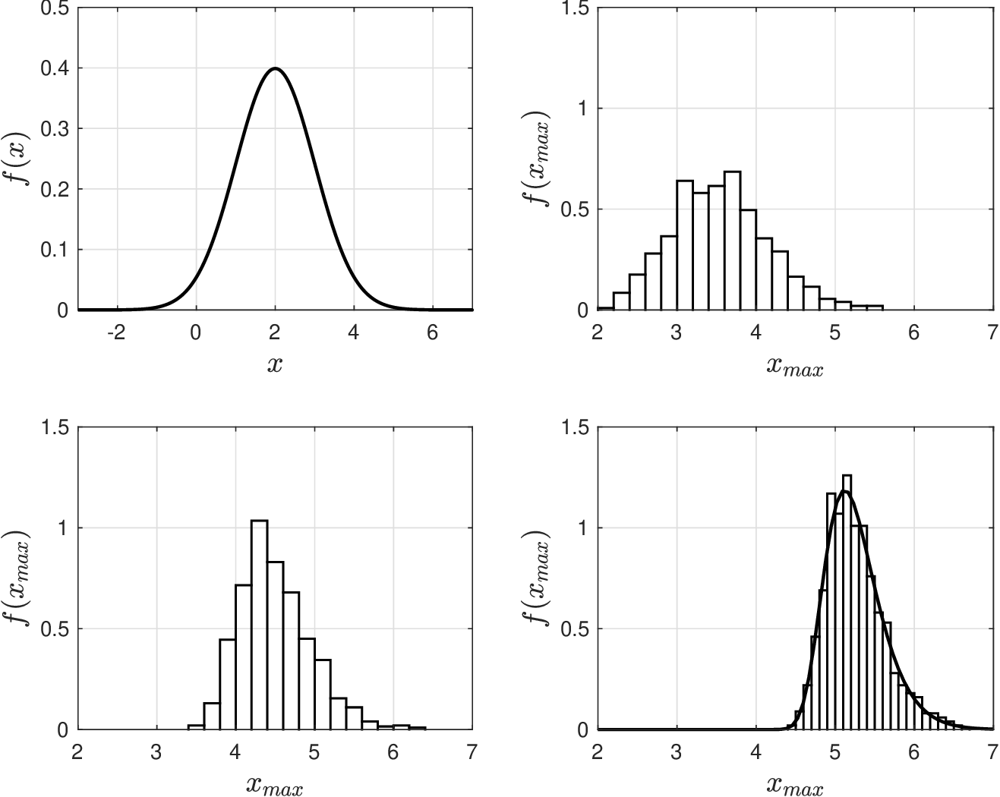
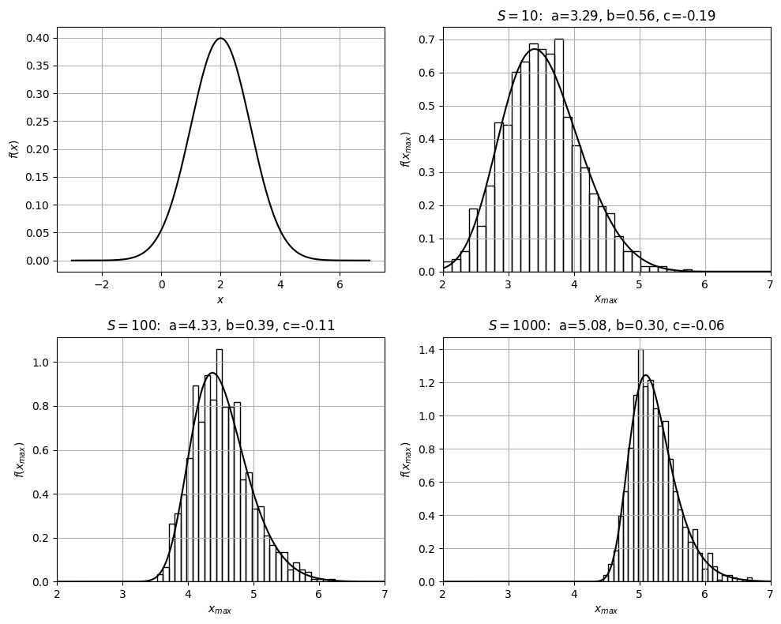
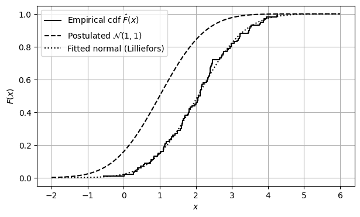

# Extreme Value Theorem

* In CLT we study limiting behavior of *sample average* $$\hat{\mathbb{E}}_X^S=\frac{1}{S}\sum_{\omega\in \mathcal{S}}X_\omega$$.
* What if we are interested in a different statistic? For instance, the *sample max*:

  $$
  X_{max}^S=\max\{X_1,X_2,\cdots, X_S\}
  $$

* *Extreme value theorem* (EVT) characterizes pdf of $$X_{max}^S$$ as $$S\to \infty$$.
* Consider, as before, an i.i.d. sequence $$X_1,X_2,...,X_S$$ for RV $$X$$. The EVT states:

  $$
  \lim_{S\to \infty}X_{max}^S\sim \textrm{GEV}(a,b,c)
  $$

   where $$\textrm{GEV}(a,b,c)$$ is generalized extreme value (GEV) RV with params $$a,b,c$$.

* GEV has cdf:

  $$
  \begin{aligned}
  F_{X_{max}}(x)= \begin{cases}\exp(-(1+c s)^{-1/c}) & c\neq0 \\ \exp(-\exp(-s)) & c = 0\end{cases}
  \end{aligned}
  $$

   where $$s=(x-a)/b$$ is a standardized variable.

* GEV is reverse Weibull (for $$c<0$$), Fréchet (for $$c>0$$), and Gumbel (for $$c=0$$).
* Reverse Weibull is a variant of the two-parameter Weibull (explored before).
* GEV RV is used in failure analysis because sample max characterizes *extreme events*.
* This is relevant because such events often have small probabilities (are *rare* events).
* GEV thus gives a mechanism to estimate probabilities for rare events.

## Example: Verifying Extreme Value Theorem


* Collect i.i.d. samples $$X_1,...,X_S$$ from $$X\sim \mathcal{N}(2,1)$$ and compute  $$X_{max}^S=\max\{X_1,\cdots, X_S\}$$.
* Repeat procedure for different sets of samples and visualize pdf of $$X_{max}^S$$.
* We do this for different $$S$$ to verify that pdf follows that of a GEV as we increase $$S$$.


<figure><figcaption><p>Pdf for 𝑋 ∼ 𝒩(2, 1) (top-left) and sample max 𝑋ₘₐₓˢ with 𝑆 = 10 (top-right), 𝑆 = 100 (bottom-left) and 𝑆 = 1000 (bottom-right).</p></figcaption></figure>

#### Python implementation


Notebook [`ch4_evt_example.ipynb`](https://colab.research.google.com/github/vzavala/StatsBook/blob/master/Python/ch4_evt_example.ipynb) — open it in Colab and run the cells alongside this section.


Verifying the extreme value theorem (Victor Z, UW-Madison, 2024).

| Slides | Python | Meaning |
|---|---|---|
| $$X\sim\mathcal{N}(2,1)$$ | `mu`, `sigma` | underlying RV |
| $$X^S_{max}=\max\{X_1,\dots,X_S\}$$ | `x_max` | sample maxima (one per repetition) |
| $$\mathrm{GEV}(a,b,c)$$ | `a`, `b`, `c` | location, scale, shape |

`scipy.stats.genextreme` uses the opposite sign for the shape: `c_scipy = -c`.
`R` is the number of repetitions.

**Note:** This notebook reproduces Example 4.8 (Section 4.3.4) of *Statistics for Chemical Engineers*: the distribution of the maximum of S observations of N(2,1).

```python
import numpy as np
import matplotlib.pyplot as plt
from scipy.stats import norm, genextreme

mu, sigma = 2, 1
R = 1000
np.random.seed(0)

fig, axs = plt.subplots(2, 2, figsize=(10, 8))
x = np.linspace(-3, 7, 400)
axs[0, 0].plot(x, norm.pdf(x, mu, sigma), 'black', linewidth=1.5)
axs[0, 0].set_xlabel('$x$')
axs[0, 0].set_ylabel('$f(x)$')
for ax, S in zip((axs[0, 1], axs[1, 0], axs[1, 1]), (10, 100, 1000)):
    x_max = np.random.normal(mu, sigma, (R, S)).max(axis=1)
    ax.hist(x_max, bins=30, density=True, edgecolor='black', facecolor='none')
    c_scipy, a, b = genextreme.fit(x_max)
    ax.plot(x, genextreme.pdf(x, c_scipy, loc=a, scale=b), 'k', linewidth=1.5)
    ax.set_xlim(2, 7)
    ax.set_title(f'$S={S}$:  a={a:.2f}, b={b:.2f}, c={-c_scipy:.2f}')
    ax.set_xlabel(r'$x_{max}$')
    ax.set_ylabel(r'$f(x_{max})$')
for ax in axs.ravel():
    ax.grid(True)
plt.tight_layout()
plt.show()
```

<figure></figure>

Probabilities of rare events from the GEV fit for $$S=1000$$.

```python
for x_k in (5, 7):
    print(f"P(X_max > {x_k}) = {genextreme.sf(x_k, c_scipy, loc=a, scale=b):.3g}")
```

```
P(X_max > 5) = 0.727
P(X_max > 7) = 0.000273
```

**Note:** As in the book, for S = 1000 the peak is likely above 5 but unlikely above 7 (P = 3.6e-4); these probabilities come from the extreme value model, without knowing the nature of X.

---

#### Python implementation


Notebook [`ch4_example_hypothesis.ipynb`](https://colab.research.google.com/github/vzavala/StatsBook/blob/master/Python/ch4_example_hypothesis.ipynb) — open it in Colab and run the cells alongside this section.


Hypothesis testing (Victor Z, UW-Madison, 2024): we draw a random sample from $$\mathcal{N}(2,1)$$ and
test whether it comes from the (wrong) postulated model $$\mathcal{N}(1,1)$$ with the z-test and the
Kolmogorov-Smirnov (KS) test; the Lilliefors test checks whether the sample comes from *some* normal RV.
A test returns `h = 1` when it rejects the null hypothesis and `h = 0` when it fails to reject it
(significance level 0.05, as MATLAB's `ztest`, `kstest`, and `lillietest`).

| Book | Python | Meaning |
|---|---|---|
| $$x_\omega$$, $$S$$ | `x_omega`, `S` | sample and sample size |
| $$\mu$$, $$\sigma$$ | `mu0`, `sigma0` | postulated model $$\mathcal{N}(1,1)$$ |
| $$z=\frac{\bar{x}-\mu}{\sigma/\sqrt{S}}$$ | `z` | z-score (test statistic of the z-test) |
| $$d=\max_x\,\lvert\hat{F}(x)-F(x)\rvert$$ | `d` | KS distance between empirical and model cdf |
| $$h$$ | `h1`, `h2`, `h3` | test decision (1 = reject the null hypothesis) |

**Note:** This notebook reproduces Example 4.9 (Section 4.4) of *Statistics for Chemical Engineers*: testing whether a sample of N(2,1) comes from the (wrong) model N(1,1).

```python
import numpy as np
import matplotlib.pyplot as plt
from scipy.stats import norm, kstest
from statsmodels.stats.diagnostic import lilliefors

# generate observations from N(2,1)
np.random.seed(0)
S = 100
mu, sigma = 2, 1
x_omega = np.random.normal(mu, sigma, S)

alpha = 0.05            # significance level
mu0, sigma0 = 1, 1      # postulated model N(1,1)
```

**z-test.** The z-score measures how far the sample mean is from the postulated mean; the p-value is the
probability of a z-score at least this large (in absolute value) if the null hypothesis were true.

```python
z = (np.mean(x_omega) - mu0) / (sigma0 / np.sqrt(S))
p1 = 2 * (1 - norm.cdf(abs(z)))           # two-sided test
h1 = int(p1 < alpha)
print(f"z-test:          z = {z:.3f}, p = {p1:.2e}, h1 = {h1}")
```

```
z-test:          z = 10.598, p = 0.00e+00, h1 = 1
```

**KS test.** The test statistic is the largest distance between the empirical cdf of the sample and the cdf
of the postulated model $$\mathcal{N}(1,1)$$.

```python
d, p2 = kstest(x_omega, 'norm', args=(mu0, sigma0))
h2 = int(p2 < alpha)
print(f"KS test:         d = {d:.3f}, p = {p2:.2e}, h2 = {h2}")
```

```
KS test:         d = 0.425, p = 7.03e-17, h2 = 1
```

**Lilliefors test.** This test first fits a normal model to the data (sample mean and standard deviation) and
then measures the KS distance to the fitted model; it tests whether the data come from a normal RV.

```python
d3, p3 = lilliefors(x_omega, dist='norm')
h3 = int(p3 < alpha)
print(f"Lilliefors test: d = {d3:.3f}, p = {p3:.3f}, h3 = {h3}")
```

```
Lilliefors test: d = 0.064, p = 0.400, h3 = 0
```

```python
xx = np.linspace(-2, 6, 400)
x_sorted = np.sort(x_omega)
F_hat = np.arange(1, S + 1) / S
fig, ax = plt.subplots(figsize=(7, 4))
ax.step(x_sorted, F_hat, where='post', color='black', label=r'Empirical cdf $\hat{F}(x)$')
ax.plot(xx, norm.cdf(xx, mu0, sigma0), 'k--', label=r'Postulated $\mathcal{N}(1,1)$')
ax.plot(xx, norm.cdf(xx, np.mean(x_omega), np.std(x_omega, ddof=1)), 'k:', label='Fitted normal (Lilliefors)')
ax.set_xlabel('$x$')
ax.set_ylabel('$F(x)$')
ax.grid(True)
ax.legend()
plt.show()
```

<figure></figure>

As in the book, the z-test and the KS test reject the null hypothesis that the data come from $$\mathcal{N}(1,1)$$,
while the Lilliefors test fails to reject that the data come from a normal RV. (The sample differs from the one
drawn in MATLAB, because the two use different random numbers; the conclusions are the same.)

**Note:** As in the book, the z-test and KS test reject that the data come from N(1,1), while the Lilliefors test (which first fits a normal model) does not reject that the data are normal.
