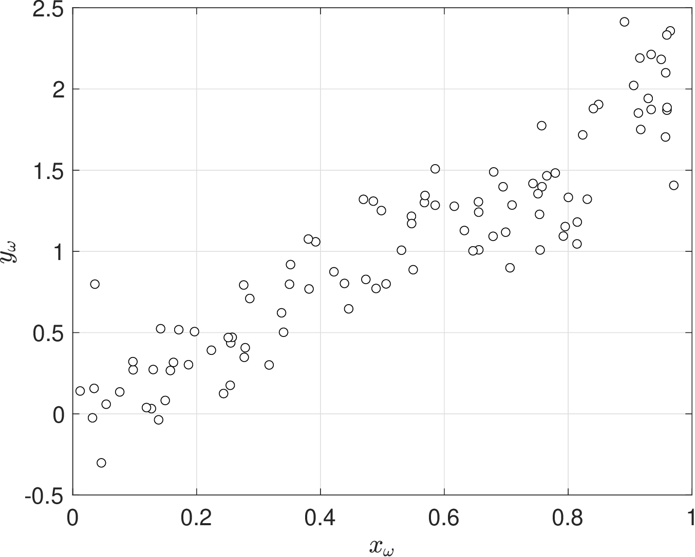
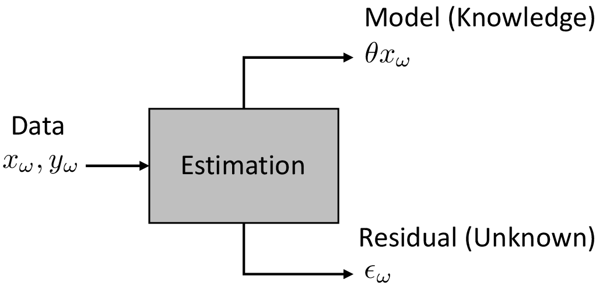
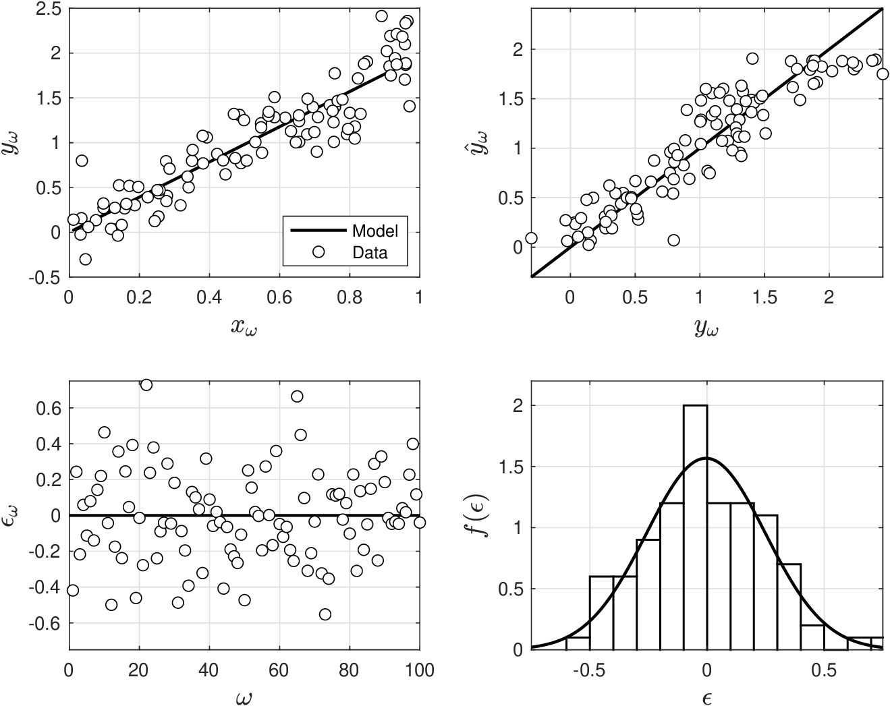
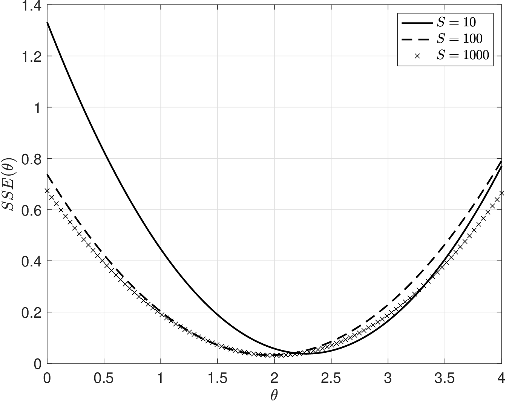
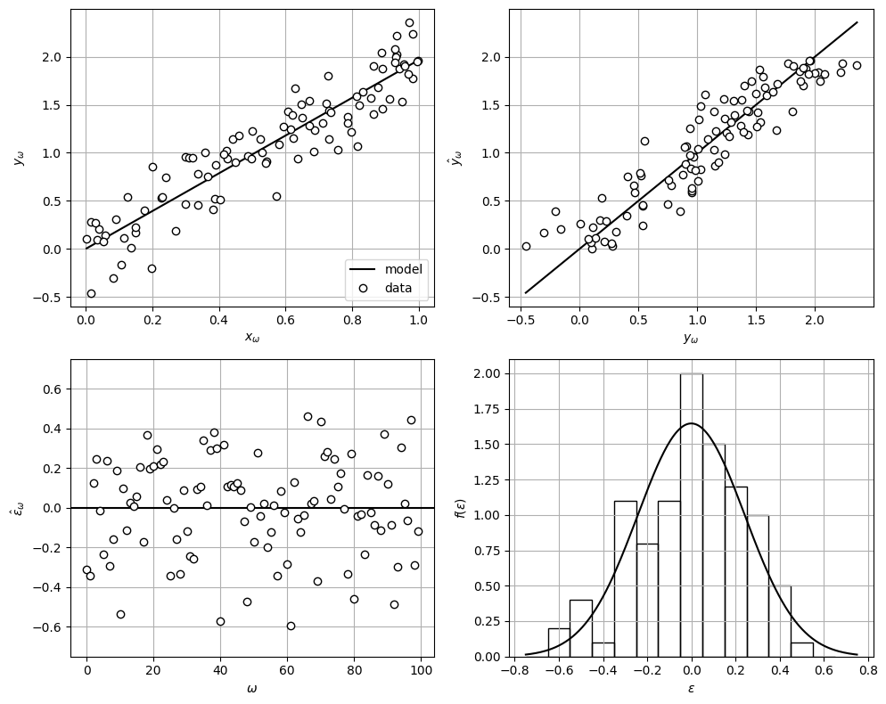
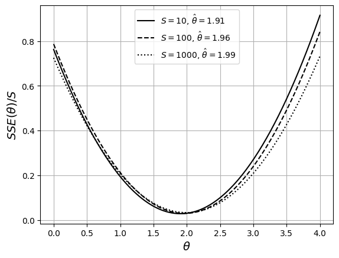

# Scalar Linear Models

* We begin our discussion by considering univariate RVs $$Y$$ and $$X$$.
* Consider experiments $$\omega \in \mathcal{S}$$ and observation pairs $$(y_\omega,x_\omega)$$.
* Typically, input variable $$X$$ is a variable that we can control when designing an experiment while output variable $$Y$$ is the result of the experiment.

  <figure></figure>

* From the data above, it is clear that pairs $$(y_\omega,x_\omega)$$ follow a *systematic trend*; however, we note that the linear trend is not perfect (contains variability).

* We postulate that behavior in $$Y$$ follows systematic dependence on $$X$$ of the form:

  $$
  Y=\theta X +\epsilon
  $$

* Here, $$\theta$$ is a parameter that captures  *linear* trend between $$X$$ and $$Y$$.
* For now, assume that $$X$$ and $$\theta$$ are deterministic variables and therefore any variability observed in $$Y$$ is the result of a hidden RV $$\epsilon$$.
* Postulated model contains deterministic component $$\theta X$$. This component will be called the *structural model* and captures the mechanism by which $$Y$$ depends on $$X$$.
* Structural model $$\theta X$$ captures knowledge about $$Y$$ and allows us to make predictions.
* Postulated model also obtains a random component, which is modeled as RV $$\epsilon$$. Here,  we assume that RV model is $$\epsilon \sim \mathcal{N}(0,\sigma^2)$$.
* Random component is called random model (or noise model) and captures what we do not know about $$Y$$.  Random model contains parameter $$\sigma$$.

* Assume observation pairs $$(y_\omega,x_\omega)$$ are related as:

  $$
  y_\omega=\theta x_\omega + \epsilon_\omega,\; \omega \in \mathcal{S}.
  $$

* Here, $$\epsilon_\omega$$ is random sample of $$\epsilon$$ (it is an RV);  as such, $$y_\omega$$ is an RV.
* Input $$X$$ is deterministic variable and with known values $$x_\omega$$.
* Parameter $$\theta$$ is a deterministic variable but we do not know its value.
* Can write model as $$\epsilon_\omega=y_\omega-\theta x_\omega$$; noise variable captures discrepancy between model and observed output (it is a residual).
* Goal is to find $$\theta,\sigma$$ that maximize knowledge extracted ($$\theta x_\omega$$) from data $$x_\omega,y_\omega$$.
* Aspects of the data that cannot be explained with model ($$\epsilon_\omega$$) represent the unknown;  consequently, our goal is equivalent to minimize residual.
* An interesting analogy of this process is that of a separation system.

<figure><figcaption><p>Extraction of knowledge from data. The structural model represents our knowledge while the random model represents the unknown (what cannot be explained with the structural model).</p></figcaption></figure>

* Since $$x_\omega$$ and $$\theta$$ are deterministic, $$y_\omega$$ is linear transformation of Gaussian RV $$\epsilon_\omega$$.
* Consequently, $$y_\omega$$ is Gaussian RV $$\mathcal{N}(\theta x_\omega,\sigma^2)$$.
* Expected behavior of output is deterministic model.
* Variance of its behavior results from variance of noise.

## Maximum Likelihood Estimation

* Most popular technique to estimate parameters is MLE.
* Define $$f(y_\omega|x_\omega,\theta,\sigma)$$ as conditional prob that $$Y=y_\omega$$ given values of $$x_\omega$$,  $$\theta$$, and $$\sigma$$.
* Observations are *random* samples with joint likelihood:

  $$
  f(\mathbf{y}|\mathbf{x},\theta,\sigma)=\prod_{\omega\in \mathcal{S}}f(y_\omega|x_\omega,\theta,\sigma).
  $$

* Goal is to find $$\theta$$ that maximizes log likelihood function:

  $$
  \max_\theta\; \log L(\theta)=\sum_{\omega \in \mathcal{S}} \log f(y_\omega|x_\omega,\theta,\sigma)
  $$

* We know that $$y_\omega\sim \mathcal{N}(\theta x_\omega,\sigma^2)$$ and thus:

  $$
  \log f(y_\omega|x_\omega,\theta,\sigma)=-\log {\sqrt{2\pi\sigma^2}}-{\frac{(y_\omega-\theta x_\omega)^2}{2\sigma^2}}
  $$

* MLE problem can be written as:

  $$
  \max_{\theta,\sigma^2}\; -\frac{S}{2}\log {2\pi}-\frac{S}{2}\log \sigma^2 -\sum_{\omega \in \mathcal{S}} {\frac{(y_\omega-\theta x_\omega)^2}{2\sigma^2}}
  $$

* Assume now that $$\sigma^2$$ is a known quantity, first and second terms are fixed constants that do not affect the solution of optimization problem.
* We can thus express problem in the equivalent form:

  $$
  \min_\theta \frac{1}{2}\sum_{\omega \in \mathcal{S}} (y_\omega-\theta x_\omega)^2
  $$

* This is a least-squares problem that estimates $${\theta}$$ by minimizing discrepancy between  observed output $$y_\omega$$ and deterministic model prediction $${\theta} x_\theta$$.
* Function to be minimized in this problem is known as the sum of squared errors (SSE) and will be denoted as $$SSE(\theta)$$.
* Value of $$\theta$$ that solves the problem is known as *maximum likelihood estimate* $$\hat{\theta}$$.
* Because observations used to estimate $$\hat{\theta}$$ are random, estimate is an RV.

* Estimate $$\hat{\theta}$$ that minimizes $$SSE(\theta)=\frac{1}{2}\sum_{\omega \in \mathcal{S}} (y_\omega-\theta x_\omega)^2$$ must satisfy:

  $$
  \frac{\partial SSE(\hat{\theta})}{\partial \theta}=-\sum_{\omega \in \mathcal{S}}x_\omega (y_\omega-\hat{\theta} x_\omega)=0
  $$

* Satisfying this guarantees that $$\hat{\theta}$$ is a stationary point but does not guarantee that this is a minimum point for $$SSE(\theta)$$ (i.e., max point also satisfies this).
* We thus say this condition is *necessary but not sufficient*.
* Sufficient condition guaranteeing that $$SSE(\hat{\theta})$$ is a unique minimum is:

  $$
  \frac{\partial^2 SSE(\hat{\theta})}{\partial \theta^2}>0.
  $$

* Necessary condition tells us that the estimate is given by $$\hat{\theta}=\frac{\sum_{\omega \in \mathcal{S}}x_\omega y_\omega}{\sum_{\omega \in \mathcal{S}}x_\omega^2}$$
* Sufficient condition tells us that $$\sum_{\omega \in \mathcal{S}}x_\omega^2>0.$$
* Estimate $$\hat{\theta}$$ is *unique* and becomes better defined as we add data (min is sharper).

* Estimate $$\hat{\theta}$$ gives residuals $$\hat{\epsilon}_\omega =y_\omega-\hat{\theta}x_\omega,\; \omega \in \mathcal{S}$$.
* If residual estimates follow our assumption that $$\hat{\epsilon}_\omega\sim \mathcal{N}(0,\sigma^2)$$ then available data and postulated model are satisfactory.
* If this is not satisfied, more data or another model is needed (e.g., nonlinear).
* This is because noise might be absorbing aspects of trend (it is not purely random).

## Example: Linear Estimation with Correct Model

* Consider $$X,Y$$ with structural  relationship $$Y=\theta X$$ and $$\theta=2$$.
* Assume that observations $$Y$$ are corrupted by noise $$\epsilon_\omega  \sim \mathcal{N}(0,0.0625)$$.
* Use model to generate $$S=100$$ observations $$(x_\omega,y_\omega)$$.
* We postulate a model $$Y=\theta X + \epsilon$$ with $$\epsilon\in \mathcal{N}(0,\sigma^2)$$ and estimate $$\theta$$ using MLE.

  <figure></figure>

* Plot $$SSE(\theta)$$ for different amounts of data $$S=10,100,1000$$.
* Surface becomes better defined as we add data and reveals true value $$\theta=2$$.
* If we use $$S=10$$, $$SSE(\theta)$$ is minimized at $$\hat{\theta}=2.2$$.
* If we use $$S=100$$ or $$S=1000$$ obs, $$SSE(\theta)$$ is minimized  at $$\hat{\theta}=2$$.

  <figure></figure>

#### Python implementation


Notebook [`ch5_linear_est_example.ipynb`](https://colab.research.google.com/github/vzavala/StatsBook-GitBook/blob/main/notebooks/ch5_linear_est_example.ipynb) — open it in Colab and run the cells alongside this section.


Scalar linear estimation with the correct model (Victor Z and Jaron T, UW-Madison, 2024).

| Slides | Python | Meaning |
|---|---|---|
| $$(x_\omega,y_\omega)$$, $$S$$ | `x_omega`, `y_omega`, `S` | observation pairs |
| $$\theta$$, $$\sigma$$ | `theta`, `sigma` | true slope and noise SD ($$\sigma^2=0.0625$$) |
| $$\hat{\theta}=\sum_\omega x_\omega y_\omega/\sum_\omega x_\omega^2$$ | `theta_hat` | MLE (least squares) |
| $$\hat{y}_\omega=\hat{\theta}x_\omega$$, $$\hat{\epsilon}_\omega$$ | `y_hat`, `eps_hat` | predictions and residuals |
| $$SSE(\theta)$$ | `SSE` | sum of squared errors |

```python
import numpy as np
import matplotlib.pyplot as plt
from scipy.stats import norm

theta, sigma = 2, 0.25

def generate(S, seed=0):
    """S observations of y = theta x + eps with eps ~ N(0, sigma^2)."""
    rng = np.random.default_rng(seed)
    x_omega = rng.random(S)
    y_omega = theta * x_omega + rng.normal(0, sigma, S)
    return x_omega, y_omega

S = 100
x_omega, y_omega = generate(S)
theta_hat = np.sum(x_omega * y_omega) / np.sum(x_omega**2)
y_hat = theta_hat * x_omega
eps_hat = y_omega - y_hat
mu_eps, sigma_eps = norm.fit(eps_hat)
print(f"theta_hat = {theta_hat:.3f};  residuals ~ N({mu_eps:.3f}, {sigma_eps:.3f}^2)")
```

```
theta_hat = 1.965;  residuals ~ N(-0.000, 0.242^2)
```

```python
fig, axs = plt.subplots(2, 2, figsize=(10, 8))
order = np.argsort(x_omega)
axs[0, 0].plot(x_omega[order], y_hat[order], 'k-', linewidth=1.5, label='model')
axs[0, 0].plot(x_omega, y_omega, 'ko', markerfacecolor='w', label='data')
axs[0, 0].set_xlabel(r'$x_\omega$'); axs[0, 0].set_ylabel(r'$y_\omega$'); axs[0, 0].legend(loc='lower right')
lims = [y_omega.min(), y_omega.max()]
axs[0, 1].plot(lims, lims, 'k-')
axs[0, 1].plot(y_omega, y_hat, 'ko', markerfacecolor='w')
axs[0, 1].set_xlabel(r'$y_\omega$'); axs[0, 1].set_ylabel(r'$\hat{y}_\omega$')
axs[1, 0].axhline(0, color='k')
axs[1, 0].plot(eps_hat, 'ko', markerfacecolor='w')
axs[1, 0].set_ylim(-3*sigma, 3*sigma)
axs[1, 0].set_xlabel(r'$\omega$'); axs[1, 0].set_ylabel(r'$\hat{\epsilon}_\omega$')
e = np.linspace(-0.75, 0.75, 200)
axs[1, 1].hist(eps_hat, bins=np.arange(-0.75, 0.75, 0.1), density=True, edgecolor='black', facecolor='none')
axs[1, 1].plot(e, norm.pdf(e, mu_eps, sigma_eps), 'k-', linewidth=1.5)
axs[1, 1].set_xlabel(r'$\epsilon$'); axs[1, 1].set_ylabel(r'$f(\epsilon)$')
for ax in axs.ravel():
    ax.grid(True)
plt.tight_layout()
plt.show()
```

<figure></figure>

$$SSE(\theta)=\frac{1}{2}\sum_\omega(y_\omega-\theta x_\omega)^2$$ (scaled by $$1/S$$) becomes sharper as $$S$$ grows.

```python
theta_grid = np.linspace(0, 4, 200)
for S, style in ((10, 'k-'), (100, 'k--'), (1000, 'k:')):
    x_omega, y_omega = generate(S)
    SSE = np.array([0.5 * np.sum((y_omega - th * x_omega)**2) for th in theta_grid])
    theta_hat = np.sum(x_omega * y_omega) / np.sum(x_omega**2)
    plt.plot(theta_grid, SSE / S, style, linewidth=1.5, label=rf'$S={S}$, $\hat\theta={theta_hat:.2f}$')
plt.grid(True)
plt.xlabel(r'$\theta$', fontsize=14)
plt.ylabel(r'$SSE(\theta)/S$', fontsize=14)
plt.legend()
plt.show()
```

<figure></figure>

## Bias, Precision, and Information

* MLE delivers an unbiased estimate $$\hat{\theta}$$ of true parameters $$\theta$$.
* To see this, write MLE problem as:

  $$
  \min_\theta\; -\log L(\theta)=-\log f(\mathbf{y}|\theta).
  $$

* Solution satisfies necessary condition (a.k.a. score function):

  $$
  -\frac{\partial \log f(\mathbf{y}|\hat{\theta})}{\partial \theta}=0.
  $$

* Estimate $$\hat{\theta}$$ is RV because it depends on random data $$\mathbf{y}$$.
* Imagine we use observations $$\mathbf{y}$$ to obtain an estimate $$\hat{\theta}$$ and repeat this with different observations $$\mathbf{y}$$ to obtain different estimates $$\hat{\theta}$$.
* Can we guarantee that this process delivers estimates satisfying $$\mathbb{E}[\hat{\theta}]=\theta$$?
* One can show that the answer is yes, because one can show that:

  $$
  \mathbb{E}\left[-\frac{\partial \log f(\mathbf{y}|\theta)}{\partial \theta}\right]=0\qquad (\textrm{expectation wrt $\mathbf{y}$)}
  $$

* Now explore how does $$\hat{\theta}$$ *vary* as we vary observations $$\mathbf{y}$$.
* Variance tell us how certain we are that our estimate $$\hat{\theta}$$ is true value $$\theta$$ and recall also that variance is measure of estimate precision.
* To assess how much $$\hat{\theta}$$ varies, we need to assess variance of score function:

  $$
  \mathcal{I}(\theta)=\mathbb{V}\left[-\frac{\partial \log f(\mathbf{y}|\theta)}{\partial \theta}\right]
  $$

* Function $$\mathcal{I}(\theta)$$ is known as the *Fisher information* and can be expressed as:

  $$
  \mathcal{I}(\theta)=\mathbb{E}\left[-\frac{\partial^2 \log f(\mathbf{y}|\theta)}{\partial \theta^2}\right]
  $$

* FI is thus related to second derivative of log likelihood function.
* FI gives limit of best possible estimator precision.  Specifically, one can show that:

  $$
  \mathbb{V}[\hat{\theta}]\geq \frac{1}{\mathcal{I}(\theta)}.
  $$

* This is known as Cramer-Rao bound.

* FI in general cannot be computed ($$\theta$$ is not known and requires expectation wrt $$\mathbf{y}$$).
* In some special situations, however, FI can be computed.
* This is the case for linear  models; to see this, note that log likelihood is:

  $$
  -\log f(\mathbf{y}|\theta)=\frac{S}{2}\log {2\pi}+\frac{S}{2}\log \sigma^2 +\sum_{\omega \in \mathcal{S}} {\frac{(y_\omega-\theta x_\omega)^2}{2\sigma^2}}.
  $$

* The second derivative of this function is:

  $$
  -\frac{\partial^2 \log f(\mathbf{y}|\theta)}{\partial \theta^2}=\frac{1}{\sigma^2}\sum_{\omega \in \mathcal{S}} x_\omega^2.
  $$

* FI is thus:

  $$
  \mathcal{I}(\theta)=\mathbb{E}\left[-\frac{\partial^2 \log f(\mathbf{y}|\theta)}{\partial \theta^2}\right]=\frac{1}{\sigma^2}\sum_{\omega \in \mathcal{S}} x_\omega^2.
  $$

* As increase amount of data ($$S$$ larger), FI increases (minimum becomes sharper).
* As variance of $$\mathbf{y}$$ decreases  ($$\sigma^2$$ smaller), FI increases.

## Estimation of Structural and Random Parameters

* So far, we have assumed that $$\sigma$$ is a deterministic variable with known value.
* If not known, parameter $$\sigma$$ can be estimated using MLE.
* To see this, consider MLE problem:

  $$
  \min_{\theta,\sigma}\; -\log L(\theta,\sigma)=-\sum_{\omega \in \mathcal{S}} \log f(y_\omega|x_\omega,\theta,\sigma).
  $$

* Rearranging:

  $$
  \min_{\theta,\sigma}\; \frac{S}{2}\log 2\pi + \frac{S}{2}\log \sigma^2+ \frac{1}{2\sigma^2}\sum_{\omega \in \mathcal{S}} (y_\omega-\theta x_\omega)^2
  $$

* Estimates must satisfy optimality conditions:

  $$
  \begin{aligned}
  -\frac{\partial \log L(\theta,\sigma)}{\partial \theta}&=0\\
  -\frac{\partial \log L(\theta,\sigma)}{\partial \sigma^2}&=0.
  \end{aligned}
  $$

* First optimality condition yields:

  $$
  \frac{1}{{\sigma^2}}\sum_{\omega \in \mathcal{S}} x_\omega(y_\omega-\theta x_\omega)=0.
  $$

* Multiplying through by $$\sigma^2$$ and rearranging we obtain:

  $$
  \hat{\theta}=\frac{\sum_{\omega \in \mathcal{S}}x_\omega y_\omega}{\sum_{\omega \in \mathcal{S}}x_\omega^2}.
  $$

* We thus have that $$\hat{\theta}$$ does not depend on $$\sigma$$.
* Second optimality condition yields:

  $$
  \frac{S}{2}\frac{1}{\sigma^2}-\frac{1}{2(\sigma^2)^2}\sum_{\omega \in \mathcal{S}} (y_\omega-\theta x_\omega)^2=0.
  $$

* Using estimate $$\hat{\theta}$$ and rearranging:

  $$
  \hat{\sigma}^2=\frac{1}{S}\sum_{\omega \in \mathcal{S}} (y_\omega-\hat{\theta} x_\omega)^2.
  $$

* Estimate $$\hat{\sigma}^2$$ is thus sample variance of residuals.
