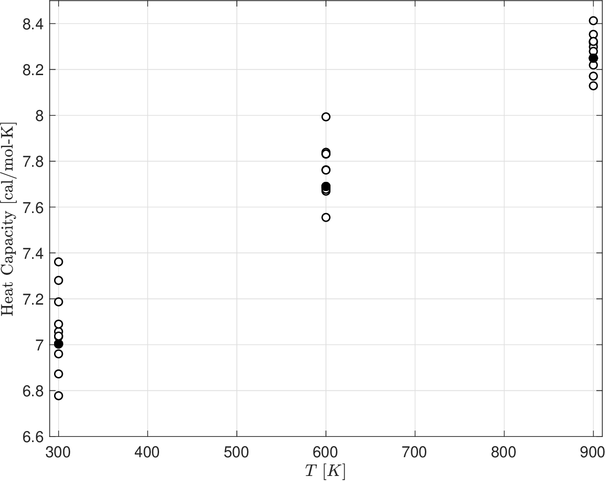
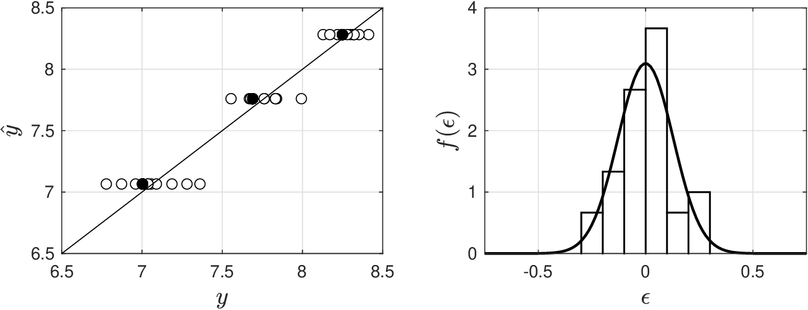
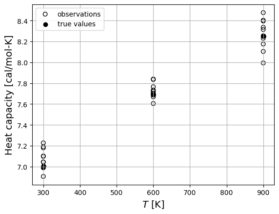
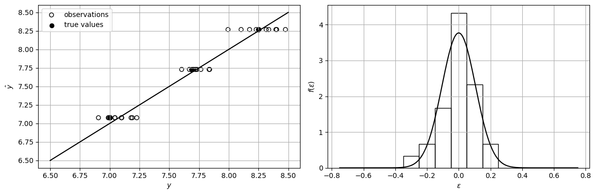

# Multidimensional Linear Models

* We now generalize linear model to account for multiple inputs.

  $$
  \begin{aligned}
  Y&=\theta_0+\sum_{i=1}^n\theta_iX_i+\epsilon
  \end{aligned}
  $$

* Observation pairs $$(y_\omega,x_\omega)$$ satisfy:

  $$
  y_\omega=\theta_0+\sum_{i=1}^n\theta_i x_{\omega,i} + \epsilon_\omega,\; \omega \in \mathcal{S}.
  $$

* This set of equations can be expressed compactly using matrix notation:

  $$
  \mathbf{y}=\mathbf{X}\theta + \mathbf{e}
  $$

   where:

  $$
  \begin{aligned}
  \mathbf{y}=\left[\begin{array}{c}y_1\\y_2\\\vdots \\ y_S\end{array}\right],\;
  \mathbf{X}=\left[\begin{array}{ccccc}1&x_{1,1}&x_{1,2}&\hdots&x_{1,n}\\
  1&x_{2,1}&x_{2,2}&\hdots&x_{2,n}\\
  \vdots&&&\vdots\\
  1&x_{S,1}&x_{S,2}&\hdots&x_{S,n}\\
  \end{array}\right],\;
  \boldsymbol{\theta}=\left[\begin{array}{c}\theta_0\\\theta_1\\\vdots \\ \theta_n\end{array}\right],\;
  \; \mathbf{e}=\left[\begin{array}{c}\epsilon_1\\\epsilon_2\\\vdots \\ \epsilon_S\end{array}\right].
  \end{aligned}
  $$

* Assume random noise is $$S$$-dimensional RV $$\mathbf{e}\sim \mathcal{N}(0,\Sigma)$$.
* Here, $$\Sigma \in \mathbb{R}^{S\times S}$$ is noise covariance.
* Noise covariance captures variance and correlations in sensor errors.
* As in scalar case, assume$$\mathbf{X}$$, $$\theta$$, and $$\Sigma$$ are deterministic variables.
* Output is thus $$\mathbf{y}\sim \mathcal{N}(\mathbf{X}\theta,\Sigma)$$ with joint density $$f(\mathbf{y}|\mathbf{X},\theta,\Sigma)$$.
* Estimates $$\hat{\theta}$$ and $$\hat{\Sigma}$$ are found by maximizing log likelihood

  $$
  \max_{\theta,\Sigma} \;
  \log f(\mathbf{y}|\mathbf{X},\theta,\Sigma)=-\log\left((2\pi)^{S/2}|\Sigma|^{1/2}\right) -\frac{1}{2}(\mathbf{y}-\mathbf{X}\theta)^T\Sigma^{-1}(\mathbf{y}-\mathbf{X}\theta).
  $$

* This is most general form of MLE problem.

* If we assume noise covariance $$\Sigma$$ is given, MLE problem reduces to:

  $$
  \min_{\theta} \; -\log f(\mathbf{y}|\mathbf{X},\theta,\Sigma)=\log\left((2\pi)^{S/2}|\Sigma|^{1/2}\right) +\frac{1}{2}(\mathbf{y}-\mathbf{X}\theta)^T\Sigma^{-1}(\mathbf{y}-\mathbf{X}\theta).
  $$

* Since $$\Sigma$$ is a constant, first term in log likelihood is a constant and can be eliminated.
* MLE problem is thus reduced to:

  $$
  \min_{\theta} \; \frac{1}{2}(\mathbf{y}-\mathbf{X}\theta)^T\Sigma^{-1}(\mathbf{y}-\mathbf{X}\theta).
  $$

* This is a least-squares problem (covariance acts as *weighting* matrix).

* If we assume $$\Sigma$$ is diagonal with entries $$\Sigma_{\omega,\omega}=\sigma^2_\omega$$ for $$\omega\in\mathcal{S}$$:

  $$
  \min_{\theta} \; \frac{1}{2}\sum_{\omega \in \mathcal{S}}\frac{1}{\sigma_\omega^2}(y_\omega-\mathbf{x}_\omega^T \theta)^2.
  $$

* Reciprocal of variance $$1/\sigma_\omega^2$$ acts as *weight* for observation $$\omega$$.
* If we further assume noise variances are equal ($$\sigma_\omega^2=\sigma^2$$):

  $$
  \begin{aligned}
  \min_{\theta}&\quad \frac{1}{2}\sum_{\omega \in \mathcal{S}}(y_\omega-\mathbf{x}_\omega^T \theta)^2.
  \end{aligned}
  $$

* This is a min problem for sum-of-squared errors (simplest form of MLE problem).

* SSE function can be written compactly as:

  $$
  \begin{aligned}
  SSE(\theta)&= \frac{1}{2}\sum_{\omega \in \mathcal{S}}(y_\omega-\mathbf{x}_\omega^T \theta)^2\\
  &=\frac{1}{2}(\mathbf{y}-\mathbf{X}\theta)^T (\mathbf{y}-\mathbf{X}\theta)=\frac{1}{2}\|\mathbf{y}-\mathbf{X}\theta\|^2.
  \end{aligned}
  $$

* Solution of SSE min problem must satisfy necessary conditions:

  $$
  \nabla_\theta SSE(\theta) =0.
  $$

* Here, $$\nabla_\theta SSE(\theta) \in \mathbb{R}^{n+1}$$ is gradient vector:

  $$
  \begin{aligned}
  \nabla_\theta SSE(\theta) &= \left[\begin{array}{c}\frac{\partial SSE(\theta)}{\partial \theta_0}\\ \frac{\partial SSE(\theta)}{\partial \theta_1}\\ \vdots\\ \frac{\partial SSE(\theta)}{\partial \theta_n}\end{array}\right].
  \end{aligned}
  $$

* Gradient vector is given by:

  $$
  \nabla_\theta SSE(\theta)=-\mathbf{X}^T(\mathbf{y}-\mathbf{X}\theta).
  $$

* This is set of $$n+1$$ linear equations that must be solved to obtain $$\hat{\theta}$$.
* Explicit solution can be found by using matrix manipulations:

  $$
  \hat{\theta}=(\mathbf{X}^T\mathbf{X})^{-1}\mathbf{X}^T\mathbf{y}.
  $$

* Recall that this estimate is only guaranteed to be a stationarity point for $$SSE(\theta)$$.
* A stationary point can be a min or max; moreover, such point might be non-unique.
* Non-uniqueness indicates that multiple values of $$\theta$$ give same min value of SSE.

* Estimate $$\hat{\theta}$$ is *unique min* of $$SSE(\theta)$$ if sufficient condition holds:

  $$
  \nabla_\theta^2 SSE(\theta) \succ 0
  $$

* Here, $$\nabla_\theta^2 SSE(\theta)$$ is Hessian matrix:

  $$
  \begin{aligned}
  \nabla_\theta^2 SSE(\theta)=\left[\begin{array}{ccccc}\frac{\partial^2 SSE(\theta)}{\partial \theta_0\partial \theta_0}&\frac{\partial^2 SSE(\theta)}{\partial \theta_1\partial \theta_0}&\hdots&\frac{\partial^2 SSE(\theta)}{\partial \theta_n\partial \theta_0}\\
  \frac{\partial^2 SSE(\theta)}{\partial \theta_0\partial \theta_1}&\frac{\partial^2 SSE(\theta)}{\partial \theta_1\partial \theta_1}&\hdots&\frac{\partial^2 SSE(\theta)}{\partial \theta_n\partial \theta_1}\\
  \vdots&\vdots &\ddots &\vdots\\
  \frac{\partial^2 SSE(\theta)}{\partial \theta_0\partial \theta_n}&\frac{\partial^2 SSE(\theta)}{\partial \theta_1\partial \theta_n}&\hdots&\frac{\partial^2 SSE(\theta)}{\partial \theta_n\partial \theta_n}\\
  \end{array}\right].
  \end{aligned}
  $$

* Hessian is given by $$\nabla_\theta^2 SSE(\theta)=\mathbf{X}^T\mathbf{X}$$.
* Recall that suff condition for scalar case requires second derivative to be positive.
* Suff condition in multivariate case requires that the Hessian is positive definite (all its eigenvalues are strictly positive).

## Example: Estimating Heat Capacity

* Calorimetry experiments used to determine heat capacity as function of temperature.
* Hypothesize a structural relationship of the form:

  $$
  Y=\theta_0+\theta_1X + \theta_2X^2+\epsilon,
  $$

   where $$Y$$ is heat capacity (in cal/mol-K) and $$X$$ is temperature (in K).

* Model has three parameters and relationship between $$Y$$ and $$X$$ is nonlinear.
* Model, however, is linear in the parameters; to see this, we write model as:

  $$
  Y=\theta_0+\theta_1X_1 + \theta_2X_2+\epsilon
  $$

   where $$X_1=X$$ as temperature and $$X_2=X^2$$ as squared temperature.

* Conduct a total of $$S=30$$ experiments (10 replicates at each temperature).
* Why is there variability?

  <figure></figure>

* This variability in replicates is the type of behavior that the random component of our model captures. Experiments, in general, are not perfectly reproducible.

* We usually do not have information about sensor accuracy.
* Assume noise covariance is diagonal with entries $$\Sigma_{\omega,\omega}=\sigma^2$$.
* MLE thus reduces to minimization of SSE with solution:

  $$
  \begin{aligned}
  \hat{\boldsymbol{\theta}}=\left[\begin{array}{r}6.19\times 10^{+0}\\ 3.17\times 10^{-3}\\ -9.60\times 10^{-7}\end{array}\right].
  \end{aligned}
  $$

* Fit and residuals are shown below

  <figure></figure>

* Hessian $$\nabla_\theta^2 SSE(\theta)=\mathbf{X}^T\mathbf{X}$$ has positive eigenvalues (estimates are unique).

#### Python implementation: Least-squares estimate


Notebook [`ch5_heat_capacity_lin_est.ipynb`](https://colab.research.google.com/github/vzavala/StatsBook-GitBook/blob/main/notebooks/ch5_heat_capacity_lin_est.ipynb) — open it in Colab and run the cells alongside this section.


Estimating heat capacity with a model that is linear in the parameters
(Victor Z and Jaron T, UW-Madison, 2024).

| Slides | Python | Meaning |
|---|---|---|
| $$X$$ (temperature), $$Y$$ (heat capacity) | `x`, `y` | inputs [K] and outputs [cal/mol-K] |
| $$\mathbf{X}=[1,\ x,\ x^2]$$, $$\mathbf{y}$$ | `X`, `y` | data matrix and output vector |
| $$\theta=(\theta_0,\theta_1,\theta_2)$$ | `theta` (true), `theta_hat` | parameters |
| $$\hat{\mathbf{y}}$$, $$\hat{\epsilon}$$ | `y_hat`, `eps_hat` | predictions and residuals |
| $$\hat{\sigma}$$ | `sigma_hat` | estimated noise SD |
| $$\mathrm{Cov}[\hat{\theta}]$$, $$\mathcal{I}(\theta)$$ | `Cov_theta`, `FI` | parameter covariance and Fisher information |

```python
import numpy as np
import matplotlib.pyplot as plt
from scipy.stats import norm, probplot

# true model  C_p = theta_0 + theta_1 T + theta_2 T^2  (cal/mol-K, T in K)
theta = np.array([6.190, 2.923e-3, -7.052e-7])

# S = 30 experiments: 10 replicates at each of T = 300, 600, 900 K
x = np.repeat([300.0, 600.0, 900.0], 10)
S = len(x)
X = np.column_stack([np.ones(S), x, x**2])
y_true = X @ theta
np.random.seed(0)        # results differ slightly from Matlab (different random numbers)
sigma = 0.1
y = y_true + np.random.normal(0, sigma, S)

plt.scatter(x, y, facecolors='none', edgecolors='black', label='observations')
plt.scatter(x, y_true, color='black', label='true values')
plt.xlabel('$T$ [K]', fontsize=14)
plt.ylabel('Heat capacity [cal/mol-K]', fontsize=14)
plt.legend()
plt.grid(True)
plt.show()
```

<figure></figure>

With $$\Sigma=\sigma^2 I$$, MLE is SSE minimization:
$$\hat{\theta}=(\mathbf{X}^T\mathbf{X})^{-1}\mathbf{X}^T\mathbf{y}$$. The minimizer is unique if the Hessian
$$\nabla^2_\theta SSE=\mathbf{X}^T\mathbf{X}$$ is positive definite.

```python
theta_hat = np.linalg.solve(X.T @ X, X.T @ y)
y_hat = X @ theta_hat
eps_hat = y - y_hat
print("theta_hat =", np.array2string(theta_hat, precision=3))
print("eigenvalues of X^T X:", np.array2string(np.linalg.eigvalsh(X.T @ X), precision=3))

fig, axs = plt.subplots(1, 2, figsize=(12, 4))
axs[0].plot([6.5, 8.5], [6.5, 8.5], 'k')
axs[0].scatter(y, y_hat, facecolors='none', edgecolors='black', label='observations')
axs[0].scatter(y_true, y_hat, color='black', label='true values')
axs[0].set_xlabel('$y$'); axs[0].set_ylabel(r'$\hat{y}$'); axs[0].legend()
e = np.linspace(-0.75, 0.75, 200)
axs[1].hist(eps_hat, bins=np.arange(-0.75, 0.85, 0.1), density=True, edgecolor='black', facecolor='none')
axs[1].plot(e, norm.pdf(e, *norm.fit(eps_hat)), 'k-', linewidth=1.5)
axs[1].set_xlabel(r'$\epsilon$'); axs[1].set_ylabel(r'$f(\epsilon)$')
for ax in axs:
    ax.grid(True)
plt.tight_layout()
plt.show()
```

```
theta_hat = [ 6.310e+00  2.747e-03 -6.348e-07]
eigenvalues of X^T X: [5.263e-01 6.980e+05 7.938e+12]
```

<figure></figure>

## Multidimensional Linear Models

* Recall that observations are random $$\mathbf{y}=\mathbf{X}\theta+\mathbf{e}$$  ($$\theta$$ is true parameter).
* Can thus express estimate $$\hat{\theta}$$ as:

  $$
  \begin{aligned}
  \hat{\theta}&=(\mathbf{X}^T\mathbf{X})^{-1}\mathbf{X}^T\mathbf{y}\\
  &=(\mathbf{X}^T\mathbf{X})^{-1}\mathbf{X}^T(\mathbf{X}\theta+\mathbf{e})\\
  &=\theta+(\mathbf{X}^T\mathbf{X})^{-1}\mathbf{X}\mathbf{e}.
  \end{aligned}
  $$

* Estimate $$\hat{\theta}$$ is an RV that results from a linear transformation of $$\mathbf{e}\sim\mathcal{N}(0,\Sigma)$$:

  $$
  \hat{\theta}\sim\mathcal{N}(\theta,(\mathbf{X}^T\mathbf{X})^{-1}\sigma^2)
  $$

* Expected estimate is $$\mathbb{E}[\hat{\theta}]=\theta$$ ($$\hat{\theta}$$ is an *unbiased* estimator of $$\theta$$).
* Covariance of estimate is $$\textrm{Cov}[\hat{\theta}]=(\mathbf{X}^T\mathbf{X})^{-1}\sigma^2$$.
* Hessian matrix $$\mathbf{X}^T\mathbf{X}$$ plays key role (more on this later).
* For non-diagonal noise covariance we have that $$\hat{\theta}\sim \mathcal{N}(\theta,(\mathbf{X}^T\Sigma^{-1}\mathbf{X})^{-1})$$.

## Example: Estimating Heat Capacity

* From fit of residuals we find $$\epsilon\sim \mathcal{N}(\hat{\mu},\hat{\sigma}^2)$$ with $$\hat{\mu}=5.02\times 10^{-14}$$ and $$\hat{\sigma}=0.13$$.
* We confirm that noise has a mean of zero and $$\hat{\theta}$$ is unbiased.
* From this we also find that parameter covariance matrix is:

  $$
  \begin{aligned}
  \textrm{Cov}[\hat{\theta}]&=(\mathbf{X}^T\Sigma^{-1}\mathbf{X})^{-1}\\
  &=
  \left[\begin{array}{rrr}
  3.15\times 10^{-2}&-1.16\times 10^{-4}&9.23\times 10^{-8}\\
  -1.16\times 10^{-4} &     4.52\times 10^{-7} &    -3.69\times 10^{-10}\\
  9.23\times 10^{-8} &    -3.69\times 10^{-10}    & 3.07\times 10^{-13}
  \end{array}\right].
  \end{aligned}
  $$

* Parameter variances (diagonal entries) are small; estimates have a small uncertainty.

#### Python implementation: Parameter covariance

Fit $$\epsilon\sim\mathcal{N}(\hat{\mu},\hat{\sigma}^2)$$ to the residuals and use
$$\mathrm{Cov}[\hat{\theta}]=(\mathbf{X}^T\Sigma^{-1}\mathbf{X})^{-1}=(\mathbf{X}^T\mathbf{X})^{-1}\hat{\sigma}^2$$.

```python
mu_hat, sigma_hat = norm.fit(eps_hat)
Cov_theta = np.linalg.inv(X.T @ X) * sigma_hat**2
print(f"mu_hat = {mu_hat:.2e},  sigma_hat = {sigma_hat:.3f}")
print("Cov[theta_hat] =\n", np.array2string(Cov_theta, precision=3))
```

```
mu_hat = 0.00e+00,  sigma_hat = 0.106
Cov[theta_hat] =
 [[ 2.127e-02 -7.836e-05  6.219e-08]
 [-7.836e-05  3.047e-07 -2.488e-10]
 [ 6.219e-08 -2.488e-10  2.073e-13]]
```

## Bias, Precision, and Information

* Fisher information in multivariate case is a matrix:

  $$
  \mathcal{I}(\theta)=\mathbb{E}[-\nabla_\theta^2 \log f(\mathbf{y}|\theta)].
  $$

* FI is Hessian matrix of log likelihood function.
* Use FI to generalize Cramer-Rao bound:

  $$
  \textrm{Cov}[\hat{\theta}]\succeq \mathcal{I}(\theta)^{-1}.
  $$

* From this we can conclude that:

  $$
  \textrm{Cov}[\hat{\theta}]_{jj}\geq \mathcal{I}(\theta)^{-1}_{jj},\quad j=0,...,n
  $$

* For multidimensional linear model:

  $$
  \begin{aligned}
  \mathcal{I}(\theta)&=\mathbf{X}^T\Sigma^{-1}\mathbf{X}.
  \end{aligned}
  $$

* This is inverse of parameter covariance $$\textrm{Cov}[\hat{\theta}]=(\mathbf{X}^T\Sigma^{-1}\mathbf{X})^{-1}$$.

## Example: Estimating Heat Capacity

* Since model is linear, FI is inverse of $$\textrm{Cov}[\hat{\theta}]$$:

  $$
  \begin{aligned}
  \mathcal{I}(\theta)=\mathbf{X}^T\Sigma^{-1}\mathbf{X}=
  \left[\begin{array}{lll}
  1.80\times 10^3   &  1.08\times 10^6   &  7.57\times 10^8\\
  1.08\times 10^6  &   7.57\times 10^8  &   5.84\times 10^{11}\\
  7.57\times 10^8  &  5.84\times 10^{11}  &   4.77\times 10^{14}.
  \end{array}\right].
  \end{aligned}
  $$

* FI has large eigenvalues $$(4.77\times 10^{14}, 4.19\times 10^7, 3.16\times 10^1)$$.
* We conclude that data contains significant information.
* This also indicates that estimates lie on a sharp minimum of log likelihood.

#### Python implementation: Fisher information

For the linear model, $$\mathcal{I}(\theta)=\mathbf{X}^T\Sigma^{-1}\mathbf{X}=\mathrm{Cov}[\hat{\theta}]^{-1}$$;
large eigenvalues mean the data carry a lot of information.

```python
FI = X.T @ X / sigma_hat**2
print("I(theta) =\n", np.array2string(FI, precision=3))
print("eigenvalues of I:", np.array2string(np.linalg.eigvalsh(FI)[::-1], precision=3))
```

```
I(theta) =
 [[2.680e+03 1.608e+06 1.126e+09]
 [1.608e+06 1.126e+09 8.683e+11]
 [1.126e+09 8.683e+11 7.091e+14]]
eigenvalues of I: [7.091e+14 6.235e+07 4.702e+01]
```
