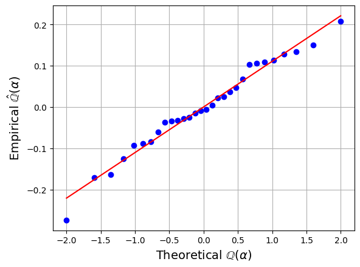
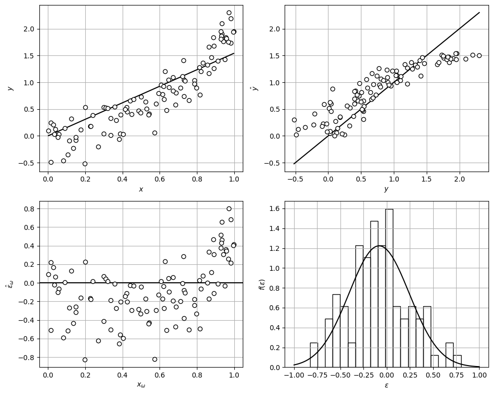

# Residual Analysis

* We now develop strategies to *quantify* quality of MLE estimate $$\hat{\theta}$$.
* We will analyze statistics of residuals and confidence of estimates.
* Recall that postulated model makes assumption that random model is $$\epsilon\sim \mathcal{N}(0,\Sigma)$$.
* After obtaining $$\hat{\theta}$$,  it is important to verify that residuals are indeed Gaussian.
* Otherwise, random model might contain systematic errors (it is not truly random)
* A useful technique to visually confirm that residuals are Gaussian is the Q-Q plot.


How much of the variability in $$\mathbf{y}$$ can be explained by knowledge (model predictions $$\hat{\mathbf{y}}$$) and how much cannot be explained (model error $$\epsilon$$)?


* Total variability is given by:

  $$
  S_{y}=\sum_{\omega\in \mathcal{S}}(y_\omega -\bar{{y}})^2\; \textrm{with}\; \bar{{y}}=\frac{1}{S}\sum_{\omega \in \mathcal{S}}y_\omega
  $$

* Total variability can be decomposed as:

  $$
  S_{y}=\underbrace{\sum_{\omega\in \mathcal{S}}(\hat{y}_\omega -\bar{y})^2}_{S_m}+\underbrace{\sum_{\omega\in \mathcal{S}}(y_\omega -\hat{y}_\omega)^2}_{S_e}
  $$

* $$S_m$$ is *model sum-of-squares* and $$S_e$$ is *sum-of-squared errors* (SSE).
* Based on these quantities we define index (coefficient of determination):

  $$
  \begin{aligned}
  R^2&=\frac{S_m}{S_y}=1-\frac{S_e}{S_y}
  \end{aligned}
  $$

* Index is fraction of variability captured by model; one can show that this index is directly related to the Pearson correlation of the predicted and observed outputs.

#### Python implementation: R^2 and Q-Q plot of the residuals

$$S_y=\sum_\omega(y_\omega-\bar{y})^2$$, $$S_m=\sum_\omega(\hat{y}_\omega-\bar{y})^2$$, $$S_e=\sum_\omega(y_\omega-\hat{y}_\omega)^2$$ and
$$R^2=S_m/S_y=1-S_e/S_y$$. A Q-Q plot checks whether the residuals are Gaussian.

```python
y_bar = np.mean(y)
S_y = np.sum((y - y_bar)**2)
S_m = np.sum((y_hat - y_bar)**2)
S_e = np.sum((y - y_hat)**2)
print(f"R^2 = S_m/S_y = {S_m/S_y:.4f}   (1 - S_e/S_y = {1 - S_e/S_y:.4f})")

probplot(eps_hat, dist="norm", plot=plt)
plt.title('')
plt.xlabel(r'Theoretical $\mathbb{Q}(\alpha)$', fontsize=14)
plt.ylabel(r'Empirical $\hat{\mathbb{Q}}(\alpha)$', fontsize=14)
plt.grid(True)
plt.show()
```

```
R^2 = S_m/S_y = 0.9549   (1 - S_e/S_y = 0.9549)
```

<figure></figure>

#### Python implementation


Notebook [`ch5_linear_est_example_wrong.ipynb`](https://colab.research.google.com/github/vzavala/StatsBook-GitBook/blob/main/notebooks/ch5_linear_est_example_wrong.ipynb) — open it in Colab and run the cells alongside this section.


**Additional example: residuals of a wrong model** (Victor Z and Leo Gonzalez, UW-Madison, 2024).
Data come from $$Y=\theta X^2+\epsilon$$ but we fit $$Y=\theta X+\epsilon$$. The residuals
$$\hat{\epsilon}_\omega=y_\omega-\hat{\theta}x_\omega$$ show a systematic trend and are not
$$\mathcal{N}(0,\sigma^2)$$: part of the structure has leaked into the "noise".
Python names as in `ch5_linear_est_example`.

```python
import numpy as np
import matplotlib.pyplot as plt
from scipy.stats import norm

rng = np.random.default_rng(0)
S, theta, sigma = 100, 2, 0.25
x_omega = rng.random(S)
y_omega = theta * x_omega**2 + rng.normal(0, sigma, S)      # true structure is quadratic

theta_hat = np.sum(x_omega * y_omega) / np.sum(x_omega**2)   # fit of the (wrong) linear model
y_hat = theta_hat * x_omega
eps_hat = y_omega - y_hat
print(f"theta_hat = {theta_hat:.3f}")

fig, axs = plt.subplots(2, 2, figsize=(10, 8))
order = np.argsort(x_omega)
axs[0, 0].plot(x_omega[order], y_hat[order], 'k-', linewidth=1.5)
axs[0, 0].plot(x_omega, y_omega, 'ko', markerfacecolor='w')
axs[0, 0].set_xlabel('$x$'); axs[0, 0].set_ylabel('$y$')
lims = [y_omega.min(), y_omega.max()]
axs[0, 1].plot(lims, lims, 'k-')
axs[0, 1].plot(y_omega, y_hat, 'ko', markerfacecolor='w')
axs[0, 1].set_xlabel('$y$'); axs[0, 1].set_ylabel(r'$\hat{y}$')
axs[1, 0].axhline(0, color='k')
axs[1, 0].plot(x_omega, eps_hat, 'ko', markerfacecolor='w')
axs[1, 0].set_xlabel(r'$x_\omega$'); axs[1, 0].set_ylabel(r'$\hat{\epsilon}_\omega$')
e = np.linspace(-1, 1, 200)
axs[1, 1].hist(eps_hat, bins=20, density=True, edgecolor='black', facecolor='none')
axs[1, 1].plot(e, norm.pdf(e, *norm.fit(eps_hat)), 'k-', linewidth=1.5)
axs[1, 1].set_xlabel(r'$\epsilon$'); axs[1, 1].set_ylabel(r'$f(\epsilon)$')
for ax in axs.ravel():
    ax.grid(True)
plt.tight_layout()
plt.show()
```

```
theta_hat = 1.544
```

<figure></figure>
