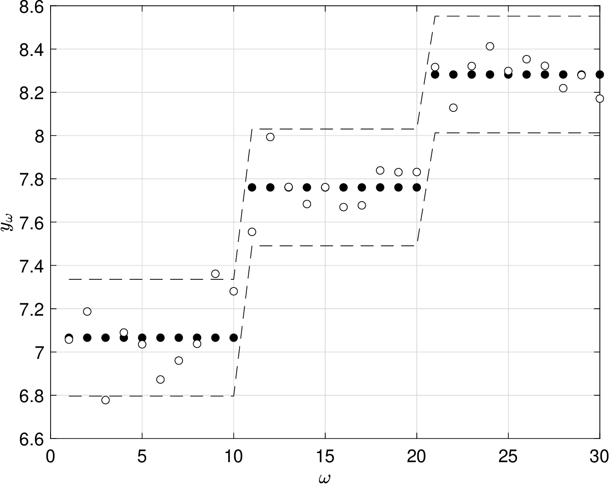
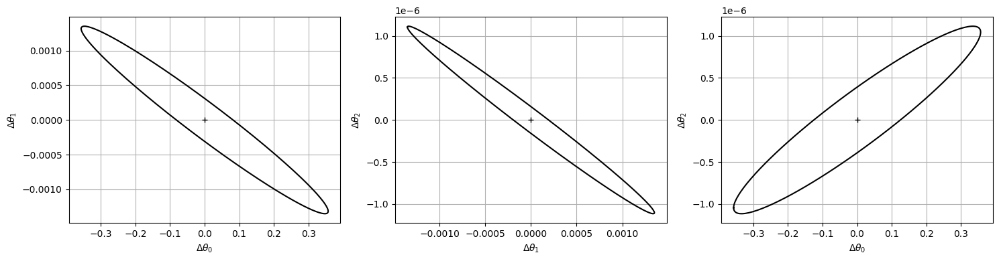
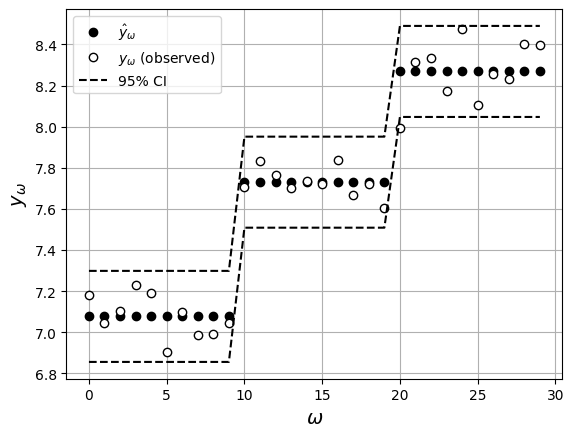

# Uncertainty Quantification


How much can we trust our parameter estimate and model predictions?


* For linear model the estimate is gaussian $$\hat{\theta}\sim\mathcal{N}(\theta,\textrm{Cov}[\hat{\theta}])$$ with:

  $$
  \textrm{Cov}[\hat{\theta}]=(\mathbf{X}^T\Sigma ^{-1}\mathbf{X})^{-1}.
  $$

* One can use covariance matrix to obtain $$1-\alpha$$ confidence intervals:

  $$
  \theta_i=\hat{\theta}_i\pm m_i,\; i=0,...,n\qquad \textrm{with}\qquad
  m_i=\sqrt{q_{n+1}\textrm{Cov}[\hat{\theta}]_{ii}}
  $$

* Here, $$q_{n+1}$$ is the $$(1-\alpha)$$-quantile of $$\chi^2(n+1)$$.
* Size of CIs ($$m_i$$) is a measure of their *precision*.
* Precision affected by number of parameters $$n+1$$ ($$q_{n+1}$$ increases with $$n$$)
* Precision affected by variances of estimated parameters $$\mathbb{V}[\hat{\theta}_i]=\textrm{Cov}[\hat{\theta}]_{ii}$$.

* Can construct CIs for model predictions by noticing that the output $$\hat{\mathbf{y}}=\mathbf{X}\hat{\theta}$$ is a linear transformation of the Gaussian $$\hat{\theta}$$ and thus:

  $$
  \hat{\mathbf{y}}\sim \mathcal{N}(\mathbf{y},\mathbf{X}\textrm{Cov}[\hat{\theta}]\mathbf{X}^T).
  $$

* Expected value of predictions $$\mathbb{E}[\hat{\mathbf{y}}]$$ is true (noise-free) output $$\mathbf{y}=\mathbf{X}\theta$$.
* We also have that the covariance of the predictions is:

  $$
  \textrm{Cov}[\hat{\mathbf{y}}]=\mathbf{X}\textrm{Cov}[\hat{\theta}]\mathbf{X}^T
  $$

* From these quantities, we can obtain CIs for predictions:

  $$
  y_\omega=\hat{y}_\omega\pm m_\omega,\qquad \textrm{with}\qquad
  m_\omega=\sqrt{q_{S}\,\textrm{Cov}[\hat{\mathbf{y}}]_{\omega\omega}}.
  $$

* Here, $$q_{S}$$ is the $$(1-\alpha)$$-quantile of $$\chi^2(S)$$.

## Example: Estimating Heat Capacity

* Parameter estimate and covariance are:

  $$
  \begin{aligned}
  \hat{\boldsymbol{\theta}}=\left[\begin{array}{r}6.19\times 10^{+0}\\ 3.17\times 10^{-3}\\ -9.60\times 10^{-7}\end{array}\right],
  \end{aligned}
  $$

  $$
  \begin{aligned}
  \textrm{Cov}[\hat{\theta}]&=\left[\begin{array}{rrr}
  3.15\times 10^{-2}&-1.16\times 10^{-4}&9.23\times 10^{-8}\\
  -1.16\times 10^{-4} &     4.52\times 10^{-7} &    -3.69\times 10^{-10}\\
  9.23\times 10^{-8} &    -3.69\times 10^{-10}    & 3.07\times 10^{-13}
  \end{array}\right].
  \end{aligned}
  $$

* Compute $$q_{n+1}=q_3=7.81$$ (this is $$0.95$$ quantile of $$\chi^2(3)$$) and thus:

  $$
  \begin{aligned}
  m_{0}=\sqrt{7.81\cdot 3.15\times 10^{-2}}=4.96\times 10^{-1}\\
  m_{1}=\sqrt{7.81\cdot 4.52\times 10^{-7}}=1.88\times 10^{-3}\\
  m_{2}=\sqrt{7.81\cdot 3.07\times 10^{-13}}=1.55\times 10^{-6}.
  \end{aligned}
  $$

* 95% confidence intervals for true parameters are:

  $$
  \begin{aligned}
  \theta_{0}&=6.19\times 10^{+0}\pm 4.96\times 10^{-1}\\
  \theta_{1}&=3.17\times 10^{-3}\pm 1.88\times 10^{-3}\\
  \theta_{2}&=-9.60\times 10^{-7}\pm1.55\times 10^{-6}.
  \end{aligned}
  $$

* Compute CIs for predicted heat capacities.
* Compute $$q_S=43.77$$,  this is 0.95 quantile of $$\chi^2(S)$$ with $$S=30$$.
* Compute $$\textrm{Cov}[\hat{\mathbf{y}}]=\mathbf{X}\textrm{Cov}[\hat{\theta}]\mathbf{X}^T$$ (a 30$$\times$$ 30 matrix).
* Confidence intervals for outputs, observations, and true values are shown below.

  <figure></figure>

#### Python implementation: Confidence intervals for the parameters


Notebook [`ch5_heat_capacity_uncertainty.ipynb`](https://colab.research.google.com/github/vzavala/StatsBook-GitBook/blob/main/notebooks/ch5_heat_capacity_uncertainty.ipynb) — open it in Colab and run the cells alongside this section.


Uncertainty quantification for the heat-capacity model (Victor Z and Jaron T, UW-Madison, 2024).

| Slides | Python | Meaning |
|---|---|---|
| $$\hat{\theta}$$, $$\mathrm{Cov}[\hat{\theta}]$$ | `theta_hat`, `Cov_theta` | estimate and its covariance |
| $$q_{n+1}$$ | `q_np1` | 0.95 quantile of $$\chi^2(n+1)$$ |
| $$m_i=\sqrt{q_{n+1}\mathrm{Cov}[\hat{\theta}]_{ii}}$$ | `m_theta` | parameter CI half-widths |
| $$\mathrm{Cov}[\hat{\mathbf{y}}]=\mathbf{X}\mathrm{Cov}[\hat{\theta}]\mathbf{X}^T$$ | `Cov_y` | prediction covariance |
| $$q_S$$, $$m_\omega$$ | `q_S`, `m_y` | 0.95 quantile of $$\chi^2(S)$$ and prediction CI half-widths |

```python
import sys
import numpy as np
import matplotlib.pyplot as plt
from scipy.stats import chi2, norm
sys.path.append(path + 'Support')
from ellipse import ellipse

theta = np.array([6.190, 2.923e-3, -7.052e-7])
x = np.repeat([300.0, 600.0, 900.0], 10)
S = len(x)
X = np.column_stack([np.ones(S), x, x**2])
np.random.seed(0)
y = X @ theta + np.random.normal(0, 0.1, S)

theta_hat = np.linalg.solve(X.T @ X, X.T @ y)
y_hat = X @ theta_hat
sigma_hat = norm.fit(y - y_hat)[1]
Cov_theta = np.linalg.inv(X.T @ X) * sigma_hat**2

n_par = len(theta_hat)                         # n + 1 parameters
q_np1 = chi2.ppf(0.95, n_par)
m_theta = np.sqrt(q_np1 * np.diag(Cov_theta))
print(f"q_(n+1) = {q_np1:.2f}")
for i in range(n_par):
    print(f"theta_{i} = {theta_hat[i]: .3e} +/- {m_theta[i]:.2e}   (true {theta[i]: .3e})")
```

```
q_(n+1) = 7.81
theta_0 =  6.310e+00 +/- 4.08e-01   (true  6.190e+00)
theta_1 =  2.747e-03 +/- 1.54e-03   (true  2.923e-03)
theta_2 = -6.348e-07 +/- 1.27e-06   (true -7.052e-07)
```

95% confidence ellipses for pairs of parameters (deviations $$\Delta\theta=\theta-\hat{\theta}$$).

```python
fig, axs = plt.subplots(1, 3, figsize=(15, 4))
for ax, (i, j) in zip(axs, [(0, 1), (1, 2), (0, 2)]):
    C_ij = Cov_theta[np.ix_([i, j], [i, j])]
    xe, ye, _, _, _ = ellipse(np.linalg.inv(C_ij), chi2.ppf(0.95, 2), 200, [0, 0])
    ax.plot(xe, ye, 'k')
    ax.plot(0, 0, 'k+')
    ax.set_xlabel(rf'$\Delta\theta_{i}$')
    ax.set_ylabel(rf'$\Delta\theta_{j}$')
    ax.grid(True)
plt.tight_layout()
plt.show()
```

<figure></figure>

#### Python implementation: Confidence intervals for the predictions

$$\hat{\mathbf{y}}\sim\mathcal{N}(\mathbf{y},\mathbf{X}\mathrm{Cov}[\hat{\theta}]\mathbf{X}^T)$$, so
$$y_\omega=\hat{y}_\omega\pm m_\omega$$ with $$m_\omega=\sqrt{q_S\,\mathrm{Cov}[\hat{\mathbf{y}}]_{\omega\omega}}$$.

```python
Cov_y = X @ Cov_theta @ X.T
q_S = chi2.ppf(0.95, S)
m_y = np.sqrt(q_S * np.diag(Cov_y))
print(f"q_S = {q_S:.2f}  (S = {S})")

plt.plot(y_hat, 'ko', markerfacecolor='black', label=r'$\hat{y}_\omega$')
plt.plot(y, 'ko', markerfacecolor='white', label=r'$y_\omega$ (observed)')
plt.plot(y_hat - m_y, 'k--', label='95% CI')
plt.plot(y_hat + m_y, 'k--')
plt.xlabel(r'$\omega$', fontsize=14)
plt.ylabel(r'$y_\omega$', fontsize=14)
plt.legend()
plt.grid(True)
plt.show()
```

```
q_S = 43.77  (S = 30)
```

<figure></figure>

For comparison, `statsmodels` reports the usual $$t$$-based (marginal) 95% intervals, which are
narrower than the joint $$\chi^2(n+1)$$ intervals above.

```python
import statsmodels.api as sm
print(sm.OLS(y, X).fit().conf_int(0.05))
```

```
[[ 5.99478266e+00  6.62562366e+00]
 [ 1.55330619e-03  3.94114441e-03]
 [-1.61957716e-06  3.49878602e-07]]
```
