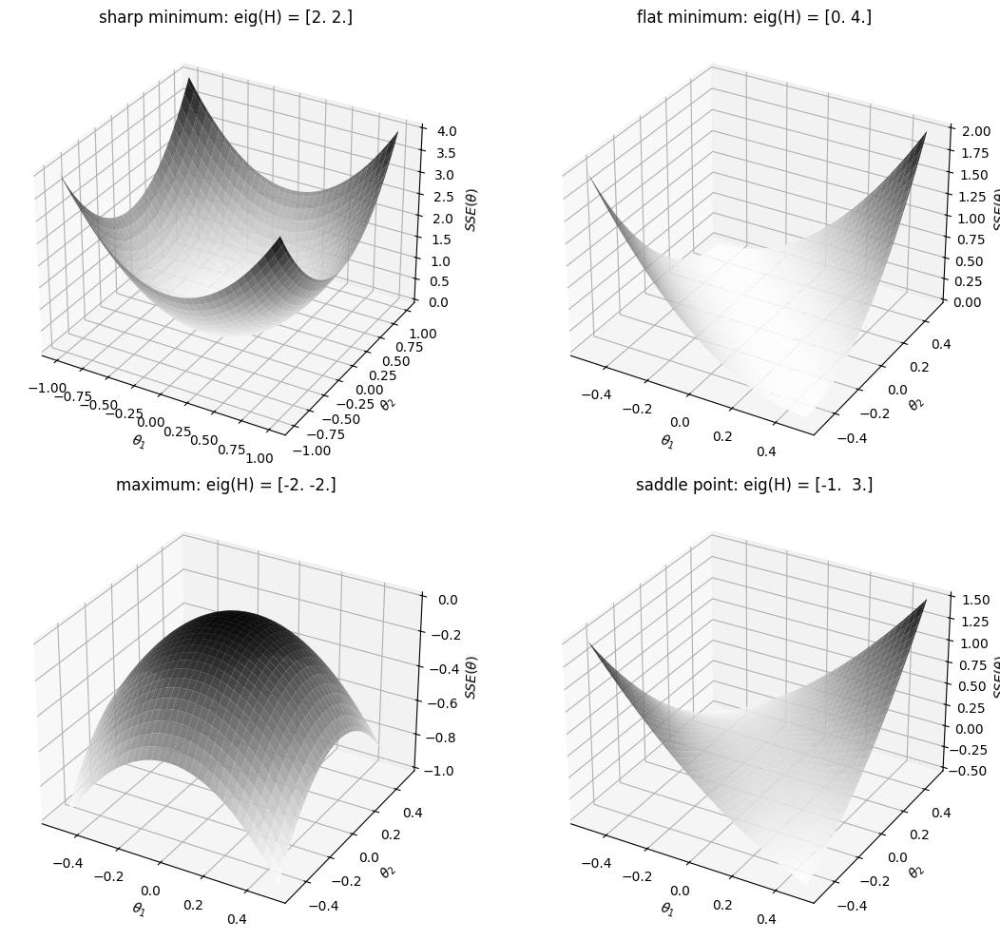
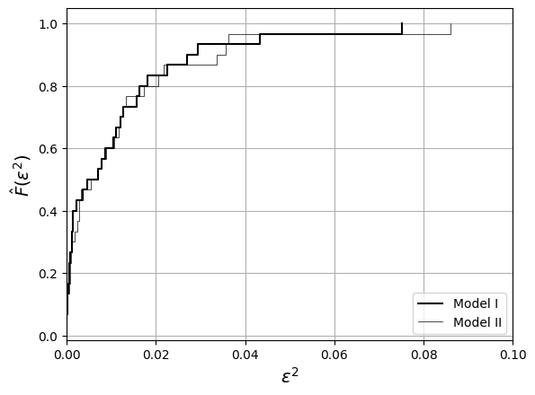
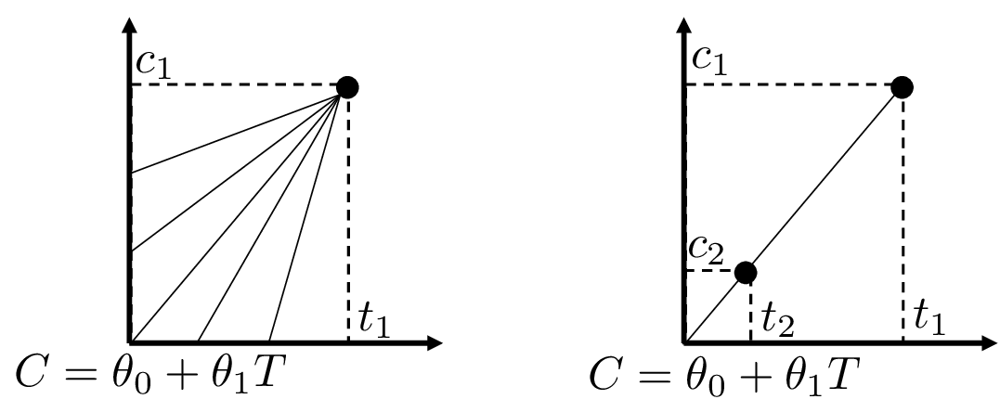

# Data Sufficiency and Overfitting


Did we use enough data to estimate model parameters?


* Hessian $$\mathcal{H}(\hat{\theta})=-\nabla_{\theta}^2 \log f(\mathbf{y}|\hat{\theta})$$ plays a key role in answering this question.
* We analyze Hessian in context of *linear model*: $$\mathcal{H}(\hat{\theta})=\mathbf{X}^T\Sigma^{-1}\mathbf{X}$$.
* Hessian (a.k.a. kernel) contains all input data and does not depend on $$\hat{\theta}$$ and $$\mathbf{y}$$.
* Recall that Hessian is FI matrix and inverse of parameter covariance:

  $$
  \mathcal{H}(\hat{\theta})=\mathcal{I}(\hat{\theta})=\textrm{Cov}[\hat{\theta}]^{-1}=\mathbf{X}^T\Sigma^{-1}\mathbf{X}.
  $$

* This connects concepts of sharpness of minimum, information, and uncertainty.

* Eigenvalues of Hessian $$\mathcal{H}(\hat{\theta})$$ help us *quantify* data sufficiency.
* For $$\hat{\theta}$$ to be minimizer, we need that all eigenvalues of are non-negative (either zero or positive). For linear model this is guaranteed.
* If all eigs of are large and positive, estimate $$\hat{\theta}$$ is a sharp minimum of likelihood. This indicates that the estimate $$\hat{\theta}$$ is well-defined by data.
* If one (or more) eigenvalues are close to zero, estimate $$\hat{\theta}$$ is sitting at a minimum that is not sharp.  This indicates that $$\hat{\theta}$$ is ill-defined by data and exhibits high variability.
* If one eigenvalue of $$\mathcal{H}(\hat{\theta})$$ is exactly zero,  estimate $$\hat{\theta}$$ cannot be obtained uniquely from data. This indicates that estimate is sitting at a minimum that is flat. This also indicates that estimate has infinite variability (infinite uncertainty).

* Can improve precision by controlling  $$\mathbf{X}$$ and with this control FI $$\mathcal{I}(\theta)=\mathbf{X}^T\Sigma^{-1}\mathbf{X}$$.
* Can be done by increasing amount of data; however, we also require *quality* of data.
* Data points that are *redundant* do not provide new information.
* Redundancy results in $$\mathbf{X}$$ that has dependent rows and to FI  that has small eigs.
* If input vars $$X$$ are weakly related to output $$Y$$, estimates $$\hat{\theta}$$ will be imprecise.
* Knowledge of application to select appropriate input vars is extremely important.
* Lack of data results in overfitting (need to validate that model predicts well for data not used for estimation). This procedure is known as *cross-validation*.
* Can design $$\mathbf{X}$$ to maximize measure of $$\mathcal{I}(\theta)$$ (e.g., sum of eigs)
* Systematic selection of input variables and data is part of *design of experiments*.

#### Python implementation


Notebook [`ch5_examples_surfaces.ipynb`](https://colab.research.google.com/github/vzavala/StatsBook-GitBook/blob/main/notebooks/ch5_examples_surfaces.ipynb) — open it in Colab and run the cells alongside this section.


Quadratic surfaces $$SSE(\theta)=\theta^T\mathcal{H}\theta$$ and the eigenvalues of the Hessian
$$\mathcal{H}$$ (`H`) (Victor Z and Leo Gonzalez, UW-Madison, 2024): large positive eigenvalues give a
sharp minimum, a zero eigenvalue a flat (non-unique) minimum, negative eigenvalues a maximum,
and mixed signs a saddle point.

```python
import numpy as np
import matplotlib.pyplot as plt

cases = [("sharp minimum", np.array([[2, 0], [0, 2]]), 1.0),
         ("flat minimum", np.array([[2, 2], [2, 2]]), 0.5),
         ("maximum", -np.array([[2, 0], [0, 2]]), 0.5),
         ("saddle point", np.array([[1, 2], [2, 1]]), 0.5)]
fig = plt.figure(figsize=(12, 10))
for k, (title, H, r) in enumerate(cases):
    theta_1, theta_2 = np.meshgrid(np.linspace(-r, r, 101), np.linspace(-r, r, 101))
    SSE = H[0, 0]*theta_1**2 + 2*H[0, 1]*theta_1*theta_2 + H[1, 1]*theta_2**2
    ax = fig.add_subplot(2, 2, k + 1, projection='3d')
    ax.plot_surface(theta_1, theta_2, SSE, cmap='Greys', alpha=0.9)
    ax.set_title(f"{title}: eig(H) = {np.round(np.linalg.eigvalsh(H), 2)}")
    ax.set_xlabel(r'$\theta_1$'); ax.set_ylabel(r'$\theta_2$'); ax.set_zlabel(r'$SSE(\theta)$')
plt.tight_layout()
plt.show()
```

<figure></figure>

#### Python implementation


Notebook [`ch5_heat_capacity_benchmark.ipynb`](https://colab.research.google.com/github/vzavala/StatsBook-GitBook/blob/main/notebooks/ch5_heat_capacity_benchmark.ipynb) — open it in Colab and run the cells alongside this section.


**Additional example: benchmarking models and cross-validation** (Victor Z and Leo Gonzalez,
UW-Madison, 2020). Model I is $$Y=\theta_0+\theta_1X+\theta_2X^2$$, model II is $$Y=\theta_0+\theta_1X$$.
We compare their squared errors $$\hat{\epsilon}_\omega^2$$ (mean and empirical cdf), and then their
3-fold cross-validation errors on data not used for estimation.
Python names: `X_I`, `X_II` (data matrices), `eps2_I`, `eps2_II`, `MSE_cv`.

```python
import numpy as np
import matplotlib.pyplot as plt

theta = np.array([6.190, 2.923e-3, -7.052e-7])
x = np.repeat([300.0, 600.0, 900.0], 10)
S = len(x)
np.random.seed(0)
y = theta[0] + theta[1]*x + theta[2]*x**2 + np.random.normal(0, 0.1, S)

X_I = np.column_stack([np.ones(S), x, x**2])
X_II = np.column_stack([np.ones(S), x])

def fit(X, y):
    return np.linalg.solve(X.T @ X, X.T @ y)

eps2_I = (y - X_I @ fit(X_I, y))**2
eps2_II = (y - X_II @ fit(X_II, y))**2
print(f"MSE I = {eps2_I.mean():.4f},  MSE II = {eps2_II.mean():.4f}")

for e2, lw, label in ((eps2_I, 1.5, 'Model I'), (eps2_II, 0.5, 'Model II')):
    plt.step(np.sort(e2), np.arange(1, S + 1) / S, 'k-', where='post', linewidth=lw, label=label)
plt.xlim(0, 0.1)
plt.xlabel(r'$\epsilon^2$', fontsize=14)
plt.ylabel(r'$\hat{F}(\epsilon^2)$', fontsize=14)
plt.legend(loc='lower right')
plt.grid(True)
plt.show()
```

```
MSE I = 0.0112,  MSE II = 0.0119
```

<figure></figure>

3-fold cross-validation: estimate on two folds, test on the third.

```python
rng = np.random.default_rng(0)
folds = np.array_split(rng.permutation(S), 3)
for name, X in (("I", X_I), ("II", X_II)):
    MSE_cv = []
    for k in range(3):
        test = folds[k]
        train = np.concatenate([folds[j] for j in range(3) if j != k])
        theta_k = fit(X[train], y[train])
        MSE_cv.append(np.mean((y[test] - X[test] @ theta_k)**2))
    print(f"Model {name}: sum of test MSE over folds = {np.sum(MSE_cv):.4f}")
```

```
Model I: sum of test MSE over folds = 0.0478
Model II: sum of test MSE over folds = 0.0499
```

## Example: Estimating Heat Capacity with Insufficient Data

* Want model of heat capacity $$C$$ as a function of temperature $$T$$:

  $$
  C=\theta_0+\theta_1 T
  $$

* Assume we have one experimental data point $$(t_1,c_1)$$ to estimate $$\theta_0,\theta_1$$.
* Can $$\theta_0,\theta_1$$ be estimated *uniquely* from $$(t_1,c_1)$$?
* There are multiple (infinite) combinations of $$(\theta_0,\theta_1)$$ that can fit single data point.
* If we were to estimate these parameters using MLE, model will overfit data.

  <figure></figure>

* Consider SSE minimization problem:

  $$
  \min_{\theta_0,\theta_1} \; SSE(\theta_0,\theta_1)=\frac{1}{2}(c_1-\theta_0-\theta_1t_1)^2.
  $$

* First-order derivatives of $$SSE(\theta)$$ are:

  $$
  \begin{aligned}
  \frac{\partial SSE(\theta)}{\partial \theta_0}&=-(c_1-\theta_0-\theta_1 t_1)\\
  \frac{\partial SSE(\theta)}{\partial \theta_1}&=-t_1(c_1-\theta_0-\theta_1 t_1).
  \end{aligned}
  $$

* Second derivatives of $$SSE(\theta)$$ are:

  $$
  \begin{aligned}
  \frac{\partial^2 SSE(\theta)}{\partial \theta_0 \partial \theta_0}&=1,\quad \frac{\partial^2 SSE(\theta)}{\partial \theta_0\partial \theta_1}=t_1\\
  \frac{\partial^2 SSE(\theta)}{\partial \theta_1 \partial \theta_0}&=t_1,\quad \frac{\partial^2 SSE(\theta)}{\partial \theta_1 \partial \theta_1}=t_1^2.
  \end{aligned}
  $$

* We thus have that Hessian matrix is:

  $$
  \begin{aligned}
  \mathcal{H}(\hat{\theta})=\left[\begin{array}{cc}1&t_1\\ t_1 & t_1^2\end{array}\right]
  \end{aligned}
  $$

* Since model is linear, can also obtain Hessian by noticing that $$\mathcal{H}(\hat{\theta})=\mathbf{X}^T\mathbf{X}$$ with:

  $$
  \mathbf{X}=\left[1\;\; t_1\right]
  $$

   and thus

  $$
  \begin{aligned}
  \mathbf{X}^T\mathbf{X}=\left[\begin{array}{c}1 \\ t_1\end{array}\right]\left[1\;\; t_1\right]=\left[\begin{array}{cc}1&t_1\\ t_1 & t_1^2\end{array}\right].
  \end{aligned}
  $$

* Determinant of Hessian is:

  $$
  |\mathcal{H}(\hat{\theta})|=t_1^2-t_1^2=0
  $$

* This tells us that one of the eigenvalues is zero and thus $$\theta_0,\theta_1$$ cannot be estimated uniquely from data.
