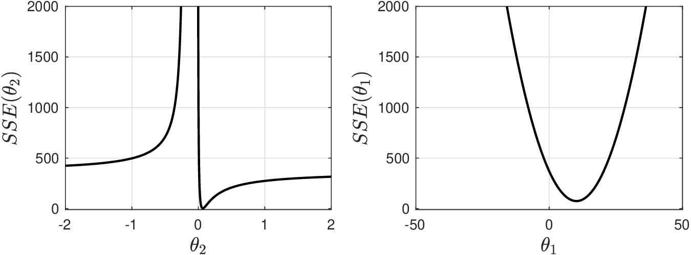
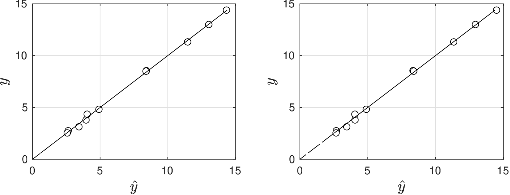
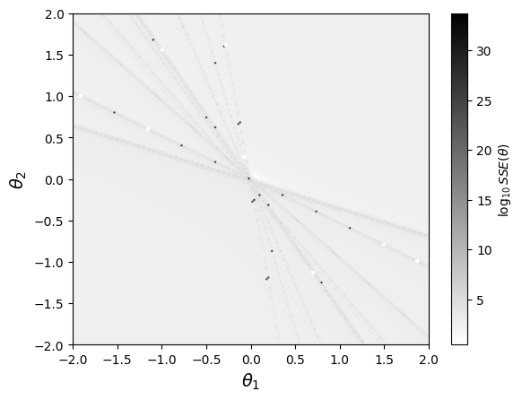
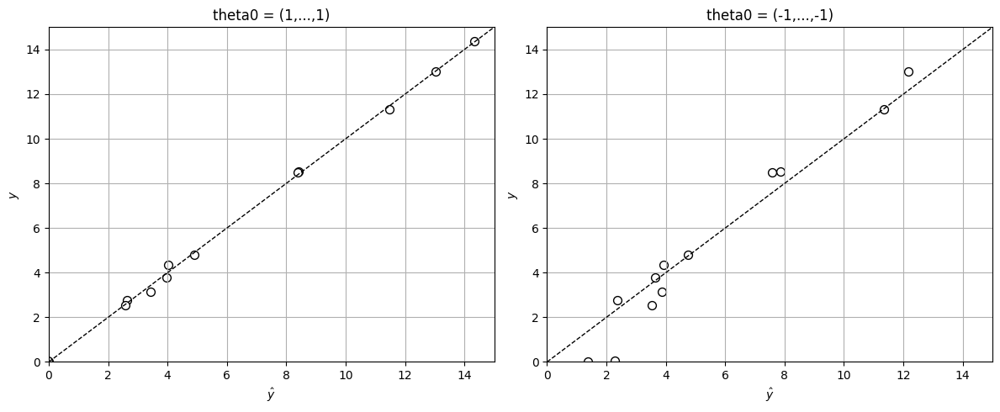

# Estimation for General Nonlinear Models

* We now extend discussion to general models of the form:

  $$
  y_\omega=m(\theta, \mathbf{x}_{\omega}) + \epsilon_\omega,\; \omega \in \mathcal{S}.
  $$

   where $$m:\mathbb{R}^{n}\times \mathbb{R}^S\to \mathbb{R}$$ is the model (a function of parameters and inputs).

* Model captures structural relationships between inputs, params, and outputs.
* For instance, this can be a reactor model and $$\theta$$ are kinetic constraints.
* Model also captures advanced empirical models such as neural nets (more later).

* We express model in compact form $$\mathbf{y}=\mathbf{m}(\theta,\mathbf{X})+\mathbf{e}$$ and assume $$\mathbf{e}\sim \mathcal{N}(0,\Sigma)$$.
* We assume $$\theta$$ and $$\mathbf{X}$$ are deterministic vars and thus $$\mathbf{y}\sim \mathcal{N}(\mathbf{m}(\theta),\Sigma)$$.
* We use MLE framework to estimate $$\theta$$ by minimizing $$-\log f(\mathbf{y}|\theta)$$:

  $$
  \min_\theta -\log\left((2\pi)^{S/2}|\Sigma|^{1/2}\right) -\frac{1}{2}(\mathbf{y}-\mathbf{m}(\theta))^T\Sigma^{-1}(\mathbf{y}-\mathbf{m}(\theta)).
  $$

* As in linear case, if $$\Sigma$$ is diagonal with entries $$\Sigma_{\omega,\omega}=\sigma^2$$, MLE problem reduces to: SSE minimization problem.

* Solution $$\hat{\theta}$$ must satisfy necessary conditions (score equations):

  $$
  -\nabla_\theta \log f(\mathbf{y}|\theta)=-\nabla_\theta \mathbf{m}(\theta)^T\Sigma^{-1} (\mathbf{y}-\mathbf{m}(\theta))=0,
  $$

* Score equations are a set of $$n$$ *nonlinear* equations.
* Here, $$\nabla_\theta \mathbf{m}(\theta)\in \mathbb{R}^{S\times n}$$ is *Jacobian* matrix and we  define this as $$\mathcal{J}(\theta)=\nabla_\theta \mathbf{m}(\theta)$$.
* Jacobian contains partial derivatives of model with respect to every parameter:

  $$
  \mathcal{J}(\theta)_{\omega,j}=\frac{\partial m(\theta,\mathbf{x}_\omega)}{\partial \theta_j},\; \omega=1,...,S,\,\, j=1,...,n.
  $$

* If model is linear, $$\mathcal{J}(\theta)=\mathbf{X}$$ and score equations reduce to form previously discussed.
* Nonlinear score equations do not have an explicit solution (as in linear case) and require numerical techniques (e.g., Newton's method).
* Jacobian is also difficult to compute analytically and one must resort to numerical techniques (e.g., automatic differentiation).

* To ensure that $$\hat{\theta}$$ minimizes $$-\log f(\mathbf{y}|\theta)$$, we must ensure $$\mathcal{H}(\hat{\theta})\succ 0$$ holds.
* Here, $$\mathcal{H}(\hat{\theta})=-\nabla_\theta^2 \log f(\mathbf{y}|\hat{\theta}) \in \mathbb{R}^{n\times n}$$.
* Hessian is matrix of second derivatives of log-likelihood function:

  $$
  \mathcal{H}({\theta})_{j,j}=-\frac{\partial^2 \log f(\mathbf{y}|\theta)}{\partial \theta_i\partial \theta_j},\; i=1,...,n,\; j=1,...,n.
  $$

* Hessian is a complex quantity that requires numerical techniques to be computed.
* When residuals $$\mathbf{y}-\mathbf{m}(\theta)$$ are small, Hessian can be approximated as:

  $$
  \mathcal{H}(\hat{\theta})\approx \nabla_\theta \mathbf{m}(\hat{\theta})^T\Sigma^{-1}\nabla_\theta \mathbf{m}(\hat{\theta}).
  $$

* This approximation is known as Gauss-Newton approximation.
* For linear models we have seen that Hessian is given by:

  $$
  \mathcal{H}(\hat{\theta})=\mathbf{X}^T\Sigma^{-1}\mathbf{X}.
  $$

* Gauss-Newton approximation is thus exact when model is linear.


What is different about nonlinear estimation (compared to linear case)?


* It is significantly more difficult to obtain a pdf for $$\hat{\theta}$$.
* In linear case, this was obtained by noticing that estimate is a linear transformation of noise (this is no longer true in nonlinear case).
* Typically, in nonlinear case, pdf is approximated as:

  $$
  \hat{\theta}\sim\mathcal{N}(\theta,\mathcal{H}(\hat{\theta})^{-1})
  $$

* This approximation is accurate if nonlinearity of $$\mathbf{m}(\theta)$$ is not too strong.
* Here, we make assumption that $$\textrm{Cov}[\hat{\theta}]=\mathcal{H}(\hat{\theta})^{-1}$$.
* Hessian can be difficult to compute but modern modeling languages can compute this  automatically (e.g., JuMP, Pyomo, Casadi).
* Surprisingly, most numerical packages do not provide Hessians.  In such cases, one can use Gauss-Newton approximation.

* Recall $$\textrm{Cov}[\hat{\theta}]$$ tells us how $$\hat{\theta}$$ varies as we vary noise $$\mathbf{e}$$.
* We can thus obtain covariance by perturbing output data $$\mathbf{y}$$ with noise and by obtaining corresponding estimates.
* Consider realizations $$\mathbf{e}_k,\; k=1,...,K$$ (from $$\mathcal{N}(0,\Sigma)$$)  and perturb data $$\mathbf{y}_k=\mathbf{y}+\mathbf{e}_k$$.
* We solve MLE problems for $$k=1,...,K$$:

  $$
  \hat{\theta}_k\in \mathop{\textrm{argmin}}_\theta \; -\log f(\mathbf{y}_k|\theta)
  $$

* This gives realizations for estimates $$\hat{\theta}_k,\, k=1,...,K$$ and from this we compute:

  $$
  \hat{\mathbb{E}}[\hat{\theta}]=\frac{1}{K}\sum_{k=1}^K\hat{\theta}_k.
  $$

   and:

  $$
  \hat{\textrm{Cov}}[\hat{\theta}]=\frac{1}{K-1}\sum_{k=1}^K(\hat{\theta}_k-\hat{\mathbb{E}}[\hat{\theta}])(\hat{\theta}_k-\hat{\mathbb{E}}[\hat{\theta}])^T.
  $$

* This is a Monte Carlo simulation approach that is easy to implement.

#### Python implementation


Notebook [`ch5_heat_capacity_mc.ipynb`](https://colab.research.google.com/github/vzavala/StatsBook-GitBook/blob/main/notebooks/ch5_heat_capacity_mc.ipynb) — open it in Colab and run the cells alongside this section.


**Monte Carlo estimate of the parameter covariance** (heat-capacity data). Perturb the outputs,
$$\mathbf{y}_k=\mathbf{y}+\mathbf{e}_k$$ with $$\mathbf{e}_k\sim\mathcal{N}(0,\hat{\sigma}^2 I)$$, re-estimate
$$\hat{\theta}_k$$ for $$k=1,\dots,K$$, and compute
$$\hat{\mathrm{Cov}}[\hat{\theta}]=\frac{1}{K-1}\sum_k(\hat{\theta}_k-\hat{\mathbb{E}}[\hat{\theta}])(\hat{\theta}_k-\hat{\mathbb{E}}[\hat{\theta}])^T$$.
For this linear model we can compare with the exact $$(\mathbf{X}^T\mathbf{X})^{-1}\hat{\sigma}^2$$.
Python names: `K`, `theta_k` (K x 3), `Cov_mc`, `Cov_exact`.

```python
import numpy as np

theta = np.array([6.190, 2.923e-3, -7.052e-7])
x = np.repeat([300.0, 600.0, 900.0], 10)
S = len(x)
X = np.column_stack([np.ones(S), x, x**2])
np.random.seed(0)
y = X @ theta + np.random.normal(0, 0.1, S)

theta_hat = np.linalg.solve(X.T @ X, X.T @ y)
sigma2_hat = np.var(y - X @ theta_hat)
Cov_exact = np.linalg.inv(X.T @ X) * sigma2_hat

K = 1000
theta_k = np.array([np.linalg.solve(X.T @ X, X.T @ (y + np.random.normal(0, np.sqrt(sigma2_hat), S)))
                    for _ in range(K)])
E_theta = theta_k.mean(axis=0)
Cov_mc = (theta_k - E_theta).T @ (theta_k - E_theta) / (K - 1)

np.set_printoptions(precision=3)
print("exact Cov[theta_hat]:\n", Cov_exact)
print("Monte Carlo estimate:\n", Cov_mc)
print("ratio of variances (MC / exact):", np.diag(Cov_mc) / np.diag(Cov_exact))
```

```
exact Cov[theta_hat]:
 [[ 2.127e-02 -7.836e-05  6.219e-08]
 [-7.836e-05  3.047e-07 -2.488e-10]
 [ 6.219e-08 -2.488e-10  2.073e-13]]
Monte Carlo estimate:
 [[ 1.973e-02 -7.323e-05  5.845e-08]
 [-7.323e-05  2.864e-07 -2.345e-10]
 [ 5.845e-08 -2.345e-10  1.956e-13]]
ratio of variances (MC / exact): [0.928 0.94  0.944]
```

## Example: Hougen-Watson

* We are interested in finding parameters for Hougen-Watson (HW)  model:

  $$
  Y=\frac{(\theta_0X_2-X_3/\theta_4)}{(1+\theta_1X_1+\theta_2X_2+\theta_3X_3)}
  $$

* Model captures competitive reaction and adsorption rates in a heterogeneous catalytic reaction (gas components adsorb into solid catalyst).
* In this model, $$Y$$ is reaction rate and $$(X_1,X_2,X_3)$$ are species partial pressures.
* Parameters $$(\theta_0,\theta_1,\theta_2,\theta_3,\theta_4)$$ have physical meaning (these represent adsorption and reaction rates and thus need to be non-negative).

* We have $$S=13$$ observations $$(y_\omega,x_\omega)$$ available and $$n=5$$ parameters to estimate.
* We are not given info about noise model and we thus solve SSE problem:

  $$
  \begin{aligned}
  \min_{\theta}& \; \frac{1}{2}\|\mathbf{y}- \mathbf{m}(\theta)\|^2
  \end{aligned}
  $$

   where:

  $$
  m_\omega(\theta)=\frac{(\theta_0x_{2,\omega}-x_{3,\omega}/\theta_4)}{(1+\theta_1x_{1,\omega}+\theta_2x_{2,\omega}+\theta_3x_{3,\omega})}.
  $$

* HW model is highly nonlinear and this results in high nonlinearity of $$SSE(\theta)$$.
* Below we show behavior of $$SSE(\theta)$$ for different values of $$\theta_1\in [-2,2]$$ and $$\theta_2\in [-2,2]$$  (while keeping rest of parameters fixed).
* In a nonlinear model, we can find  emergence of max and min points in $$SSE(\theta)$$ and complex behavior (e.g., SSE function “blows up" at specific parameter values).
* This behavior differs from that observed in linear model (SSE function only has minimum points) and makes nonlinear problems difficult to solve.

  <figure></figure>

* We have intentionally evaluated SSE function at negative values of parameters.
* We know from physical understanding that these parameters cannot be negative.
* Unless this knowledge is explicitly encoded in SSE problem, we run risk that numerical solver lands at minimum point that has non-physical values.
* Used   Matlab function $$\texttt{fitnlm}$$, which provides estimates:

  $$
  \begin{aligned}
  \hat{\theta}_0&=1.25\\
  \hat{\theta}_1&=0.06\\
  \hat{\theta}_2&=0.04\\
  \hat{\theta}_3&=0.11\\
  \hat{\theta}_4&=1.19.
  \end{aligned}
  $$

* Minimum SSE value found was $$SSE(\hat{\theta})=0.2989$$; we use initial guess $$\hat{\theta}=(1,1,1,1,1)$$ to initialize the Newton algorithm used by $$\texttt{fitnlm}$$.

* We now solve problem by using initial guess $$\hat{\theta}=(-1,-1,-1,-1,-1)$$ and find that  Newton algorithm does not converge after 200 iterations and delivers estimates:

  $$
  \begin{aligned}
  \hat{\theta}_0&=-73.60\\
  \hat{\theta}_1&=-3.70\\
  \hat{\theta}_2&=-2.62\\
  \hat{\theta}_3&=-6.36\\
  \hat{\theta}_4&=-0.02
  \end{aligned}
  $$

   which are clearly non-physical.

* Interestingly, these estimates give $$SSE(\hat{\theta})=0.3834$$, which is not too far from value found with the other set of estimates.
* This shows how numerical solvers might encounter estimates that give excellent fits (minimize the SSE function) but that are non-physical.

<figure><figcaption><p>Fit of HW model to exp data with physical (left) and non-physical (right) parameters.</p></figcaption></figure>

#### Python implementation: The SSE function is highly nonlinear


Notebook [`ch5_hougen_watson.ipynb`](https://colab.research.google.com/github/vzavala/StatsBook-GitBook/blob/main/notebooks/ch5_hougen_watson.ipynb) — open it in Colab and run the cells alongside this section.


Nonlinear estimation for the Hougen-Watson model (Victor Z and Leo Gonzalez, UW-Madison, 2024).

$$
m_\omega(\theta)=\frac{\theta_0x_{2,\omega}-x_{3,\omega}/\theta_4}{1+\theta_1x_{1,\omega}+\theta_2x_{2,\omega}+\theta_3x_{3,\omega}}
$$

| Slides | Python | Meaning |
|---|---|---|
| $$x_{1,\omega},x_{2,\omega},x_{3,\omega}$$ | `X[:, 0]`, `X[:, 1]`, `X[:, 2]` | partial pressures ($$S=13$$ experiments) |
| $$y_\omega$$ | `y` | reaction rate |
| $$\theta=(\theta_0,\dots,\theta_4)$$ | `theta[0]`, ..., `theta[4]` | parameters |
| $$m(\theta)$$, $$SSE(\theta)=\frac{1}{2}\lVert\mathbf{y}-\mathbf{m}(\theta)\rVert^2$$ | `m(theta, X)`, `SSE(theta)` | model and objective |

```python
import numpy as np
import matplotlib.pyplot as plt
from scipy.optimize import least_squares

data = np.loadtxt(path+'Data/hougenwatson.dat')
X, y = data[:, :3], data[:, -1]
S = len(y)

def m(theta, X):
    """Hougen-Watson model m(theta, x) for all rows of X."""
    x1, x2, x3 = X[:, 0], X[:, 1], X[:, 2]
    return (theta[0]*x2 - x3/theta[4]) / (1 + theta[1]*x1 + theta[2]*x2 + theta[3]*x3)

def SSE(theta):
    return 0.5 * np.sum((y - m(theta, X))**2)
```

$$SSE(\theta)$$ as we span $$\theta_1,\theta_2\in[-2,2]$$ (other parameters fixed at a reference value).
Note the poles where the denominator of $$m$$ vanishes.

```python
theta_ref = np.array([1.0, 0.05, 0.02, 0.1, 2.0])
grid = np.linspace(-2, 2, 201)
SSE_map = np.zeros((len(grid), len(grid)))
for i, t2 in enumerate(grid):
    for j, t1 in enumerate(grid):
        th = theta_ref.copy()
        th[1], th[2] = t1, t2
        SSE_map[i, j] = SSE(th)
plt.imshow(np.log10(SSE_map), extent=[-2, 2, -2, 2], origin='lower', cmap='gray_r', aspect='auto')
plt.colorbar(label=r'$\log_{10} SSE(\theta)$')
plt.xlabel(r'$\theta_1$', fontsize=14)
plt.ylabel(r'$\theta_2$', fontsize=14)
plt.show()
```

<figure></figure>

#### Python implementation: Good and bad initial guesses

Solve $$\min_\theta \frac{1}{2}\lVert\mathbf{y}-\mathbf{m}(\theta)\rVert^2$$ with a Levenberg-Marquardt
(Newton-like) method, from $$\theta=(1,\dots,1)$$ and from $$\theta=(-1,\dots,-1)$$.
(The slides use Matlab's `fitnlm`; `scipy.optimize.least_squares` plays the same role.)

```python
fits = {}
for label, theta0 in (("theta0 = (1,...,1)", np.ones(5)), ("theta0 = (-1,...,-1)", -np.ones(5))):
    sol = least_squares(lambda th: y - m(th, X), theta0, method='lm', max_nfev=2000)
    fits[label] = sol.x
    print(f"{label}:  theta_hat = {np.round(sol.x, 2)},  SSE = {SSE(sol.x):.4f}")

fig, axs = plt.subplots(1, 2, figsize=(12, 5))
for ax, (label, th) in zip(axs, fits.items()):
    ax.plot([0, 15], [0, 15], 'k--', linewidth=1)
    ax.scatter(m(th, X), y, marker='o', color='w', edgecolor='k', s=50)
    ax.set_title(label)
    ax.set_xlabel(r'$\hat{y}$'); ax.set_ylabel('$y$')
    ax.axis([0, 15, 0, 15])
    ax.grid(True)
plt.tight_layout()
plt.show()
```

```
theta0 = (1,...,1):  theta_hat = [1.25 0.06 0.04 0.11 1.19],  SSE = 0.1495
theta0 = (-1,...,-1):  theta_hat = [-2887567.23  -183298.6    -58849.71  -652886.96    37012.98],  SSE = 5.6952
```

<figure></figure>
