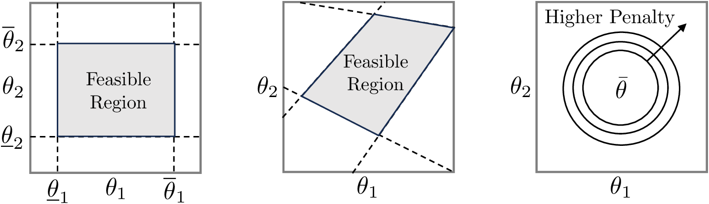
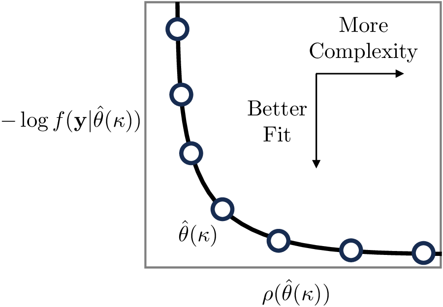
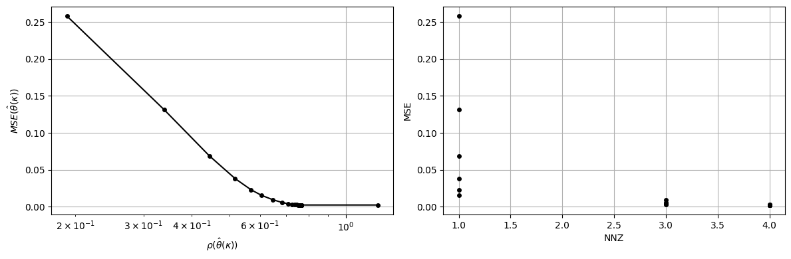
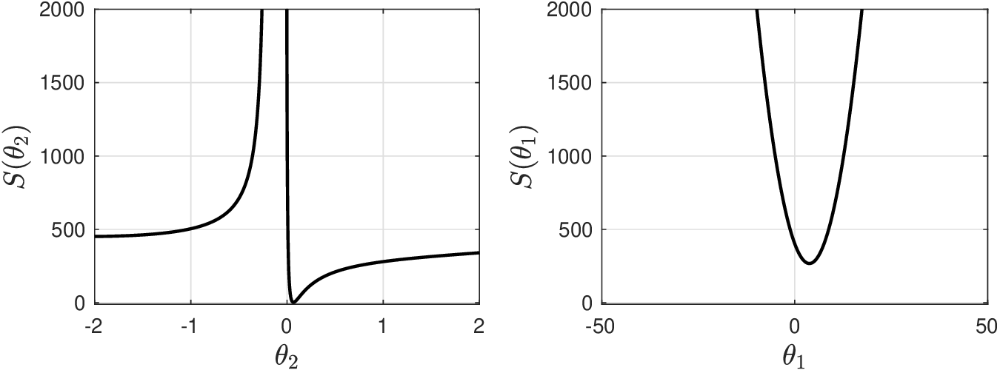
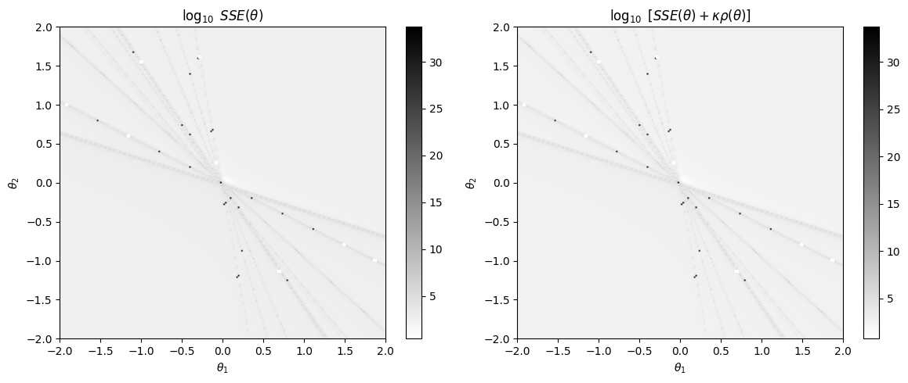
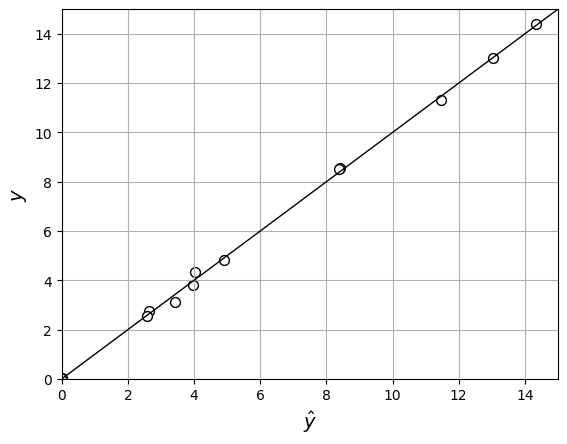

# Prior Knowledge

* We often have some idea of what actual param values should be or if they must respect some general rules.
* For instance,  our physical knowledge might tell us that a param cannot be negative or that it cannot be above a certain threshold.
* We are interested in incorporating this *prior* knowledge in our estimation procedure.
* Prior knowledge help us deal with situations in which the available data is insufficient to estimate params uniquely (e.g., Hessian has zero eigs) or reliably (e.g., Hessian has eigs that are close to zero).
* Prior knowledge helps us eliminate spurious estimates $$\hat{\theta}$$ with no physical meaning.
* Prior knowledge helps us narrow down space over we search on.
* Reducing number of parameters helps us address overfitting.
* Narrowing search space helps numerical solvers find estimates.

* Can incorporate prior knowledge by adding bounds on parameters:

  $$
  \begin{aligned}
  \min_{\theta}& \;- \log f(\mathbf{y}|\theta)\\
  \textrm{s.t.}&\;\;\; \underline \theta\leq \theta\leq\overline\theta
  \end{aligned}
  $$

* Can add general constraints (e.g., sum of params must be equal to some value):

  $$
  \begin{aligned}
  \min_{\theta}& \;- \log f(\mathbf{y}|\theta)\\
  \textrm{s.t.}&\; \;\;\underline\theta\leq \Pi \theta \leq \overline\theta
  \end{aligned}
  $$

* Can add a *penalty* term to log-likelihood to control parameter behavior:

  $$
  \begin{aligned}
  \min_{\theta}& \; - \log f(\mathbf{y}|\theta)+\kappa\cdot  \rho(\theta).
  \end{aligned}
  $$

* Here, $$\kappa\geq 0$$ is a constant that trades-off model fit  and allowed parameter movement.
* Balances *prior knowledge* induced by $$\rho(\theta)$$ with *new knowledge* contained in data.

<figure><figcaption><p>Feasible region defined by bounds (left) and general constraints (middle). Penalization induced by ridge penalty (right).</p></figcaption></figure>

Common choices for penalty function $$\rho(\theta)$$ are:

* $$\ell$$-2 norm (a.k.a ridge or Tikhonov penalty):

  $$
  \begin{aligned}
  \rho(\theta)&=\frac{1}{2}\|\theta-\bar{\theta}\|_2^2\\
  &=\frac{1}{2}\sum_{i=1}^n(\theta_i-\bar{\theta}_i)^2\\
  &=\frac{1}{2}(\theta-\bar{\theta})^T(\theta-\bar{\theta}).
  \end{aligned}
  $$

* $$\ell$$-1 norm (a.k.a. lasso penalty):

  $$
  \rho(\theta)=\|\theta-\bar{\theta}\|_1=\sum_{i=1}^n
  |\theta_i-\bar{\theta}_i|.
  $$

* Bayes penalty function:

  $$
  \rho(\theta)=\frac{1}{2}(\theta-\bar{\theta})^T\Sigma_\theta^{-1} (\theta -\bar{\theta})
  $$

   Similar to ridge penalty but matrix $$\Sigma_\theta$$ induces different weights on params.

* Estimate obtained from a penalized problem depends on the value of $$\kappa$$ chosen and thus we have a range of solutions (for different values of $$\kappa$$) that we denote as $$\hat{\theta}(\kappa)$$.
* As a result, one often forms a *trade-off* curve $$- \log f(\mathbf{y}|\hat{\theta}(\kappa))$$ vs. $$\rho(\hat{\theta}(\kappa))$$ and one selects the point that has the best trade-off.
* The smaller $$\kappa$$, the smaller  $$-\log f(\mathbf{y}|\hat{\theta}(\kappa))$$ and the larger the $$\rho(\hat{\theta}(\kappa))$$.
* One can also obtain trade-off curve by solving constrained MLE problem:

  $$
  \begin{aligned}
  \min_{\theta}& \; - \log f(\mathbf{y}|\theta)\\
  \textrm{s.t.}&\;  \rho(\theta)\leq \kappa
  \end{aligned}
  $$

* Here, $$\kappa$$ is now interpreted as the allowed threshold for the penalty function $$\rho(\theta)$$.
* From this we can see that one can express penalty functions as constraints.

<figure><figcaption><p>Trade-off between model flexibility and model fit.</p></figcaption></figure>

#### Python implementation


Notebook [`ch5_gibbs_tradeoff.ipynb`](https://colab.research.google.com/github/vzavala/StatsBook-GitBook/blob/main/notebooks/ch5_gibbs_tradeoff.ipynb) — open it in Colab and run the cells alongside this section.


**Additional example: lasso trade-off for the Gibbs reactor** (Victor Z and Jaron T, UW-Madison, 2024).
Predict conversion $$y$$ from pressure, the three outlet flows, and temperature (scaled), solving

$$
\min_\theta\ MSE(\theta)+\kappa\,\rho(\theta),\qquad \rho(\theta)=\lVert\theta\rVert_1,
$$

for a range of $$\kappa$$ and drawing the trade-off curve $$MSE(\hat{\theta}(\kappa))$$ vs $$\rho(\hat{\theta}(\kappa))$$.
Python names: `X` (with intercept column), `y`, `kappa`, `theta_hat`, `MSE`, `rho`, `NNZ`
(number of nonzero parameters).

```python
import numpy as np
import matplotlib.pyplot as plt
from scipy.optimize import minimize

data_cov = np.loadtxt(path+'Data/gibbs_covariance.dat')
data_low = np.loadtxt(path+'Data/gibbs_lowtemp_class.dat')
data = np.hstack((data_cov, data_low[:, :1]))
y = data[:, 1].copy()                       # conversion
X = data[:, [0, 2, 3, 4]]                   # pressure and outlet flows
np.random.seed(1)
y += np.random.normal(0, 0.05, y.shape)
X = (X - X.mean(axis=0)) / X.std(axis=0)    # scale inputs
X = np.hstack((np.ones((len(y), 1)), X))    # intercept theta_0

def MSE_of(theta):
    return np.mean((X @ theta - y)**2)

def rho(theta):
    return np.sum(np.abs(theta))

theta_ls = np.linalg.solve(X.T @ X, X.T @ y)     # kappa = 0 (least squares)
print("least-squares theta_hat =", np.round(theta_ls, 4))
print("eigenvalues of X^T X:", np.round(np.linalg.eigvalsh(X.T @ X), 2))
```

```
least-squares theta_hat = [0.6903 0.0082 0.1433 0.2206 0.4326]
eigenvalues of X^T X: [ -0.     0.     9.09 250.   990.91]
```

```python
kappa_values = np.logspace(-6, 0, 40)
results = []
theta0 = theta_ls.copy()
for kappa in kappa_values:
    sol = minimize(lambda th: MSE_of(th) + kappa * rho(th), theta0, method='Powell',
                   options={'xtol': 1e-8, 'ftol': 1e-12, 'maxiter': 20000})
    theta0 = sol.x
    results.append((MSE_of(sol.x), rho(sol.x), np.sum(np.abs(sol.x) > 1e-4)))
MSE, rho_values, NNZ = map(np.array, zip(*results))

fig, axs = plt.subplots(1, 2, figsize=(12, 4))
axs[0].semilogx(rho_values, MSE, 'ko-', markersize=4)
axs[0].set_xlabel(r'$\rho(\hat{\theta}(\kappa))$'); axs[0].set_ylabel(r'$MSE(\hat{\theta}(\kappa))$')
axs[1].plot(NNZ, MSE, 'ko', markersize=4)
axs[1].set_xlabel('NNZ'); axs[1].set_ylabel('MSE')
for ax in axs:
    ax.grid(True)
plt.tight_layout()
plt.show()
```

<figure></figure>

## Example: Hougen-Watson Regularized

* We augment SSE using a ridge regularizer:

  $$
  SSE(\theta)+\frac{1}{2}||\theta -\bar{\theta}||_2^2.
  $$

   where $$\kappa=1$$ and $$\bar{\theta}=0$$.

* We can see that regularizer helps better define minimum points of SSE unction but does not avoid presence of non-physical regions.

  <figure><figcaption><p>Behavior of regularized SSE function as we span values for $$\theta_1$$ and $$\theta_2$$.</p></figcaption></figure>

#### Python implementation


Notebook [`ch5_hougen_watson_regularized.ipynb`](https://colab.research.google.com/github/vzavala/StatsBook-GitBook/blob/main/notebooks/ch5_hougen_watson_regularized.ipynb) — open it in Colab and run the cells alongside this section.


Ridge-regularized SSE for the Hougen-Watson model (Victor Z and Leo Gonzalez, UW-Madison, 2024):

$$
SSE(\theta)+\kappa\,\rho(\theta),\qquad \rho(\theta)=\frac{1}{2}\lVert\theta-\bar{\theta}\rVert_2^2,\quad \kappa=1,\ \bar{\theta}=0.
$$

Python names: `kappa`, `theta_bar`, `rho(theta)`, `SSE(theta)` (model `m` as in `ch5_hougen_watson`).

```python
import numpy as np
import matplotlib.pyplot as plt

data = np.loadtxt(path+'Data/hougenwatson.dat')
X, y = data[:, :3], data[:, -1]

def m(theta, X):
    x1, x2, x3 = X[:, 0], X[:, 1], X[:, 2]
    return (theta[0]*x2 - x3/theta[4]) / (1 + theta[1]*x1 + theta[2]*x2 + theta[3]*x3)

def SSE(theta):
    return 0.5 * np.sum((y - m(theta, X))**2)

kappa = 1.0
theta_bar = np.zeros(5)

def rho(theta):
    return 0.5 * np.sum((theta - theta_bar)**2)

theta_ref = np.array([1.0, 0.05, 0.02, 0.1, 2.0])
grid = np.linspace(-2, 2, 201)
maps = {'SSE': np.zeros((201, 201)), 'regularized': np.zeros((201, 201))}
for i, t2 in enumerate(grid):
    for j, t1 in enumerate(grid):
        th = theta_ref.copy()
        th[1], th[2] = t1, t2
        maps['SSE'][i, j] = SSE(th)
        maps['regularized'][i, j] = SSE(th) + kappa * rho(th)

fig, axs = plt.subplots(1, 2, figsize=(12, 5))
for ax, (title, Z) in zip(axs, maps.items()):
    im = ax.imshow(np.log10(Z), extent=[-2, 2, -2, 2], origin='lower', cmap='gray_r', aspect='auto')
    fig.colorbar(im, ax=ax)
    ax.set_title(r'$\log_{10}$ ' + ('$SSE(\\theta)$' if title == 'SSE' else r'$[SSE(\theta)+\kappa\rho(\theta)]$'))
    ax.set_xlabel(r'$\theta_1$'); ax.set_ylabel(r'$\theta_2$')
plt.tight_layout()
plt.show()
```

<figure></figure>

## Example: Hougen-Watson Constrained

* Consider now constrained MLE problem:

  $$
  \begin{aligned}
  \min_{\theta}& \; \frac{1}{2}\|\mathbf{y}- \mathbf{m}(\theta)\|^2\\
  \textrm{s.t.}&\; \underline\theta\leq \theta\leq \overline\theta
  \end{aligned}
  $$

   with $$\underline \theta=(0,0,0,0,0)$$ and $$\overline \theta=(2,2,2,2,2)$$.

* Constrained MLE problem solved using a numerical package that implements a Newton-like algorithm.
* Routines uses Newton algorithm to find parameters but can also handle constraints.
* Solve problem with guess $$\hat{\theta}=(-1,-1,-1,-1,-1)$$ and without using constraints.
* We find that algorithm does not converge and obtains estimates that are negative.
* Upon incorporating constraints we find:

  $$
  \begin{aligned}
  \hat{\theta}&=(1.25,0.06,0.04,0.11,1.19).
  \end{aligned}
  $$

* The numerical package does not provide Hessian info but provides Jacobian  $$\nabla_\theta \mathbf{m}(\hat{\theta})$$.
* We approximate Hessian using Gauss-Newton approximation.
* Info used to determine if estimated params are unique and to obtain covariance:

  $$
  \begin{aligned}
  \mathcal{H}(\hat{\theta})=\left[\begin{array}{rrrrr}
  619.12    &  -4305.49  &    -6345.59   &    -940.39    &     99.98\\
  -4305.49  &    37792.30  &    44531.04   &    4721.95    &   -434.18\\
  -6345.59   &   44531.04  &    75036.07   &    9325.14    &   -663.07\\
  -940.39    &   4721.95    &   9325.14    &   2149.56   &    -193.73\\
  99.98     &  -434.18     &  -663.07     & -193.73     &    39.38
  \end{array}\right]
  \end{aligned}
  $$

* Eigs of Hessian are all positive:

  $$
  \lambda=(1.06\times 10^{5} ,  8.35\times 10^{3} ,  9.52\times 10^{2},   3.53\times 10^{1} ,  2.55\times 10^{-2}).
  $$

* This indicates that $$\hat{\theta}$$ is sitting at a minimum point of the SSE function.
* Estimate variances are:

  $$
  \mathbb{V}[\hat{\theta}]= (7.63\times 10^{-1}, 1.92\times 10^{-3}, 9.69\times 10^{-4}, 5.73\times 10^{-3},7.10\times 10^{-1}).
  $$

#### Python implementation


Notebook [`ch5_hougen_watson_constraints.ipynb`](https://colab.research.google.com/github/vzavala/StatsBook-GitBook/blob/main/notebooks/ch5_hougen_watson_constraints.ipynb) — open it in Colab and run the cells alongside this section.


Hougen-Watson estimation with bounds $$\underline{\theta}\leq\theta\leq\overline{\theta}$$
(Victor Z and Leo Gonzalez, UW-Madison, 2024).

| Slides | Python | Meaning |
|---|---|---|
| $$\underline{\theta}$$, $$\overline{\theta}$$ | `theta_lb`, `theta_ub` | bounds $$(0,\dots,0)$$ and $$(2,\dots,2)$$ |
| $$\nabla_\theta\mathbf{m}(\hat{\theta})$$ | `J` | Jacobian returned by the solver |
| $$\mathcal{H}(\hat{\theta})\approx\nabla_\theta\mathbf{m}^T\nabla_\theta\mathbf{m}$$ | `H` | Gauss-Newton Hessian |
| $$\lambda$$ | `lam` | eigenvalues of $$\mathcal{H}$$ |
| $$\mathrm{Cov}[\hat{\theta}]$$, $$\mathbb{V}[\hat{\theta}]$$ | `Cov_theta`, `V_theta` | covariance and variances |

```python
import numpy as np
import matplotlib.pyplot as plt
from scipy.optimize import least_squares

data = np.loadtxt(path+'Data/hougenwatson.dat')
X, y = data[:, :3], data[:, -1]
S = len(y)

def m(theta, X):
    x1, x2, x3 = X[:, 0], X[:, 1], X[:, 2]
    return (theta[0]*x2 - x3/theta[4]) / (1 + theta[1]*x1 + theta[2]*x2 + theta[3]*x3)

def residual(theta):
    return m(theta, X) - y
```

Unconstrained problem from the bad initial guess $$\theta=(-1,\dots,-1)$$:

```python
sol = least_squares(residual, -np.ones(5), method='trf')
print("unconstrained theta_hat =", np.round(sol.x, 2))
```

```
unconstrained theta_hat = [-2267.65  -114.05   -80.49  -196.14    -0.  ]
```

Constrained problem with $$\underline{\theta}=0$$ and $$\overline{\theta}=2$$:

```python
theta_lb, theta_ub = np.zeros(5), 2 * np.ones(5)
sol = least_squares(residual, np.ones(5), bounds=(theta_lb, theta_ub), method='trf')
theta_hat = sol.x
print("constrained theta_hat =", np.round(theta_hat, 2))

y_hat = m(theta_hat, X)
plt.plot([0, 15], [0, 15], 'k-', linewidth=1)
plt.scatter(y_hat, y, marker='o', color='w', edgecolor='k', s=50)
plt.xlabel(r'$\hat{y}$', fontsize=14); plt.ylabel('$y$', fontsize=14)
plt.axis([0, 15, 0, 15]); plt.grid(True)
plt.show()
```

```
constrained theta_hat = [1.25 0.06 0.04 0.11 1.19]
```

<figure></figure>

Gauss-Newton Hessian, its eigenvalues, and $$\mathrm{Cov}[\hat{\theta}]=\mathcal{H}(\hat{\theta})^{-1}\hat{\sigma}^2$$.

```python
J = sol.jac
H = J.T @ J
lam = np.linalg.eigvalsh(H)[::-1]
sigma2_hat = np.var(y_hat - y, ddof=1)
Cov_theta = np.linalg.inv(H) * sigma2_hat
V_theta = np.diag(Cov_theta)
np.set_printoptions(precision=3)
print("H =\n", H)
print("eigenvalues of H:", lam)
print("V[theta_hat] =", V_theta)
```

```
H =
 [[ 6.196e+02 -4.309e+03 -6.351e+03 -9.411e+02  9.998e+01]
 [-4.309e+03  3.782e+04  4.457e+04  4.726e+03 -4.342e+02]
 [-6.351e+03  4.457e+04  7.510e+04  9.333e+03 -6.631e+02]
 [-9.411e+02  4.726e+03  9.333e+03  2.151e+03 -1.937e+02]
 [ 9.998e+01 -4.342e+02 -6.631e+02 -1.937e+02  3.934e+01]]
eigenvalues of H: [1.064e+05 8.362e+03 9.531e+02 3.534e+01 2.561e-02]
V[theta_hat] = [0.501 0.001 0.001 0.004 0.466]
```
