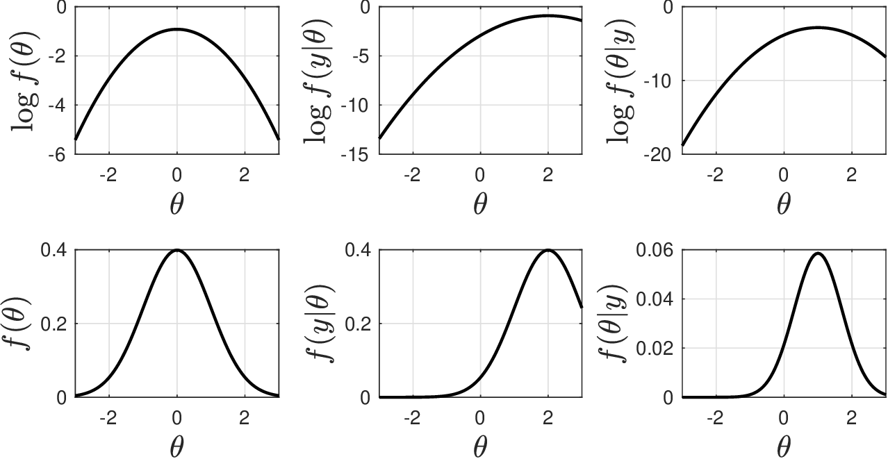
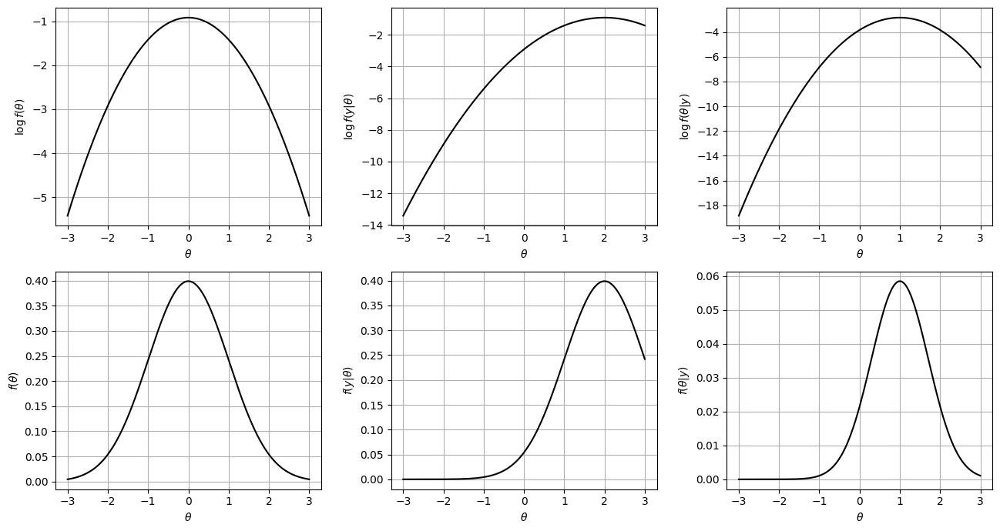

# Bayesian Estimation

* We have used MLE as main paradigm to determine parameters from data.
* Idea is to  find the estimate that maximizes conditional pdf $$f(\mathbf{y}|\mathbf{X},\theta,\Sigma)$$.
* Approach implicitly assumes that $$\mathbf{X}$$, $$\theta$$, and $$\Sigma$$ are deterministic variables.
* This is limiting because input data $$\mathbf{X}$$ might contain uncertainty (i.e., sensors) or because we want to convey prior knowledge on $$\mathbf{X},\theta,\Sigma$$ in statistical terms.

* The is a more general estimation paradigm known as Bayes estimation that allows us to handle overcome the limitations of MLE.
* Key difference is that $$\theta,\mathbf{X}$$ and $$\Sigma$$ are treated as RVs.
* For simplicity, we will focus on $$\theta$$ (generalizing arguments is relatively easy).
* In context of estimation problem of interest, Bayes' theorem states that:

  $$
  f(\theta|\mathbf{y})=\frac{f(\mathbf{y}|\theta)f(\theta)}{f(\mathbf{y})}
  $$

* $$f(\theta|\mathbf{y})$$ is prob that parameters take value $$\theta$$ given knowledge that output takes value $$\mathbf{y}$$. This pdf is known as posterior pdf.
* $$f(\theta)$$ is prob that parameters take value $$\theta$$ given no knowledge of output.  This pdf is known as the prior pdf.
* $$f(\mathbf{y}|\theta)$$ is prob that output takes value $$\mathbf{y}$$ given knowledge that parameters take value $$\theta$$. This pdf is likelihood function maximized in MLE.
* $$f(\mathbf{y})$$ is marginal probability of outputs; this pdf is often neglected as it does not carry knowledge on parameters and thus one often expresses Bayes theorem as:

  $$
  f(\theta|\mathbf{y})\propto f(\mathbf{y}|\theta)f(\theta)
  $$

* Bayesian estimation maximizes prob of parameters $$f(\theta|\mathbf{y})$$.
* This makes more sense than MLE (maximizes probability of outputs $$f(\mathbf{y}|\theta)$$).
* We thus find Bayes estimate $$\hat{\theta}$$ by solving:

  $$
  \max_\theta\quad  \log f(\mathbf{y}|\theta)+\log f(\theta)
  $$

* Prior term $$\log f(\theta)$$ naturally carries prior knowledge.

* Consider now model $$\mathbf{y}=\mathbf{m}(\theta)+\mathbf{e}$$ with $$\mathbf{e}\sim \mathcal{N}(0,\Sigma)$$.
* Moreover, consider prior knowledge that $$\theta\sim \mathcal{N}(\bar{\theta},\Sigma_\theta)$$.
* This indicates that:

  $$
  \begin{aligned}
  \log f(\theta)&=\log\left((2\pi)^{n/2}|\Sigma_\theta|^{1/2}\right)+\frac{1}{2}(\theta-\bar{\theta})^T\Sigma_\theta^{-1}(\theta-\bar{\theta})\\
  \log f(\mathbf{y}|\theta)&=\log\left((2\pi)^{S/2}|\Sigma|^{1/2}\right) +\frac{1}{2}(\mathbf{y}-\mathbf{m}(\theta))^T\Sigma^{-1}(\mathbf{y}-\mathbf{m}(\theta)).
  \end{aligned}
  $$

* After dropping constant terms and changing from max to min, we obtain:

  $$
  \begin{aligned}
  \min_{\theta}& \quad \frac{1}{2}(\mathbf{y}-\mathbf{m}(\theta))^T\Sigma^{-1}(\mathbf{y}-\mathbf{m}(\theta))+\frac{1}{2}(\theta-\bar{\theta})^T\Sigma_\theta^{-1}(\theta-\bar{\theta}).
  \end{aligned}
  $$

* Gaussian prior $$f(\theta)$$ achieves its maximum at reference point $$\bar{\theta}$$ while $$f(\mathbf{y}|\theta)$$ achieves its maximum when $$\theta$$ fits perfectly the data.
* Bayes estimation naturally seeks to strike a *balance* (trade-off) between what we previously knew about $$\theta$$ and the new knowledge gained through the data of $$\mathbf{y}$$.
* If we ignore prior knowledge, all we know about $$\theta$$ is through data $$\mathbf{y}$$ (as in MLE).
* This might lead to ambiguity if data is insufficient to estimate parameters uniquely.
* Consequently, adding prior knowledge seeks to reduce *ambiguity*.
* Reference $$\bar{\theta}$$ is prior estimate (best estimate prior to observing new data $$\mathbf{y}$$).
* How much we trust our prior estimate is dictated by covariance matrix $$\Sigma_\theta$$.

## Example: Bayesian Estimation

* Consider  simple linear model $$Y=\theta X+\epsilon$$ and assume that we have a single observation that we denote as $$(x=1,y=2)$$.
* Prior knowledge is $$\theta\sim \mathcal{N}(0,1)$$ and this defines marginal $$f(\theta)$$.
* Info provided by data $$(x,y)$$ is $$y\sim \mathcal{N}(\theta x,1)$$ and this defines  likelihood $$f(y|\theta)$$.
* Combined information given by posterior pdf $$f(\theta|y)\propto f(y|\theta)f(\theta)$$.

  <figure></figure>

* Location of maximum points for pdfs and log pdfs coincides.
* According to prior information (embedded in$$f(\theta)$$), we have that $$\theta=0$$ is the most likely value.
* According to new information (embedded in $$f(y|\theta)$$), we have that $$\theta=2$$ is the most likely value. This would be estimate obtained with MLE (ignoring prior information).
* According to combined prior and new information (embedded in $$f(\theta|y)$$), we have that $$\theta=1$$ is the most likely value.
* Bayesian estimation naturally “blends" old and new information and finds an estimate that is a trade-off point.

#### Python implementation


Notebook [`ch5_bayes_estimation.ipynb`](https://colab.research.google.com/github/vzavala/StatsBook-GitBook/blob/main/notebooks/ch5_bayes_estimation.ipynb) — open it in Colab and run the cells alongside this section.


Bayesian estimation for $$Y=\theta X+\epsilon$$ with one observation $$(x=1,y=2)$$
(Victor Z and Jaron T, UW-Madison, 2024).

| Slides | Python | Meaning |
|---|---|---|
| $$\theta\sim\mathcal{N}(\bar{\theta},\Sigma_\theta)$$ | `theta_bar`, `Sigma_theta` | prior (0, 1) |
| $$y\sim\mathcal{N}(\theta x,\sigma^2)$$ | `sigma2` | likelihood noise variance (1) |
| $$\log f(\theta)$$, $$\log f(y\mid\theta)$$, $$\log f(\theta\mid y)$$ | `log_f_theta`, `log_f_y_theta`, `log_f_theta_y` | log prior, log likelihood, log posterior (up to a constant) |

```python
import numpy as np
import matplotlib.pyplot as plt

theta = np.linspace(-3, 3, 400)
theta_bar, Sigma_theta = 0.0, 1.0
x, y, sigma2 = 1.0, 2.0, 1.0

log_f_theta = -0.5*np.log(2*np.pi*Sigma_theta) - (theta - theta_bar)**2 / (2*Sigma_theta)
log_f_y_theta = -0.5*np.log(2*np.pi*sigma2) - (y - theta*x)**2 / (2*sigma2)
log_f_theta_y = log_f_y_theta + log_f_theta          # Bayes: f(theta|y) ∝ f(y|theta) f(theta)

fig, axs = plt.subplots(2, 3, figsize=(13, 7))
for k, (vals, label) in enumerate(((log_f_theta, r'f(\theta)'), (log_f_y_theta, r'f(y|\theta)'),
                                   (log_f_theta_y, r'f(\theta|y)'))):
    axs[0, k].plot(theta, vals, 'k', linewidth=1.5)
    axs[0, k].set_ylabel(rf'$\log {label}$')
    axs[1, k].plot(theta, np.exp(vals), 'k', linewidth=1.5)
    axs[1, k].set_ylabel(rf'${label}$')
    for ax in axs[:, k]:
        ax.set_xlabel(r'$\theta$')
        ax.grid(True)
plt.tight_layout()
plt.show()

for vals, name in ((log_f_theta, 'prior'), (log_f_y_theta, 'likelihood (MLE)'), (log_f_theta_y, 'posterior (Bayes)')):
    print(f"{name:18s} is maximized at theta = {theta[np.argmax(vals)]:.2f}")
```

<figure></figure>

```
prior              is maximized at theta = -0.01
likelihood (MLE)   is maximized at theta = 1.99
posterior (Bayes)  is maximized at theta = 1.00
```

#### Python implementation


Notebook [`ch5_heat_capacity_bayes.ipynb`](https://colab.research.google.com/github/vzavala/StatsBook-GitBook/blob/main/notebooks/ch5_heat_capacity_bayes.ipynb) — open it in Colab and run the cells alongside this section.


**Additional example: recursive Bayesian estimation of the heat-capacity model.**
With a Gaussian prior $$\theta\sim\mathcal{N}(\bar{\theta},\Sigma_\theta)$$ the Bayes estimate solves

$$
\min_\theta\ \frac{1}{2}(\mathbf{y}-\mathbf{X}\theta)^T\Sigma^{-1}(\mathbf{y}-\mathbf{X}\theta)+\frac{1}{2}(\theta-\bar{\theta})^T\Sigma_\theta^{-1}(\theta-\bar{\theta}),
$$

and the posterior covariance is $$(\mathbf{X}^T\Sigma^{-1}\mathbf{X}+\Sigma_\theta^{-1})^{-1}$$. Processing the data
in batches, the posterior of one batch becomes the prior of the next.
Python names: `theta_bar`, `Sigma_theta`, `Sigma` (noise covariance), `theta_hat`.

```python
import numpy as np

theta = np.array([6.190, 2.923e-3, -7.052e-7])
x = np.repeat([300.0, 600.0, 900.0], 20)
S = len(x)
X = np.column_stack([np.ones(S), x, x**2])
np.random.seed(0)
sigma = 0.1
y = X @ theta + np.random.normal(0, sigma, S)
idx = np.random.permutation(S)
X, y = X[idx], y[idx]

def bayes_estimate(X, y, Sigma, theta_bar, Sigma_theta):
    """Minimizer of the Bayes objective (closed form for a linear model) and posterior covariance."""
    A = X.T @ np.linalg.solve(Sigma, X) + np.linalg.inv(Sigma_theta)
    b = X.T @ np.linalg.solve(Sigma, y) + np.linalg.solve(Sigma_theta, theta_bar)
    return np.linalg.solve(A, b), np.linalg.inv(A)

theta_bar, Sigma_theta = np.ones(3), np.eye(3)
theta_hat, Sigma_post = bayes_estimate(X, y, sigma**2 * np.eye(S), theta_bar, Sigma_theta)
print("all data at once:  theta_hat =", np.array2string(theta_hat, precision=4))
```

```
all data at once:  theta_hat = [ 6.2546e+00  2.9045e-03 -8.1641e-07]
```

Recursive estimation with batches of 20 experiments:

```python
batch = 20
for k in range(S // batch):
    rows = slice(k * batch, (k + 1) * batch)
    theta_bar, Sigma_theta = bayes_estimate(X[rows], y[rows], sigma**2 * np.eye(batch), theta_bar, Sigma_theta)
    print(f"after batch {k+1}: theta_hat = {np.array2string(theta_bar, precision=4)},  "
          f"SD = {np.array2string(np.sqrt(np.diag(Sigma_theta)), precision=2)}")
```

```
after batch 1: theta_hat = [ 6.0420e+00  3.7342e-03 -1.4977e-06],  SD = [1.76e-01 6.87e-04 5.66e-07]
after batch 2: theta_hat = [ 6.1788e+00  3.2053e-03 -1.0496e-06],  SD = [1.22e-01 4.64e-04 3.81e-07]
after batch 3: theta_hat = [ 6.2546e+00  2.9045e-03 -8.1641e-07],  SD = [9.70e-02 3.67e-04 3.03e-07]
```

## Bayesian Estimation

* Bayes framework can be naturally capture prior info on input data $$\mathbf{X}$$.
* Assume uncertainty in input data $$\mathbf{{X}}\sim \mathcal{N}(\bar{\mathbf{X}},\Sigma_X)$$; here, the reference point (mean) $$\bar{\mathbf{X}}$$ is observed value and $$\Sigma_X$$ captures their uncertainty (e.g., precision of sensor).
* Given model $$\mathbf{y}=\mathbf{m}(\theta,\mathbf{X})$$, we *simultaneously* estimate params $$\theta$$ and inputs $$\mathbf{X}$$.
* Bayes' theorem tells us that:

  $$
  f(\theta,\mathbf{X}|\mathbf{y})\propto f(\mathbf{y}|\theta,\mathbf{X})f(\theta,\mathbf{X})
  $$

* If $$\theta$$ and $$\mathbf{X}$$ are independent $$f(\theta,\mathbf{X})=f(\theta)f(\mathbf{X})$$.
* Our estimates can thus be obtained by solving problem:

  $$
  \max_{\theta,\mathbf{X}}\;  \log f(\mathbf{y}|\theta,\mathbf{X}) +\log f(\theta) + \log f(\mathbf{X}).
  $$

* Bayes estimation problem can be expressed as:

  $$
  \begin{aligned}
  \min_{\theta,\mathbf{X}}& \quad \frac{1}{2}(\mathbf{y}-\mathbf{m}(\theta))^T\Sigma^{-1}(\mathbf{y}-\mathbf{m}(\theta)) +\frac{1}{2}(\theta-\bar{\theta})^T\Sigma_\theta^{-1}(\theta-\bar{\theta})+\frac{1}{2}(\mathbf{X}-\bar{\mathbf{X}})^T\Sigma_X^{-1}(\mathbf{X}-\bar{\mathbf{X}}).
  \end{aligned}
  $$

* Note that this approach is equivalent to defining $$\mathbf{X}$$ as parameters.

## Example: Data Reconciliation

* We consider a system with output flow $$Y$$ and input flow $$X$$.
* There is no transformation in the system and we thus know have that conservation $$Y=X$$ must hold.
* We have a single input-output observation (measurement) that we denote as $$(x_\omega,y_\omega)$$.  This input and output measurements are subject to Gaussian errors with variances $$\sigma_x^2$$ and $$\sigma_y^2$$.
* Because of sensor errors in input and output flow, observed input and output do not satisfy conservation (i.e., $$x_\omega\neq y_\omega$$).
* We use Bayesian estimation to obtain estimate of input flow  $$\hat{x}$$ that reconciles observed input and output data  to conservation equation (model).

* Bayes' theorem tells us that $$f(x|y)\propto f(y|x)f(x)$$.
* We obtain $$\hat{x}$$ by finding value $$x$$ that maximizes $$f(x|y)$$.
* Bayes estimation problem seeks to maximize $$f(x|y)$$ and can be expressed as:

  $$
  \begin{aligned}
  \min_{x}& \quad \frac{1}{2\sigma_y^2}(y_\omega-x)^2 + \frac{1}{2\sigma_x^2}(x-x_\omega)^2.
  \end{aligned}
  $$

* Estimate $$\hat{x}$$ seeks to minimize error from conservation and minimize deviation from reference value $$x_\omega$$ (from observation).
* How much weight is put on conservation and correction is controlled by $$\sigma_y^2$$ and $$\sigma_x^2$$.

* To find solution, we take derivative of objective function with respect to $$x$$:

  $$
  -\frac{1}{\sigma_y^2}(y_\omega-x)+\frac{1}{\sigma_x^2}(x-x_\omega)=0
  $$

* From here we can determine that the estimate $$\hat{x}$$ is:

  $$
  \hat{x}=\frac{\frac{1}{\sigma_y^2}y_\omega+\frac{1}{\sigma_x^2}x_\omega}{\frac{1}{\sigma_y^2}+\frac{1}{\sigma_x^2}}.
  $$

* This can also be written as:

  $$
  \hat{x}=\frac{y_\omega+\frac{\sigma_y^2}{\sigma_x^2}x_\omega}{1+\frac{\sigma_y^2}{\sigma_x^2}}.
  $$

* From this expression it is clear that, if we trust output measurement much more than input measurement then $$\sigma_y^2/\sigma_x^2\to 0$$ and thus $$\hat{x}\to y_\omega$$.
* On other other hand, if we trust input measurement much more than output measurement then $$\sigma_y^2/\sigma_x^2\to \infty$$ and thus $$\hat{x}\to x_\omega$$.

#### Python implementation


Notebook [`ch5_data_reconciliation.ipynb`](https://colab.research.google.com/github/vzavala/StatsBook-GitBook/blob/main/notebooks/ch5_data_reconciliation.ipynb) — open it in Colab and run the cells alongside this section.


Data reconciliation with Bayesian estimation (written for the book to accompany the slide
example; the measurement values are illustrative). Conservation requires $$Y=X$$; we observe
$$(x_\omega,y_\omega)$$ with error variances $$\sigma_x^2$$, $$\sigma_y^2$$ and solve

$$
\min_x\ \frac{1}{2\sigma_y^2}(y_\omega-x)^2+\frac{1}{2\sigma_x^2}(x-x_\omega)^2
\quad\Rightarrow\quad \hat{x}=\frac{y_\omega+\frac{\sigma_y^2}{\sigma_x^2}x_\omega}{1+\frac{\sigma_y^2}{\sigma_x^2}}.
$$

Python names: `x_omega`, `y_omega`, `sigma2_x`, `sigma2_y`, `x_hat`.

```python
import numpy as np
from scipy.optimize import minimize_scalar

x_omega, y_omega = 100.0, 104.0      # measured input and output flows (illustrative)

def x_hat_formula(sigma2_x, sigma2_y):
    r = sigma2_y / sigma2_x
    return (y_omega + r * x_omega) / (1 + r)

for sigma2_x, sigma2_y in ((1.0, 1.0), (1.0, 0.01), (0.01, 1.0)):
    obj = lambda x: (y_omega - x)**2 / (2*sigma2_y) + (x - x_omega)**2 / (2*sigma2_x)
    x_num = minimize_scalar(obj).x
    print(f"sigma2_x = {sigma2_x:5.2f}, sigma2_y = {sigma2_y:5.2f}:  "
          f"x_hat = {x_hat_formula(sigma2_x, sigma2_y):7.3f}  (numerical: {x_num:7.3f})")
```

```
sigma2_x =  1.00, sigma2_y =  1.00:  x_hat = 102.000  (numerical: 102.000)
sigma2_x =  1.00, sigma2_y =  0.01:  x_hat = 103.960  (numerical: 103.960)
sigma2_x =  0.01, sigma2_y =  1.00:  x_hat = 100.040  (numerical: 100.040)
```
