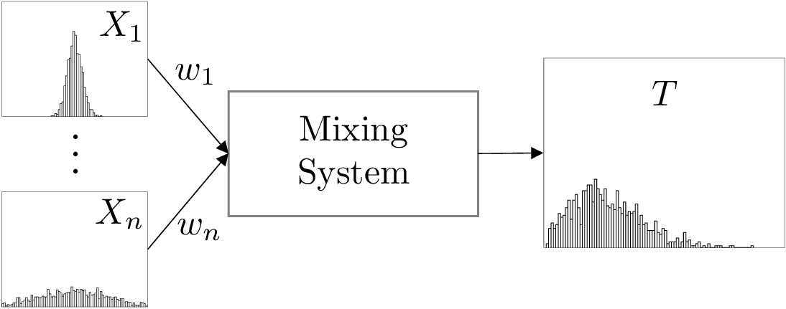
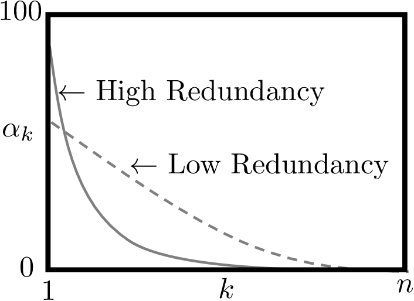
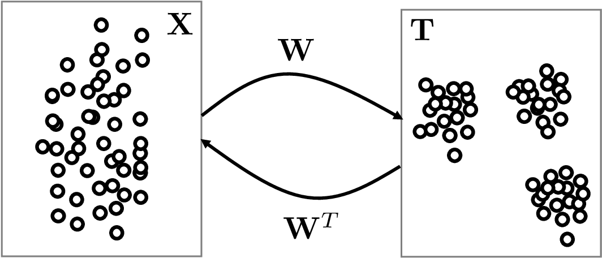
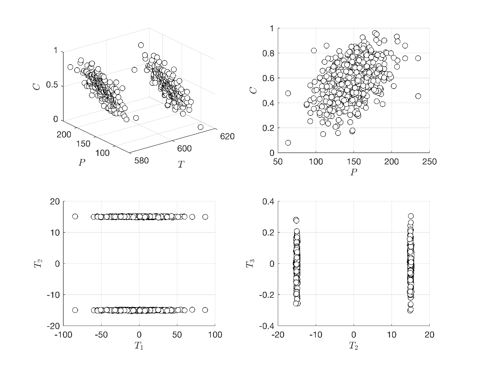
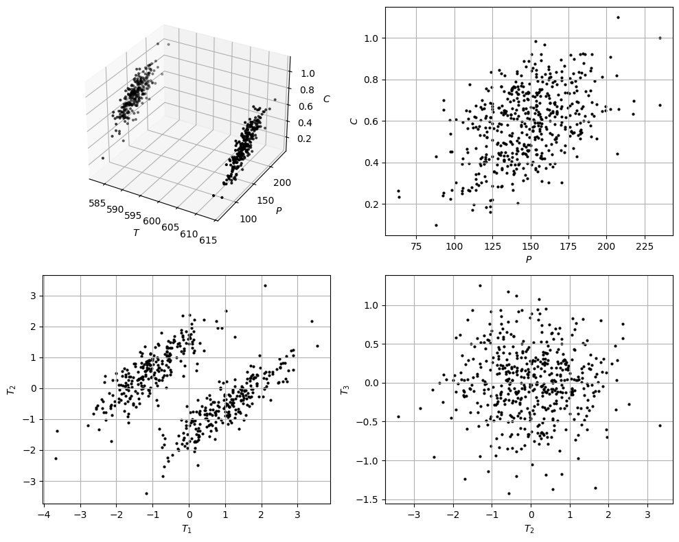

# Principal Component Analysis

## Principal Component Analysis (PCA)

* Consider questions:
   * How can I interpret and extract knowledge (e.g., trends) from high-dimensional data?
   * How can I reduce (compress) data to facilitate analysis, visualization, storage, and use?
* We analyze data that is stationary (as opposed to time-dependent).
* Stationary data involves obs that are independent over  time.
* Time-dependent involves obs that are correlated over time (more difficult).

## Principal Component Analysis

* Have RVs $$X=(X_1,X_2,...,X_n)$$ and want to create a *mixture* of the form:

  $$
  T=\sum_{i=1}^nw_iX_i=w^TX
  $$

   where $$w_i\in \mathbb{R}$$ are mixture proportions, collected in vector $$w=(w_1, w_2,...,w_n)$$.

* Consider questions:
   * What proportions $$w$$ give product $$T$$ that contains maximum information about $$X$$?
   * What proportions $$w$$ give product $$T$$ that contains second most information about $$X$$?
   * What proportions $$w$$ give product $$T$$ that contains minimum information about $$X$$?
* Think about analogy of this statistical mixing process with that of physical mixing.
* In physical process, want to mix flows of different quality so that product is valuable.
* Statistical mixing problem can be solved using PCA.

<figure><figcaption><p>Statistical mixing problem to be studied using principal component analysis (PCA).</p></figcaption></figure>

* Collect obs $$x_\omega\in \mathbb{R}^n,\; \omega \in \mathcal{S}$$ for $$X=(X_1,X_2,...,X_n)$$.
* Make implicit assumption that obs are i.i.d. samples of $$X$$.
* Store obs in $$S\times n$$ data matrix:

  $$
  \begin{aligned}
  \mathbf{X}=\left[\begin{array}{ccccccc}x_{1,1}&x_{1,2}&\cdots &x_{1,n}\\
  x_{2,1}&x_{2,2}&\cdots &x_{2,n}\\
  \vdots&\vdots&\vdots &\vdots\\
  x_{S,1}&x_{S,2}&\cdots&x_{S,n}
  \end{array}
  \right]
  \end{aligned}
  $$

* Normalize (re-scale) columns of matrix $$\mathbf{X}$$ in such a way that

  $$
  \frac{1}{S}\sum_{\omega=1}^S\mathbf{X}_{\omega,j}=0,\;\; j=1,...,n
  $$

   (e.g., by substracting means of each variable).

* One can show that sample covariance matrix of $$X$$ is:

  $$
  \hat{\textrm{Cov}}(X)= \mathbf{X}^T\mathbf{X}.
  $$

* Matrix $$\mathbf{X}^T\mathbf{X}$$ is known as *kernel* matrix and we denote this as $$\boldsymbol{\Sigma}$$.

* Kernel contains all info of $$X$$; variance is measure of *info content*.
* Kernel is closely related to cov matrix of parameter estimates for structural models.
* Mixture $$T=w^TX$$ is an RV and one can show that $$\hat{\mathbb{V}}[T]=w^T\boldsymbol{\Sigma} w$$.
* Sample variance of $$T$$ is thus related to sample covariance of $$X$$ ($$\boldsymbol{\Sigma}$$).
* Proportions that contain max information of $$X$$ are those that max variance of $$T$$:

  $$
  \max_{w}\; w^T\boldsymbol{\Sigma} w\; \textrm{s.t.}\; \|w\|=1
  $$

* Solution $$w_1$$ is eigenvec of $$\boldsymbol{\Sigma}$$ associated with largest eigv $$\lambda_1$$ (i.e., $$\boldsymbol{\Sigma}w_1=\lambda_1 w_1$$).
* Eigv is $$\lambda_1=w^T_1\Sigma w_1$$ (is measure of info content).
* Optimal mixture associated with eigenvec is given by $$T_1=w_1^TX$$.

* Can identify mixture that contains 2nd most info by solving:

  $$
  \max_{w}\; w^T\boldsymbol{\Sigma} w\; \textrm{s.t.}\; \|w\|=1,\; w^Tw_1=0.
  $$

* Solution $$w_2$$ is eigenvec associated with 2nd largest eigenv $$\lambda_2=w_2^T\boldsymbol{\Sigma} w_2$$.
* Constraint $$w^T_2w_1=0$$ (a.k.a. orthogonality constraint) ensures that mixture $$T_2=w_2^TX$$ is not correlated to mixture $$T_1=w_1^TX$$.
* This guarantees that $$T_2$$ and $$T_1$$ provide complementary (non-redundant) info.
* Can continue procedure to obtain all eigenvecs $$w_k,\, k=1,...,n$$ of $$\boldsymbol{\Sigma}$$.
* Each eigenvec $$w_k$$ has mixture $$T_k=w^T_kX$$ with info content $$\lambda_k=w^T\Sigma w$$.
* Mixtures are ranked in order of info content $$\lambda_1\geq \lambda_2\geq \dots \lambda_n$$.

* Set of eigenvecs and eigenv can be used to decompose kernel as:

  $$
  \boldsymbol{\Sigma} =\lambda_1w_1w_1^T+\lambda_2w_2w_2^T+\cdots + \lambda_n w_nw_n^T
  $$

* Truncating series (drop smallest eigenvs) enables compression of $$\boldsymbol{\Sigma}$$.
* Eigendecomposition of $$\boldsymbol{\Sigma}$$ can be written in compact form:

  $$
  \boldsymbol{\Sigma}=\mathbf{W}\boldsymbol{\Lambda} \mathbf{W}^T
  $$

   where $$\mathbf{W}\in \mathbb{R}^{n\times n}$$ is:

  $$
  \mathbf{W}=[w_1|w_2|\dots| w_n].
  $$

* Matrix $$\boldsymbol{\Lambda}\in \mathbb{R}^{n\times n}$$ is diagonal with entries $$\boldsymbol{\Lambda}_{k,k}=\lambda_k$$.
* Eigenvalues are usually visualized using spectrum, which summarizes information content.

* Eigenvalues are usually visualized using spectrum, which summarizes % of total information content.

  $$
  \alpha_k=100\cdot\frac{\lambda_k}{\displaystyle\sum_{j=1}^n\lambda_j},\; k=1,...,n.
  $$

* Spectrum that decays rapidly indicates that matrix has a high degree of redundancy (can be compressed more easily).

  <figure><figcaption><p>Illustration of spectrum of a couple of covariance matrices small amount of redundancy (solid) and high amount of redundancy (dashed).</p></figcaption></figure>

* Mixtures $$T_1,T_2,...T_n$$ (a.k.a. principal components) contain all info about $$X$$.
* Eigenvec matrix $$\mathbf{W}$$ *projects* data $$\mathbf{X}$$ into space of PCs as:

  $$
  \mathbf{T}=\mathbf{X}\mathbf{W}
  $$

   where $$\mathbf{T}\in \mathbb{R}^{S\times n}$$ is matrix with entries $$\mathbf{T}_{i,j},\,i=1,...,S,\, j=1,...,n$$.

* Here, $$\mathbf{T}_{i,j}$$ is the $$i$$-th observation of PC $$T_j$$.
* PCA can be seen as a projection of the data from a physical space to an information space (a.k.a. as latent space).
* Can project back from latent space to physical space using $$\mathbf{X}=\mathbf{T}\mathbf{W}^T$$.

<figure><figcaption><p>Projection of data from physical space  to information/latent space (and back) using the eigenvectors 𝐖.</p></figcaption></figure>

* From projection $$\mathbf{T}=\mathbf{X}\mathbf{W}$$:

  $$
  \begin{aligned}
  \hat{\textrm{Cov}}(T)&=\mathbf{T}^T\mathbf{T}\\
  &=\mathbf{W}^T\mathbf{X}^T\mathbf{X}\mathbf{W}\\
  &=\mathbf{W}^T\mathbf{W}\boldsymbol{\Lambda} \mathbf{W}\mathbf{W}\\
  &=\boldsymbol{\Lambda},
  \end{aligned}
  $$

* Here, we use property that $$\mathbf{W}^T\mathbf{W}=\mathbf{I}$$ (eigenvecs are orthogonal).
* PCs are thus uncorrelated and all info of $$T$$ (variance) is contained in eigenvalues.
* Projection $$\mathbf{T}=\mathbf{X}\mathbf{W}$$ transforms data from physical space (under which $$\mathbf{X}$$ lives) into an information space (under which $$\mathbf{T}$$ lives).
* **Note:** it is not necessary to normalize data to apply PCA.
* Normalization is required if one seeks to interpret $$\mathbf{X}^T\mathbf{X}$$ as covariance of $$X$$.

## Example: PCA Analysis for Gibbs Reactor Data

* Dataset with measurements of pressure, temperature, and conversion $$(P,T,C)$$.
* If visualize data in 3D $$(P,T,C)$$ space, separates in clusters (failure/normal mode).
* Humans can only visualize data in a small number of dimensions (typically 2D plots).
* Imagine we visualize our data in 2D by ignoring temperature ($$P,C$$).
* Visualizing data in this reduced space hides clusters in the data.
* Common issue with visualizing data in many dimensions (hundreds to thousands).
* Specifically, reduction might *hide* key aspects of data.

* We visualize data in 2D but in info space of PCs $$(T_1,T_2)$$ and of $$(T_2,T_3)$$.
* Visualization clearly reveals the clusters.

  <figure><figcaption><p>3D visual in physical space of 𝑃, 𝑇, 𝐶 (top-left). 2D visualization in physical space of 𝐶, 𝑃 (top-right). 2D visual in info space of 𝑇₁, 𝑇₂ (bottom-left) and of 𝑇₂, 𝑇₃ (bottom-right).</p></figcaption></figure>

#### Python implementation


Notebook [`ch6_gibbs_pca.ipynb`](https://colab.research.google.com/github/vzavala/StatsBook-GitBook/blob/main/notebooks/ch6_gibbs_pca.ipynb) — open it in Colab and run the cells alongside this section.


PCA of the Gibbs reactor data (Shiyi (Amy) Qin and Victor Z, UW-Madison, 2024).

| Slides | Python | Meaning |
|---|---|---|
| $$\mathbf{X}$$ ($$S\times n$$) | `X` | data matrix with columns $$(T, P, C)$$, centered and scaled |
| $$\boldsymbol{\Sigma}=\mathbf{X}^T\mathbf{X}$$ | `Sigma` | kernel matrix |
| $$\mathbf{W}$$, $$\lambda_k$$ | `W`, `lam` | eigenvectors and eigenvalues (descending) |
| $$\alpha_k$$ | `alpha` | spectrum (% of information) |
| $$\mathbf{T}=\mathbf{X}\mathbf{W}$$ | `T_pc` | principal components (scores) |

(`T_pc` avoids a clash with the temperature `T`.)

```python
import numpy as np
import matplotlib.pyplot as plt

data = np.vstack((np.loadtxt(path+'Data/gibbs_hightemp_class.dat'),
                  np.loadtxt(path+'Data/gibbs_lowtemp_class.dat')))
S = len(data)
np.random.seed(1)
T = data[:, 0] + np.random.randn(S) * 0.1    # temperature
P = data[:, 1] + np.random.randn(S) * 0.1    # pressure
C = data[:, 2] + np.random.randn(S) * 0.1    # conversion

X_raw = np.column_stack((T, P, C))
X = (X_raw - X_raw.mean(axis=0)) / X_raw.std(axis=0)     # zero-mean, unit-variance columns
```

Eigendecomposition $$\boldsymbol{\Sigma}=\mathbf{W}\boldsymbol{\Lambda}\mathbf{W}^T$$, spectrum
$$\alpha_k=100\,\lambda_k/\sum_j\lambda_j$$, and projection $$\mathbf{T}=\mathbf{X}\mathbf{W}$$.

```python
Sigma = X.T @ X
lam, W = np.linalg.eigh(Sigma)
order = np.argsort(lam)[::-1]
lam, W = lam[order], W[:, order]
alpha = 100 * lam / lam.sum()
T_pc = X @ W
print("eigenvalues:", np.round(lam, 1), "  spectrum alpha_k [%]:", np.round(alpha, 1))
print("Cov(T) = T^T T is diagonal:", np.allclose(T_pc.T @ T_pc, np.diag(lam)))
```

```
eigenvalues: [899.6 500.1 100.3]   spectrum alpha_k [%]: [60.  33.3  6.7]
Cov(T) = T^T T is diagonal: True
```

```python
fig = plt.figure(figsize=(10, 8))
ax = fig.add_subplot(221, projection='3d')
ax.scatter(T, P, C, c='black', s=4)
ax.set_xlabel('$T$'); ax.set_ylabel('$P$'); ax.set_zlabel('$C$')
ax = fig.add_subplot(222)
ax.scatter(P, C, c='black', s=4)
ax.set_xlabel('$P$'); ax.set_ylabel('$C$')
ax = fig.add_subplot(223)
ax.scatter(T_pc[:, 0], T_pc[:, 1], c='black', s=4)
ax.set_xlabel('$T_1$'); ax.set_ylabel('$T_2$')
ax = fig.add_subplot(224)
ax.scatter(T_pc[:, 1], T_pc[:, 2], c='black', s=4)
ax.set_xlabel('$T_2$'); ax.set_ylabel('$T_3$')
for a in fig.axes[1:]:
    a.grid(True)
plt.tight_layout()
plt.show()
```

<figure></figure>
