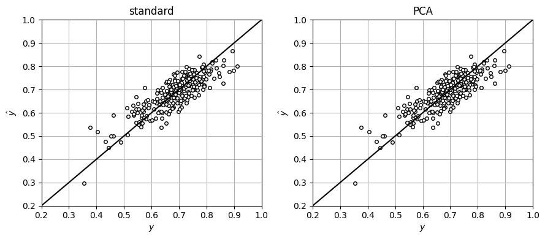

# Principal Component Estimation

* Previously explored strategies to estimate params for models $$\mathbf{y}=\mathbf{X}\theta$$.
* Discussed how data redundancy leads to rows or columns in $$\mathbf{X}$$ that are linear dependent and how this can lead to high param variance (low precision).
* We can use PCA to identify and eliminate data redundancies.
* Kernel $$\mathbf{X}^T\mathbf{X}$$ is related to covariance of estimates $$\hat{\theta}$$ as:

  $$
  \begin{aligned}
  \textrm{Cov}(\hat{\theta})
  &=\sigma^2(\mathbf{X}^T\mathbf{X})^{-1}\\
  &=\sigma^2(\mathbf{W}\boldsymbol{\Lambda}\mathbf{W}^T)^{-1}\\
  &=\sigma^2\mathbf{W}\boldsymbol{\Lambda}^{-1}\mathbf{W}^T\\
  &=\sigma^2(\lambda_1^{-1}w_1w_1^T+\lambda_2^{-1}w_2w_2^T+\cdots + \lambda_n^{-1} w_nw_n^T).
  \end{aligned}
  $$

* Small eigs of $$\mathbf{X}^T\mathbf{X}$$ lead to large variances of estimates.  This is often a sign of strong correlations or collinearities (linear dependencies).

* It makes sense to build $$\mathbf{y}= \mathbf{X}\theta$$ by *pre-processing* (cleaning) data $$\mathbf{X}$$.
* Specifically, remove effect of small eigs associated with non-informative data.
* This is done by partitioning eigenvector matrix:

  $$
  \begin{aligned}
  \mathbf{W}&=[\mathbf{W}_1|\mathbf{W}_2]\\
  &=[\underbrace{w_1,w_2,...,w_{n_1}}_{\textrm{low information}}|\underbrace{w_{n_1+1},w_{n_1+2},...,w_n}_{\textrm{high information}}].
  \end{aligned}
  $$

* This induces a partitioning of eigs matrix:

  $$
  \begin{aligned}
  \boldsymbol{\Lambda}=\left[\begin{array}{c|c}\boldsymbol{\Lambda}_1\\ \hline & \boldsymbol{\Lambda}_2\end{array}\right],
  \end{aligned}
  $$

* We project (reduce) input data into information space as $$\mathbf{T}_1=\mathbf{X}\mathbf{W}_1$$.
* Build a reduced model of form $$\mathbf{y}=\mathbf{T}_1\gamma$$ where $$\gamma \in \mathbb{R}^{n_1}$$ are the parameters.
* Projection reduces number of params (from $$n$$ in $$\theta$$ to $$n_1$$ in $$\gamma$$) .

* Estimate params $$\gamma$$ by solving:

  $$
  \hat{\gamma}\in \mathop{\textrm{argmin}}_\gamma\; \frac{1}{2}\|\mathbf{y}-\mathbf{T}_1\gamma\|_2^2.
  $$

* Covariance of estimate is:

  $$
  \begin{aligned}
  \textrm{Cov}(\hat{\gamma})&=\sigma^2(\mathbf{T}_1^T\mathbf{T}_1)^{-1}.
  \end{aligned}
  $$

* Estimated params $$\hat{\gamma}$$ live in info space that differs from physical space of $$\theta$$.
* Estimate of params in original physical space is $$\hat{\theta}=\mathbf{W}_1\hat{\gamma}$$.
* One can show that:

  $$
  \begin{aligned}
  \textrm{Cov}(\hat{\theta})
  &=\sigma^2\mathbf{W}_1\boldsymbol{\Lambda}_1^{-1}\mathbf{W}_1^T\\
  &=\sigma^2(\lambda_1^{-1}w_1w_1^T+\lambda_2^{-1}w_2w_2^T+\cdots + \lambda_{n_1}^{-1} w_{n_1}w_{n_1}^T)
  \end{aligned}
  $$

* As desired, data pre-processing removes effect of small eigs.

## Example: PCA Estimation for Gibbs Reactor

* Develop a model that predicts conversion as a function of different vars:

  $$
  Y=\theta_0+\theta_1X_1+\theta_2X_2+\theta_3X_3+\theta_4X_4+\theta_5X_5+\epsilon
  $$

* $$X_1$$ is press, $$X_2$$  is $$CO$$ flow, $$X_3$$ is $$H_2$$ flow, $$X_4$$ is $$CH_3OH$$ flow, and $$X_5$$ is temp.
* Have total of $$n+1=6$$ params and $$S=250$$ obs.
* Some of the data is redundant (variables are strongly correlated).
* However, it is difficult to know which set of variables can predict conversion or if there is a minimum set of variables that we should consider.

* Standard MLE gives estimates $$\hat{\theta}$$ with good SSE of $$2.44\times 10^{-3}$$.
* However, we find that covariance matrix of these parameters is singular.
* This is because the eigs of kernel matrix $$\mathbf{X}^T\mathbf{X}$$ are:

  $$
  \lambda=(1.45\times 10^{8},2.36\times 10^{5},1.97\times 10^{3}, -2.99\times 10^{-8},1.47\times 10^{-10},-1.72\times 10^{-11}).
  $$

* Three parameters cannot be estimated reliably.

* To eliminate effect, we obtain eigenvecs $$\mathbf{W}$$ and eliminate columns corresponding to three smallest eigs, to give $$\mathbf{W}_1$$.
* We reduce data  $$\mathbf{T}_1=\mathbf{X}\mathbf{W}_1$$ and estimate $$\hat{\gamma}$$ and $$\hat{\theta}=\mathbf{W}_1\hat{\gamma}$$.
* SSE value remains the same $$2.44\times 10^{-3}$$ but variances are:

  $$
  \mathbb{V}(\hat{\theta})=(7.34\times 10^{-13}, 3.19\times 10^{-7}, 1.77\times 10^{-7}, 2.49\times 10^{-7},2.56\times 10^{-7},2.49\times 10^{-7}).
  $$

* Parameters can be estimated reliably with data reduction.

<figure><figcaption><p>Fit of linear model under standard estimation (left) and PCA estimation (right).</p></figcaption></figure>

#### Python implementation


Notebook [`ch6_gibbs_pca_estimation.ipynb`](https://colab.research.google.com/github/vzavala/StatsBook-GitBook/blob/main/notebooks/ch6_gibbs_pca_estimation.ipynb) — open it in Colab and run the cells alongside this section.


Principal component estimation for the Gibbs reactor (Shiyi (Amy) Qin and Victor Z, UW-Madison, 2024).

| Slides | Python | Meaning |
|---|---|---|
| $$\mathbf{X}=[1, X_1,\dots,X_5]$$ | `X` | intercept, $$P$$, $$CO$$, $$H_2$$, $$CH_3OH$$ flows, $$T$$ ($$S=250$$) |
| $$\mathbf{y}$$ | `y` | conversion |
| $$\hat{\theta}$$, $$\mathrm{Cov}(\hat{\theta})$$ | `theta_hat`, `Cov_theta` | standard estimate |
| $$\mathbf{W}_1$$, $$\boldsymbol{\Lambda}_1$$, $$n_1$$ | `W1`, `Lam1`, `n1` | retained eigenvectors/eigenvalues |
| $$\mathbf{T}_1=\mathbf{X}\mathbf{W}_1$$ | `T1` | reduced inputs |
| $$\hat{\gamma}$$, $$\hat{\theta}=\mathbf{W}_1\hat{\gamma}$$ | `gamma_hat`, `theta_hat_pca` | PCA estimate |

```python
import numpy as np
import matplotlib.pyplot as plt

data = np.hstack((np.loadtxt(path+'Data/gibbs_covariance.dat'),
                  np.loadtxt(path+'Data/gibbs_lowtemp_class.dat')[:, [0]]))
S = len(data)
np.random.seed(2024)
data[:, 1] += np.random.normal(0, 0.05, S)
y = data[:, 1]
X = np.hstack((np.ones((S, 1)), data[:, [0, 2, 3, 4, 5]]))
print(np.round(X[:6], 2))
```

```
[[  1.   166.98  25.56 451.12  74.44 583.15]
 [  1.   170.71  24.75 449.51  75.25 583.15]
 [  1.   141.17  32.22 464.44  67.78 583.15]
 [  1.   146.63  30.64 461.28  69.36 583.15]
 [  1.   164.67  26.08 452.16  73.92 583.15]
 [  1.   157.43  27.79 455.59  72.21 583.15]]
```

Standard MLE: $$\hat{\theta}=(\mathbf{X}^T\mathbf{X})^{-1}\mathbf{X}^T\mathbf{y}$$. The kernel has three
(numerically) zero eigenvalues, so $$\mathrm{Cov}(\hat{\theta})=\sigma^2(\mathbf{X}^T\mathbf{X})^{-1}$$ is singular.

```python
theta_hat = np.linalg.lstsq(X, y, rcond=None)[0]
SSE = np.mean((X @ theta_hat - y)**2)
lam, W = np.linalg.eigh(X.T @ X)
order = np.argsort(lam)[::-1]
lam, W = lam[order], W[:, order]
print(f"SSE (mean squared error) = {SSE:.3e}")
print("eigenvalues of X^T X:", np.array2string(lam, precision=2))
```

```
SSE (mean squared error) = 2.549e-03
eigenvalues of X^T X: [ 1.45e+08  2.36e+05  1.97e+03  2.44e-11 -3.02e-09 -1.54e-08]
```

Keep the $$n_1=3$$ informative eigenvectors, project $$\mathbf{T}_1=\mathbf{X}\mathbf{W}_1$$, estimate
$$\hat{\gamma}=\arg\min\frac{1}{2}\lVert\mathbf{y}-\mathbf{T}_1\gamma\rVert^2$$, and map back $$\hat{\theta}=\mathbf{W}_1\hat{\gamma}$$ with
$$\mathrm{Cov}(\hat{\theta})=\sigma^2\mathbf{W}_1\boldsymbol{\Lambda}_1^{-1}\mathbf{W}_1^T$$.

```python
n1 = 3
W1, Lam1 = W[:, :n1], np.diag(lam[:n1])
T1 = X @ W1
gamma_hat = np.linalg.solve(T1.T @ T1, T1.T @ y)
theta_hat_pca = W1 @ gamma_hat
e = X @ theta_hat_pca - y
sigma2 = np.var(e)
Cov_theta_pca = sigma2 * W1 @ np.linalg.inv(Lam1) @ W1.T
print(f"SSE (PCA) = {np.mean(e**2):.3e}")
print("V(theta_hat) with PCA:", np.array2string(np.diag(Cov_theta_pca), precision=2))

fig, axs = plt.subplots(1, 2, figsize=(9, 4))
for ax, th, title in ((axs[0], theta_hat, 'standard'), (axs[1], theta_hat_pca, 'PCA')):
    ax.plot(y, X @ th, 'ko', markerfacecolor='w', markersize=4)
    ax.plot([0, 1], [0, 1], 'k')
    ax.set_title(title)
    ax.set_xlabel('$y$'); ax.set_ylabel(r'$\hat{y}$')
    ax.axis([0.2, 1, 0.2, 1])
    ax.grid(True)
plt.tight_layout()
plt.show()
```

```
SSE (PCA) = 2.549e-03
V(theta_hat) with PCA: [7.63e-13 3.32e-07 1.84e-07 2.59e-07 2.67e-07 2.60e-07]
```

<figure></figure>
