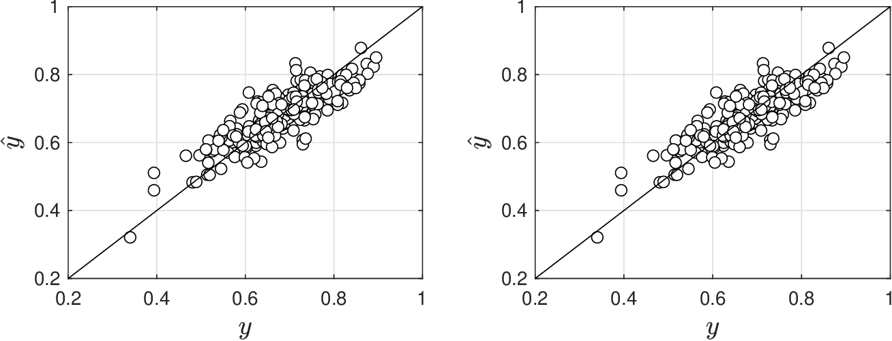
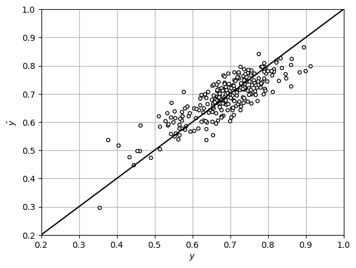

# Sparse PCA

* Eigenvector $$w$$ contains proportions of mixture $$T=\sum_{j=1}^nw_jX_j$$.
* Magnitudes  $$|w_j|$$ reveal key (dominant) input variables (ingredients) in our mixture.
* Number of variables can be quite large (e.g., hundreds) and we want to find a handful of key variables.

* Sparse PCA sparsifies eigenvec $$w_j$$ by solving regularized problem:

  $$
  \tilde{w}_j\in \mathop{\textrm{\textrm{argmin}}}_w\; \frac{1}{2}\|\mathbf{X}w_j-\mathbf{X}w\|_2^2 +\kappa\|w\|_1
  $$

* Finds vector $$w$$ that minimizes distance to data projection obtained with $$w_j$$ and minimizes $$\|w\|_1=\sum_{i=1}^n|w_i|$$.
* $$\kappa\in\mathbb{R}_+$$ is param that trades-off sparsity of eigenvec $$\tilde{w}_j$$  and proximity to $$w_j$$.
* Sparsification is applied to eigenvecs $$w_j,\; j=1,...,n$$ to obtain a sparse $$\tilde{\mathbf{W}}$$.
* If $$\kappa$$ is large, sparse eigenvec $$\tilde{w}_j$$ will contain a single variable.

## Example: Sparse PCA for Gibbs Reactor

* Applying PCA to  $$\mathbf{X}^T\mathbf{X}$$ we obtain:

  $$
  \begin{aligned}
  \mathbf{W}=\left[\begin{array}{rrrrrr}
  -0.00   &      -0.00       &  -0.00     &    -0.00     &     0.00      &   -0.00\\
  -0.19    &     -0.84   &       0.50   &      -0.20     &     0.01    &     -0.01\\
  -0.04   &       0.23   &       0.38    &     -0.03    &     -0.43    &     -0.79\\
  -0.61    &      0.40    &      0.45     &    -0.59     &     0.53     &     0.06\\
  -0.09    &     -0.25   &      -0.45    &     -0.04   &       0.59    &     -0.62\\
  -0.76    &     -0.09   &      -0.45    &     -0.78     &    -0.42   &       0.02
  \end{array}\right].
  \end{aligned}
  $$

* Last 3 eigenvecs responsible for small eigs but do not indicate variable driving behavior.
* To identify problematic variables, we apply sparse PCA and obtain:

  $$
  \begin{aligned}
  \tilde{\mathbf{W}}=\left[\begin{array}{rrrrrr}
  0   &          0      &       0        &     0      &       0      &       0 \\
  0  &        1.00   &          0    &         0   &          0    &         0\\
  0  &           0    &         0      &       0     &     1.00    &         0\\
  0   &          0    &      1.00    &         0   &          0    &         0\\
  0   &          0     &        0      &       0     &        0      &    1.00\\
  1.00   &          0    &         0    &      1.00   &          0   &          0
  \end{array}\right].
  \end{aligned}
  $$

* Suggests to eliminate $$X_5$$ (temperature), $$X_2$$ ($$CO$$ flow), and $$X_4$$ ($$CH_3OH$$ flow).

* Elimination of $$X_5,X_2,X_4$$ does not affect model fit and provides precise estimates.

  <figure><figcaption><p>Fit of linear model under PCA estimation (left) and fit using subset of variables identified with sparse PCA (right).</p></figcaption></figure>

#### Python implementation


Notebook [`ch6_gibbs_pca_estimation_sparse.ipynb`](https://colab.research.google.com/github/vzavala/StatsBook-GitBook/blob/main/notebooks/ch6_gibbs_pca_estimation_sparse.ipynb) — open it in Colab and run the cells alongside this section.


Sparse eigenvectors to find redundant variables in the Gibbs reactor data
(Shiyi (Amy) Qin and Victor Z, UW-Madison, 2019).

| Slides | Python | Meaning |
|---|---|---|
| $$\mathbf{W}$$ | `W` | eigenvectors of $$\mathbf{X}^T\mathbf{X}$$ (rows: 1, $$X_1,\dots,X_5$$) |
| $$\tilde{\mathbf{W}}$$, $$\kappa$$ | `W_sparse`, `kappa` | sparsified eigenvectors and sparsity weight |

Here each eigenvector is sparsified by solving
$$\tilde{w}_j=\arg\min_w \frac{1}{2}\lVert w_j-w\rVert_2^2+\kappa\lVert w\rVert_1$$ (soft thresholding),
with $$\kappa$$ large enough to keep one entry. (For eigenvectors with zero eigenvalue
$$\mathbf{X}w_j=0$$, so the data-space version on the slide returns $$\tilde{w}_j=0$$.)

```python
import numpy as np
import matplotlib.pyplot as plt

names = ['1', 'X1 (P)', 'X2 (CO)', 'X3 (H2)', 'X4 (CH3OH)', 'X5 (T)']
data = np.hstack((np.loadtxt(path+'Data/gibbs_covariance.dat'),
                  np.loadtxt(path+'Data/gibbs_lowtemp_class.dat')[:, [0]]))
S = len(data)
np.random.seed(2024)
data[:, 1] += np.random.normal(0, 0.05, S)
y = data[:, 1]
X = np.hstack((np.ones((S, 1)), data[:, [0, 2, 3, 4, 5]]))

lam, W = np.linalg.eigh(X.T @ X)
order = np.argsort(lam)[::-1]
lam, W = lam[order], W[:, order]
np.set_printoptions(precision=2, suppress=True)
print("W =\n", W)

def soft_threshold(w, kappa):
    return np.sign(w) * np.maximum(np.abs(w) - kappa, 0)

W_sparse = np.zeros_like(W)
for j in range(W.shape[1]):
    kappa = np.sort(np.abs(W[:, j]))[-2]          # keeps only the largest entry
    w = soft_threshold(W[:, j], kappa)
    W_sparse[:, j] = w / np.linalg.norm(w)
print("W_sparse =\n", np.abs(W_sparse))
for j in range(3, 6):
    print(f"eigenvector {j+1} (lambda = {lam[j]:.1e}) is driven by {names[np.argmax(np.abs(W_sparse[:, j]))]}")
```

```
W =
 [[-0.    0.    0.   -0.   -0.   -1.  ]
 [-0.19  0.84 -0.5  -0.    0.    0.  ]
 [-0.04 -0.23 -0.38  0.81 -0.39 -0.  ]
 [-0.61 -0.4  -0.45 -0.11  0.51  0.  ]
 [-0.09  0.25  0.45  0.58  0.62  0.  ]
 [-0.76  0.09  0.45 -0.02 -0.45  0.  ]]
W_sparse =
 [[0. 0. 0. 0. 0. 1.]
 [0. 1. 1. 0. 0. 0.]
 [0. 0. 0. 1. 0. 0.]
 [0. 0. 0. 0. 0. 0.]
 [0. 0. 0. 0. 1. 0.]
 [1. 0. 0. 0. 0. 0.]]
eigenvector 4 (lambda = 2.4e-11) is driven by X2 (CO)
eigenvector 5 (lambda = -3.0e-09) is driven by X4 (CH3OH)
eigenvector 6 (lambda = -1.5e-08) is driven by 1
```

The three non-informative eigenvectors point to CO, CH$$_3$$OH and to the constant column
(the intercept and $$X_5=T$$ are identical up to scale because $$T$$ is constant). Dropping
$$X_2$$, $$X_4$$, $$X_5$$ keeps the fit and gives precise estimates.

```python
keep = [0, 1, 3]                                  # intercept, P, H2
X_red = X[:, keep]
theta_red = np.linalg.solve(X_red.T @ X_red, X_red.T @ y)
e = X_red @ theta_red - y
Cov_red = np.var(e) * np.linalg.inv(X_red.T @ X_red)
print("kept:", [names[k] for k in keep])
print("theta_hat =", np.array2string(theta_red, formatter={'float': '{:.3e}'.format}))
print("V(theta_hat) =", np.array2string(np.diag(Cov_red), formatter={'float': '{:.3e}'.format}))
print(f"SSE = {np.mean(e**2):.3e}")

plt.plot(y, X_red @ theta_red, 'ko', markerfacecolor='w', markersize=4)
plt.plot([0, 1], [0, 1], 'k')
plt.xlabel('$y$'); plt.ylabel(r'$\hat{y}$')
plt.axis([0.2, 1, 0.2, 1]); plt.grid(True)
plt.show()
```

```
kept: ['1', 'X1 (P)', 'X3 (H2)']
theta_hat = [2.922e+00 2.127e-04 -4.900e-03]
V(theta_hat) = [2.893e-01 3.321e-07 9.643e-07]
SSE = 2.549e-03
```

<figure></figure>
