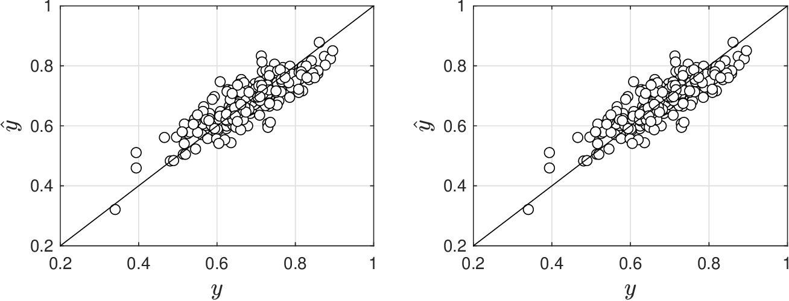

# Sparse PCA

* Eigenvector $$w$$ contains proportions of mixture $$T=\sum_{j=1}^nw_jX_j$$.
* Magnitudes  $$|w_j|$$ reveal key (dominant) input variables (ingredients) in our mixture.
* Number of variables can be quite large (e.g., hundreds) and we want to find a handful of key variables.

* Sparse PCA sparsifies eigenvec $$w_j$$ by solving regularized problem:

  $$
  \tilde{w}_j\in \mathop{\textrm{\textrm{argmin}}}_w\; \frac{1}{2}\|\mathbf{X}w_j-\mathbf{X}w\|_2^2 +\kappa\|w\|_1
  $$

* Finds vector $$w$$ that minimizes distance to data projection obtained with $$w_j$$ and minimizes $$\|w\|_1=\sum_{i=1}^n|w_i|$$.
* $$\kappa\in\mathbb{R}_+$$ is param that trades off sparsity of eigenvec $$\tilde{w}_j$$  and proximity to $$w_j$$.
* Sparsification is applied to eigenvecs $$w_j,\; j=1,...,n$$ to obtain a sparse $$\tilde{\mathbf{W}}$$.
* If $$\kappa$$ is large, sparse eigenvec $$\tilde{w}_j$$ will contain a single variable.

## Example: Sparse PCA for Gibbs Reactor

* Applying PCA to  $$\mathbf{X}^T\mathbf{X}$$ we obtain:

  $$
  \begin{aligned}
  \mathbf{W}=\left[\begin{array}{rrrrrr}
  -0.00   &      -0.00       &  -0.00     &    -0.00     &     0.00      &   -0.00\\
  -0.19    &     -0.84   &       0.50   &      -0.20     &     0.01    &     -0.01\\
  -0.04   &       0.23   &       0.38    &     -0.03    &     -0.43    &     -0.79\\
  -0.61    &      0.40    &      0.45     &    -0.59     &     0.53     &     0.06\\
  -0.09    &     -0.25   &      -0.45    &     -0.04   &       0.59    &     -0.62\\
  -0.76    &     -0.09   &      -0.45    &     -0.78     &    -0.42   &       0.02
  \end{array}\right].
  \end{aligned}
  $$

* Last 3 eigenvecs responsible for small eigs but do not indicate variable driving behavior.
* To identify problematic variables, we apply sparse PCA and obtain:

  $$
  \begin{aligned}
  \tilde{\mathbf{W}}=\left[\begin{array}{rrrrrr}
  0   &          0      &       0        &     0      &       0      &       0 \\
  0  &        1.00   &          0    &         0   &          0    &         0\\
  0  &           0    &         0      &       0     &     1.00    &         0\\
  0   &          0    &      1.00    &         0   &          0    &         0\\
  0   &          0     &        0      &       0     &        0      &    1.00\\
  1.00   &          0    &         0    &      1.00   &          0   &          0
  \end{array}\right].
  \end{aligned}
  $$

* Suggests eliminating $$X_5$$ (temperature), $$X_2$$ ($$CO$$ flow), and $$X_4$$ ($$CH_3OH$$ flow).

* Elimination of $$X_5,X_2,X_4$$ does not affect model fit and provides precise estimates.

  <figure><figcaption><p>Fit of linear model under PCA estimation (left) and fit using subset of variables identified with sparse PCA (right).</p></figcaption></figure>

#### Python implementation


Notebook [`ch6_gibbs_pca_estimation_sparse.ipynb`](https://colab.research.google.com/github/vzavala/StatsBook/blob/master/Python/ch6_gibbs_pca_estimation_sparse.ipynb) — open it in Colab and run the cells alongside this section.


Sparse eigenvectors to find redundant variables in the Gibbs reactor data
(Shiyi (Amy) Qin and Victor Z, UW-Madison, 2019).

| Slides | Python | Meaning |
|---|---|---|
| $$\mathbf{W}$$ | `W` | eigenvectors of $$\mathbf{X}^T\mathbf{X}$$ (rows: 1, $$X_1,\dots,X_5$$) |
| $$\tilde{\mathbf{W}}$$ | `W_sparse` | sparse eigenvectors with one nonzero entry each |

The sparse eigenvectors are computed with the same method used in the book (the sparse PCA
method of Hein and Bühler, used in the MATLAB script with one nonzero entry per component):
each component selects the input column with the largest norm, and the data are then
deflated along that component before computing the next one.

Note that $$\mathbf{X}$$ has rank 3, so the last three eigenvalues of $$\mathbf{X}^T\mathbf{X}$$ are zero
(up to round-off). Any rotation of the corresponding eigenvectors is also a valid set of
eigenvectors, so the last three columns of `W` (and of `W_sparse`) can differ from those
reported in the book, and can change with the numerical library used.

```python
import numpy as np
import matplotlib.pyplot as plt

names = ['1', 'X1 (P)', 'X2 (CO)', 'X3 (H2)', 'X4 (CH3OH)', 'X5 (T)']
data = np.hstack((np.loadtxt(path+'Data/gibbs_covariance.dat'),
                  np.loadtxt(path+'Data/gibbs_lowtemp_class.dat')[:, [0]]))
S = len(data)
np.random.seed(2024)
data[:, 1] += np.random.normal(0, 0.05, S)
y = data[:, 1]
X = np.hstack((np.ones((S, 1)), data[:, [0, 2, 3, 4, 5]]))

lam, W = np.linalg.eigh(X.T @ X)
order = np.argsort(lam)[::-1]
lam, W = lam[order], W[:, order]
np.set_printoptions(precision=2, suppress=True)
print("rank of X =", np.linalg.matrix_rank(X))
print("W =\n", W)

def sparse_pca_card1(X, num_comp):
    # sparse PCA with one nonzero entry per component and deflation of the data
    X_cur = X.copy()
    F = np.zeros((X.shape[1], num_comp))
    for l in range(num_comp):
        i = np.argmax(np.linalg.norm(X_cur, axis=0))   # best one-entry component
        F[i, l] = 1.0
        z = X_cur[:, i] / np.linalg.norm(X_cur[:, i])
        X_cur = X_cur - np.outer(z, z @ X_cur)        # deflate along the component
    return F

with np.errstate(all='ignore'):
    W_sparse = sparse_pca_card1(X, 6)
print("W_sparse =\n", W_sparse)
for j in range(3):
    print(f"component {j+1} selects {names[np.argmax(W_sparse[:, j])]}")
```

```
rank of X = 3
W =
 [[-0.    0.    0.   -0.   -0.   -1.  ]
 [-0.19  0.84 -0.5  -0.    0.    0.  ]
 [-0.04 -0.23 -0.38  0.81 -0.39 -0.  ]
 [-0.61 -0.4  -0.45 -0.11  0.51  0.  ]
 [-0.09  0.25  0.45  0.58  0.62  0.  ]
 [-0.76  0.09  0.45 -0.02 -0.45  0.  ]]
W_sparse =
 [[0. 0. 0. 0. 0. 0.]
 [0. 1. 0. 0. 1. 0.]
 [0. 0. 0. 0. 0. 0.]
 [0. 0. 1. 0. 0. 0.]
 [0. 0. 0. 0. 0. 1.]
 [1. 0. 0. 1. 0. 0.]]
component 1 selects X5 (T)
component 2 selects X1 (P)
component 3 selects X3 (H2)
```

The first three (informative) sparse components select $$X_5=T$$, $$X_1=P$$ and $$X_3=H_2$$, which
reproduces the first columns of $$\tilde{\mathbf{W}}$$ in the book. The input data matrix only contains three
independent columns: $$T$$ is constant in this dataset (so its column is a multiple of the intercept
column), and the flows of CO, H$$_2$$, and CH$$_3$$OH are linked by the mass balances. We thus keep the
intercept, $$X_1$$, and $$X_3$$ and drop $$X_2$$, $$X_4$$, $$X_5$$; this keeps the fit and gives precise estimates.

```python
keep = [0, 1, 3]                                  # intercept, P, H2
X_red = X[:, keep]
theta_red = np.linalg.solve(X_red.T @ X_red, X_red.T @ y)
e = X_red @ theta_red - y
Cov_red = np.var(e) * np.linalg.inv(X_red.T @ X_red)
print("kept:", [names[k] for k in keep])
print("theta_hat =", np.array2string(theta_red, formatter={'float': '{:.3e}'.format}))
print("V(theta_hat) =", np.array2string(np.diag(Cov_red), formatter={'float': '{:.3e}'.format}))
print(f"SSE = {np.mean(e**2):.3e}")

plt.plot(y, X_red @ theta_red, 'ko', markerfacecolor='w', markersize=4)
plt.plot([0, 1], [0, 1], 'k')
plt.xlabel('$y$'); plt.ylabel(r'$\hat{y}$')
plt.axis([0.2, 1, 0.2, 1]); plt.grid(True)
plt.show()
```

```
kept: ['1', 'X1 (P)', 'X3 (H2)']
theta_hat = [2.922e+00 2.127e-04 -4.900e-03]
V(theta_hat) = [2.893e-01 3.321e-07 9.643e-07]
SSE = 2.549e-03
```
