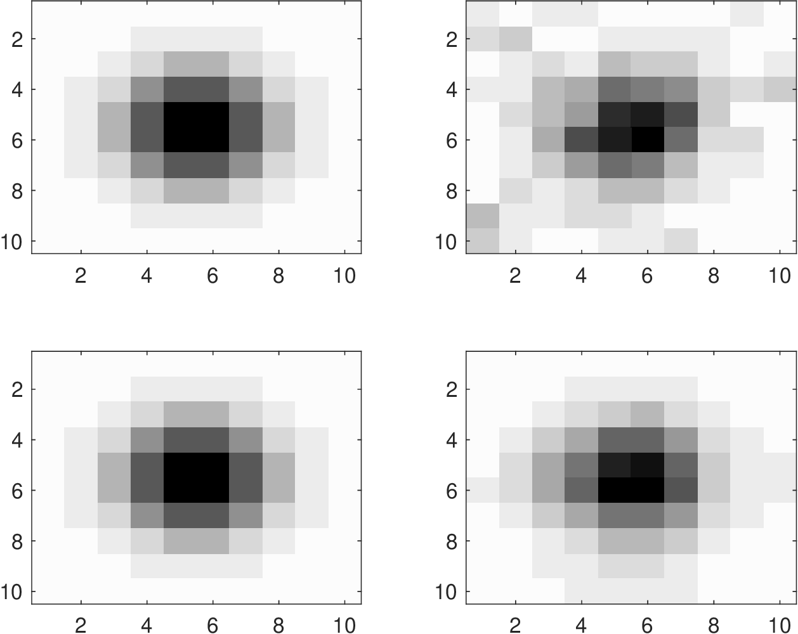
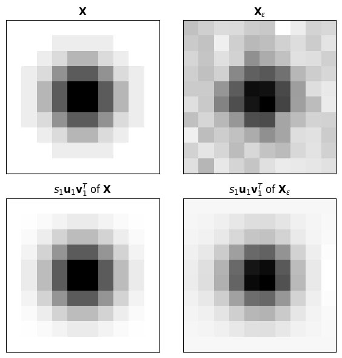
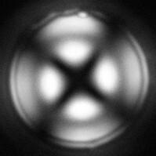
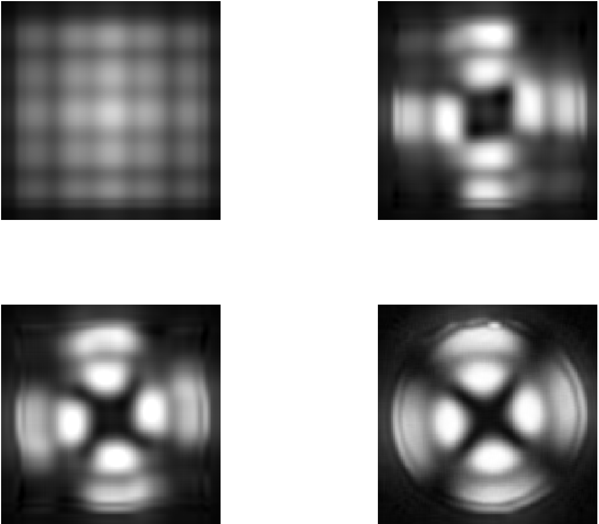
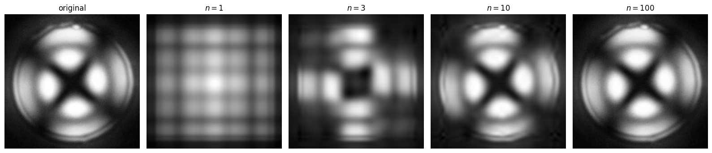

# Singular Value Decomposition

## Singular Value Decomposition (SVD)

* PCA relies on eigendecomp $$\boldsymbol{\Sigma}=\mathbf{W}\boldsymbol{\Lambda} \mathbf{W}^T$$.
* SVD is a generalization of eigendecomp.
* Eigendecomp can only be applied to square matrices (e.g., $$\boldsymbol{\Sigma}$$) while SVD can be applied to rectangular matrices (e.g.,$$\mathbf{X}$$).
* SVD is broadly applicable for reduction of different forms of data (e.g., images).

* To explain how SVD works, it is convenient to think about this in context of PCA.
* Consider data matrix $$\mathbf{X}\in\mathbb{R}^{S\times n}$$ (assume $$n\leq S$$) and its decomposition:

  $$
  \mathbf{X}=\mathbf{U}\mathbf{S}\mathbf{V}^T
  $$

* $$\mathbf{U}\in \mathbb{R}^{S\times n}$$ is left eigenvec matrix, $$\mathbf{V}\in \mathbb{R}^{n\times n}$$ is right eigenvec matrix.
* $$\mathbf{S}\in \mathbb{R}^{S\times n}$$ is singular value (SV) matrix.
* Matrix $$\mathbf{S}$$ contains SVs $$s_j\in  \mathbb{R},\; j=1,...,n$$ in diagonal.
* Singular values are ordered in magnitude $$s_1\geq s_2\geq \cdots \geq s_n$$.

* Number of non-zero singular values reveals *rank* of $$\mathbf{X}$$.
* Rank is max number of linearly independent rows (same as number of linearly independent columns).
* Since we have assumed that $$n\leq S$$ (most common case in applications), $$\mathbf{X}$$ is regular if rank is $$n$$.
* If matrix is non-regular it means that there are redundant rows or columns.
* In PCA, a non-regular $$\mathbf{X}$$ means that there are redundant observations or variables.
* SVs can thus help us detect and eliminate data redundancies.

* Matrices $$\mathbf{U},\mathbf{V}$$ are orthogonal and thus satisfy $$\mathbf{U}^T\mathbf{U}=\mathbf{I}$$ and $$\mathbf{V}^T\mathbf{V}=\mathbf{I}$$.
* Consequently, we can observe that:

  $$
  \begin{aligned}
  \mathbf{X}^T\mathbf{X}&=(\mathbf{U}\mathbf{S}\mathbf{V}^T)^T(\mathbf{U}\mathbf{S}\mathbf{V}^T)\\
  &=\mathbf{V}\mathbf{S}^T\mathbf{S}\mathbf{V}^T.
  \end{aligned}
  $$

* By defining $$\mathbf{W}=\mathbf{V}$$ and $$\boldsymbol{\Lambda}=\mathbf{S}^T\mathbf{S}$$, we obtain standard PCA.
* Eigs of $$\mathbf{X}^T\mathbf{X}$$ and singular values of $$\mathbf{X}$$ are related as $$\lambda_i=s_i^2,\; i=1,...,n$$.

* SVD of $$\mathbf{X}$$ can be written as an expansion:

  $$
  \mathbf{X}=\sum_{j=1}^ns_ju_jv_j^T
  $$

* $$s_j=\mathbf{S}_{j,j}$$ and $$u_j$$ and $$v_j$$ are $$j$$-th columns of $$\mathbf{U}$$ and $$\mathbf{V}$$, respectively.
* One can truncate expansion to obtain a compressed representation of the matrix $$\mathbf{X}$$.

## Example: SVD for Gibbs Reactor

* Perform SVD on $$\mathbf{X}$$ (this has $$S=250$$ rows and $$n=6$$ columns) to obtain:

  $$
  \textrm{diag}(\mathbf{S})=(12059.49 ,486.03,         44.43,          0.00,         0.00,          0.00).
  $$

* Matrix has a rank of 3 (there are 3 non-zero singular values), matrix is irregular.
* By inspecting data matrix (few rows):

  $$
  \begin{aligned}
  \mathbf{X}=\left[
  \begin{array}{rrrrrr}
  1.00    &    166.98    &     25.56     &   451.12     &    74.44   &     583.15\\
  1.00    &    170.71   &      24.75  &      449.51   &      75.25    &    583.15\\
  1.00    &    141.17    &     32.22    &    464.44     &    67.78    &    583.15\\
  1.00    &    146.63   &      30.64   &     461.28   &      69.36  &      583.15\\
  1.00      &  164.67       &  26.08    &    452.16    &     73.92     &   583.15\\
  1.00    &    157.43     &    27.79   &     455.59  &       72.21     &   583.15
  \end{array}
  \right].
  \end{aligned}
  $$

* 1st and 6th columns are linearly dependent but rest of dependencies are less obvious.

* 1st and 6th columns are linearly dependent but rest of dependencies are less obvious.
* Redundancies are identified as:

  $$
  \begin{aligned}
  \textrm{rank}(\mathbf{X}\lbrack :,1\rbrack )&=1\\
  \textrm{rank}(\mathbf{X}\lbrack :,1,2\rbrack )&=2\\
  \textrm{rank}(\mathbf{X}\lbrack :,1,2,3\rbrack )&=3\\
  \textrm{rank}(\mathbf{X}\lbrack :,1,2,3,4\rbrack )&=3\\
  \textrm{rank}(\mathbf{X}\lbrack :,1,2,3,4,5\rbrack )&=3\\
  \textrm{rank}(\mathbf{X}\lbrack :,1,2,3,4,5,6\rbrack )&=3
  \end{aligned}
  $$

* 4th, 5th, and 6th columns are dependent on the 1st, 2nd, and 3rd columns.
* These dependencies arise due to mass balances (conservation); sum of some flows results in another flow.

#### Python implementation


Notebook [`ch6_gibbs_pca_estimation_svd.ipynb`](https://colab.research.google.com/github/vzavala/StatsBook-GitBook/blob/main/notebooks/ch6_gibbs_pca_estimation_svd.ipynb) — open it in Colab and run the cells alongside this section.


Finding data redundancies with the SVD (Shiyi (Amy) Qin and Victor Z, UW-Madison, 2024).

| Slides | Python | Meaning |
|---|---|---|
| $$\mathbf{X}=\mathbf{U}\mathbf{S}\mathbf{V}^T$$ | `U`, `s`, `Vt` | SVD (`s` holds the singular values $$s_j$$; `S` is the sample size) |
| $$\lambda_i=s_i^2$$ | `lam` | eigenvalues of $$\mathbf{X}^T\mathbf{X}$$ |
| $$\mathrm{rank}(\mathbf{X}\lbrack :,1..k\rbrack )$$ | `np.linalg.matrix_rank` | rank as columns are added |

```python
import numpy as np

data = np.hstack((np.loadtxt(path+'Data/gibbs_covariance.dat'),
                  np.loadtxt(path+'Data/gibbs_lowtemp_class.dat')[:, [0]]))
S = len(data)
X = np.hstack((np.ones((S, 1)), data[:, [0, 2, 3, 4, 5]]))
np.set_printoptions(precision=2, suppress=True)
print("first rows of X:\n", X[:6])

U, s, Vt = np.linalg.svd(X, full_matrices=False)
print("diag(S) =", s)
print("lambda = s^2 =", np.array2string(s**2, precision=3))
for k in range(1, X.shape[1] + 1):
    print(f"rank(X[:, 1..{k}]) = {np.linalg.matrix_rank(X[:, :k])}")
```

```
first rows of X:
 [[  1.   166.98  25.56 451.12  74.44 583.15]
 [  1.   170.71  24.75 449.51  75.25 583.15]
 [  1.   141.17  32.22 464.44  67.78 583.15]
 [  1.   146.63  30.64 461.28  69.36 583.15]
 [  1.   164.67  26.08 452.16  73.92 583.15]
 [  1.   157.43  27.79 455.59  72.21 583.15]]
diag(S) = [12059.49   486.03    44.43     0.       0.       0.  ]
lambda = s^2 = [1.454e+08 2.362e+05 1.974e+03 3.269e-24 4.921e-27 5.291e-32]
rank(X[:, 1..1]) = 1
rank(X[:, 1..2]) = 2
rank(X[:, 1..3]) = 3
rank(X[:, 1..4]) = 3
rank(X[:, 1..5]) = 3
rank(X[:, 1..6]) = 3
```

## Example: Images as Matrices

* Any matrix $$\mathbf{X}$$ can be represented as grayscale image; each entry corresponds to a pixel and number at such entry is intensity  (i.e., how dark pixel is).
* Similarly, any grayscale image can be represented as a matrix $$\mathbf{X}$$ and this is the basic property that enables image processing (e.g., compression and filtering).
* To illustrate this, consider matrix (notice symmetry and decaying magnitudes):

  $$
  \mathbf{X}\;=\;
  \left[\begin{array}{cccccccccc}
  0 & 0 & 0 & 0 & 0 & 0 & 0 & 0 & 0 & 0 \\
  0 & 0 & 0 & 1 & 1 & 1 & 1 & 0 & 0 & 0 \\
  0 & 0 & 1 & 2 & 4 & 4 & 2 & 1 & 0 & 0 \\
  0 & 1 & 2 & 6 & 9 & 9 & 6 & 2 & 1 & 0 \\
  0 & 1 & 4 & 9 & 14 & 14 & 9 & 4 & 1 & 0 \\
  0 & 1 & 4 & 9 & 14 & 14 & 9 & 4 & 1 & 0 \\
  0 & 1 & 2 & 6 & 9 & 9 & 6 & 2 & 1 & 0 \\
  0 & 0 & 1 & 2 & 4 & 4 & 2 & 1 & 0 & 0 \\
  0 & 0 & 0 & 1 & 1 & 1 & 1 & 0 & 0 & 0 \\
  0 & 0 & 0 & 0 & 0 & 0 & 0 & 0 & 0 & 0
  \end{array}\right]
  $$

* What is image corresponding to this matrix? What if this is corrupted with noise?

<figure><figcaption><p>Image corresponding to matrix $$\mathbf{X}$$ (top-left) and to perturbed matrix $$\mathbf{X}_\epsilon$$ (top-right). Image corresponding to compression of matrix $$\mathbf{X}$$ (bottom-left) and of perturbed matrix $$\mathbf{X}_\epsilon$$ (bottom-right) using first singular value.</p></figcaption></figure>

* Images contain $$10\times 10=$$100 pixels and capture spatial pattern of matrices.
* To human eye, it is easier to visualize patterns using images.
* However, matrix representation enables analysis, storage, and manipulation.
* Perform SVD of image $$\mathbf{X}=\mathbf{U}\mathbf{S}\mathbf{V}^T$$ and write as expansion:

  $$
  \mathbf{X}=\sum_{i=1}^{10}s_i\mathbf{u}_i\mathbf{v}_i^T
  $$

   where $$\mathbf{u}_i$$ and $$\mathbf{v}_i$$ are vectors of dimension 10.

* From SVD we find that image has 4 non-zero singular values:

  $$
  (41.8629, 1.5625, 0.8498, 0.5757).
  $$

* 1st SV dominates, image can be approximated as $$\mathbf{X}\approx s_1\mathbf{u}_1\mathbf{v}_1^T$$.
* We have reduced the amount of data that we need to store by 80%.
* SVD applied to noisy image can be used to eliminate noise.
* Compression possible because of strong redundancies in the image (note that it is symmetric in all directions).

#### Python implementation


Notebook [`ch6_svd_image_field.ipynb`](https://colab.research.google.com/github/vzavala/StatsBook-GitBook/blob/main/notebooks/ch6_svd_image_field.ipynb) — open it in Colab and run the cells alongside this section.


Images as matrices (Shiyi (Amy) Qin and Victor Z, UW-Madison, 2020). We use the $$10\times 10$$
matrix $$\mathbf{X}$$ shown on the slide, a noisy version $$\mathbf{X}_\epsilon$$ (`X_eps`), and the rank-1
approximation $$s_1\mathbf{u}_1\mathbf{v}_1^T$$ from the expansion $$\mathbf{X}=\sum_i s_i\mathbf{u}_i\mathbf{v}_i^T$$.

```python
import numpy as np
import matplotlib.pyplot as plt

X = np.array([[0, 0, 0, 0, 0, 0, 0, 0, 0, 0],
              [0, 0, 0, 1, 1, 1, 1, 0, 0, 0],
              [0, 0, 1, 2, 4, 4, 2, 1, 0, 0],
              [0, 1, 2, 6, 9, 9, 6, 2, 1, 0],
              [0, 1, 4, 9, 14, 14, 9, 4, 1, 0],
              [0, 1, 4, 9, 14, 14, 9, 4, 1, 0],
              [0, 1, 2, 6, 9, 9, 6, 2, 1, 0],
              [0, 0, 1, 2, 4, 4, 2, 1, 0, 0],
              [0, 0, 0, 1, 1, 1, 1, 0, 0, 0],
              [0, 0, 0, 0, 0, 0, 0, 0, 0, 0]], dtype=float)
np.random.seed(2024)
X_eps = X + np.random.normal(0, 1, X.shape)

def rank1(A):
    U, s, Vt = np.linalg.svd(A)
    return s, s[0] * np.outer(U[:, 0], Vt[0])

s, X1 = rank1(X)
s_eps, X1_eps = rank1(X_eps)
print("nonzero singular values of X:", np.round(s[s > 1e-10], 4))
print("rank(X) =", np.linalg.matrix_rank(X), "  rank(X_eps) =", np.linalg.matrix_rank(X_eps))

fig, axes = plt.subplots(2, 2, figsize=(6, 6))
for ax, A, title in ((axes[0, 0], X, r'$\mathbf{X}$'), (axes[0, 1], X_eps, r'$\mathbf{X}_\epsilon$'),
                     (axes[1, 0], X1, r'$s_1\mathbf{u}_1\mathbf{v}_1^T$ of $\mathbf{X}$'),
                     (axes[1, 1], X1_eps, r'$s_1\mathbf{u}_1\mathbf{v}_1^T$ of $\mathbf{X}_\epsilon$')):
    ax.imshow(A, cmap='gray_r')
    ax.set_title(title)
    ax.set_xticks([]); ax.set_yticks([])
plt.tight_layout()
plt.show()
```

```
nonzero singular values of X: [41.8629  1.5625  0.8498  0.5757]
rank(X) = 4   rank(X_eps) = 10
```

<figure></figure>

## Example: Image Compression using SVD

* Decompose complex image $$\mathbf{X}=\sum_{k=1}^ns_k\mathbf{u}_k\mathbf{v}_k^T$$.
* Large components tend to contain broad (global) features while small components contain granular (local) features such as noise.
* By truncating expansion to compress image, we ignore (filter out) granular behavior.
* Image is matrix $$\mathbf{X}$$ of dimension 605$$\times$$ 605 and has total of 366,025 pixels.

  <figure></figure>

* Upon applying SVD, we find that matrix is full rank (regular).
* Obtain approx images by truncating series with $$n=1,3,10,100$$.
* Coarse features develop quickly ($$n=3$$) while granular features develop slowly.
* Elements $$s_ju_jv_j^T$$ of SVD series encode different “features" of image.
* Observe that  a nearly perfect image is obtained with $$n=100$$.
* Truncating series filters out granular features (*imperceptible to human eye*).

<figure></figure>

<figure><figcaption><p>Original image (left) and compressions using $$n=1,3,10,100$$ singular values (right).</p></figcaption></figure>

#### Python implementation


Notebook [`ch6_svd_reconstruction.ipynb`](https://colab.research.google.com/github/vzavala/StatsBook-GitBook/blob/main/notebooks/ch6_svd_reconstruction.ipynb) — open it in Colab and run the cells alongside this section.


Image compression with the SVD (Shiyi (Amy) Qin and Victor Z, UW-Madison, 2020).
The grayscale image is a matrix $$\mathbf{X}$$ (`X`); we keep the first $$n$$ terms of
$$\mathbf{X}=\sum_k s_k\mathbf{u}_k\mathbf{v}_k^T$$ for $$n=1,3,10,100$$.

```python
import numpy as np
import matplotlib.pyplot as plt
from skimage import color, io

X = 255 * color.rgb2gray(io.imread(path+'Data/droplet1.jpg'))
print("image size:", X.shape, "  rank:", np.linalg.matrix_rank(X))
U, s, Vt = np.linalg.svd(X, full_matrices=False)

n_values = [1, 3, 10, 100]
errors = []
fig, axs = plt.subplots(1, 5, figsize=(16, 4))
axs[0].imshow(X, cmap='gray'); axs[0].set_title('original')
for ax, n in zip(axs[1:], n_values):
    X_n = (U[:, :n] * s[:n]) @ Vt[:n]            # sum of the first n terms
    errors.append(np.sum((X - X_n)**2))
    ax.imshow(X_n, cmap='gray'); ax.set_title(f'$n={n}$')
for ax in axs:
    ax.axis('off')
plt.tight_layout()
plt.show()

plt.semilogy(n_values, errors, 'ko-')
plt.xlabel('$n$'); plt.ylabel(r'$\lVert\mathbf{X}-\mathbf{X}_n\rVert_F^2$')
plt.grid(True)
plt.show()
```

```
image size: (199, 199)   rank: 199
```

<figure></figure>
