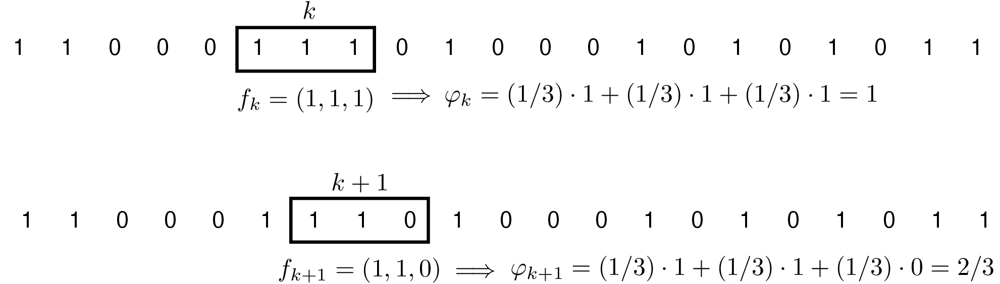
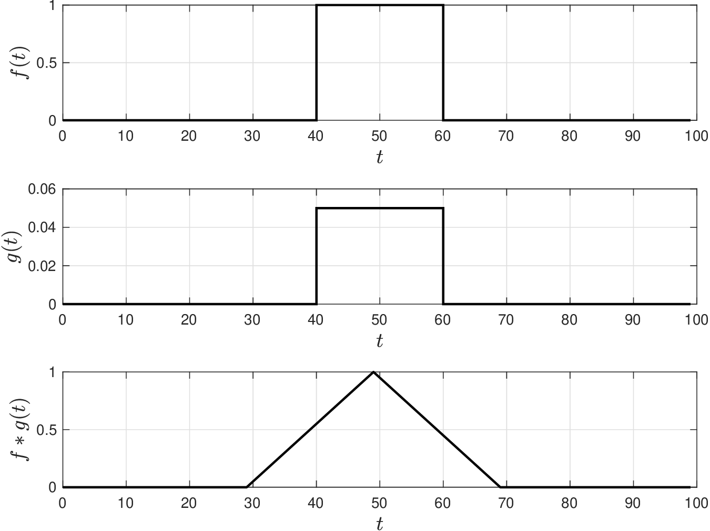
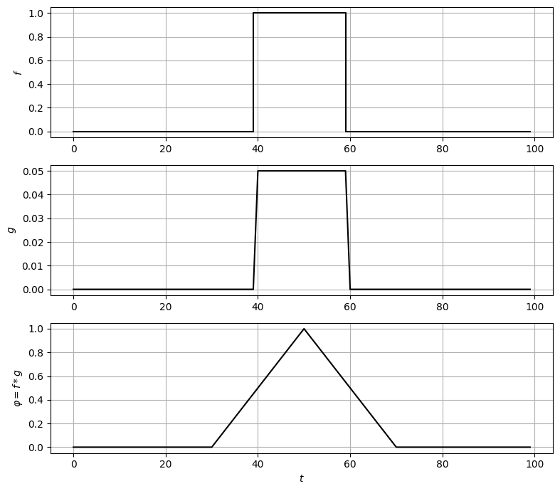
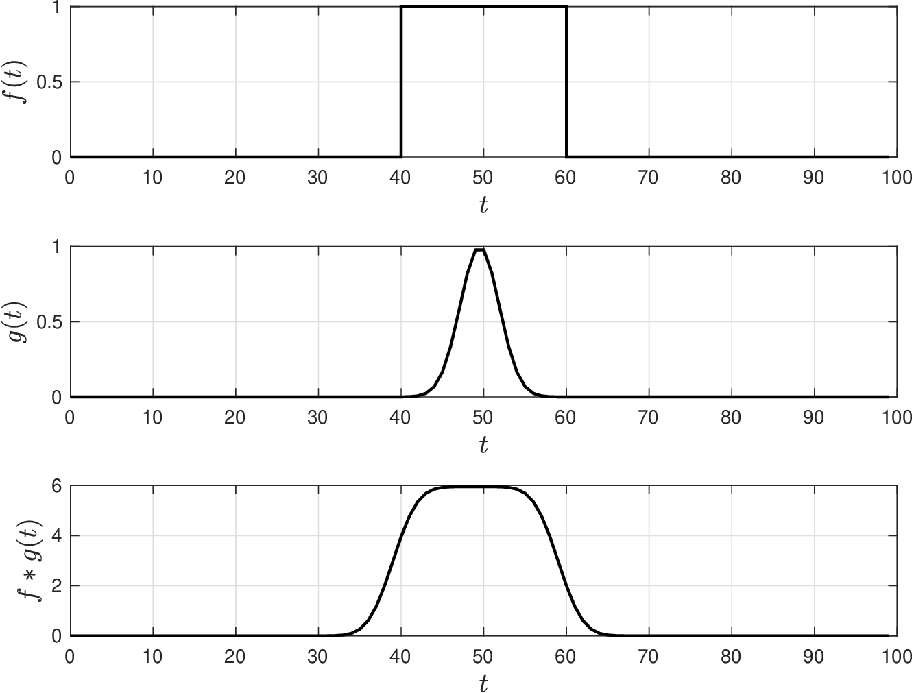
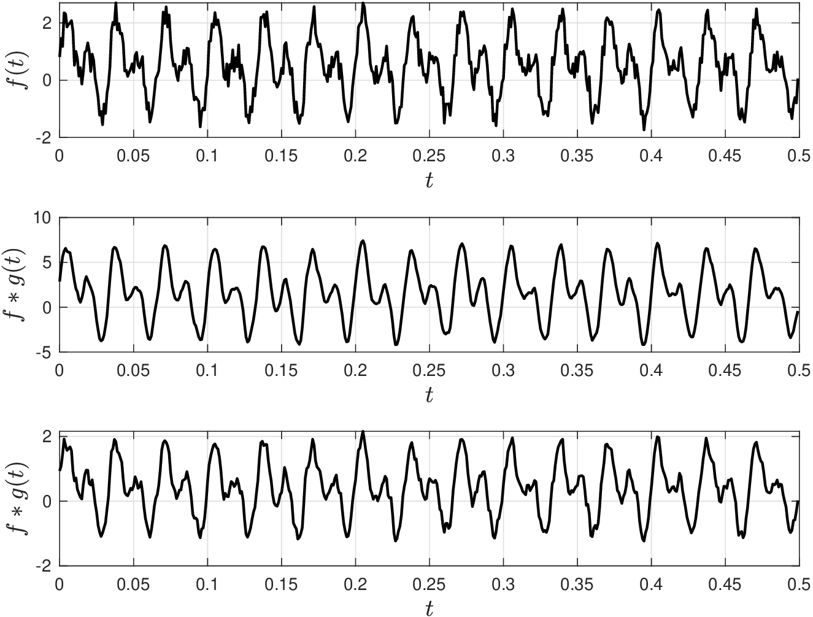
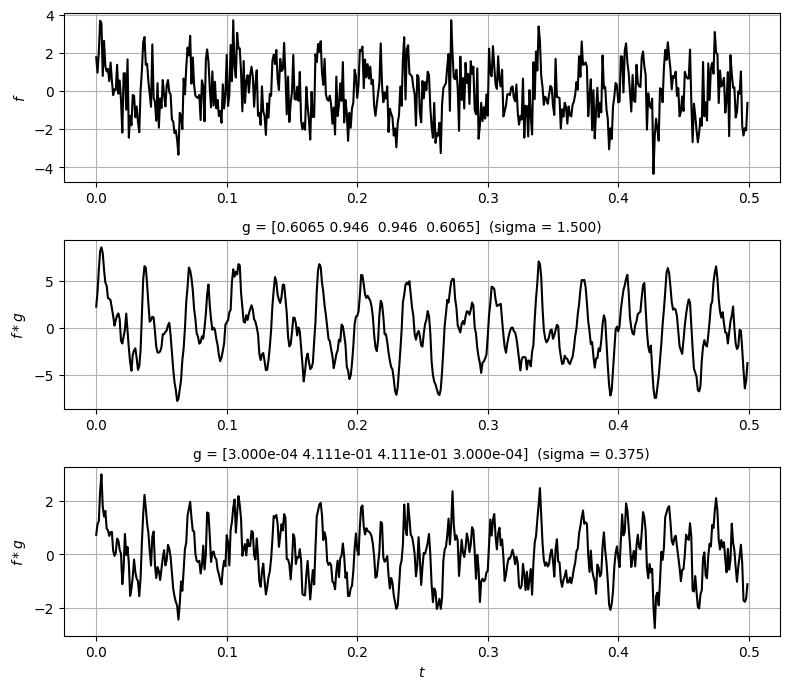
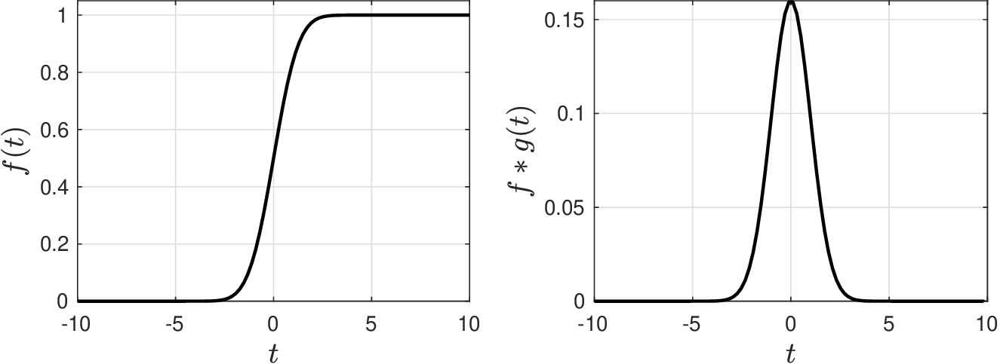
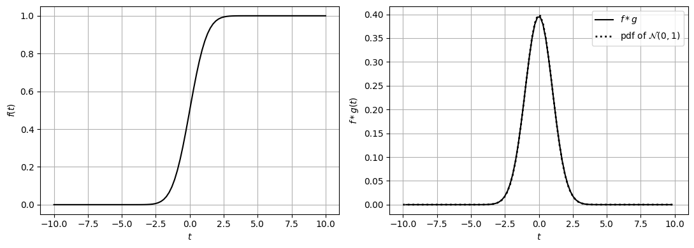

# 1D Convolution Operations

* Consider continuous signal represented by scalar (1D) function $$f:\mathbb{R}\to \mathbb{R}$$.
* Consider a weight (filter) denoted by scalar function $$g:\mathbb{R}\to \mathbb{R}$$.
* Convolution of signal and filter is a function $$\varphi:\mathbb{R}\to \mathbb{R}$$ given by:

  $$
  \varphi(t)=\int_{-\infty}^{\infty}f(\tau)g(t-\tau)d\tau,\;\; t\in (-\infty,\infty).
  $$

* Convolution function is expressed as $$\varphi=f*g$$.
* Domains of signal and filter is $$(-\infty,\infty)$$; this is symmetric and centered around zero.
* One can also define convolutions over asymmetric and finite domains $$t\in [0,N]$$.

* Consider *discrete* signal given by sequence $$f_j,\, j=-\infty,...,\infty$$.
* Consider filter represented by sequence  $$g_j,\; j=-\infty,...,\infty$$.
* Convolution of signal and filter is sequence $$\varphi_k,\; k=-\infty,....,\infty$$ given by:

  $$
  \varphi_k=\sum_{j=-\infty}^\infty f_jg_{k-j},\;\; k=-\infty,...,\infty.
  $$

* Convolution function is expressed as $$\varphi=f*g$$.
* Continuous representation used to establish analytical results.
* Discrete representation used to enable computations.

* Convolution is *matching* operation between signal and filter.
* Operation seeks to extract patterns (features) from signal and such patterns are defined by filter.
* Extraction can also be interpreted as a process that filters out features that are not present in the filter (hence origin of term “filter").
* Filters are strategically defined to extract specific features from a signal.
* Moving average filter is function of form:

  $$
  \begin{aligned}
  g(t)=\left\{\begin{array}{ll}
  0&-\infty\leq t< a\\
  w(t)& a\leq t\leq b\\
  0& b< t\leq \infty
  \end{array}\right.
  \end{aligned}
  $$

* Here, $$w(t)=1/(b-a),\, t\in [a,b]$$ is weight function that satisfies $$\int_{a}^bw(t)=1$$.
* Moving average filter is pdf of uniform RV.

* Consider discrete version of moving average filter:

  $$
  \begin{aligned}
  g_j=\left\{\begin{array}{ll}
  0&-\infty\leq j< a\\
  w_j& a\leq j\leq b\\
  0& b< j\leq \infty
  \end{array}\right.
  \end{aligned}
  $$

* Here, $$w_j=1/(b-a+1)\,j=a,...,b$$ are weights that satisfy $$\sum_{j=a}^b w_j=1$$.
* Define $$a=-1$$ and $$b=+1$$ so that $$b-a+1=3$$.
* Consider weighted average of $$f$$ over window $$k=-1,0,1$$:

  $$
  \begin{aligned}
  \varphi_k&=w_{-1}\cdot f_{k-1}+w_{0}\cdot f_{k}+ w_{+1}\cdot f_{k+1}\\
  &=\sum_{j=-1}^{+1}w_jf_{k+j}.
  \end{aligned}
  $$

* Window is also known as *scanning* window.

## Convolution Operations

* Consider symmetric window with $$N$$ entries: $$a=-(N-1)/2$$ and $$b=(N-1)/2$$.
* Weighted average over window centered at $$f_k$$ is:

  $$
  \begin{aligned}
  \varphi_k&=\sum_{j=-(N-1)/2}^{(N-1)/2}w_j\cdot f_{k+j}\\
  &=\sum_{j=-\infty}^{\infty} g_j\cdot f_{k+j}
  \end{aligned}
  $$

* Weighted average is convolution of signal and filter.
* Convolution value $$\varphi_k$$ is obtained by centering symmetric window at $$f_k$$.
* Next value $$\varphi_{k+1}$$ is obtained by shifting (sliding) scanning window forward and centering it at $$f_{k+1}$$ (hence term moving average filter).
* Moving average filter $$g$$ smooths out noisy signals $$f$$ and this helps reveal patterns.
* Filters are expressed as weight vectors over scanning window; e.g., for $$N=3$$ we have $$g=(1/3,1/3,1/3)$$.

<figure><figcaption><p>Illustration of the application of moving average filter to a signal.</p></figcaption></figure>

## Example: Moving Average Filter for Pulse Signal

* Rectangular signal $$f$$, moving average filter $$g$$, and convolution $$\phi=f*g$$.
* Signal and filter are vectors with 100 entries.
* Filter has window with $$N=20$$ entries and each weight is $$1/N=1/20$$.
* Note convolution peaks at location in which filter and signal match.

  <figure></figure>

#### Python implementation: Moving average filter for a pulse


Notebook [`ch6_example_convolutions.ipynb`](https://colab.research.google.com/github/vzavala/StatsBook-GitBook/blob/main/notebooks/ch6_example_convolutions.ipynb) — open it in Colab and run the cells alongside this section.


1D convolutions with moving-average and Gaussian filters (Shiyi (Amy) Qin and Victor Z, UW-Madison, 2024).

| Slides | Python | Meaning |
|---|---|---|
| $$f_j$$ | `f` | signal |
| $$g_j$$ | `g` | filter (weights over a window of $$N$$ entries) |
| $$\varphi=f*g$$ | `phi` | convolution $$\varphi_k=\sum_j g_j f_{k+j}$$ |
| $$N$$, $$\alpha$$, $$\sigma=(N-1)/(2\alpha)$$ | `N`, `alpha`, `sigma` | window length, width factor, Gaussian SD |

The Gaussian weights are $$g_j=e^{-j^2/(2\sigma^2)}$$, $$j=-(N-1)/2,\dots,(N-1)/2$$
(this reproduces the slide values, e.g. $$g=(0.13,0.6,1,0.6,0.13)$$ for $$N=5$$, $$\alpha=2$$).

```python
import numpy as np
import matplotlib.pyplot as plt

def gaussian_filter_1d(N, alpha):
    sigma = (N - 1) / (2 * alpha)
    j = np.arange(N) - (N - 1) / 2
    return np.exp(-j**2 / (2 * sigma**2)), sigma

print("N=5, alpha=2:", np.round(gaussian_filter_1d(5, 2)[0], 2))

def show(t, f, g_padded, phi):
    fig, axs = plt.subplots(3, 1, figsize=(8, 7))
    axs[0].step(t, f, 'k'); axs[0].set_ylabel('$f$')
    axs[1].plot(t, g_padded, 'k'); axs[1].set_ylabel('$g$')
    axs[2].plot(t, phi, 'k'); axs[2].set_ylabel(r'$\varphi=f*g$')
    for ax in axs:
        ax.grid(True)
    axs[2].set_xlabel('$t$')
    plt.tight_layout()
    plt.show()

N, pad = 20, 40
f = np.concatenate([np.zeros(pad), np.ones(N), np.zeros(pad)])     # rectangular pulse (100 entries)
t = np.arange(len(f))
g = np.ones(N) / N                                                 # moving average, weights 1/N
phi = np.convolve(f, g, mode='same')
show(t, f, np.concatenate([np.zeros(pad), g, np.zeros(pad)]), phi)
```

```
N=5, alpha=2: [0.14 0.61 1.   0.61 0.14]
```

<figure></figure>

## Convolution Operations

* Another popular filter is the Gaussian filter:

  $$
  g(t)=\frac{1}{\sqrt{2\pi\sigma^2}}e^{-\frac{1}{2}\frac{t^2}{\sigma^2}},\; t\in (-\infty,\infty).
  $$

* Here, $$\sigma^2$$ is param of kernel function (pdf of $$\mathcal{N}(0,\sigma^2)$$).
* Gaussian filter also induces averaging effect but effect is smoother.
* Weights of moving average filter are held constant over averaging window and then are decreased abruptly to zero outside the window.
* For Gaussian filter,  weights are progressively reduced inside averaging window and this creates a smoother transition outside the window.

## 1D Convolution Operations

* One often expresses discrete Gaussian filter over symmetric window.
* Consider a window of length $$N$$, this creates symmetric domain

  $$
  -(N-1)/2,...,0,...,(N-1)/2
  $$

* With this, we construct discrete Gaussian filter:

  $$
  g_j=e^{-j^2/\sigma^2},\; j=-(N-1)/2,...,(N-1)/2.
  $$

   with $$\sigma=(N-1)/(2\alpha)$$.

* Here, $$\alpha$$ is called width factor; for window length $$N$$, increasing $$\alpha$$ decreases $$\sigma$$.
* Gaussian filters also expressed as vectors; e.g., for $$N=5$$ with $$\alpha=2$$ ($$\sigma=1$$) we have $$g=(0.13,0.6,1, 0.6,0.13)$$.

## Example: Gaussian Filter for Pulse Signal

* Rectangular pulse signal $$f$$, Gaussian $$g$$, and convolution $$\phi=f*g$$.
* Filter constructed using window with $$N=20$$ and setting $$\alpha=4$$ ($$\sigma=2.4$$).
* Applying Gaussian filter has effect of smoothing sharp edges.

  <figure><figcaption><p>Signal (top), filter (middle), and convolution (bottom) using Gaussian filter.</p></figcaption></figure>

## Example: Gaussian Filter for Noisy Signal

* Show signal $$f$$ and convolution $$\phi=f*g$$ using Gaussian filter $$g=(0.60,    0.94, 0.94, 0.60)$$.
* We also perform convolution using Gaussian filter $$g=(0.0003, 0.41, 0.41, 0.003)$$. Smoothing is not as effective; why?

  <figure><figcaption><p>Signal (top), convolution with Gaussian filter with σ = 1.5 (middle), and convolution with Gaussian filter with σ = 0.37 (bottom).</p></figcaption></figure>

#### Python implementation: Gaussian filter for a pulse

```python
g, sigma = gaussian_filter_1d(N=20, alpha=4)
print(f"sigma = {sigma:.2f}")
phi = np.convolve(f, g, mode='same')
show(t, f, np.concatenate([np.zeros(pad), g, np.zeros(pad)]), phi)
```

```
sigma = 2.38
```

<figure></figure>

#### Python implementation: Gaussian filters for a noisy signal

```python
Fs = 1000                                  # sampling frequency [Hz]
t = np.arange(500) / Fs
np.random.seed(0)
f = np.sin(2*np.pi*30*t) + np.sin(2*np.pi*60*t) + np.random.normal(0, 1, len(t))

fig, axs = plt.subplots(3, 1, figsize=(8, 7))
axs[0].plot(t, f, 'k'); axs[0].set_ylabel('$f$')
for ax, alpha in ((axs[1], 1), (axs[2], 4)):
    g, sigma = gaussian_filter_1d(N=4, alpha=alpha)
    ax.plot(t, np.convolve(f, g, mode='same'), 'k')
    ax.set_ylabel(r'$f*g$')
    ax.set_title(f"g = {np.round(g, 4)}  (sigma = {sigma:.3f})", fontsize=10)
for ax in axs:
    ax.grid(True)
axs[2].set_xlabel('$t$')
plt.tight_layout()
plt.show()
```

<figure></figure>

## 1D Convolution Operations

* One can design filters that extract interesting features from signal.
* e.g., imagine you want to extract derivative (gradient) of $$f(t)$$:

  $$
  \frac{d f(t)}{d t}=\frac{f(t+\Delta t)-f(t-\Delta t)}{2\cdot \Delta t}.
  $$

* Define $$\frac{d f(t)}{d t}=\varphi_k$$, $$f(t)=f_k$$, $$f(t+\Delta t)=f_{k+1}$$, and $$f(t-\Delta t)=f_{k-1}$$.
* Define weights $$g_{-1}=1/2\Delta t$$, $$g_0=0$$, and $$g_{1}=-1/2\Delta t$$.
* Derivative can be written as weighted sum:

  $$
  \varphi_k=g_{-1}f_{k-1}+g_0f_k+g_1f_{k+1}.
  $$

* This is a convolution with filter $$g=(-1,0,1)$$.
* Known as gradient filter and helps identify  location of min/max/flat points of signal.

* Weight has positive/negative values (Gaussian and uniform have positive).
* Weights correspond to coefficients of central finite difference approx.
* Another popular finite difference approx has weights $$g=(1,-2,1)$$:

  $$
  \frac{d^2 f(t)}{d t^2}=\frac{f(t+\Delta t)-2f(t)+f(t-\Delta t)}{(\Delta t)^ 2}.
  $$

* This computes second derivative of signal $$f$$.
* This helps identify min/max/flat points of signal.

## Example: Applying Derivative Filter to Signal

* We have previously observed that pdf is derivative of cdf.
* To verify, define $$f$$ as cdf for $$\mathcal{N}(0,1)$$ and use derivative filter $$g=(1,0,-1)$$.
* Cdf $$f$$ and convolution $$f*g$$ are shown below.
* Convolution exactly matches pdf of $$\mathcal{N}(0,1)$$.
* Convolution tells us where cdf grows faster/slower.

  <figure></figure>

#### Python implementation


Notebook [`ch6_derivative_filter.ipynb`](https://colab.research.google.com/github/vzavala/StatsBook-GitBook/blob/main/notebooks/ch6_derivative_filter.ipynb) — open it in Colab and run the cells alongside this section.


Derivative filter (Shiyi (Amy) Qin and Victor Z, UW-Madison, 2024). With signal $$f$$ = cdf of
$$\mathcal{N}(0,1)$$ (`f`) and the central-difference filter $$g=(1,0,-1)/(2\Delta t)$$ (`g`),
the convolution $$f*g$$ (`phi`) approximates $$df/dt$$, i.e. the pdf.
(`np.convolve` flips the filter, so `[1, 0, -1]` gives $$f_{k+1}-f_{k-1}$$.)

```python
import numpy as np
import matplotlib.pyplot as plt
from scipy.stats import norm

t = np.linspace(-10, 10, 100)
dt = t[1] - t[0]
f = norm.cdf(t)
g = np.array([1, 0, -1]) / (2 * dt)
phi = np.convolve(f, g, mode='same')[1:-1]      # drop the two boundary points

fig, axs = plt.subplots(1, 2, figsize=(11, 4))
axs[0].plot(t, f, 'k', linewidth=1.5)
axs[0].set_ylabel('$f(t)$')
axs[1].plot(t[1:-1], phi, 'k', linewidth=1.5, label='$f*g$')
axs[1].plot(t, norm.pdf(t), 'k:', linewidth=2, label=r'pdf of $\mathcal{N}(0,1)$')
axs[1].set_ylabel('$f*g(t)$')
axs[1].legend()
for ax in axs:
    ax.set_xlabel('$t$')
    ax.grid(True)
plt.tight_layout()
plt.show()
print(f"max |f*g - pdf| = {np.max(np.abs(phi - norm.pdf(t[1:-1]))):.4f}")
```

<figure></figure>

```
max |f*g - pdf| = 0.0027
```
