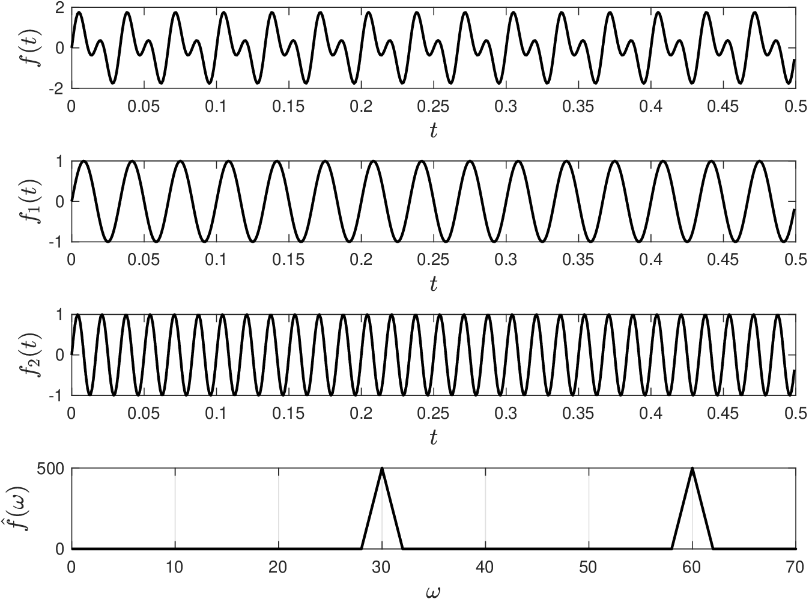
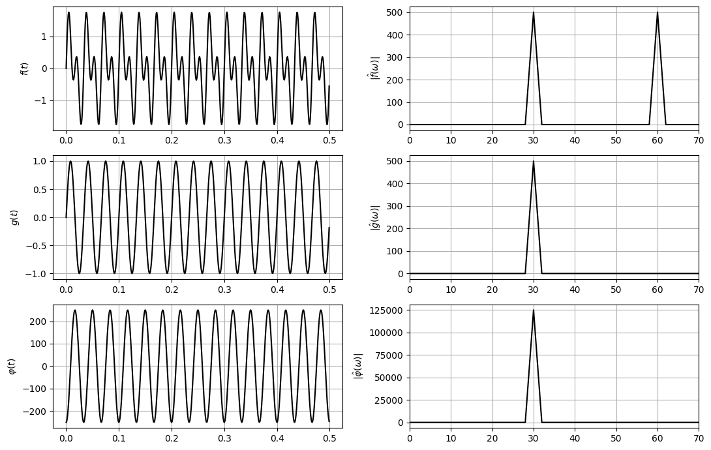
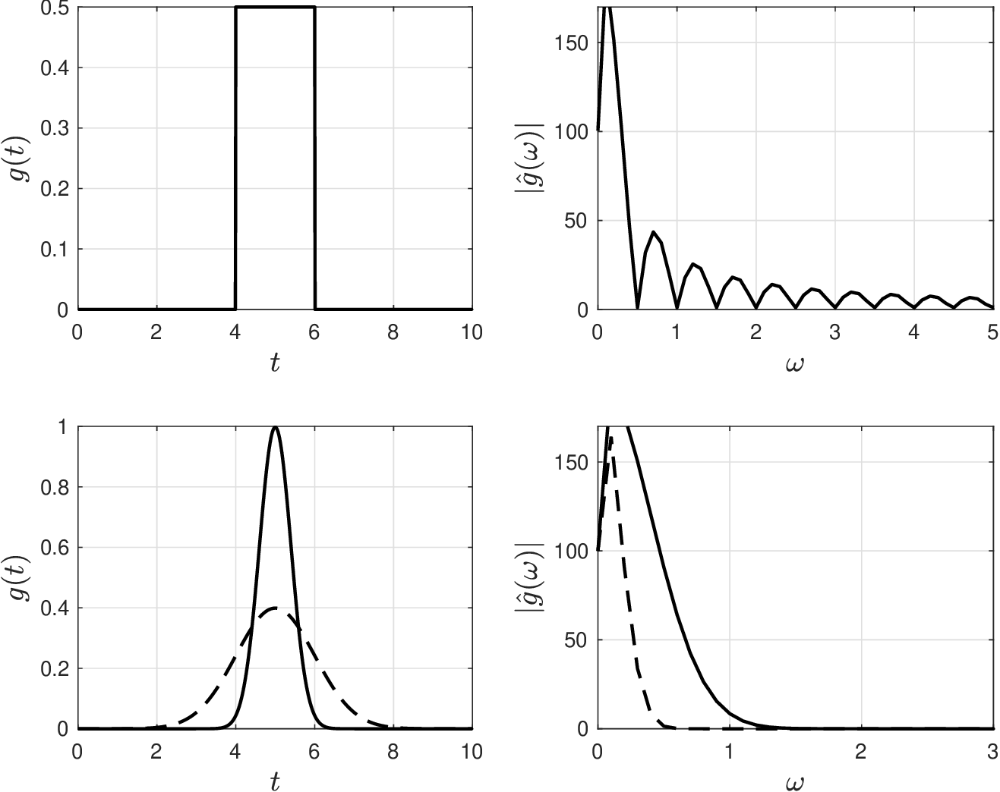
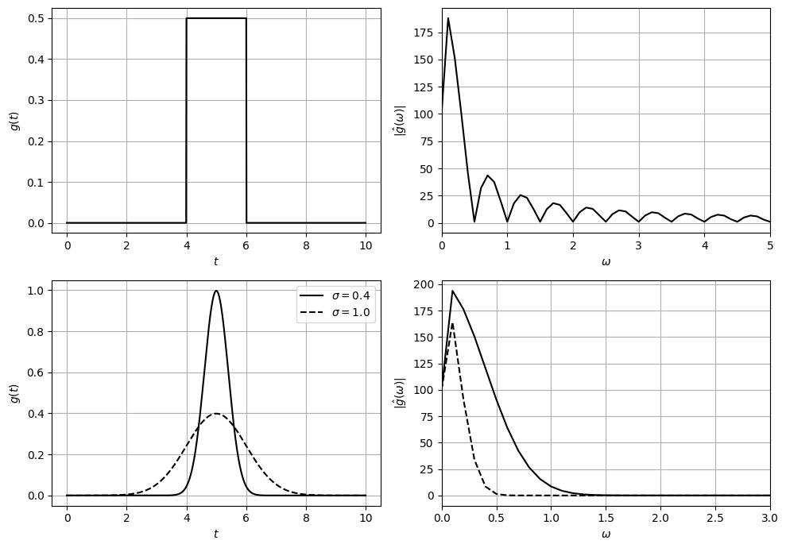
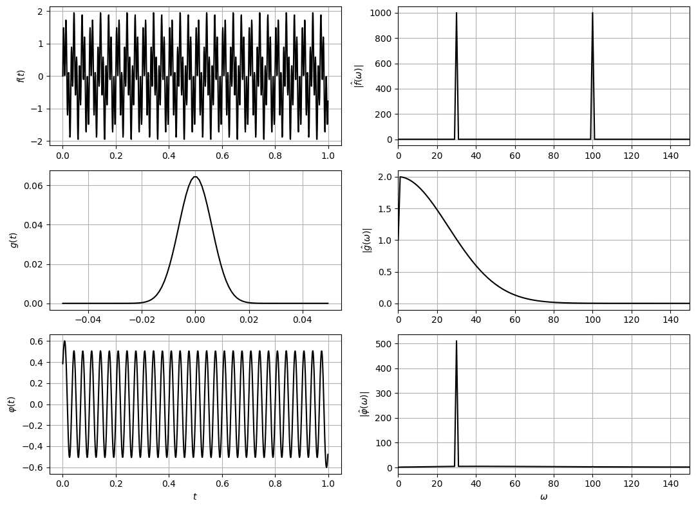
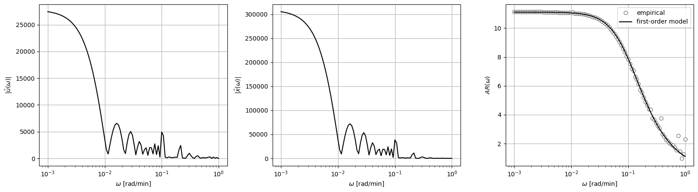

# 1D Fourier Transforms

* Convolution can be performed using Fourier transforms (FT) of signal and filter.
* FT also provide important insights into feature content of signals and filters.
* Recall that FT of function $$f:\mathbb{R}\to \mathbb{R}$$ is:

  $$
  \begin{aligned}
  \hat{f}(\omega)&=\int_{-\infty}^{\infty}f(\tau)\cdot e^{-i(2\pi\omega\tau ) }d\tau\\
  &=\left(\int_{-\infty}^{\infty}f(\tau)\cos(2\pi \omega\tau )d\tau\right) -i \left(\int_{-\infty}^{\infty}f(\tau)\sin(2\pi \omega\tau )d\tau\right),\quad \omega \in (-\infty,\infty)
  \end{aligned}
  $$

* FT is expressed as $$\hat{f}=\mathcal{F}\{f\}$$; $$i=\sqrt{-1}$$ and $$\omega$$ is frequency.
* FT transforms $$f$$ from domain of $$t$$ (time, space) to frequency domain of $$\omega$$.
* Inverse FT recovers function $$f(t)$$ from $$\hat{f}(\omega)$$:

  $$
  {f}(t)=\int_{-\infty}^{\infty}\hat{f}(\omega)e^{i(2\pi\omega\tau)}d\omega\;\; t \in (-\infty,\infty).
  $$

* Inverse FT is expressed as $$f=\mathcal{F}^{-1}\{\hat{f}\}$$.

* Discrete FT of signal $$f_j,\,j=0,...,N-1$$ is:

  $$
  \begin{aligned}
  \hat{f}_{k}&=\sum_{j=0}^{N-1} f_j e^{-i(2\pi k j/N)}\\
  &=\sum_{j=0}^{N-1}f_j\left( \cos\left(2\pi k j/N\right) - i \sin\left(2\pi k j/N\right)\right),\qquad k=0,...,N-1
  \end{aligned}
  $$

* Discrete FT is expressed as $$\hat{f}=\mathcal{F}\{f\}$$ and inverse FT is $${f}=\mathcal{F}^{-1}\{\hat{f}\}$$.
* FT returns complex numbers $$\hat{f}_{k},\,k=0,...,N-1$$ (each correspond to freq $$\omega_k$$).
* Power of each freq is $$|\hat{f}_k|$$ (captures how strong its presence in the signal is).
* *Any* signal $$f(t)$$ can be obtained by combining sinusoidal functions of different freqs.
* One often visualizes frequency content by using a plot of $$\omega_k$$ vs. $$|\hat{f}_k|$$.
* Freq components are symmetric and thus $$|\hat{f}_k|=|\hat{f}_{-k}|$$ (only consider nonnegative $$k$$).

## Example: FT of Periodic Signal

* Construct a periodic signal:

  $$
  f(t)=\sin(2\pi\omega_1 t)+\sin(2\pi\omega_2 t)
  $$

   with freqs $$\omega_1=30$$ and $$\omega_2=60$$.

* Compute FT to obtain $$\hat{f}(\omega)$$; this reveals dominant freqs at $$\omega_1=30$$ and $$\omega_2=60$$.

  <figure></figure>

#### Python implementation


Notebook [`ch6_fourier_transform.ipynb`](https://colab.research.google.com/github/vzavala/StatsBook-GitBook/blob/main/notebooks/ch6_fourier_transform.ipynb) — open it in Colab and run the cells alongside this section.


Fourier transform of a periodic signal (Shiyi (Amy) Qin and Victor Z, UW-Madison, 2024).

| Slides | Python | Meaning |
|---|---|---|
| $$f(t)=\sin(2\pi\omega_1t)+\sin(2\pi\omega_2t)$$ | `f`, `omega_1`, `omega_2` | signal (30 and 60 Hz) |
| $$\hat{f}_k=\sum_j f_je^{-i2\pi kj/N}$$ | `f_hat = np.fft.fft(f)` | discrete FT |
| $$\omega_k$$, $$\lvert\hat{f}_k\rvert$$ | `omega`, `power(f_hat)` | frequencies and one-sided magnitude |
| $$\mathcal{F}\{f*g\}=\mathcal{F}\{f\}\cdot\mathcal{F}\{g\}$$ | `phi_hat = f_hat * g_hat` | convolution theorem |

```python
import numpy as np
import matplotlib.pyplot as plt

L, Fs = 500, 1000                       # number of samples, sampling frequency [Hz]
t = np.arange(L) / Fs
omega = Fs * np.arange(L // 2 + 1) / L  # nonnegative frequencies

def power(z_hat):
    """One-sided magnitude |z_hat_k| for k >= 0 (uses |z_hat_k| = |z_hat_-k|)."""
    m = np.abs(z_hat[:L // 2 + 1]).copy()
    m[1:-1] *= 2
    return m

omega_1, omega_2 = 30, 60
f1, f2 = np.sin(2*np.pi*omega_1*t), np.sin(2*np.pi*omega_2*t)
f = f1 + f2
f_hat = np.fft.fft(f)

fig, axs = plt.subplots(4, 1, figsize=(8, 9))
for ax, s, lab in zip(axs[:3], (f, f1, f2), ('$f(t)$', '$f_1(t)$', '$f_2(t)$')):
    ax.plot(t, s, 'k'); ax.set_ylabel(lab); ax.set_xlabel('$t$')
axs[3].plot(omega, power(f_hat), 'k')
axs[3].set_xlim(0, 70)
axs[3].set_ylabel(r'$|\hat{f}(\omega)|$'); axs[3].set_xlabel(r'$\omega$')
for ax in axs:
    ax.grid(True)
plt.tight_layout()
plt.show()
print("dominant frequencies:", omega[np.argsort(power(f_hat))[-2:]])
```

<figure></figure>

```
dominant frequencies: [60. 30.]
```

Convolution through the frequency domain: multiply $$\hat{f}$$ by the FT of a 30 Hz sine $$g$$
and invert. Only the 30 Hz content survives.

```python
g = np.sin(2*np.pi*30*t)
g_hat = np.fft.fft(g)
phi_hat = f_hat * g_hat
phi = np.fft.ifft(phi_hat).real

fig, axs = plt.subplots(3, 2, figsize=(11, 7))
for row, (s, s_hat, lab) in enumerate(((f, f_hat, 'f'), (g, g_hat, 'g'), (phi, phi_hat, r'\varphi'))):
    axs[row, 0].plot(t, s, 'k'); axs[row, 0].set_ylabel(f'${lab}(t)$')
    axs[row, 1].plot(omega, power(s_hat), 'k'); axs[row, 1].set_xlim(0, 70)
    axs[row, 1].set_ylabel(rf'$|\hat{{{lab}}}(\omega)|$')
for ax in axs.ravel():
    ax.grid(True)
plt.tight_layout()
plt.show()
```

<figure></figure>

## Example: FT of Pulse and Gaussian

* FT for rect pulse function and for Gaussian function.
* Rect has strong content at low freqs and decays (non-monotonic) at high freqs.
* Gaussian has strong content at low freqs and decays (monotonic) at high freqs.
* Freq content of Gaussian controlled using $$\sigma$$.

  <figure></figure>

#### Python implementation


Notebook [`ch6_fourier_transform_filters.ipynb`](https://colab.research.google.com/github/vzavala/StatsBook-GitBook/blob/main/notebooks/ch6_fourier_transform_filters.ipynb) — open it in Colab and run the cells alongside this section.


Fourier transforms of a rectangular pulse and of Gaussians (Shiyi (Amy) Qin and Victor Z, UW-Madison, 2020).
Filters $$g$$ (`g`) are the pdf of $$\mathcal{U}(4,6)$$ and of $$\mathcal{N}(5,\sigma^2)$$ with $$\sigma=0.4$$ and 1;
we plot the one-sided magnitude $$|\hat{g}(\omega)|$$.

```python
import numpy as np
import matplotlib.pyplot as plt
from scipy.stats import uniform, norm

L, Fs = 1000, 100
t = np.arange(L) / Fs
omega = Fs * np.arange(L // 2 + 1) / L

def power(z):
    m = np.abs(np.fft.fft(z)[:L // 2 + 1])
    m[1:-1] *= 2
    return m

fig, axs = plt.subplots(2, 2, figsize=(10, 7))
g = uniform.pdf(t, 4, 2)
axs[0, 0].plot(t, g, 'k'); axs[0, 1].plot(omega, power(g), 'k'); axs[0, 1].set_xlim(0, 5)
for sigma, style in ((0.4, 'k-'), (1.0, 'k--')):
    g = norm.pdf(t, 5, sigma)
    axs[1, 0].plot(t, g, style, label=rf'$\sigma={sigma}$')
    axs[1, 1].plot(omega, power(g), style)
axs[1, 1].set_xlim(0, 3)
axs[1, 0].legend()
for ax in axs[:, 0]:
    ax.set_xlabel('$t$'); ax.set_ylabel('$g(t)$')
for ax in axs[:, 1]:
    ax.set_xlabel(r'$\omega$'); ax.set_ylabel(r'$|\hat{g}(\omega)|$')
for ax in axs.ravel():
    ax.grid(True)
plt.tight_layout()
plt.show()
```

<figure></figure>

#### Python implementation


Notebook [`ch6_convolution_filters.ipynb`](https://colab.research.google.com/github/vzavala/StatsBook-GitBook/blob/main/notebooks/ch6_convolution_filters.ipynb) — open it in Colab and run the cells alongside this section.


**Additional example: a Gaussian filter as a low-pass filter** (Shiyi (Amy) Qin and Victor Z,
UW-Madison, 2024). The signal $$f$$ mixes 30 Hz and 100 Hz sines. The FT of the Gaussian filter
$$g$$ (window $$N=100$$, width factor $$\alpha=8$$) is large only at low frequencies, so $$f*g$$ keeps the
30 Hz component and removes the 100 Hz one. Python names: `f`, `g`, `phi`, `omega`.

```python
import numpy as np
import matplotlib.pyplot as plt
from scipy.signal import fftconvolve

L, Fs = 1000, 1000
t = np.arange(L) / Fs
f = np.sin(2*np.pi*30*t) + np.sin(2*np.pi*100*t)

N, alpha = 100, 8
sigma = (N - 1) / (2 * alpha)
j = np.arange(N) - (N - 1) / 2
g = np.exp(-j**2 / (2 * sigma**2))
g /= g.sum()                                  # unit area: keeps the amplitude of what passes

def power(z, n):
    m = np.abs(np.fft.fft(z, n)[:n // 2 + 1])
    m[1:-1] *= 2
    return m, Fs * np.arange(n // 2 + 1) / n

phi = fftconvolve(f, g, mode='same')
fig, axs = plt.subplots(3, 2, figsize=(11, 8))
for row, (s, lab) in enumerate(((f, 'f'), (g, 'g'), (phi, r'\varphi'))):
    tt = j / Fs if lab == 'g' else t
    axs[row, 0].plot(tt, s, 'k'); axs[row, 0].set_ylabel(f'${lab}(t)$')
    m, om = power(s, L)
    axs[row, 1].plot(om, m, 'k'); axs[row, 1].set_xlim(0, 150)
    axs[row, 1].set_ylabel(rf'$|\hat{{{lab}}}(\omega)|$')
for ax in axs.ravel():
    ax.grid(True)
axs[2, 0].set_xlabel('$t$'); axs[2, 1].set_xlabel(r'$\omega$')
plt.tight_layout()
plt.show()
```

<figure></figure>

#### Python implementation


Notebook [`ch6_sysid_co2_est.ipynb`](https://colab.research.google.com/github/vzavala/StatsBook-GitBook/blob/main/notebooks/ch6_sysid_co2_est.ipynb) — open it in Colab and run the cells alongside this section.


**Additional example: system identification with Fourier transforms** (Victor M Zavala, UW-Madison, 2024).
A building has CO$$_2$$ input $$u(t)$$ (occupants) and indoor CO$$_2$$ concentration $$x(t)$$ above 400 ppm.
We compute the magnitude of the Fourier transforms $$|\hat{u}(\omega)|$$ and $$|\hat{x}(\omega)|$$ by numerical
integration, form the amplitude ratio $$AR(\omega)=|\hat{x}(\omega)|/|\hat{u}(\omega)|$$, and fit a first-order
model $$AR(\omega)=K/\sqrt{(\tau\omega)^2+1}$$ by least squares.

| Symbol | Python | Meaning |
|---|---|---|
| $$t$$, $$u(t)$$, $$x(t)$$ | `t`, `u`, `x` | time [min], input, output (ppm above 400) |
| $$\omega$$ | `omega` | frequency [rad/min] |
| $$\lvert\hat{u}(\omega)\rvert$$, $$\lvert\hat{x}(\omega)\rvert$$ | `mag_u`, `mag_x` | spectra |
| $$K$$, $$\tau$$ | `K`, `tau` | gain and time constant |

```python
import numpy as np
import matplotlib.pyplot as plt
from scipy.optimize import least_squares

data = np.loadtxt(path+'Data/data_sysid_co2.dat')
t, u, x = data[:, 0], data[:, 1], data[:, 2] - 400

omega = np.logspace(-3, 0, 100)

def spectrum(z):
    """|z_hat(omega)| = |integral z(t) e^{-i omega t} dt| by the trapezoidal rule."""
    return np.array([np.abs(np.trapz(z * np.exp(-1j * w * t), t)) for w in omega])

mag_u, mag_x = spectrum(u), spectrum(x)
AR = mag_x / mag_u

def residual(theta):
    K, tau = theta
    return AR - K / np.sqrt((tau * omega)**2 + 1)

K, tau = least_squares(residual, [1, 1], bounds=([0, 0], [100, 100]), max_nfev=5000).x
print(f"K = {K:.3f},  tau = {tau:.2f} min")

fig, axs = plt.subplots(1, 3, figsize=(16, 4.5))
axs[0].semilogx(omega, mag_u, 'k'); axs[0].set_ylabel(r'$|\hat{u}(\omega)|$')
axs[1].semilogx(omega, mag_x, 'k'); axs[1].set_ylabel(r'$|\hat{x}(\omega)|$')
axs[2].semilogx(omega, AR, 'o', markerfacecolor='w', color='0.5', label='empirical')
axs[2].semilogx(omega, K / np.sqrt((tau * omega)**2 + 1), 'k-', label='first-order model')
axs[2].set_ylabel(r'$AR(\omega)$'); axs[2].legend()
for ax in axs:
    ax.set_xlabel(r'$\omega$ [rad/min]'); ax.grid(True)
plt.tight_layout()
plt.show()
```

```
K = 11.105,  tau = 9.92 min
```

<figure></figure>

Physical parameters for a building of volume $$V$$: air flow $$Q=V/\tau$$ and generation $$G=KQ$$.

```python
V = 10000                 # building volume [cubic feet]
Q = V / tau
G = K * Q
print(f"Q = {Q:.1f},  G = {G:.1f}")
```

```
Q = 1007.9,  G = 11192.6
```
