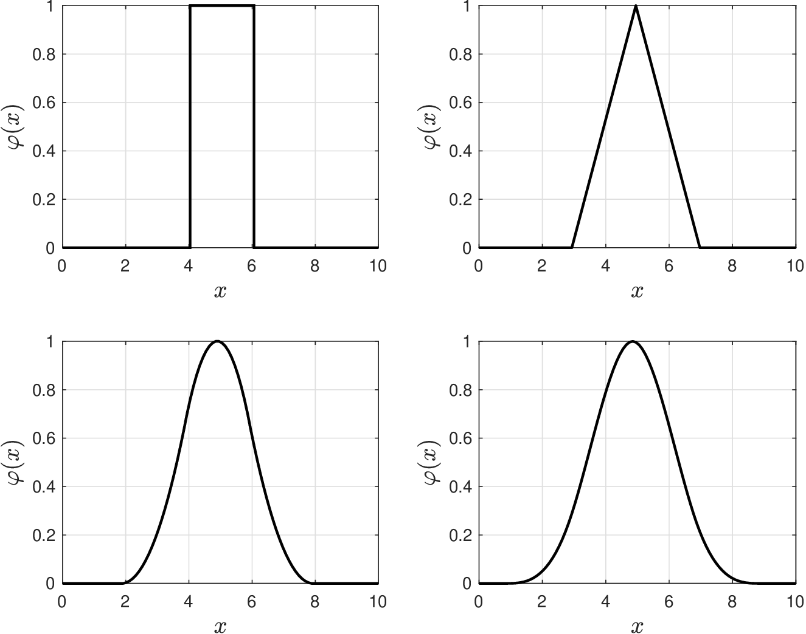
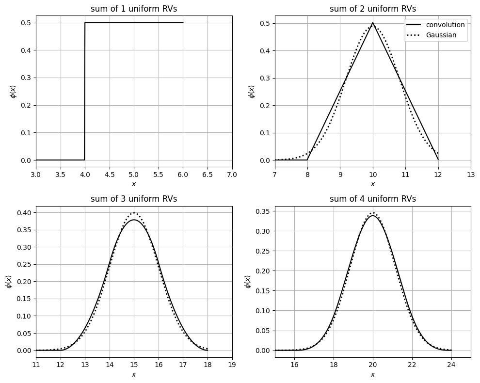

# Properties of Convolution

* FT facilitates analysis and implementation of convolution operations.
* Enabled by fundamental result known as *convolution theorem*:

  $$
  \mathcal{F}\{f*g\}=\mathcal{F}\{{f}\}\cdot \mathcal{F}\{{g}\}.
  $$

* Convolution in freq domain obtained via products (instead of integrals).
* Pdf of sum of indep RVs $$X_1$$ and $$X_2$$ is convolution of pdfs $$f_{X_1}$$ and $$f_{X_2}$$.
* Specifically, pdf of $$Y=X_1+X_2$$ is $$f_Y=f_{X_1}*f_{X_2}$$.

## Example: Recursive Application of Convolution

* Consider indep RVs $$X_1,X_2,X_3,X_4\sim \mathcal{U}(4,6)$$ with same pdf $$f(x)$$.
* Pdf of $$X_1$$ is $$f$$, of $$X_1+X_2$$  is $$\phi=f*f$$, of $$X_1+X_2+X_3$$ is $$\phi=f*(f*f)$$), and of $$X_1+X_2+X_3+X_4$$ is $$\phi=f*(f*(f*f))$$.
* Result confirms central limit theorem (sum of i.i.d. RVs is Gaussian).

  <figure></figure>

#### Python implementation


Notebook [`ch6_clt_convolution.ipynb`](https://colab.research.google.com/github/vzavala/StatsBook-GitBook/blob/main/notebooks/ch6_clt_convolution.ipynb) — open it in Colab and run the cells alongside this section.


The central limit theorem through convolutions (Victor Z and Ugochukwu Ikegwu, UW-Madison, 2024).
For independent $$X_i\sim\mathcal{U}(4,6)$$ with pdf $$f$$, the pdf of $$X_1+X_2$$ is $$\phi=f*f$$, of
$$X_1+X_2+X_3$$ is $$f*(f*f)$$, and so on. We convolve numerically on a grid of step `dx`
(`phi = np.convolve(phi, f) * dx`) and compare with the Gaussian that has the same mean and variance.

```python
import numpy as np
import matplotlib.pyplot as plt
from scipy.stats import uniform, norm

dx = 0.01
x = np.arange(0, 6 + dx, dx)
f = uniform.pdf(x, loc=4, scale=2)

fig, axs = plt.subplots(2, 2, figsize=(10, 8))
phi = f.copy()
for k, ax in enumerate(axs.ravel(), start=1):
    if k > 1:
        phi = np.convolve(phi, f) * dx               # pdf of X_1 + ... + X_k
    xk = np.arange(len(phi)) * dx
    ax.plot(xk, phi, 'k', linewidth=1.5, label='convolution')
    if k > 1:
        ax.plot(xk, norm.pdf(xk, 5 * k, np.sqrt(k * 4 / 12)), 'k:', linewidth=2, label='Gaussian')
    ax.set_xlim(4 * k - 1, 6 * k + 1)
    ax.set_title(f'sum of {k} uniform RVs')
    ax.set_xlabel('$x$'); ax.set_ylabel(r'$\phi(x)$')
    ax.grid(True)
axs[0, 1].legend()
plt.tight_layout()
plt.show()
```

<figure></figure>
