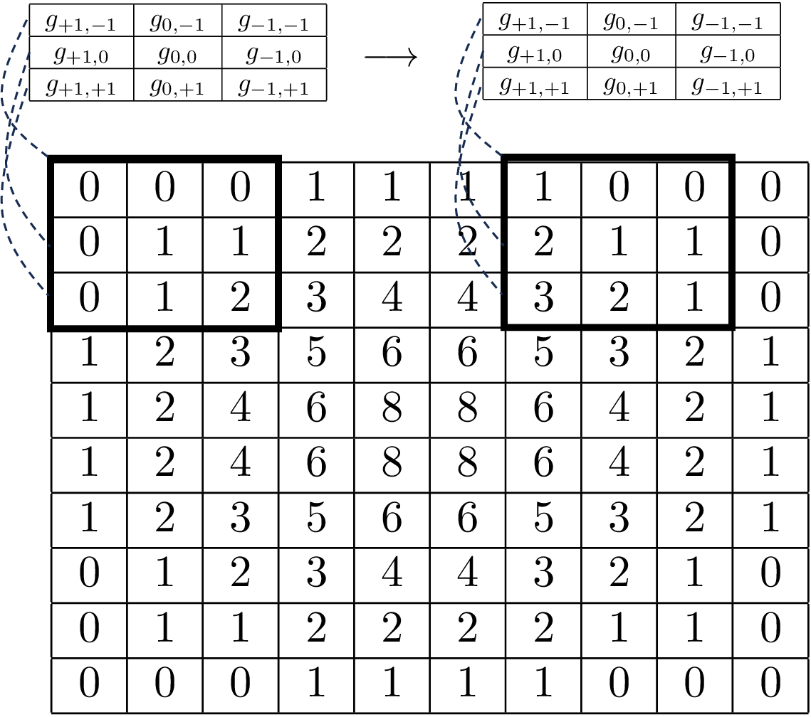
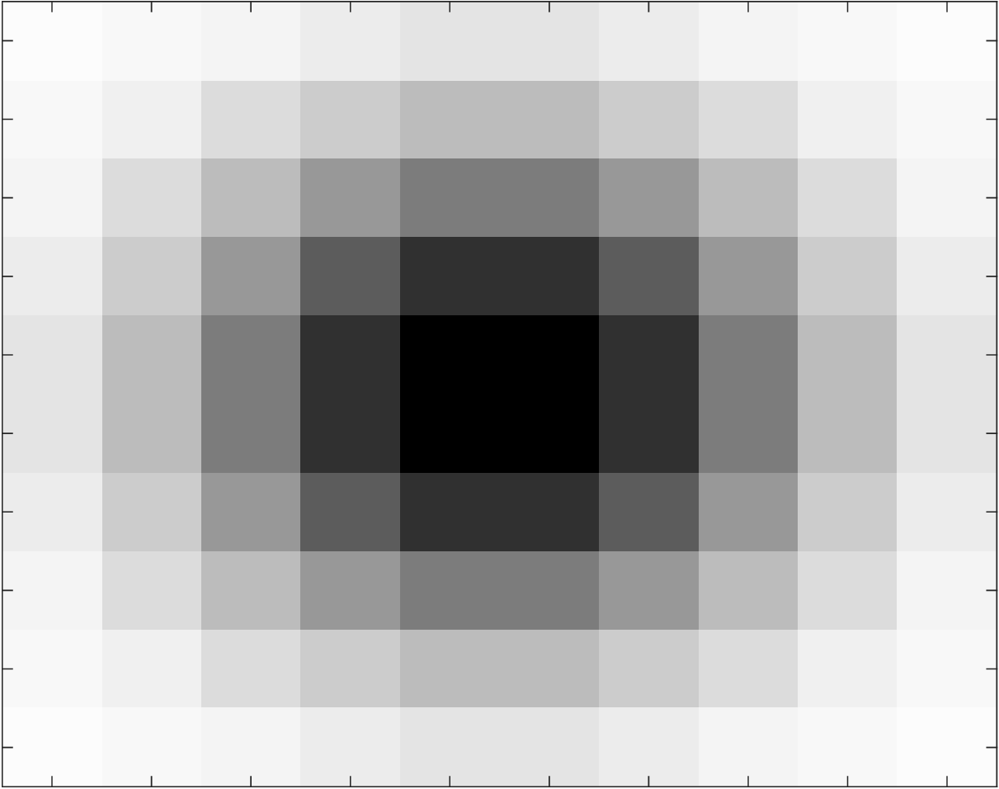
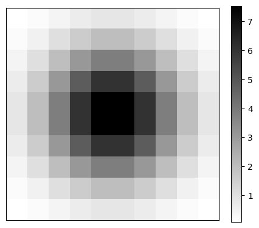
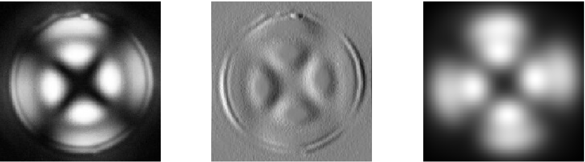
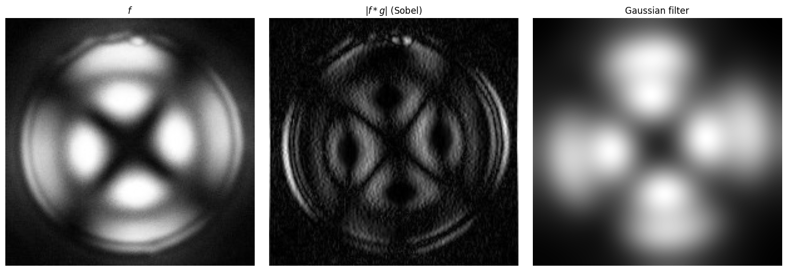

# 2D Convolutions

## Convolutions and Fourier Transforms in 2D

* Convolutions can be performed on 2D/3D signals (or even higher-dim).
* This allows analysis and processing of images, spatial fields, and other objects.
* Consider 2D discrete signal:

  $$
  f_{j_1,j_2},\;\; j_1,j_2=-\infty,...,\infty,
  $$

* Consider 2D filter represented:

  $$
  g_{j_1,j_2},\;\; j_1,j_2=-\infty,...,\infty.
  $$

* Convolution is given by:

  $$
  \phi_{k_1,k_2}=\sum_{j_1=-\infty}^\infty \sum_{j_2=-\infty}^\infty g_{j_1,j_2}\cdot f_{k_1-j_1,k_2-j_2},\;\; k_1,k_2=-\infty,...,\infty.
  $$

* As in 1D, one can think of a 2D conv $$\phi_{k_1,k_2}$$ as weighted sum in a given neighborhood of signal $$f$$ that is centered at $$f_{k_1,k_2}$$.

* Consider $$N\times N$$ neighb of $$f$$ (centered at $$f_{k_1,k_2}$$ and $$N=3$$). This window is a matrix with $$N^2=9$$ entries.
* Goal is to compute a weighted avg of all the entries in window; to do so, we associate a weight to each signal value in window.
* Convolution is given by:

  $$
  \begin{aligned}
  \varphi_{k_1,k_2}&=\; f_{k_1-1,k_2+1}\cdot g_{-1,1}+f_{k_1,k_2+1}\cdot g_{0,1}+f_{k_1+1,k_2+1}\cdot g_{1,1}\\
  &\;\;\;\;\; f_{k_1-1,k_2} \cdot g_{-1,0}+f_{k_1,k_2}\cdot g_{0,0}+f_{k_1+1,k_2} \cdot g_{1,0}\\
  &\;\;\;\;\; f_{k_1-1,k_2-1} \cdot g_{-1,-1}+f_{k_1,k_2-1} \cdot g_{0,-1}+f_{k_1+1,k_2-1} \cdot g_{1,-1}.
  \end{aligned}
  $$

* In compact form:

  $$
  \varphi_{k_1,k_2}=\sum_{j_1=-(N-1)/2}^{(N-1)/2} \sum_{j_2=-(N-1)/2}^{(N-1)/2} g_{j_1,j_2}\cdot f_{k_1-j_1,k_2-j_2}.
  $$

<figure><figcaption><p>Example of convolution of a 2D field by using a moving window.</p></figcaption></figure>

## Example: Convolution of Matrix with Filter

* Consider conv of $$f$$ given by $$5\times 5$$ matrix and filter given by $$3\times 3$$ matrix $$g$$:

  $$
  \begin{aligned}
  \underbrace{\left[\begin{array}{ccccc}
  1&0&1&0&0\\
  0&1&0&1&0\\
  1&0&1&1&1\\
  0&0&1&1&0\\
  0&1&1&0&0
  \end{array}\right]}_f*\underbrace{\left[\begin{array}{ccc}
  1&0&1\\
  0&1&0\\
  1&0&1
  \end{array}\right]}_g=\underbrace{\left[\begin{array}{ccc}
  5    &1   &  4\\
  1 &    4    &  2\\
  3  &   3  &   4
  \end{array}\right]}_\phi.
  \end{aligned}
  $$

* There are two ways of performing the convolution.
* In 1st approach we center filter at every entry of signal matrix but in such a way that the window is always inside signal matrix (we avoid boundary entries); this will return a convolution $$f*g$$ that is a $$3\times 3$$ matrix.
* In 2nd approach, we center filter at every entry of signal matrix and allow for some entries of  window to be outside signal matrix (we simply ignore any filter entries that are outside); this will return a convolution $$f*g$$ that is a $$5\times 5$$ matrix.
* Note that convolution matrix has high values where pattern matches.

#### Python implementation


Notebook [`ch6_matrix_convolution.ipynb`](https://colab.research.google.com/github/vzavala/StatsBook-GitBook/blob/main/notebooks/ch6_matrix_convolution.ipynb) — open it in Colab and run the cells alongside this section.


Convolution of a $$5\times 5$$ matrix $$f$$ with a $$3\times 3$$ filter $$g$$ (written for the book to
accompany the slide example). `mode='valid'` keeps the window inside $$f$$ (a $$3\times 3$$ result);
`mode='same'` lets the window stick out and ignores the outside entries (a $$5\times 5$$ result).
The filter is symmetric, so convolution and correlation coincide.

```python
import numpy as np
from scipy.signal import convolve2d

f = np.array([[1, 0, 1, 0, 0],
              [0, 1, 0, 1, 0],
              [1, 0, 1, 1, 1],
              [0, 0, 1, 1, 0],
              [0, 1, 1, 0, 0]])
g = np.array([[1, 0, 1],
              [0, 1, 0],
              [1, 0, 1]])
print("phi = f*g (valid):\n", convolve2d(f, g, mode='valid'))
print("phi = f*g (same):\n", convolve2d(f, g, mode='same'))
```

```
phi = f*g (valid):
 [[5 1 4]
 [1 4 2]
 [3 3 4]]
phi = f*g (same):
 [[2 0 3 0 1]
 [0 5 1 4 1]
 [2 1 4 2 3]
 [1 3 3 4 1]
 [0 2 2 1 1]]
```

## 2D Convolutional Filters

* Define 2D kernel functions to generate filters; e.g., kernel of 2D Gaussian filter is:

  $$
  g(x,y)=\frac{1}{\sqrt{2\pi \sigma^2}}e^{-\frac{x^2+y^2}{2\sigma^2}}.
  $$

* This is pdf of $$\mathcal{N}(0,\Sigma)$$ with $$\Sigma_{1,1}=\Sigma_{2,2}=\sigma^2$$ and $$\Sigma_{1,2}=\Sigma_{2,1}=0$$.
* Recall pdf projected on 2D field defines ellipses.

## Example: Weight Matrix of 2D Gaussian Filter

* Below we see 2D Gaussian filter with $$10\times 10$$ window and $$\sigma=\sqrt{2}$$.
* Here, we visualize filter matrix and image (a 2D field).
* Filter is symmetric around center point; center point has highest value and values decay quickly as one moves away from the center point.

  <figure><figcaption><p>Weight matrix for 2D Gaussian filter (top) and visualization as a 2D field (bottom).</p></figcaption></figure>

#### Python implementation


Notebook [`ch6_gauss_filter_2D.ipynb`](https://colab.research.google.com/github/vzavala/StatsBook-GitBook/blob/main/notebooks/ch6_gauss_filter_2D.ipynb) — open it in Colab and run the cells alongside this section.


Weight matrix of a 2D Gaussian filter (Victor Z and Ugochukwu Ikegwu, UW-Madison, 2024):
the kernel $$g(x,y)$$ is the pdf of $$\mathcal{N}(0,\Sigma)$$ with $$\Sigma=\sigma^2 I$$, $$\sigma=\sqrt{2}$$,
evaluated on a $$10\times 10$$ window (`g`, scaled by 100).

```python
import numpy as np
import matplotlib.pyplot as plt
from scipy.stats import multivariate_normal

sigma2 = 2.0
x = np.linspace(-3, 3, 10)
X1, X2 = np.meshgrid(x, x)
g = multivariate_normal([0, 0], sigma2 * np.eye(2)).pdf(np.dstack((X1, X2)))
print(np.round(100 * g).astype(int))

plt.figure(figsize=(5, 5))
plt.imshow(100 * g, cmap='gray_r', interpolation='nearest', origin='lower')
plt.xticks([]); plt.yticks([])
plt.colorbar(fraction=0.046)
plt.show()
```

```
[[0 0 0 1 1 1 1 0 0 0]
 [0 1 1 2 2 2 2 1 1 0]
 [0 1 2 3 4 4 3 2 1 0]
 [1 2 3 5 6 6 5 3 2 1]
 [1 2 4 6 8 8 6 4 2 1]
 [1 2 4 6 8 8 6 4 2 1]
 [1 2 3 5 6 6 5 3 2 1]
 [0 1 2 3 4 4 3 2 1 0]
 [0 1 1 2 2 2 2 1 1 0]
 [0 0 0 1 1 1 1 0 0 0]]
```

<figure></figure>

## 2D Convolutional Filters

* Deriv filters are used in image analysis to extract gradients and detect boundaries.
* Consider you want to compute derivative:

  $$
  \nabla^2 f(x,u)=\frac{\partial^2 f(x,y)}{\partial x^2}+ \frac{\partial^2 f(x,y)}{\partial y^2}.
  $$

* This derivative is known as Laplace operator and can be approx as:

  $$
  \begin{aligned}
  \nabla^2 f(x,u)&=\frac{f(x-\Delta,y)-2f(x,y)+f(x+\Delta,y)}{\Delta^2}+
  \frac{f(x,y-\Delta)-2f(x,y)+f(x,y+\Delta)}{\Delta^2}\\
  &=\frac{f(x-\Delta,y)+f(x+\Delta ,y)-4f(x,y)+f(x,y-\Delta)+f(x,y+\Delta)}{\Delta^2}
  \end{aligned}
  $$

* Laplace operator can be written as convolution:

  $$
  \begin{aligned}
  f*g=
  \left[
  \begin{array}{ccc}
  f_{k_1-1,k_2+1}&f_{k_1,k_2+1}&f_{k_1+1,k_2+1}\\
  f_{k_1-1,k_2}&f_{k_1,k_2}&f_{k_1+1,k_2}\\
  f_{k_1-1,k_2-1}&f_{k_1,k_2-1}&f_{k_1+1,k_2-1}
  \end{array}
  \right]*
  \left[\begin{array}{ccc}0 &1 &0\\ 1&-4&1\\ 0 & 1 & 0\end{array}\right].
  \end{aligned}
  $$

* Another set of popular derivative filters are Sobel filters:

  $$
  \begin{aligned}
  \left[\begin{array}{rrr}1 &2 &1\\ 0&0&0\\ -1 & -2 & -1\end{array}\right]\qquad
  \left[\begin{array}{rrr}1 &0 &-1\\ 2&0&-2\\ 1 & 0 & -1\end{array}\right].
  \end{aligned}
  $$

## Example: Applying 2D Filters to an Image

* Left panel is micrograph of liquid crystal droplet when exposed to polarized light.
* Middle panel shows micrograph after applying a horizontal Sobel filter; this reveals regions in which the the brightness exhibits strong changes in intensity (gradients).
* Right panel we see that application of Gaussian filter smooths out image and this reveals coarse features of micrograph.

  <figure><figcaption><p>Micrograph image (left), image filtered with Sobel filter (middle), and image filtered with Gaussian filter  (right).</p></figcaption></figure>

#### Python implementation


Notebook [`ch6_micrograph_filters_2D.ipynb`](https://colab.research.google.com/github/vzavala/StatsBook-GitBook/blob/main/notebooks/ch6_micrograph_filters_2D.ipynb) — open it in Colab and run the cells alongside this section.


Applying 2D filters to a micrograph (Victor Z and Ugochukwu Ikegwu, UW-Madison, 2024).
The image is a 2D signal $$f$$ (`f`); $$f_1=f*g$$ with a Sobel filter $$g$$ reveals intensity gradients and
$$f_2$$ with a Gaussian filter ($$\sigma=10$$ pixels) keeps the coarse features.

```python
import numpy as np
import matplotlib.pyplot as plt
from skimage import io, color
from scipy.signal import convolve2d
from scipy.ndimage import gaussian_filter

f = 255 * color.rgb2gray(io.imread(path+'Data/droplet1.jpg'))

g = np.array([[1, 2, 1],
              [0, 0, 0],
              [-1, -2, -1]]).T          # Sobel filter (horizontal gradient)
f_1 = convolve2d(f, g, mode='same')
f_2 = gaussian_filter(f, sigma=10)

fig, axs = plt.subplots(1, 3, figsize=(15, 5))
for ax, img, title in ((axs[0], f, '$f$'), (axs[1], np.abs(f_1), r'$|f*g|$ (Sobel)'),
                       (axs[2], f_2, 'Gaussian filter')):
    ax.imshow(img, cmap='gray')
    ax.set_title(title)
    ax.axis('off')
plt.tight_layout()
plt.show()
```

<figure></figure>
