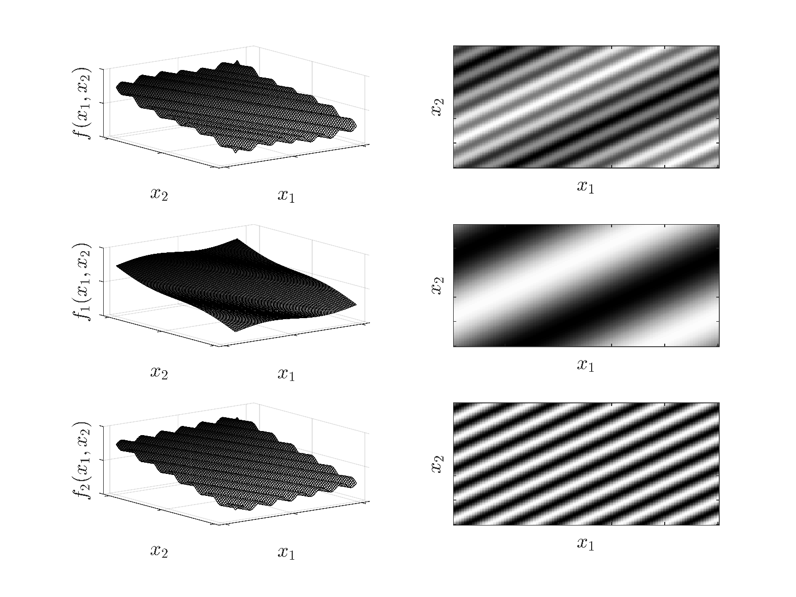
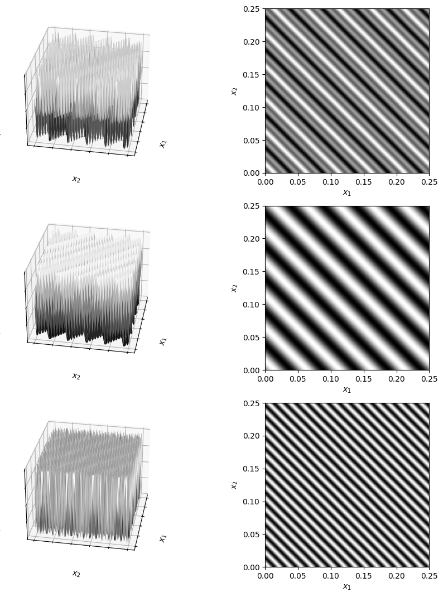
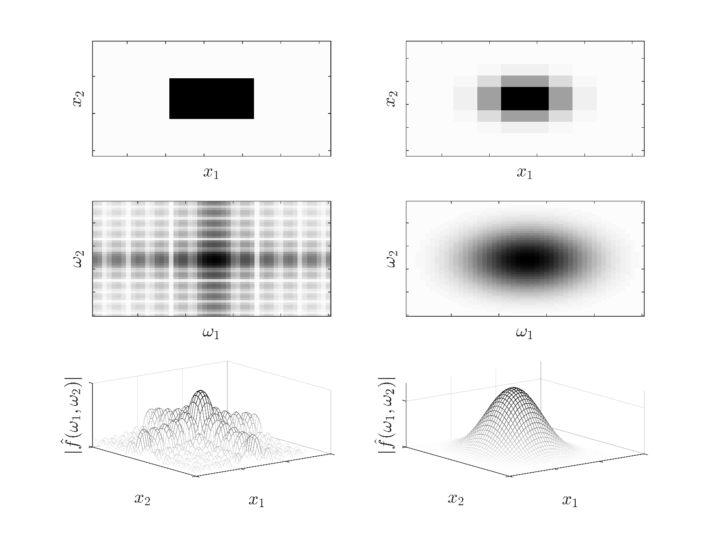
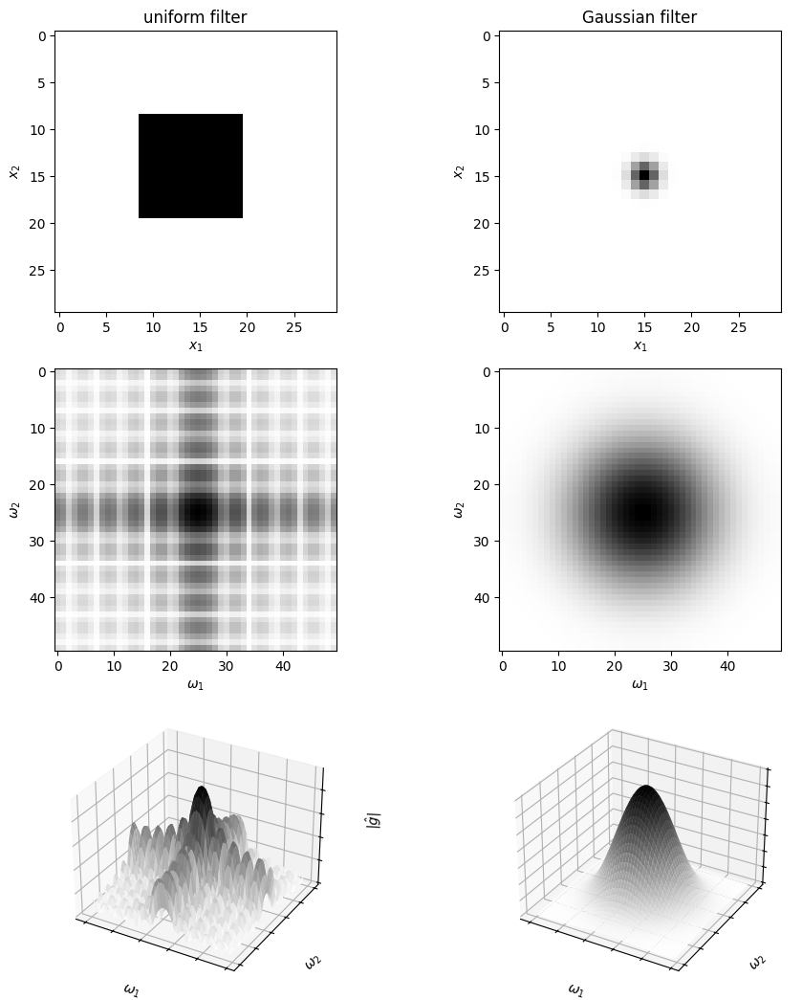
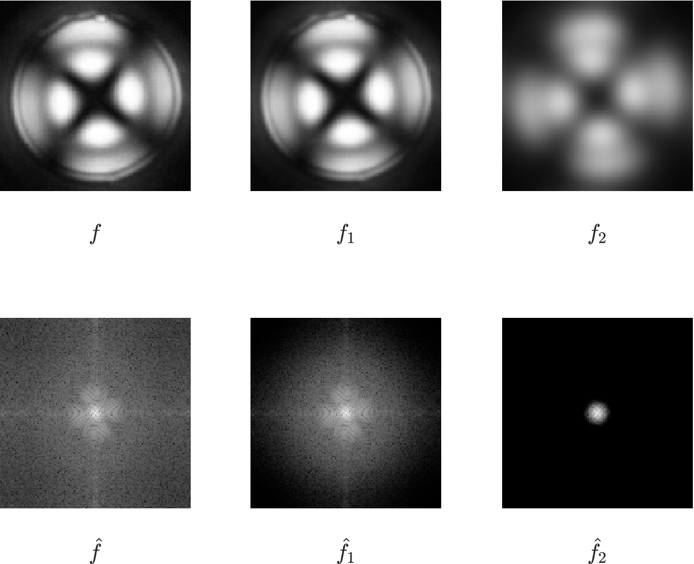
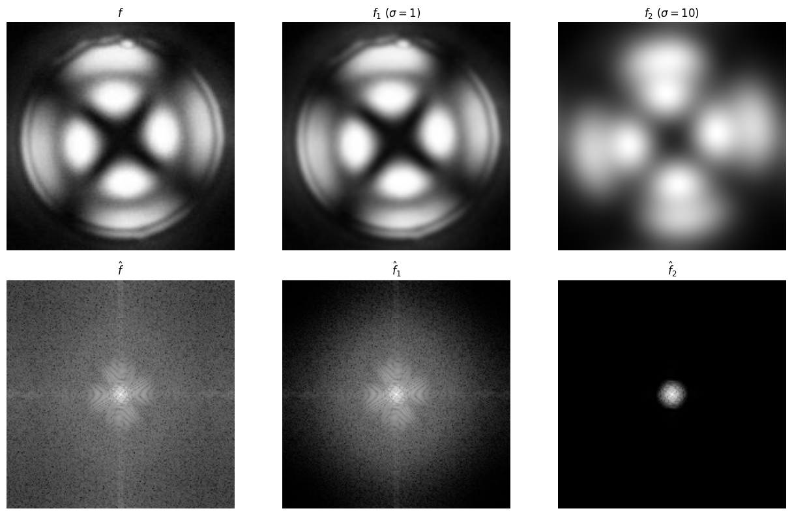

# 2D Fourier Transforms

* FTs for 2D signals are used to analyze and perform conv operations.
* Discrete FT of 2D field is:

  $$
  \hat{f}_{k_1,k_2}=\frac{1}{N}\sum_{j_1=0}^{N-1}\sum_{j_2=0}^{N-1}f_{j_1,j_2}e^{-i2\pi\left(\frac{j_1k_1}{N}+\frac{j_2k_2}{N}\right)},\; k_1=k_2=0,...,N-1.
  $$

* 2D FT returns a 2D field in the frequency domain.
* Each freq comp contains a wave (sheet); original field is a superposition of sheets.
* As in 1D,  can use convolution theorem to obtain $$f*g=\mathcal{F}^{-1}\{\mathcal{F}\{f\}\cdot \mathcal{F}\{g\}\}$$.

## Example: 2D Signals as Superposition of 2D Waves

* 2D field (e.g., an image) is superposition of 2D fields (each with a different freq).
* 2D field with a given freq is sheet with wave pattern (higher freqs have finer waves).
* Consider 2D function:

  $$
  f(x_1,x_2)=\sin \; 2\pi \omega_1(x_1+x_2)-\sin \; 2\pi \omega_2(x_1+x_2)
  $$

   with frequencies $$\omega_1=20$$ and $$\omega_2=60$$.

* Below we plot this function in 3D and we can see that this forms a wavy field (sheet) and show two waves that form function.
* We also visualize function as 2D projection. This is is what you would see if you observed wavy sheet from the top.

<figure></figure>

*2D function $$f(x_1,x_2)$$ shown in 3D and as a projection in 2D (top panels). Low-frequency component (middle panels) and high-frequency component (bottom panels).*

#### Python implementation


Notebook [`ch6_fourier_transform_2D.ipynb`](https://colab.research.google.com/github/vzavala/StatsBook-GitBook/blob/main/notebooks/ch6_fourier_transform_2D.ipynb) — open it in Colab and run the cells alongside this section.


A 2D signal as a superposition of 2D waves (Victor Z and Ugochukwu Ikegwu, UW-Madison, 2024):
$$f(x_1,x_2)=\sin 2\pi\omega_1(x_1+x_2)-\sin 2\pi\omega_2(x_1+x_2)$$ with $$\omega_1=20$$, $$\omega_2=60$$
(`omega_1`, `omega_2`). The grid is fine enough (8 samples per period of the 60 Hz wave) to avoid aliasing.

```python
import numpy as np
import matplotlib.pyplot as plt

x = np.linspace(0, 0.25, 125)
X1, X2 = np.meshgrid(x, x)
omega_1, omega_2 = 20, 60
f1 = np.sin(2*np.pi*omega_1*(X1 + X2))
f2 = np.sin(2*np.pi*omega_2*(X1 + X2))
f = f1 - f2

fig = plt.figure(figsize=(11, 13))
for row, (Z, lab) in enumerate(((f, 'f'), (f1, 'f_1'), (f2, 'f_2'))):
    ax = fig.add_subplot(3, 2, 2*row + 1, projection='3d')
    ax.plot_surface(X1, X2, Z, cmap='gray', linewidth=0)
    ax.view_init(elev=30., azim=10)
    ax.set_xlabel('$x_1$'); ax.set_ylabel('$x_2$'); ax.set_zlabel(f'${lab}(x_1,x_2)$')
    ax.set_xticklabels([]); ax.set_yticklabels([]); ax.set_zticklabels([])
    ax2 = fig.add_subplot(3, 2, 2*row + 2)
    ax2.imshow(Z, cmap='gray', origin='lower', extent=[0, 0.25, 0, 0.25])
    ax2.set_xlabel('$x_1$'); ax2.set_ylabel('$x_2$')
plt.tight_layout()
plt.show()
```

<figure></figure>

## Example: 2D FT Applied to Filtering

* We analyze frequency content of a 2D uniform average filter (defined by a 2D step function) and of a 2D Gaussian filter (defined a by 2D Gaussian kernel).

  <figure><figcaption><p>Left panels: Uniform filter, Fourier transform in 2D, and Fourier transform in 3D. Right panels: Gaussian filter, Fourier transform in 2D, and Fourier transform in 3D.</p></figcaption></figure>

#### Python implementation


Notebook [`ch6_fourier_transform_filters_2D.ipynb`](https://colab.research.google.com/github/vzavala/StatsBook-GitBook/blob/main/notebooks/ch6_fourier_transform_filters_2D.ipynb) — open it in Colab and run the cells alongside this section.


2D Fourier transforms of a uniform (box) filter and of a Gaussian filter
(Victor Z and Ugochukwu Ikegwu, UW-Madison, 2024). We show each filter $$g$$ (`g`), the magnitude
$$\log(1+|\hat{g}(\omega_1,\omega_2)|)$$ (centered with `fftshift`), and the same as a 3D surface.

```python
import numpy as np
import matplotlib.pyplot as plt
from scipy.fft import fft2, fftshift
from scipy.ndimage import gaussian_filter

L = 50
g_box = np.zeros((L, L))
g_box[19:30, 19:30] = 1                     # 2D step (uniform) filter
g_gauss = np.zeros((L, L))
g_gauss[L // 2, L // 2] = 1
g_gauss = gaussian_filter(g_gauss, sigma=1)  # 2D Gaussian filter

fig = plt.figure(figsize=(11, 13))
for col, (g, title) in enumerate(((g_box, 'uniform filter'), (g_gauss, 'Gaussian filter'))):
    g_hat = fftshift(np.log(1 + np.abs(fft2(g))))
    ax = fig.add_subplot(3, 2, col + 1)
    ax.imshow(g[10:40, 10:40], cmap='gray_r')
    ax.set_title(title); ax.set_xlabel('$x_1$'); ax.set_ylabel('$x_2$')
    ax = fig.add_subplot(3, 2, col + 3)
    ax.imshow(g_hat, cmap='gray_r')
    ax.set_xlabel(r'$\omega_1$'); ax.set_ylabel(r'$\omega_2$')
    ax = fig.add_subplot(3, 2, col + 5, projection='3d')
    W1, W2 = np.meshgrid(np.arange(L), np.arange(L))
    ax.plot_surface(W1, W2, g_hat, cmap='gray_r', linewidth=0)
    ax.set_xlabel(r'$\omega_1$'); ax.set_ylabel(r'$\omega_2$'); ax.set_zlabel(r'$|\hat{g}|$')
    ax.set_xticklabels([]); ax.set_yticklabels([]); ax.set_zticklabels([])
plt.tight_layout()
plt.show()
```

<figure></figure>

* We now illustrate how to use FTs to perform convolutions.
* We take original image $$f$$ and obtain its 2D FT $$\hat{f}$$.
* Construct Gaussian filter with $$\sigma=1$$ ($${g}_{1}$$).  We obtain its FT $$\hat{g}_1=\mathcal{F}\{g_1\}$$.
* Construct Gaussian filter with $$\sigma=10$$ ($${g}_{2}$$). We obtain its FT $$\hat{g}_2=\mathcal{F}\{g_2\}$$.
* Value of $$\sigma$$ for first filter is smaller (filter is designed to only eliminate high freqs).
* Obtain filtered images in freq domain: $$\hat{f}_1=\hat{f}\cdot \hat{g}_1$$ and $$\hat{f}_2=\hat{f}\cdot \hat{g}_2$$.
* Obtain filtered images in orig domain via inverse FT: $$f_1=\mathcal{F}^{-1}\{\hat{f}_1\}$$, $$f_2=\mathcal{F}^{-1}\{\hat{f}_2\}$$.

<figure><figcaption><p>Top panels: Original and filtered images. Bottom panels: Frequency spectrum of original and filtered images.</p></figcaption></figure>

#### Python implementation


Notebook [`ch6_image_filters_2D.ipynb`](https://colab.research.google.com/github/vzavala/StatsBook-GitBook/blob/main/notebooks/ch6_image_filters_2D.ipynb) — open it in Colab and run the cells alongside this section.


Filtering an image with the convolution theorem (Victor Z and Ugochukwu Ikegwu, UW-Madison, 2024).

| Slides | Python | Meaning |
|---|---|---|
| $$f$$, $$\hat{f}=\mathcal{F}\{f\}$$ | `f`, `f_hat` | image and its 2D FT |
| $$g_1$$, $$g_2$$ ($$\sigma=1$$, $$\sigma=10$$) | `g1`, `g2` | Gaussian filters (same size as the image) |
| $$\hat{f}_i=\hat{f}\cdot\hat{g}_i$$ | `f1_hat`, `f2_hat` | filtered images in the frequency domain |
| $$f_i=\mathcal{F}^{-1}\{\hat{f}_i\}$$ | `f1`, `f2` | filtered images |

```python
import numpy as np
import matplotlib.pyplot as plt
from numpy.fft import fft2, ifft2, fftshift, ifftshift
from scipy.ndimage import gaussian_filter

f = plt.imread(path+'Data/droplet1g.jpg').astype(float)
if f.ndim == 3:
    f = f[..., 0]

def gaussian_kernel(shape, sigma):
    """Gaussian filter g as an image: a centred delta blurred with sigma (unit sum)."""
    g = np.zeros(shape)
    g[shape[0] // 2, shape[1] // 2] = 1.0
    return gaussian_filter(g, sigma=sigma)

f_hat = fft2(f)
results = []
for sigma in (1, 10):
    g = gaussian_kernel(f.shape, sigma)
    g_hat = fft2(ifftshift(g))                 # kernel centred at the origin
    fi_hat = f_hat * g_hat                     # convolution theorem
    fi = np.real(ifft2(fi_hat))
    results.append((sigma, fi, fi_hat))

def spectrum(z_hat):
    return fftshift(np.log(1 + np.abs(z_hat)))

fig, axs = plt.subplots(2, 3, figsize=(13, 8))
axs[0, 0].imshow(f, cmap='gray'); axs[0, 0].set_title('$f$')
axs[1, 0].imshow(spectrum(f_hat), cmap='gray'); axs[1, 0].set_title(r'$\hat{f}$')
for k, (sigma, fi, fi_hat) in enumerate(results, start=1):
    axs[0, k].imshow(fi, cmap='gray'); axs[0, k].set_title(rf'$f_{k}$ ($\sigma={sigma}$)')
    axs[1, k].imshow(spectrum(fi_hat), cmap='gray'); axs[1, k].set_title(rf'$\hat{{f}}_{k}$')
for ax in axs.ravel():
    ax.axis('off')
plt.tight_layout()
plt.show()
```

<figure></figure>

Check: the result equals a direct (spatial) Gaussian convolution.

```python
direct = gaussian_filter(f, sigma=1, mode='wrap')
print(f"max |f_1 (FFT) - f_1 (direct)| = {np.max(np.abs(results[0][1] - direct)):.2e}")
```

```
max |f_1 (FFT) - f_1 (direct)| = 4.55e-13
```
