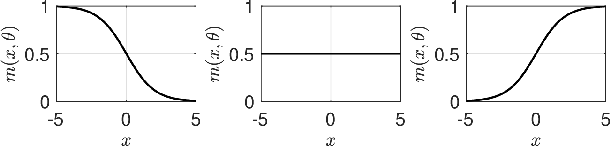
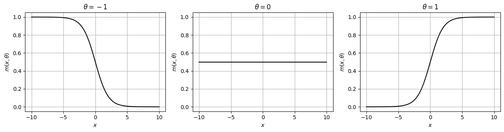
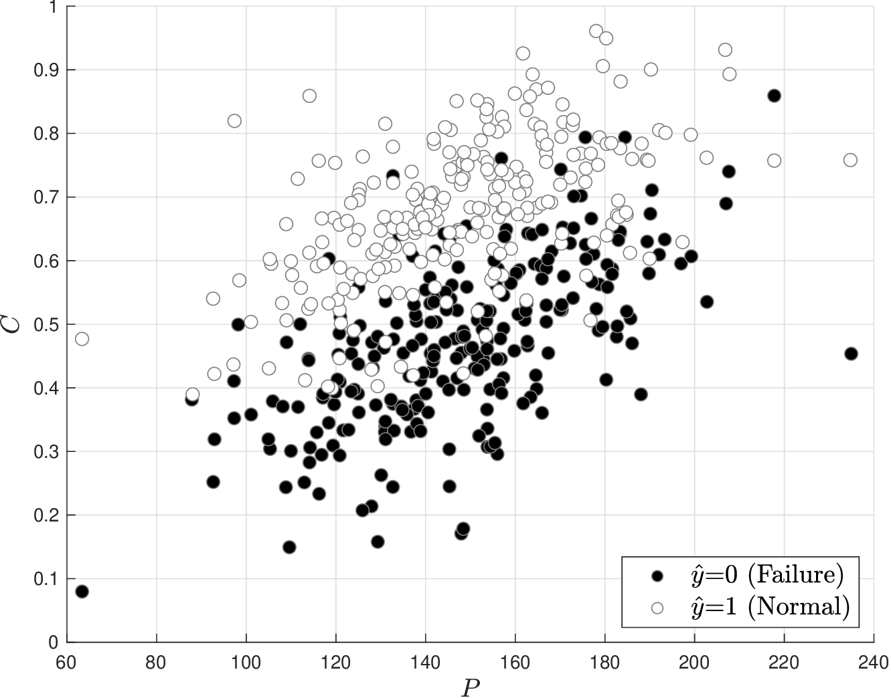
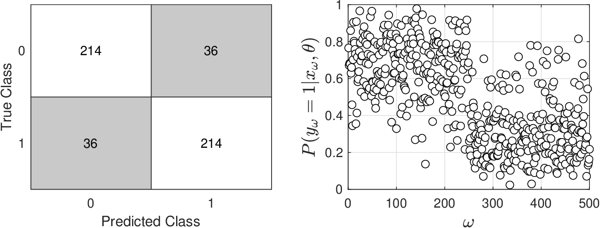
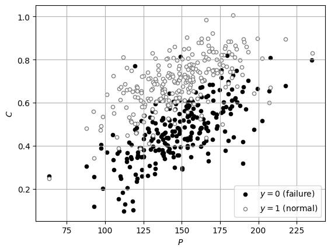
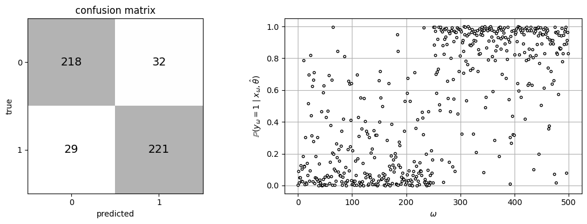
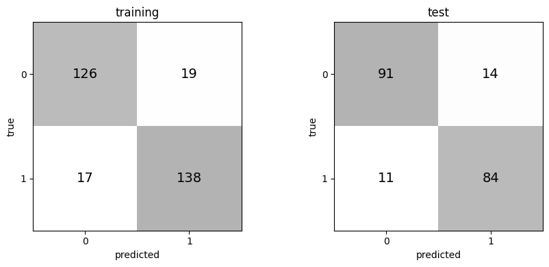

# Classification Models

* Statistical learning provides powerful tools to construct predictive models from data.
* Models explored here are generalizations of models that we have analyzed.
* We begin discussion with *classification* models.
* Have inputs $$X=(X_1,...,X_n)$$ with obs $$x_\omega$$ that lie in continuous domain $$\mathcal{D}_X \subseteq \mathbb{R}^n$$.
* Have output $$Y$$ with scalar obs $$y_{\omega}$$ that lie in (binary) domain $$\mathcal{D}_Y=\{0,1\}$$.
* We postulate relationship between $$X$$ and $$Y$$:

  $$
  Y=g(X,\theta)+\epsilon
  $$

   where $$\theta \in \mathbb{R}^n$$ are params, $$g(X,\theta)$$ is model, and $$\epsilon$$ is a noise RV.

* Goal is to find params that best explains our obs (data):

  $$
  y_\omega=g(x_\omega,\theta)+\epsilon_\omega,\; \omega \in \mathcal{S}
  $$

* Estimation problem is known as a *classification* problem.
* Inputs $$X$$ are known as features or descriptors.
* Output $$Y$$ is known as label or class.
* What is different about class models is binary nature of output $$Y$$.
* Class models have many apps and binary nature makes them intuitive to analyze.
* Think about, for example, a chemical classification problem: given features of chemical (e.g., its molecular structure), can we predict if this is toxic or not?
* Similarly, imagine you want to detect illness from blood pressure and glucose levels.

* To solve class problem, we use technique called logistic regression.
* Postulate model of form:

  $$
  m(x,\theta)=\frac{1}{1+e^{-\theta^Tx}}
  $$

* Mixture $$\theta^Tx=\theta_0+\sum_{i=1}^n\theta_ix_i$$ is known as *evidence*.
* Params attribute importance (weights) to different features.
* Postulated model is logistic function and captures binary 0-1 logic.
* Logistic function has this behavior:
   * $$m(x,\theta)\to 1\;$$ as $$\;\theta^Tx\to +\infty\;$$  (large evidence)
   * $$m(x,\theta)\to 0\;$$ as $$\;\theta^Tx\to -\infty\;$$  (small evidence)
   * $$m(x,\theta)=\frac{1}{2}\;$$ if $$\;\theta^Tx=0\;$$   (no evidence)
* Reversing sign of param has effect of reversing logic.
* Param $$\theta_0$$ does not weight any input; known as bias (ignores evidence).

<figure></figure>

*Behavior of logistic function for $$\theta=-1$$, $$\theta=0$$, and $$\theta=+1$$.*

#### Python implementation


Notebook [`ch6_logistic_function.ipynb`](https://colab.research.google.com/github/vzavala/StatsBook-GitBook/blob/main/notebooks/ch6_logistic_function.ipynb) — open it in Colab and run the cells alongside this section.


The logistic function $$m(x,\theta)=1/(1+e^{-\theta^Tx})$$ for a scalar input and
$$\theta=-1,0,+1$$ (written for the book to accompany the slide figure). The evidence is $$\theta x$$.

```python
import numpy as np
import matplotlib.pyplot as plt

def m(x, theta):
    return 1 / (1 + np.exp(-theta * x))

x = np.linspace(-10, 10, 400)
fig, axs = plt.subplots(1, 3, figsize=(13, 3.5))
for ax, theta in zip(axs, (-1, 0, 1)):
    ax.plot(x, m(x, theta), 'k', linewidth=1.5)
    ax.set_title(rf'$\theta={theta}$')
    ax.set_xlabel('$x$'); ax.set_ylabel(r'$m(x,\theta)$')
    ax.set_ylim(-0.05, 1.05)
    ax.grid(True)
plt.tight_layout()
plt.show()
```

<figure></figure>

* Function $$m(x,\theta)$$ is used to model conditional probs: $$\mathbb{P}(Y=1\,|\,x,\theta)$$ and $$\mathbb{P}(Y=0\,|\,x,\theta)=1-\mathbb{P}(Y=1\,|\,x,\theta)$$.
* Specifically, want to capture logic:
   * If evidence $$\theta^Tx$$ is large, there is a high prob that $$Y=1$$
   * If evidence $$\theta^Tx$$ is small, there is a high prob that  $$Y=0$$
   * If no evidence ($$\theta^Tx=0$$), there is ambiguity (equally prob that $$Y=0$$ or $$Y=1$$)
* This is captured by defining conditional pdf:

  $$
  f(y\,\,|x,\theta)=\mathbb{P}(Y=y|x,\theta)=m(x,\theta)^y(1-m(x,\theta))^{1-y}.
  $$

* We apply MLE to estimate the parameters $$\theta$$.
* Goal is to find $$\hat{\theta}$$ that max joint prob $$\prod_{\omega \in \mathcal{S}}f(y_\omega\,|\,x_\omega,\theta)$$:

  $$
  \max_{\theta}\; \sum_{\omega \in \mathcal{S}}y_\omega\cdot \log(m(x_\omega,\theta))+(1-y_\omega)\cdot \log(1-m(x_\omega,\theta))
  $$

## Example: Classification for Fault Detection

* Imagine we have data $$(P_\omega,C_\omega,T_\omega)$$ for Gibbs reactor.
* Data is separated into two classes; one class represents normal mode (when $$T_\omega$$ is low) and we define corresponding labels as $$y_\omega=1$$.
* Other class represent  failure mode (when $$T_\omega$$ is high)  and we define $$y_\omega=0$$.
* Our goal is to develop a classification model that predicts mode of operation by using data on pressure and conversion $$x_\omega=(P_\omega,C_\omega)$$.
* In other words, model should be able to detect if reactor is failing by looking at a data pair of pressure and concentration.  is that possible?

<figure><figcaption><p>Gibbs reactor data showing separation between normal and failure operating modes.</p></figcaption></figure>

* Model correctly predicts failures 85% of time (214 out of 250 obs).
* Logistic class also gives estimate of prob that predictions are in a given class.

  <figure><figcaption><p>Confusion matrix (left) and classification probabilities (right) for Gibbs reactor data.</p></figcaption></figure>

#### Python implementation


Notebook [`ch6_gibbs_logistic.ipynb`](https://colab.research.google.com/github/vzavala/StatsBook-GitBook/blob/main/notebooks/ch6_gibbs_logistic.ipynb) — open it in Colab and run the cells alongside this section.


Logistic classification for fault detection in the Gibbs reactor
(Victor Z and Ugochukwu Ikegwu, UW-Madison, 2024).

| Slides | Python | Meaning |
|---|---|---|
| $$x_\omega=(P_\omega,C_\omega)$$ | `X` (columns `P`, `C`) | features: pressure and conversion |
| $$y_\omega\in\{0,1\}$$ | `y` | label: 1 = normal (low $$T$$), 0 = failure (high $$T$$) |
| $$\theta$$, $$\theta^Tx$$ | `theta`, `evidence` | parameters and evidence |
| $$m(x,\theta)=\mathbb{P}(Y=1\mid x,\theta)$$ | `m_hat` | classification probability |
| $$\hat{y}_\omega$$ | `y_hat` | predicted label |

```python
import numpy as np
import matplotlib.pyplot as plt
from sklearn.linear_model import LogisticRegression
from sklearn.metrics import confusion_matrix
from sklearn.model_selection import train_test_split

data = np.vstack((np.loadtxt(path+'Data/gibbs_hightemp_class.dat'),
                  np.loadtxt(path+'Data/gibbs_lowtemp_class.dat')))
S = len(data)
y = (data[:, 0] == 583.15).astype(int)          # 1 = normal (low T), 0 = failure
np.random.seed(1)
P = data[:, 1] + np.random.randn(S) * 0.1
C = data[:, 2] + np.random.randn(S) * 0.1
X = np.column_stack((P, C))

plt.scatter(P[y == 0], C[y == 0], c='k', s=20, label='$y=0$ (failure)')
plt.scatter(P[y == 1], C[y == 1], c='w', edgecolors='0.5', s=20, label='$y=1$ (normal)')
plt.xlabel('$P$'); plt.ylabel('$C$'); plt.legend(loc='lower right'); plt.grid(True)
plt.show()
```

<figure></figure>

MLE: $$\max_\theta \sum_\omega y_\omega\log m(x_\omega,\theta)+(1-y_\omega)\log(1-m(x_\omega,\theta))$$.
(`penalty=None` gives plain MLE; scikit-learn regularizes by default.)

```python
model = LogisticRegression(penalty=None, max_iter=1000).fit(X, y)
theta = np.concatenate([model.intercept_, model.coef_.ravel()])   # (theta_0, theta_P, theta_C)
evidence = theta[0] + X @ theta[1:]
m_hat = 1 / (1 + np.exp(-evidence))                               # = model.predict_proba(X)[:, 1]
y_hat = (m_hat >= 0.5).astype(int)
print("theta_hat =", np.round(theta, 3))
print(f"accuracy = {np.mean(y_hat == y):.2%}  ({np.sum(y_hat == y)} of {S})")

def plot_confusion(ax, cm, title):
    ax.imshow(cm, cmap='Greys', alpha=0.3)
    for (i, j), v in np.ndenumerate(cm):
        ax.text(j, i, v, ha='center', va='center', fontsize=14)
    ax.set_xticks([0, 1]); ax.set_yticks([0, 1])
    ax.set_xlabel('predicted'); ax.set_ylabel('true'); ax.set_title(title)

fig, axs = plt.subplots(1, 2, figsize=(11, 4))
plot_confusion(axs[0], confusion_matrix(y, y_hat), 'confusion matrix')
axs[1].plot(m_hat, 'ko', markerfacecolor='w', markersize=3)
axs[1].set_xlabel(r'$\omega$'); axs[1].set_ylabel(r'$\mathbb{P}(y_\omega=1\mid x_\omega,\hat{\theta})$')
axs[1].grid(True)
plt.tight_layout()
plt.show()
```

```
theta_hat = [-2.229 -0.071 21.873]
accuracy = 87.80%  (439 of 500)
```

<figure></figure>

Train/test split (60/40) to check that the classifier generalizes.

```python
X_tr, X_te, y_tr, y_te = train_test_split(X, y, test_size=0.4, random_state=42)
model_tr = LogisticRegression(penalty=None, max_iter=1000).fit(X_tr, y_tr)
fig, axs = plt.subplots(1, 2, figsize=(9, 4))
plot_confusion(axs[0], confusion_matrix(y_tr, model_tr.predict(X_tr)), 'training')
plot_confusion(axs[1], confusion_matrix(y_te, model_tr.predict(X_te)), 'test')
plt.tight_layout()
plt.show()
```

<figure></figure>
