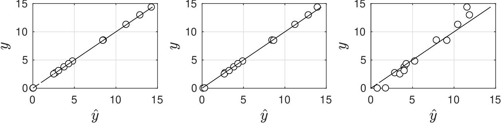
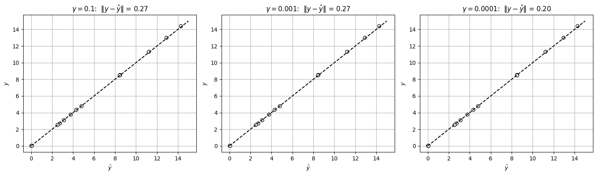

# Kernel Models

* Kernel models are generalizations of predictive models that we have explored.
* These models have surprising properties:
   * Require handful of parameters to make predictions (regardless of number of inputs)
   * Capture complex nonlinearities (without need to postulate input-output model)
* Concepts  have implications in techniques that we have discussed.
* For instance, kernel concepts can be used to capture nonlinearities in PCA.
* Key principle of kernel methods is that covariance of our data can be represented as a matrix function (rather than a fixed matrix).
* Such function (a.k.a. kernel function) captures complex nonlinear relationships present in our data.

* To explain origin of kernel methods, we explore their use in regression.
* A flexible approach to construct models consists of *mixing* different model types.
* Assume that $$Y$$ and $$X=(X_1,...,X_n)$$ follow relationship:

  $$
  Y=\sum_{j=1}^m\theta_j \phi_j(X)+\epsilon
  $$

   where $$\phi_j(X),\; j=1,...,m$$ is collection of basic models (known as basis functions).

* Here, output and input have continuous domains $$\mathcal{D}_Y\in \mathbb{R}$$ and $$\mathcal{D}_X\in \mathbb{R}^n$$.
* Predictive model is mixture $$m(X,\theta)=\sum_{j=1}^m\theta_j \phi_j(X)$$.
* Define basis vector $$\phi(X)=(\phi_1(X),...,\phi_m(X))$$ and write $$m(X,\theta)=\theta^T\phi(X)$$.
* Basis $$\phi(X)$$ can be linear or nonlinear (e.g., polynomial, sigmoidal, log, exponential).
* Parameters $$\theta\in \mathbb{R}^m$$ are mixing coeffs for basis functions.

* Determine $$\hat{\theta}$$ by solving:

  $$
  \min_{\theta}\; \frac{1}{2}\sum_{\omega \in \mathcal{S}}(y_\omega-\theta^T\phi(x_\omega))^2+\lambda \theta^T\theta
  $$

* This is Bayesian estimation with noise $$\epsilon \sim \mathcal{N}(0,\sigma^2\mathbf{I})$$ and prior $$\theta\sim \mathcal{N}(0,\lambda \mathbf{I})$$.
* Express problem in compact form:

  $$
  \min_{\theta}\; \frac{1}{2}(\mathbf{y}-\mathbf{\boldsymbol{\Phi}}\theta)^T(\mathbf{y}-\boldsymbol{\Phi}\theta)+\lambda\theta^T\theta
  $$

   where $$\boldsymbol{\Phi}\in \mathbb{R}^{S\times n}$$ is data matrix with entries $$\boldsymbol{\Phi}_{\omega,j}=\phi_{j}(x_\omega)$$ and $$\mathbf{y}$$ is output vector.

* Data matrix $$\boldsymbol{\Phi}$$ is transformation of original input data.
* If basis functions are linear then $$\boldsymbol{\Phi}=\mathbf{X}$$ (get a standard linear estimation prob).

* We define objective as $$S(\theta)$$; optimal estimate must satisfy $$\nabla_\theta S(\theta)$$:

  $$
  \theta=\frac{1}{\lambda}\boldsymbol{\Phi}^T(\mathbf{y}-\boldsymbol{\Phi}\theta).
  $$

* Define residuals $$\mathbf{r}=\frac{1}{\lambda}(\mathbf{y}-\boldsymbol{\Phi}\theta)$$ and thus $$\theta=\boldsymbol{\Phi}^T\mathbf{r}$$.
* By substituting estimate in $$S(\theta)$$:

  $$
  S(\theta)= \frac{1}{2}\mathbf{r}^T\boldsymbol{\Phi}\boldsymbol{\Phi}^T\boldsymbol{\Phi}\boldsymbol{\Phi}^T\mathbf{r}-\mathbf{r}^T\boldsymbol{\Phi}\boldsymbol{\Phi}^T\mathbf{y}+\frac{1}{2}\mathbf{y}^T\mathbf{y}+\frac{\lambda}{2}\mathbf{r}^T\boldsymbol{\Phi}\boldsymbol{\Phi}^T\mathbf{r}.
  $$

* Data matrix $$\boldsymbol{\Phi}$$ always appear as $$\boldsymbol{\Phi}\boldsymbol{\Phi}^T$$; we define $$\mathbf{K}=\boldsymbol{\Phi}\boldsymbol{\Phi}^T\in \mathbb{R}^{S\times S}$$ and thus:

  $$
  S(\theta)= \frac{1}{2}\mathbf{r}^T\mathbf{K}\mathbf{K}\mathbf{r}-\mathbf{r}^T\mathbf{K}\mathbf{y}+\frac{1}{2}\mathbf{y}^T\mathbf{y}+\frac{\lambda}{2}\mathbf{r}^TK\mathbf{r}
  $$

* $$S(\theta)$$ can be defined in terms of $$\mathbf{r}$$ (params have been eliminated).

* This suggests an alternative strategy to find $$\hat{\theta}$$:
   * Find optimal residual estimates $$\hat{\mathbf{r}}$$ by solving:

     $$
     \min_{\mathbf{r}} \frac{1}{2}\mathbf{r}^T\mathbf{K}\mathbf{K}\mathbf{r}-\mathbf{r}^T\mathbf{K}\mathbf{y}+\frac{1}{2}\mathbf{y}^T\mathbf{y}+\frac{\lambda}{2}\mathbf{r}^T\mathbf{K}\mathbf{r}
     $$

   * Recover $$\hat{\theta}=\boldsymbol{\Phi}^T\hat{\mathbf{r}}$$.
* It turns out, however, that $$\hat{\theta}$$ are *not needed at all* to make predictions.
* Specifically, optimal model prediction is:

  $$
  \begin{aligned}
  \hat{\mathbf{y}}&= \boldsymbol{\Phi}\hat{\theta}\\
  &=\boldsymbol{\Phi}\boldsymbol{\Phi}^T\hat{\mathbf{r}}\\
  &=\mathbf{K}(\mathbf{K}+\lambda I)^{-1}\mathbf{y}.
  \end{aligned}
  $$

* Consequently, prediction only depends on input data $$\mathbf{K}$$ and output data $$\mathbf{y}$$.
* Params $$\hat{\theta}$$ are *intermediary* variables.

* Kernel matrix $$\mathbf{K}$$ captures interactions of input variables $$X$$.
* Specifically,  given $$x_\omega,\; \omega \in \mathcal{S}$$, kernel matrix is:

  $$
  \mathbf{K}_{i,j}=k(x_i,x_j),\; i,j\in \mathcal{S}
  $$

   where $$k(x_i,x_j)$$ is known as *kernel function*.

* Kernel generalizes strategies discussed; e.g., linear estimation corresponds to:

  $$
  k(x_i,x_j)=x_i^Tx_j,\; i,j\in \mathcal{S}
  $$

* Case of mixtures of basis functions corresponds to:

  $$
  k(x_i,x_j)=\phi(x_i)^T\phi(x_j),\; i,j\in \mathcal{S}
  $$

* Kernel function captures nonlinear interactions in input data.
* A widely used kernel is radial basis function (RBF):

  $$
  k(x_i,x_j)=\textrm{exp}(-\gamma\|x_i-x_j\|^2),\; i,j\in \mathcal{S}
  $$

   where $$\gamma\in \mathbb{R}_+$$ is a param; this is also known as Gaussian kernel.

* Gaussian kernel captures nonlinear interactions in input data.
* To see this, consider scalar $$x_\omega$$ and notice that:

  $$
  \begin{aligned}
  &\exp(-\gamma(x_i-x_j)^2)\\
  &=\exp(-\gamma x_i^2+2\gamma x_ix_j-\gamma x_j^2)\\
  &=\exp(-\gamma x_i^2-\gamma x_j^2)\left(1+\frac{2\gamma x_ix_j}{1\, !}+\frac{(2\gamma x_ix_j)^2}{2\,!}+...\right)\\
  &=\exp(-\gamma x_i^2)\exp(-\gamma x_j^2)
  \left(1\cdot1 +\left(x_i\sqrt{2\gamma/1\,!}\right)\cdot\left(x_j\sqrt{2\gamma/1\,!}\right)\right.\\
  &\left.\qquad\qquad+\left(x_i^2\sqrt{(2\gamma)^2/2\,!}\right)\cdot \left(x_j^2\sqrt{(2\gamma)^2/2\,!}\right)+...\right)
  \end{aligned}
  $$

* Gaussian kernel is a separable function and can be written as:

  $$
  \begin{aligned}
  \exp(-\gamma(x_i-x_j)^2)&=\phi(x_i)^T\phi(x_j)
  \end{aligned}
  $$

* Where $$\phi(x)$$ is an *infinite* collection of polynomial basis functions:

  $$
  \phi(x)=e^{-\gamma x}(1,\; x\sqrt{2\gamma/1\,!},\; x^2\sqrt{(2\gamma)^2/2\,!},\; x^3\sqrt{(2\gamma)^3/3\,!},...).
  $$

* Here, a *single* param $$\gamma$$ controls coefficients of basis functions.

* In kernel methods, we do not need to postulate input-output model (e.g., $$Y=\theta^T\phi(X))$$ and estimate its params $$\theta$$).
* Instead, we postulate kernel model and estimate its params $$\gamma$$.
* Kernel can be interpreted as a generating function of basis functions and requires few params (typically a handful).
* This is key advantage over standard estimation because overparam is avoided.
* Kernels can capture highly complex nonlinear behavior.

## Example: Kernel Estimation for Hougen-Watson

* Consider Hougen-Watson model:

  $$
  Y=\frac{(\theta_0X_2-X_3/\theta_4)}{(1+\theta_1X_1+\theta_2X_2+\theta_3X_3)}
  $$

* This model might not fit data if mechanism proposed is not correct.
* Instead of using this model, we use data $$(x_\omega,y_\omega)$$ to construct a kernel model.
* We use $$k(x_\omega,x_{\omega'})=\exp(-\gamma\|x_\omega-x_{\omega'}\|^2)$$ with $$\gamma=0.1,0.001,0.0001$$.

  <figure></figure>

#### Python implementation


Notebook [`ch6_hougen_watson_kernel.ipynb`](https://colab.research.google.com/github/vzavala/StatsBook-GitBook/blob/main/notebooks/ch6_hougen_watson_kernel.ipynb) — open it in Colab and run the cells alongside this section.


Kernel model for the Hougen-Watson data (Victor Z and Ugochukwu Ikegwu, UW-Madison, 2024).

| Slides | Python | Meaning |
|---|---|---|
| $$x_\omega$$, $$y_\omega$$ | `X`, `y` | partial pressures and reaction rates |
| $$k(x_\omega,x_{\omega'})=\exp(-\gamma\lVert x_\omega-x_{\omega'}\rVert^2)$$ | `rbf(xi, xj, gamma)` | RBF kernel |
| $$\mathbf{K}$$, $$\lambda$$ | `K`, `lam` | kernel matrix and regularization |
| $$\hat{\mathbf{y}}=\mathbf{K}(\mathbf{K}+\lambda I)^{-1}\mathbf{y}$$ | `y_hat` | kernel prediction |

```python
import numpy as np
import matplotlib.pyplot as plt

data = np.loadtxt(path+'Data/hougenwatson.dat')
X, y = data[:, :3], data[:, -1]
S = len(y)
lam = 0.01

def rbf(xi, xj, gamma):
    return np.exp(-gamma * np.sum((xi - xj)**2))

fig, axs = plt.subplots(1, 3, figsize=(15, 4.5))
for ax, gamma in zip(axs, (0.1, 0.001, 0.0001)):
    K = np.array([[rbf(X[i], X[j], gamma) for j in range(S)] for i in range(S)])
    y_hat = K @ np.linalg.solve(K + lam * np.eye(S), y)
    ax.plot(y_hat, y, 'ko', markerfacecolor='w')
    ax.plot([0, 15], [0, 15], 'k--')
    ax.set_title(rf'$\gamma={gamma}$:  $\|y-\hat{{y}}\|$ = {np.linalg.norm(y - y_hat):.2f}')
    ax.set_xlabel(r'$\hat{y}$'); ax.set_ylabel('$y$')
    ax.grid(True)
plt.tight_layout()
plt.show()
```

<figure></figure>
